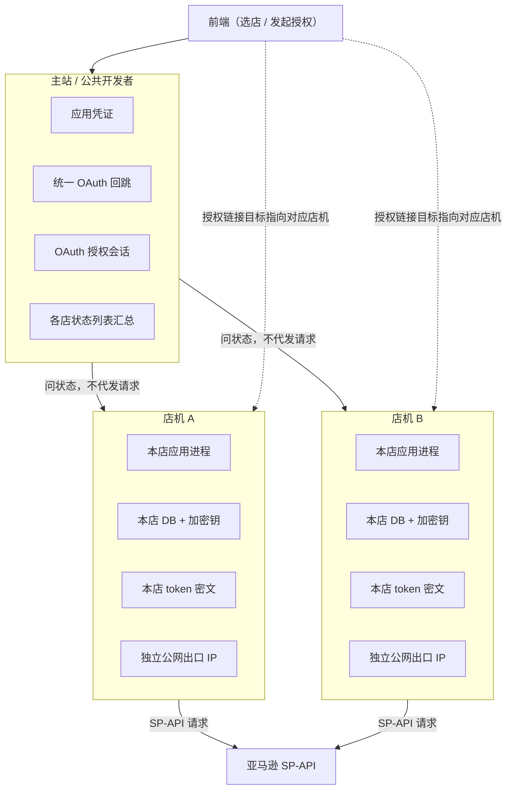

# 多店铺接亚马逊官方 SP-API，怎么安全部署与防关联？（组织架构篇）

> 本文吸收自工程师于新在「天机跨境」公众号的实践总结，并在博客侧做了结构化重写。原作：[AI 提效：多店铺接亚马逊官方 API，怎么防关联？](https://mp.weixin.qq.com/s/Poqo9xsmt8dSTu8LJbTDvg)（作者：于新）。

先把结论放在最前面，方便你决定要不要往下读。

**一台主站（公共开发者）管入口与汇总；每个亚马逊店铺各配一台店机；官方 SP-API 请求从各店机自己的公网出口发出；令牌密文只落在对应店机，绝不跨机、也不经主站代发。**

多店铺接入官方 API，真正难的往往不是「怎么调通一次接口」，而是**怎么把组织理清楚**：谁管身份、谁保管密钥、谁发出请求、加店时改哪里。单店通了，只说明调用链路通了；多店要稳，靠的是职责边界。

于新是运营出身，靠 AI 拿过亚马逊官方 SP-API AI Coding 黑客松第一名。下面这套做法，来自他在真实业务场景里踩坑后的判断与落地，不是纸上架构图。单店、或还没让 AI 碰真实店铺数据的团队，可以先收藏；等第二家店要上、又要让工具写进真实业务时，再对着过一遍。

---

## 你心里那三个疙瘩

多店一上，最常听到的担忧几乎总是这三句：

1. **怎么部署？** 一台机塞全部店行不行？店多了以后，入口谁管、路由谁认？
2. **店铺安全怎么保证？** 密钥放哪？授权会话谁保管？一家出事会不会连累全家？
3. **一起请求 API，会不会被关联？** 几个店挤在同一个出口，心里不踏实。

这三件事缠在一起。想省事，就把所有店塞一台机；想安全，就一店一机、物理隔离。隔离又带来部署与维护成本，很多人就卡在这里，不敢往下走。

单店时这些问题不显形：看板能看，授权点两下就过。第二家店一上，场面就变了——这家授权还绿着，那家突然不认；列表能刷，写操作却打到错误入口。老板不问你用了哪个模型，只问：**第二家怎么挂上去，挂上去会不会把第一家拖死。**

所以后面不堆技术名词，先把「主站 + 店机」的组织方式摊开：哪个担心被解决了，一眼能对上。

---

## 架构总览：一台主站，每店一台店机

一句话：**主站负责入口与汇总；每家店自己的店机负责本店程序、库、密钥与 API 出口。**

可以把它想成公司前台与各店办公室：

- **主站（前台）**：接待、登记、汇总；能看见各屋有没有人，但**不拿任何一间屋的钥匙**。
- **店机（办公室）**：自己的程序、自己的库、自己的钥匙；只办本店的事。

最省事的做法确实是「一台机管所有店」，技术上也跑得通。但省下的是机器钱，换来的是出事时大家一起躺、以及出口混用带来的心理负担。服务器一年往往几百块量级，通常还不如一个广告活动一天的预算——花钱买的是隔离与排障清晰度，而不是炫技。

图里有三层意思：**一个入口 + 一个汇总**；下面挂着互不往来的店机；**每家店机各自从自己的出口打向亚马逊**，主站不在请求链路上。

---

## 主站做什么，不做什么

很多人一听到「中转 / 主站」，就想把登录、授权、拉数、密钥全堆上去，造一台万能机。万能机一出事，什么都出事。所以主站的角色要收得很窄：它扮演的是**公共开发者**载体。

亚马逊侧需要一个开发者身份去登记应用、发起店铺授权。这份身份在体系里只维护一份，由主站持有。各店授权都通过这一份公共开发者身份发起——店主看到的是同一个应用，管理上也只需维护这一份身份。

有人会问：私有开发者能不能硬上多店？能硬上，但往往要为「一应用、一服务器、一家店、请求与数据维度刻意错开」付出更高成本，很多时候不如把公共开发者这条路走通，再谈一店一机。

主站通常只归四件事：

| 职责 | 说明 |
|------|------|
| 应用凭证 | 公共开发者身份，只在主站这一份 |
| 统一回跳 | 授权完成后的统一 redirect 入口落在主站 |
| OAuth 会话 | 「谁在给哪家店授权」的短暂会话记在主站 |
| 列表汇总 | 去各店机问一圈，把状态合成一张列表 |

除此之外，主站可以放**不碰某家店密钥**的公司级能力，例如跨店 VOC、listing 诊断、周报等通用工具。

边界必须写死：

- 主站**看得见**各店状态，但**不保管**任何一家店的密钥。
- 主站**不替**店铺发 SP-API 请求。
- 主站库里**不存**别店的 token 密文。

它怎么「看见」各店？去问各家店机，店机愿意报多少，就汇总多少——像主管叫各运营交报表，而不是把各屋钥匙都挂在前台。职责切开之后，排障也清楚：是入口坏了，还是某一家店坏了，一眼能分开。

**主站是公共开发者，不是请求中间人。**

---

## 店机：自己的程序、库、密钥与出口

每个店铺一台店机。机上是这一家店自己的一整套：自己的应用进程、自己的数据库、自己的加密钥、自己的令牌密文、自己的公网出口。

前端选了店 A，背后打的就是店 A 的入口；选了店 B，打的就是店 B。中间没有谁替谁转手。写操作与数据拉取都在对应店机上完成。出了问题，能直接定位到哪家店、哪台机。

最关键的判断是：

- 店 A 的 SP-API 请求，从**店 A 机自己的公网 IP** 出去；
- 店 B 同理，**互不经过对方，也不经主站代发**；
- 授权拿到的令牌，用**本机加密钥**写入**本机库**；**密文不出这台机**——密文一旦出门，就按出事处理；
- 本店账号必须落在本机身份上，串台直接拒绝。

成本上，一店一机确实比「全家挤一台」贵。但买到的是：一台机挂了只死一层；密钥不跨机，泄露面更小；出口物理分开，心理负担更轻。这和市面上头部 ERP 的独立部署思路接近（独立部署往往按年收费，量级常高于一台普通服务器），区别在于：机器本身不贵，贵的是**隔离方案**。

扩店时复制的是**程序与结构**：换子域、换本机空库、换本机新钥匙，再重新授权。**程序可以复制，钥匙不能跟着搬。** 新机 = 空库 + 新密钥 + 重走授权；绝不搬旧机密文。

---

## 防关联：行业实践下的判断，不是官方内部定论

先把口径说清：**「防关联」是行业里通行的说法与常见做法。至于亚马逊官方内部到底如何判定关联，本文不展开，也不替谁下结论。** 下面只讲于新自己的做法与背后的朴素判断——能分开的，就彻底分开。

三条合在一起：

1. **各店机各自请求**：请求从各自店机发出，出口独立，不在同一台机、同一个出口上混走。
2. **密文不跨机**：没有一份集中存放的「全家钥匙」。
3. **主站不碰业务请求**：请求链路上没有主站作为中间人；多一个中间人，就多一层说不清。

把出口分开，比事后解释「为什么没关联」更踏实。这是隔离故障，也是卸掉关联负担——是**工程与组织上的谨慎选择**，不是对官方策略的断言。

---

## 授权怎么走：三步，令牌只进对应店机

店铺安全的关键动作是授权。按步骤说：

**第一步：前端生成授权链接。**  
在主站前端选好要授权的那家店对应的服务器，系统记住「这次目标是店 A 机」，再生成链接。

**第二步：在该店铺环境里打开链接。**  
把链接复制到该店自己的环境（如紫鸟 / VPS）里打开并同意——不是在普通浏览器里随手点。

**第三步：回跳后，令牌立刻写到对应店机。**  
前端可能短暂经手令牌，但**不存**；立刻投递到目标店机入库。店 A 的授权只落店 A 机，店 B 只落店 B 机。主站前端只负责发起与投递，不当保险柜。

两家店可以共用同一套公共开发者应用身份，但钥匙各进各的房间。若令牌停在前端或落在主站库，多店一上极易串台：前端像全家钥匙挂在大门口；主站一误操作，几家店一起躺。

迁机、新机上线，也按这三步重走：空库、新加密钥、不搬旧密文。**授权永远压轴**——机配好了、路由验过了，最后才点亚马逊同意。

---

## 怎么加店：用服务器登记表驱动，别写死前端

早期最容易犯的错，是把服务器地址写死在前端。店一多，改一处漏一处，发一版前端像打仗。

更稳的做法是：**一张服务器登记表驱动路由。** 每一台可授权的店机占一行——名字、入口、状态。前端读这张表；选店、写操作、列表汇总都围着它转。权威在表，短缓存刷新即可对齐，不要把「服务器名单」当成写死在页面里的本地真理。

加一家店，顺序固定：

1. **买机**：给这家店配自己的店铺服务器；
2. **挂子域**：配好本机入口；
3. **插一行表**：登记为可用；
4. **验路由**：前端选这家店，确认打到的就是这台机；
5. **最后授权**：压轴点亚马逊同意。

前端通常不用改；官方开发者后台通常也不用为加店再折腾一轮——因为路由写在登记表里，页面只负责读表。加店变成「插一行」，不是「改一版前端」。

AI 提效，提的是**正确路径上的速度**；路径错了，加速只会更快把坑挖深。

---

## 能调用 ≠ 组织清楚

收束成几句可对照的清单：

- 一台主站管入口与汇总，每个店一台店机管自己的事；
- 主站只当公共开发者：应用凭证、统一回跳、授权会话、列表汇总；
- SP-API 请求由各店机自己发出，出口各自独立，密文不出机；
- 前端与展示可在主站侧，密文只在店机；新机空库重授，不搬旧密文；
- 表驱动路由，加店插一行，前端不改。

对业务没有实质性帮助、没人用的 AI 工具，只是华而不实的玩具。真把 AI 接进多店铺的人，缺的往往不是又一段提示词，而是**组织架构是否设计清楚**——系统才会开始像一个组织在运转。

**能调用，只说明链路通了；多店职责清楚，才能稳得住。**

现在用不上也没关系，先收藏。等真要把 AI 接进多个店铺、又要碰真实店铺数据时，再翻出来对着自己的结构过一遍。

---

*吸收自工程师于新｜公众号「天机跨境」实践总结｜博客结构化重写*  
*原作链接：https://mp.weixin.qq.com/s/Poqo9xsmt8dSTu8LJbTDvg*
