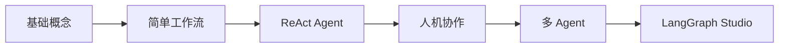

# LangGraph 快速入门实战指南：从图工作流到多 Agent 协作

LangGraph 是由 LangChain 团队开发的低层级 Agent 编排框架，专门用来构建有状态（Stateful）、可以长时运行的 AI 工作流。和传统的线性 LLM 调用链不同，它把工作流建模成有向图（Directed Graph）：

- **节点（Node）**：执行具体操作的函数，例如调用 LLM、执行工具、处理数据
- **边（Edge）**：定义节点之间的流转路径，并支持条件分支
- **状态（State）**：在整个工作流中共享并传递的数据

开源地址：https://github.com/langchain-ai/langgraph

> 本文系统介绍了 LangGraph 框架的核心概念和实战应用。LangGraph 通过图结构的工作流编排，让开发者能够构建具备循环、分支、状态持久化能力的复杂 AI Agent。相比传统的线性 LLM Chain，LangGraph 在处理需要多步推理、人机协作、多 Agent 协同的场景时具有显著优势。

以下内容按菜鸟教程《LangGraph 入门教程》整理，代码与 API 均核对自原文；示例同时支持 OpenAI 与 DeepSeek（国内推荐 DeepSeek）。

## 一、适用场景与选型对比

适合用 LangGraph 的典型场景包括：

- **对话机器人**：需要记住多轮对话上下文
- **自主 Agent**：能够规划、使用工具、迭代思考
- **多 Agent 系统**：多个 AI 协同完成复杂任务
- **审批工作流**：需要人工审核的自动化流程
- **研究助手**：需要多步骤推理和信息检索

和普通 Chain 相比，差异主要在这里：

| 特性 | 传统 LLM Chain | LangGraph |
| --- | --- | --- |
| 工作流结构 | 线性，单向执行 | 图结构，支持循环 |
| 状态管理 | 需手动管理 | 内置状态持久化 |
| 条件路由 | 实现复杂 | 原生支持 |
| 人机协作 | 需要额外开发 | 内置支持 `interrupt` |
| 多 Agent 协调 | 实现困难 | 一流支持 |
| 调试工具 | 有限 | LangGraph Studio |

**选型原则**：单向、无循环、无记忆的简单流程用普通 Chain 即可；需要工具循环、失败重试、人工审批或多专家协同时再上 LangGraph。

## 二、推荐学习路径

推荐按以下顺序循序渐进，先跑通基础图再逐步叠加能力：



## 三、核心概念速查表

| 概念 | 说明 | 关键代码 |
| --- | --- | --- |
| StateGraph | 有向图工作流引擎，LangGraph 的核心 | `StateGraph(MyState)` |
| State | 节点间共享的状态数据结构 | `TypedDict` + `Annotated` |
| Nodes | 执行具体操作的函数节点 | `builder.add_node()` |
| Edges | 节点间的流转路径，支持条件分支 | `add_edge()` / `add_conditional_edges()` |
| ReAct Agent | 推理+行动的循环模式 | `ToolNode` + `tools_condition` |
| Human-in-Loop | 人工审批与介入机制 | `interrupt()` + `Command(resume=)` |
| 持久化 | 会话记忆与状态保存 | `MemorySaver` / `SqliteSaver` |
| 多 Agent | 多专家协作系统 | Supervisor Pattern |

动手之前，先把图、状态、节点、边这四件事情想清楚。

**Graph（图）** 是整个工作流的蓝图，由节点和边组成：

```
StateGraph
   |-- Nodes（节点）
   |     |-- node_a
   |     |-- node_b
   |     +-- node_c
   +-- Edges（边）
         |-- START -> node_a
         |-- node_a -> node_b（条件边）
         |-- node_a -> node_c（条件边）
         +-- node_b -> END
```

**State（状态）** 贯穿整张图。每个节点可以读取和更新 State，更新后的 State 会传给下一个节点。`Annotated[list, add_messages]` 表示该字段使用 `add_messages` 作为 reducer——新消息会追加到列表，而不是覆盖。这是 LangGraph 状态管理的核心机制。

注：原文中 `add_messages` 分别使用了 `langgraph.graph` 和 `langgraph.graph.message` 两种导入路径，实际编写时按当前安装的 LangGraph 版本保持一致即可。

```python
from typing import TypedDict, Annotated
from langgraph.graph import add_messages

class MyState(TypedDict):
    messages: Annotated[list, add_messages]  # 消息列表（自动追加）
    user_name: str                            # 用户名称
    step_count: int                           # 步骤计数
```

**Nodes（节点）** 就是普通的 Python 函数：接收当前 State，返回需要更新的部分字段，不必返回全部字段。

```python
def my_node(state: MyState) -> dict:
    # 读取状态
    messages = state["messages"]

    # 执行操作...
    result = "处理结果"

    # 返回更新的字段（不需要返回所有字段）
    return {"messages": [{"role": "ai", "content": result}]}
```

**Edges（边）** 决定流转方式：

- 普通边：固定路径，`node_a -> node_b`
- 条件边：根据 State 动态路由，`node_a -> node_b 或 node_c`
- 起始边：`START -> 第一个节点`
- 结束边：`某节点 -> END`

## 四、环境安装

使用国内镜像安装 LangGraph 和相关依赖：

```bash
# 创建虚拟环境（推荐）
python -m venv venv
source venv/bin/activate      # macOS/Linux
# venv\Scripts\activate       # Windows

# 安装 LangGraph 和 LangChain
pip install langgraph langchain langchain-openai python-dotenv -i https://mirrors.aliyun.com/pypi/simple/

# 可选：安装开发工具
pip install langgraph-cli jupyter -i https://mirrors.aliyun.com/pypi/simple/
```

在项目根目录创建 `.env` 文件。下面的 `sk-xxx` 只是原文里的占位符，请换成自己的密钥，不要把真实 Key 写进仓库或文章。

```bash
# .env 文件内容

# OpenAI 配置（国外用户）
OPENAI_API_KEY=sk-xxx
OPENAI_BASE_URL=https://api.openai.com/v1

# DeepSeek 配置（国内用户推荐）
DEEPSEEK_API_KEY=sk-xxx
DEEPSEEK_BASE_URL=https://api.deepseek.com
DEEPSEEK_MODEL=deepseek-v4-pro
```

说明：国内推荐使用 DeepSeek，`base_url` 填 `https://api.deepseek.com`（不带 `/v1`），API Key 可在 https://platform.deepseek.com/api_keys 获取。

验证安装：

```python
import langgraph
print(f"LangGraph 版本: {langgraph.__version__}")
```

## 五、第一个简单工作流

从一个只有两个节点的线性工作流开始：定义 State，写两个节点，再用 `START → greet → process → END` 串起来。

```python
from langgraph.graph import StateGraph, START, END
from typing import TypedDict

# Step 1: 定义 State
class SimpleState(TypedDict):
    message: str
    processed: bool

# Step 2: 定义节点函数
def greet_node(state: SimpleState) -> dict:
    """欢迎节点：生成问候语"""
    print(f"[greet_node] 收到消息: {state['message']}")
    return {"message": f"你好！{state['message']}"}

def process_node(state: SimpleState) -> dict:
    """处理节点：标记为已处理"""
    print(f"[process_node] 处理消息: {state['message']}")
    return {"processed": True}

# Step 3: 构建图
builder = StateGraph(SimpleState)

# 添加节点
builder.add_node("greet", greet_node)
builder.add_node("process", process_node)

# 添加边
builder.add_edge(START, "greet")
builder.add_edge("greet", "process")
builder.add_edge("process", END)

# Step 4: 编译图
graph = builder.compile()

# Step 5: 运行
result = graph.invoke({
    "message": "世界",
    "processed": False
})

print(f"\n最终结果: {result}")
```

运行结果：

```
[greet_node] 收到消息: 世界
[process_node] 处理消息: 你好！世界

最终结果: {'message': '你好！世界', 'processed': True}
```

在 Jupyter Notebook 中可以可视化图结构，也可以打印 Mermaid：

```python
# 在 Jupyter Notebook 中可视化
from IPython.display import Image
Image(graph.get_graph().draw_mermaid_png())

# 或者打印 Mermaid 格式
print(graph.get_graph().draw_mermaid())
```

## 六、State、Nodes 与 Edges

### 1. 用 TypedDict 或 Pydantic 定义状态

普通字段会直接覆盖；需要追加或累加的字段，要显式指定 reducer。

```python
from typing import TypedDict, Annotated, Optional
from langgraph.graph.message import add_messages

class AgentState(TypedDict):
    # 消息历史（add_messages reducer 自动追加而非覆盖）
    messages: Annotated[list, add_messages]

    # 普通字段（直接覆盖）
    user_id: str
    session_id: str

    # 可选字段
    error: Optional[str]

    # 计数器（使用 operator.add 作为 reducer）
    retry_count: Annotated[int, lambda x, y: x + y]
```

生产环境原文更推荐用 Pydantic 做状态校验：

```python
from pydantic import BaseModel, Field
from typing import Annotated
from langgraph.graph.message import add_messages

class ProductionState(BaseModel):
    messages: Annotated[list, add_messages] = Field(default_factory=list)
    user_id: str = ""
    confidence_score: float = 0.0

    class Config:
        arbitrary_types_allowed = True
```

对话场景还可以直接使用内置的 `MessagesState`，不必自己定义 `messages` 字段：

```python
from langgraph.graph import MessagesState

# MessagesState 等价于:
# class MessagesState(TypedDict):
#     messages: Annotated[list[AnyMessage], add_messages]

# 直接使用，无需自定义
builder = StateGraph(MessagesState)
```

注：早期 `MessageGraph` 已废弃，请统一使用 `StateGraph`（消息场景用 `StateGraph(MessagesState)`）。

### 2. 节点：普通函数、LLM 调用、异步与类节点

普通函数节点读取状态、执行操作，然后只返回变更字段：

```python
def simple_node(state: AgentState) -> dict:
    # 读取状态
    last_message = state["messages"][-1]

    # 执行操作
    response = f"收到: {last_message.content}"

    # 返回部分状态更新
    return {
        "messages": [{"role": "assistant", "content": response}]
    }
```

下面是原文中的 LLM 调用节点。它通过 `ChatOpenAI` 接入 DeepSeek（或 OpenAI 兼容接口），把系统提示和对话历史一并交给模型：

```python
import os
from dotenv import load_dotenv
from langchain_openai import ChatOpenAI
from langchain_core.messages import SystemMessage

load_dotenv()

# 使用 DeepSeek 模型
llm = ChatOpenAI(
    model=os.getenv('DEEPSEEK_MODEL', 'deepseek-v4-pro'),
    openai_api_key=os.getenv('DEEPSEEK_API_KEY'),
    openai_api_base=os.getenv('DEEPSEEK_BASE_URL', 'https://api.deepseek.com'),
    temperature=0
)

def llm_node(state: dict) -> dict:
    """调用 LLM 的节点"""
    system_prompt = SystemMessage(content="你是一个有帮助的助手。")

    # 将系统提示与对话历史合并
    messages = [system_prompt] + state["messages"]

    # 调用 LLM
    response = llm.invoke(messages)

    return {"messages": [response]}
```

I/O 密集型操作可以用异步节点，并使用 `graph.ainvoke(...)`：

```python
import asyncio

async def async_node(state: AgentState) -> dict:
    """异步节点，适合 I/O 密集型操作"""
    # 模拟异步操作（如 API 调用、数据库查询）
    await asyncio.sleep(0.1)

    result = await some_async_api_call(state["messages"][-1].content)
    return {"messages": [{"role": "assistant", "content": result}]}

# 使用异步图
result = await graph.ainvoke({"messages": [...]})
```

类实例只要实现 `__call__`，也可以作为节点：

```python
class RouterNode:
    def __init__(self, llm, system_prompt: str):
        self.llm = llm
        self.system_prompt = system_prompt

    def __call__(self, state: AgentState) -> dict:
        """类实例可以作为节点使用"""
        messages = [
            SystemMessage(content=self.system_prompt),
            *state["messages"]
        ]
        response = self.llm.invoke(messages)
        return {"messages": [response]}

# 添加类节点
router = RouterNode(llm, "你是一个专业的路由助手。")
builder.add_node("router", router)
```

### 3. 普通边、条件边和并行（Fan-out / Fan-in）

普通边是固定路径：

```python
# 固定路径：node_a 完成后始终执行 node_b
builder.add_edge("node_a", "node_b")

# 结束：node_a 完成后图结束
builder.add_edge("node_a", END)
```

条件边是 LangGraph 的核心能力，根据当前 State 动态决定下一步。路由函数的返回值必须是已经注册的节点名称或 `END`，否则执行时会报错。

```python
def route_after_llm(state: AgentState) -> str:
    """
    路由函数：根据 LLM 的最新输出决定走哪条路径
    返回值必须是已注册节点名称或 END
    """
    last_message = state["messages"][-1]

    # 如果 LLM 请求使用工具
    if hasattr(last_message, "tool_calls") and last_message.tool_calls:
        return "tools"

    # 否则结束
    return END

# 添加条件边
builder.add_conditional_edges(
    "llm",              # 源节点
    route_after_llm,    # 路由函数
    {
        "tools": "tool_executor",   # 返回 "tools" 时 -> tool_executor 节点
        END: END                    # 返回 END 时 -> 结束
    }
)
```

从一个节点同时分叉到多个节点（Fan-out），再汇聚到一个节点（Fan-in）：

```python
# 从一个节点并行分叉到多个节点
builder.add_edge("start_node", "branch_a")
builder.add_edge("start_node", "branch_b")
builder.add_edge("start_node", "branch_c")

# 多个节点汇聚到一个节点（Fan-in）
builder.add_edge("branch_a", "merge_node")
builder.add_edge("branch_b", "merge_node")
builder.add_edge("branch_c", "merge_node")
```

### 4. 完整条件路由示例

下面这个例子按用户意图把请求分给天气、代码、通用或告别节点，把「条件边」一次走通：

```python
import os
from dotenv import load_dotenv
from langgraph.graph import StateGraph, START, END, MessagesState
from langchain_openai import ChatOpenAI
from langchain_core.messages import SystemMessage, HumanMessage

load_dotenv()

# 初始化 LLM
llm = ChatOpenAI(
    model=os.getenv('DEEPSEEK_MODEL', 'deepseek-v4-pro'),
    openai_api_key=os.getenv('DEEPSEEK_API_KEY'),
    openai_api_base=os.getenv('DEEPSEEK_BASE_URL', 'https://api.deepseek.com'),
    temperature=0.7
)

# 路由函数
def classify_intent(state: MessagesState) -> str:
    """根据用户意图路由到不同的 Agent"""
    last_message = state["messages"][-1]
    content = last_message.content.lower()

    if "天气" in content or "温度" in content:
        return "weather_agent"
    elif "代码" in content or "编程" in content:
        return "code_agent"
    elif "再见" in content or "退出" in content:
        return "farewell"
    else:
        return "general_agent"

# 定义各个 Agent 节点
def router_node(state: MessagesState) -> dict:
    """路由节点：不做处理，只用于触发路由判断"""
    return {}

def weather_node(state: MessagesState) -> dict:
    """天气 Agent"""
    response = llm.invoke([
        SystemMessage(content="你是一个天气助手，友好地回答天气相关问题。如果没有实时数据，可以给出一般性建议。"),
        *state["messages"]
    ])
    return {"messages": [response]}

def code_node(state: MessagesState) -> dict:
    """代码 Agent"""
    response = llm.invoke([
        SystemMessage(content="你是一个编程助手，擅长解答代码问题并给出清晰的代码示例。"),
        *state["messages"]
    ])
    return {"messages": [response]}

def general_node(state: MessagesState) -> dict:
    """通用 Agent"""
    response = llm.invoke([
        SystemMessage(content="你是一个友善的 AI 助手，可以回答各种问题。"),
        *state["messages"]
    ])
    return {"messages": [response]}

def farewell_node(state: MessagesState) -> dict:
    """告别节点"""
    return {"messages": [{"role": "assistant", "content": "再见！期待下次与你交流。"}]}

# 构建图
builder = StateGraph(MessagesState)

# 添加节点
builder.add_node("router", router_node)
builder.add_node("weather_agent", weather_node)
builder.add_node("code_agent", code_node)
builder.add_node("general_agent", general_node)
builder.add_node("farewell", farewell_node)

# 添加边
builder.add_edge(START, "router")
builder.add_conditional_edges(
    "router",
    classify_intent,
    {
        "weather_agent": "weather_agent",
        "code_agent": "code_agent",
        "general_agent": "general_agent",
        "farewell": "farewell",
    }
)

# 所有 agent 节点处理完后结束
for node in ["weather_agent", "code_agent", "general_agent", "farewell"]:
    builder.add_edge(node, END)

# 编译图
graph = builder.compile()

# 测试不同意图
test_inputs = [
    "北京今天天气怎么样？",
    "帮我写一个 Python 快速排序",
    "你好，介绍一下你自己",
    "再见啦！"
]

for user_input in test_inputs:
    print(f"\n用户: {user_input}")
    result = graph.invoke({"messages": [HumanMessage(content=user_input)]})
    print(f"助手: {result['messages'][-1].content[:100]}...")
    print("-" * 50)
```

运行结果示例（原文输出里嵌有一段 Python 演示，这里改成缩进，避免破坏 Markdown 代码块）：

```
用户: 北京今天天气怎么样？
助手: 很抱歉，我没有实时天气数据。不过北京现在是春季，建议您出门时关注天气预报...
--------------------------------------------------

用户: 帮我写一个 Python 快速排序
助手: 好的，下面是一个 Python 实现的快速排序算法：

    def quicksort(arr):
        if len(arr) <= 1:
            return arr
        ...
--------------------------------------------------

用户: 你好，介绍一下你自己
助手: 你好！我是一个 AI 助手，很高兴为你服务。我可以帮你回答各种问题...
--------------------------------------------------

用户: 再见啦！
助手: 再见！期待下次与你交流。
--------------------------------------------------
```

### 5. 构建一个能多轮对话的机器人

这个机器人把对话历史放在 `MessagesState` 里，因此能记住上下文，例如用户先自报姓名，后面再问「你还记得我叫什么吗」。

```python
import os
from dotenv import load_dotenv
from langgraph.graph import StateGraph, MessagesState, START, END
from langchain_openai import ChatOpenAI
from langchain_core.messages import SystemMessage, HumanMessage

load_dotenv()

# 初始化 LLM（使用 DeepSeek）
llm = ChatOpenAI(
    model=os.getenv('DEEPSEEK_MODEL', 'deepseek-v4-pro'),
    openai_api_key=os.getenv('DEEPSEEK_API_KEY'),
    openai_api_base=os.getenv('DEEPSEEK_BASE_URL', 'https://api.deepseek.com'),
    temperature=0.7
)

SYSTEM_PROMPT = """你是一个友善、专业的 AI 助手。
你的回答应该：
- 简洁清晰
- 使用中文回复
- 在不确定时主动询问用户
"""

def chatbot_node(state: MessagesState) -> dict:
    """核心对话节点"""
    system = SystemMessage(content=SYSTEM_PROMPT)
    messages = [system] + state["messages"]
    response = llm.invoke(messages)
    return {"messages": [response]}

# 构建图
builder = StateGraph(MessagesState)
builder.add_node("chatbot", chatbot_node)
builder.add_edge(START, "chatbot")
builder.add_edge("chatbot", END)

graph = builder.compile()

# 多轮对话函数
def chat(conversation_history: list, user_input: str) -> tuple[str, list]:
    """处理单轮对话，返回 AI 响应和更新后的历史"""
    conversation_history.append(HumanMessage(content=user_input))
    result = graph.invoke({"messages": conversation_history})
    conversation_history = result["messages"]
    ai_response = conversation_history[-1].content
    return ai_response, conversation_history

# 多轮对话示例
history = []
while True:
    user_input = input("你: ")
    if user_input.lower() in ["退出", "exit", "quit"]:
        print("再见！")
        break

    response, history = chat(history, user_input)
    print(f"助手: {response}\n")
```

运行结果示例：

```
你: 你好，我叫小明
助手: 你好，小明！很高兴认识你。有什么我可以帮助你的吗？

你: 我想学习 Python 编程
助手: 太好了！Python 是一门很适合初学者的编程语言。我可以帮你从基础开始：
1. 首先了解变量和数据类型
2. 学习条件语句和循环
3. 掌握函数的定义和使用
你想从哪个部分开始呢？

你: 你还记得我叫什么吗？
助手: 当然记得，你叫小明！你刚才说想学习 Python 编程，我们可以继续这个话题。

你: 退出
再见！
```

## 七、ReAct Agent 实战

让 Agent 使用外部工具，是 LangGraph 最重要的能力之一。ReAct（Reason + Act）的典型循环是：LLM 思考 → 选择工具 → 执行工具 → 观察结果 → 继续思考。

### 1. 定义工具

原文用 `@tool` 定义了搜索、计算和天气三个工具。搜索和天气在示例里是模拟返回，计算则用 `ast` 做了受限求值，避免直接 `eval`。

```python
from langchain_core.tools import tool

@tool
def search_web(query: str) -> str:
    """搜索网络获取最新信息。

    Args:
        query: 搜索关键词

    Returns:
        搜索结果摘要
    """
    # 实际项目中替换为真实搜索 API
    return f"关于 '{query}' 的搜索结果：这是模拟的搜索结果..."

@tool
def calculate(expression: str) -> str:
    """计算数学表达式。

    Args:
        expression: 数学表达式，如 '2 + 2' 或 '100 * 0.8'

    Returns:
        计算结果
    """
    import ast
    import operator

    # 安全的运算符映射
    ops = {
        ast.Add: operator.add,
        ast.Sub: operator.sub,
        ast.Mult: operator.mul,
        ast.Div: operator.truediv,
        ast.Pow: operator.pow,
        ast.USub: operator.neg,
    }

    def safe_eval(node):
        if isinstance(node, ast.Expression):
            return safe_eval(node.body)
        elif isinstance(node, ast.Constant):
            return node.value
        elif isinstance(node, ast.BinOp):
            left = safe_eval(node.left)
            right = safe_eval(node.right)
            return ops[type(node.op)](left, right)
        elif isinstance(node, ast.UnaryOp):
            operand = safe_eval(node.operand)
            return ops[type(node.op)](operand)
        else:
            raise ValueError(f"不支持的表达式类型: {type(node)}")

    try:
        tree = ast.parse(expression, mode='eval')
        result = safe_eval(tree)
        return f"计算结果: {expression} = {result}"
    except Exception as e:
        return f"计算错误: {str(e)}"

@tool
def get_weather(city: str) -> str:
    """获取指定城市的天气信息。

    Args:
        city: 城市名称

    Returns:
        天气信息
    """
    # 实际项目中替换为真实天气 API
    return f"{city} 今日天气：晴，温度 22C，湿度 60%"

tools = [search_web, calculate, get_weather]
```

### 2. 用 ToolNode 和 tools_condition 搭建循环

完整示例把工具绑定到 LLM，用预置的 `ToolNode` 执行工具，再用 `tools_condition` 自动判断「该调用工具还是结束」：

```python
import os
from dotenv import load_dotenv
from langgraph.graph import StateGraph, MessagesState, START, END
from langgraph.prebuilt import ToolNode, tools_condition
from langchain_openai import ChatOpenAI
from langchain_core.tools import tool
from langchain_core.messages import HumanMessage
import ast
import operator

load_dotenv()

# 定义工具
@tool
def search_web(query: str) -> str:
    """搜索网络获取最新信息。"""
    return f"关于 '{query}' 的搜索结果：这是模拟的搜索结果..."

@tool
def calculate(expression: str) -> str:
    """计算数学表达式。"""
    ops = {
        ast.Add: operator.add,
        ast.Sub: operator.sub,
        ast.Mult: operator.mul,
        ast.Div: operator.truediv,
        ast.Pow: operator.pow,
        ast.USub: operator.neg,
    }

    def safe_eval(node):
        if isinstance(node, ast.Expression):
            return safe_eval(node.body)
        elif isinstance(node, ast.Constant):
            return node.value
        elif isinstance(node, ast.BinOp):
            left = safe_eval(node.left)
            right = safe_eval(node.right)
            return ops[type(node.op)](left, right)
        elif isinstance(node, ast.UnaryOp):
            operand = safe_eval(node.operand)
            return ops[type(node.op)](operand)
        else:
            raise ValueError(f"不支持的表达式类型: {type(node)}")

    try:
        tree = ast.parse(expression, mode='eval')
        result = safe_eval(tree)
        return f"计算结果: {expression} = {result}"
    except Exception as e:
        return f"计算错误: {str(e)}"

@tool
def get_weather(city: str) -> str:
    """获取指定城市的天气信息。"""
    return f"{city} 今日天气：晴，温度 22C，湿度 60%"

tools = [search_web, calculate, get_weather]

# 初始化 LLM 并绑定工具
llm = ChatOpenAI(
    model=os.getenv('DEEPSEEK_MODEL', 'deepseek-v4-pro'),
    openai_api_key=os.getenv('DEEPSEEK_API_KEY'),
    openai_api_base=os.getenv('DEEPSEEK_BASE_URL', 'https://api.deepseek.com'),
    temperature=0
)
llm_with_tools = llm.bind_tools(tools)

def agent_node(state: MessagesState) -> dict:
    """Agent 推理节点：调用 LLM 决定下一步行动"""
    response = llm_with_tools.invoke(state["messages"])
    return {"messages": [response]}

# 构建 ReAct 图
builder = StateGraph(MessagesState)

# 添加节点
builder.add_node("agent", agent_node)
builder.add_node("tools", ToolNode(tools))  # 内置 ToolNode 自动处理工具调用

# 添加边
builder.add_edge(START, "agent")

# 条件路由：如果 LLM 请求工具则执行工具，否则结束
builder.add_conditional_edges(
    "agent",
    tools_condition,  # 内置路由函数
    {
        "tools": "tools",
        END: END
    }
)

# 工具执行完后返回 agent 继续推理
builder.add_edge("tools", "agent")

graph = builder.compile()

# 测试
result = graph.invoke({
    "messages": [HumanMessage(content="北京今天天气如何？另外帮我计算 1234 * 5678")]
})

for message in result["messages"]:
    print(f"[{message.type}]: {message.content[:200] if message.content else '(工具调用)'}")
```

### 3. 流式观察每一步

```python
# 流式观察 Agent 的每一步
for chunk in graph.stream(
    {"messages": [HumanMessage(content="搜索 LangGraph 的最新特性")]},
    stream_mode="updates"
):
    for node_name, updates in chunk.items():
        print(f"\n=== 节点: {node_name} ===")
        for msg in updates.get("messages", []):
            if hasattr(msg, "tool_calls") and msg.tool_calls:
                for tc in msg.tool_calls:
                    print(f"  -> 调用工具: {tc['name']}({tc['args']})")
            else:
                print(f"  -> 输出: {msg.content[:200] if msg.content else '(无内容)'}")
```

## 八、Human-in-the-Loop 人机协作

LangGraph 原生支持在工作流执行过程中暂停，等待人工审核或输入。这对需要人工确认的敏感操作非常有用。`interrupt()` 必须配合 checkpointer 使用。

```python
from langgraph.types import interrupt
from langgraph.checkpoint.memory import MemorySaver

def sensitive_action_node(state: MessagesState) -> dict:
    """执行敏感操作前请求人工审批"""
    last_msg = state["messages"][-1].content

    # 暂停图的执行，等待人工决策
    human_decision = interrupt({
        "question": "是否批准执行以下操作？",
        "action": last_msg,
        "risk_level": "中等"
    })

    if human_decision == "approve":
        return {"messages": [{"role": "assistant", "content": "操作已批准并执行完毕。"}]}
    else:
        return {"messages": [{"role": "assistant", "content": "操作已取消。"}]}

# 必须使用 checkpointer 才能支持 interrupt
checkpointer = MemorySaver()
graph = builder.compile(checkpointer=checkpointer)
```

也可以在编译时给指定节点设置断点：

```python
# 另一种方式：在编译时指定断点
graph = builder.compile(
    checkpointer=checkpointer,
    interrupt_before=["sensitive_node"],   # 执行该节点前暂停
    # interrupt_after=["review_node"],     # 执行该节点后暂停
)
```

下面是原文中的完整审批工作流：先 `invoke` 到审批节点暂停，再用 `Command(resume="approve")` 或 `Command(resume="reject")` 恢复执行。

```python
import os
from dotenv import load_dotenv
from langgraph.graph import StateGraph, MessagesState, START, END
from langgraph.types import Command, interrupt
from langgraph.checkpoint.memory import MemorySaver
from langchain_core.messages import HumanMessage

load_dotenv()

def request_node(state: MessagesState) -> dict:
    """接收用户请求"""
    return {"messages": state["messages"]}

def approval_node(state: MessagesState) -> dict:
    """审批节点：暂停等待人工审批"""
    last_msg = state["messages"][-1].content

    # 暂停执行，等待人工决策
    human_decision = interrupt({
        "question": "是否批准执行以下操作？",
        "action": last_msg
    })

    if human_decision == "approve":
        return {"messages": [{"role": "assistant", "content": f"操作已批准：{last_msg}"}]}
    else:
        return {"messages": [{"role": "assistant", "content": "操作已被拒绝。"}]}

def execute_node(state: MessagesState) -> dict:
    """执行节点"""
    return {"messages": [{"role": "assistant", "content": "任务执行完成！"}]}

# 构建图
builder = StateGraph(MessagesState)
builder.add_node("request", request_node)
builder.add_node("approval", approval_node)
builder.add_node("execute", execute_node)

builder.add_edge(START, "request")
builder.add_edge("request", "approval")
builder.add_edge("approval", "execute")
builder.add_edge("execute", END)

# 使用 checkpointer 编译图
checkpointer = MemorySaver()
graph = builder.compile(checkpointer=checkpointer)

# 每次对话使用唯一 thread_id
config = {"configurable": {"thread_id": "approval-session-001"}}

# Step 1: 启动图，会在 interrupt 处暂停
print("=== Step 1: 提交请求 ===")
result = graph.invoke(
    {"messages": [HumanMessage(content="请删除数据库中的所有测试数据")]},
    config=config
)
print("图已暂停，等待审批...")

# Step 2: 人工审批后，用 Command 恢复执行
print("\n=== Step 2: 人工审批 ===")
# 批准操作
result = graph.invoke(
    Command(resume="approve"),
    config=config
)
print(f"最终结果: {result['messages'][-1].content}")

# 如果要拒绝，使用：
# graph.invoke(Command(resume="reject"), config=config)
```

## 九、状态持久化：Checkpointer / MemorySaver / SqliteSaver

LangGraph 内置了状态持久化，让 Agent 可以跨会话记住对话历史。关键是给每次调用带上 `thread_id`：同一个线程共享记忆，不同线程彼此隔离。

### 1. 内存存储（适合开发测试）

```python
from langgraph.checkpoint.memory import MemorySaver

checkpointer = MemorySaver()
graph = builder.compile(checkpointer=checkpointer)

# 使用 thread_id 区分不同会话
config_user_a = {"configurable": {"thread_id": "user-alice"}}
config_user_b = {"configurable": {"thread_id": "user-bob"}}

# Alice 的对话
graph.invoke({"messages": [HumanMessage(content="我叫 Alice")]}, config=config_user_a)
graph.invoke({"messages": [HumanMessage(content="我叫什么名字？")]}, config=config_user_a)
# Agent 能记住：你叫 Alice

# Bob 的对话完全独立
graph.invoke({"messages": [HumanMessage(content="我叫什么名字？")]}, config=config_user_b)
# Agent 不知道 Bob 的名字（不同 thread_id）
```

### 2. SQLite 持久化（适合本地项目）

先安装 `langgraph-checkpoint-sqlite`。数据会写到本地文件，程序重启后对话历史仍在。

```python
# 安装依赖
# pip install langgraph-checkpoint-sqlite

from langgraph.checkpoint.sqlite import SqliteSaver

# 数据持久化到文件，程序重启后对话历史仍存在
with SqliteSaver.from_conn_string("./chat_memory.db") as checkpointer:
    graph = builder.compile(checkpointer=checkpointer)

    config = {"configurable": {"thread_id": "persistent-chat"}}

    # 第一次运行
    graph.invoke({"messages": [HumanMessage(content="我叫张三")]}, config=config)

    # 程序重启后再次运行，记忆仍然存在
    result = graph.invoke(
        {"messages": [HumanMessage(content="你还记得我叫什么吗？")]},
        config=config
    )
```

### 3. 查看对话历史

```python
# 获取某个 thread 的完整状态历史
history = list(graph.get_state_history(config))

for snapshot in history:
    print(f"时间: {snapshot.created_at}")
    print(f"消息数: {len(snapshot.values['messages'])}")
    print("---")

# 获取当前状态
current_state = graph.get_state(config)
print(f"当前消息数: {len(current_state.values['messages'])}")
```

## 十、多 Agent 协作：Supervisor Pattern

多 Agent 的常见做法是主从架构（Supervisor Pattern）：由一个主管节点判断当前该把任务交给哪位专家，专家处理完再回到主管，直到主管决定结束。

```python
import os
from dotenv import load_dotenv
from langgraph.graph import StateGraph, MessagesState, START, END
from langchain_openai import ChatOpenAI
from langchain_core.messages import SystemMessage, HumanMessage

load_dotenv()

# 初始化 LLM
llm = ChatOpenAI(
    model=os.getenv('DEEPSEEK_MODEL', 'deepseek-v4-pro'),
    openai_api_key=os.getenv('DEEPSEEK_API_KEY'),
    openai_api_base=os.getenv('DEEPSEEK_BASE_URL', 'https://api.deepseek.com'),
    temperature=0
)

# 定义专家 Agent
def research_agent(state: MessagesState) -> dict:
    """研究 Agent：负责信息收集"""
    system = SystemMessage(content="你是一个专业的研究员，负责收集和整理信息。请简洁地总结关键信息。")
    response = llm.invoke([system] + state["messages"])
    return {"messages": [response]}

def writing_agent(state: MessagesState) -> dict:
    """写作 Agent：负责内容创作"""
    system = SystemMessage(content="你是一个专业的写作者，负责根据已有信息撰写内容。请保持内容清晰流畅。")
    response = llm.invoke([system] + state["messages"])
    return {"messages": [response]}

def review_agent(state: MessagesState) -> dict:
    """审校 Agent：负责质量控制"""
    system = SystemMessage(content="你是一个专业的编辑，负责审核和改进内容质量。请指出问题并给出改进建议。")
    response = llm.invoke([system] + state["messages"])
    return {"messages": [response]}

# 主管 Agent 决定流程
def supervisor_node(state: MessagesState) -> dict:
    """主管：协调各专家 Agent 的工作"""
    system = SystemMessage(content="""你是一个工作流主管。
根据任务进度决定下一步应该由哪个 Agent 处理。
分析对话历史，只返回以下之一：RESEARCH、WRITING、REVIEW、FINISH
- RESEARCH：需要收集更多信息
- WRITING：信息充足，可以开始写作
- REVIEW：写作完成，需要审核
- FINISH：任务已完成
""")
    response = llm.invoke([system] + state["messages"])
    return {"messages": [response]}

def route_by_supervisor(state: MessagesState) -> str:
    """根据主管决策路由"""
    last_msg = state["messages"][-1].content.strip().upper()

    if "RESEARCH" in last_msg:
        return "research"
    elif "WRITING" in last_msg:
        return "writing"
    elif "REVIEW" in last_msg:
        return "review"
    else:
        return END

# 构建多 Agent 图
builder = StateGraph(MessagesState)
builder.add_node("supervisor", supervisor_node)
builder.add_node("research", research_agent)
builder.add_node("writing", writing_agent)
builder.add_node("review", review_agent)

builder.add_edge(START, "supervisor")
builder.add_conditional_edges("supervisor", route_by_supervisor)

# 每个专家完成后返回主管
for agent in ["research", "writing", "review"]:
    builder.add_edge(agent, "supervisor")

graph = builder.compile()

# 测试多 Agent 协作
result = graph.invoke({
    "messages": [HumanMessage(content="请帮我写一篇关于 Python 装饰器的简短介绍文章")]
})

print("=== 多 Agent 协作完成 ===")
for i, msg in enumerate(result["messages"]):
    print(f"\n[{i+1}] {msg.type}: {msg.content[:150]}...")
```

复杂子流程还可以先编译成子图（Subgraph），再作为主图里的一个节点复用：

```python
# 将复杂子流程封装为子图，在主图中复用
sub_builder = StateGraph(MessagesState)
sub_builder.add_node("step1", step1_node)
sub_builder.add_node("step2", step2_node)
sub_builder.add_edge(START, "step1")
sub_builder.add_edge("step1", "step2")
sub_builder.add_edge("step2", END)
sub_graph = sub_builder.compile()

# 在主图中使用子图
main_builder = StateGraph(MessagesState)
main_builder.add_node("preprocessing", preprocess_node)
main_builder.add_node("sub_workflow", sub_graph)  # 直接使用编译好的子图
main_builder.add_node("postprocessing", postprocess_node)

main_builder.add_edge(START, "preprocessing")
main_builder.add_edge("preprocessing", "sub_workflow")
main_builder.add_edge("sub_workflow", "postprocessing")
main_builder.add_edge("postprocessing", END)

main_graph = main_builder.compile()
```

## 十一、LangGraph Studio 简介

LangGraph Studio 是官方提供的可视化开发环境，可以实时查看 Agent 的执行过程，对开发和调试很有帮助。

安装 CLI：

```bash
pip install langgraph-cli -i https://mirrors.aliyun.com/pypi/simple/
```

在项目根目录创建 `langgraph.json`：

```json
{
  "dependencies": ["."],
  "graphs": {
    "my_agent": "./my_agent.py:graph"
  },
  "env": ".env"
}
```

启动开发服务器：

```bash
langgraph dev
```

启动后访问 `http://localhost:8123`，即可在浏览器里使用 LangGraph Studio。主要功能包括：

- **实时可视化**：图形化展示节点执行过程，直观了解工作流状态
- **状态检查**：在任意节点暂停查看当前 State，方便排查问题
- **时间旅行**：回放历史执行步骤，追踪每一步的状态变化
- **热重载**：修改代码后自动更新图结构，无需重启服务

环境要求：LangGraph Studio 需要 Docker。请先安装并启动 Docker Desktop，再运行开发服务器。

## 十二、最佳实践、常见问题与选型建议

### 状态设计要点

- 保持 State 精简，只包含必要字段
- 为复杂字段定义明确的 reducer（如 `add_messages`）
- 使用 Pydantic 模型在生产环境中验证状态类型
- 避免在 State 中存储过大的对象，考虑使用外部存储

### 节点设计要点

- 每个节点职责单一，便于测试和复用
- 节点函数应该是幂等的（相同输入产生相同输出）
- 避免在节点中直接修改传入的 `state`，而是返回新值
- 合理使用异步节点处理 I/O 密集型操作

### 错误处理

```python
def robust_node(state: AgentState) -> dict:
    try:
        result = risky_operation(state)
        return {"messages": [result], "error": None}
    except Exception as e:
        return {
            "error": str(e),
            "messages": [{"role": "assistant", "content": f"操作失败: {e}"}]
        }
```

### 避免无限循环

条件边一旦形成环，一定要设置退出条件，例如最大重试次数：

```python
def route_with_limit(state: AgentState) -> str:
    # 设置最大重试次数，防止无限循环
    if state.get("retry_count", 0) >= 3:
        return END

    if needs_retry(state):
        return "retry_node"
    return END
```

### 常见问题 FAQ

**Q1：节点返回值格式不对怎么办？**

```python
# 错误：直接修改 state 对象
def bad_node(state):
    state["messages"].append(...)  # 不要直接修改
    return state

# 正确：返回需要更新的字段
def good_node(state):
    return {"messages": [new_message]}  # 只返回变更字段
```

**Q2：如何在节点之间传递临时数据？**

将临时数据加入 State 定义，或使用下划线前缀约定为内部字段：

```python
from typing import TypedDict

class PublicState(TypedDict):
    messages: list  # 对外暴露

class PrivateState(TypedDict):
    messages: list
    _internal_cache: dict  # 以下划线开头约定为内部使用
```

**Q3：如何调试节点执行过程？**

```python
# 使用 stream 模式观察每个节点的输出
for event in graph.stream(initial_state, stream_mode="updates"):
    for node_name, state_update in event.items():
        print(f"\n[节点: {node_name}]")
        print(f"更新: {state_update}")
```

**Q4：StateGraph 和 MessageGraph 的区别？**

`MessageGraph` 已废弃，统一用 `StateGraph` 或 `StateGraph(MessagesState)`。

### 何时用 LangGraph，何时用普通 Chain

- **用普通 Chain**：单次调用、线性步骤、不需要循环、不需要记忆、也不需要人工卡点。
- **用 LangGraph**：需要工具循环（ReAct）、条件分支、跨会话记忆、人工审批，或多个专家 Agent 协同。

## 参考来源

参考来源：菜鸟教程《LangGraph 快速入门》（页面标题为《LangGraph 入门教程》）
https://www.runoob.com/ai-agent/langgraph-quick-start.html

LangGraph 开源仓库：https://github.com/langchain-ai/langgraph

本文依据上述教程整理，代码与接口均核对自原文；如后续版本接口变更，请以官方文档与原页面为准。
