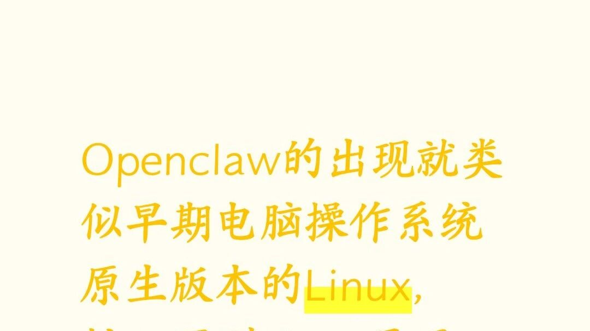

# openclaw很像最早的电脑操作系统linux

> Source: wechat
> Author: 
> Original: https://mp.weixin.qq.com/s?src=11&timestamp=1792740031&ver=7043&signature=kqgSU4h8uxWtM2*T-KQVbsQejtp45QHr2nBNFdwdY9z9f1F5nbWFeZJ6fksa8R2ArxLVd16qgD4xKfPDQ-KETaKrU4s1YoP1Z0q63NtPt5i41HtnzmtbPBvcJxadHbA7&new=1

---

---

## openclaw很像最早的电脑操作系统linux

一起说说openclaw的发展，未来形态#科技趋势分析 #开源与闭源对比 #科技圈新动态 #Openclaw操作系统

 广东,Mar 4,
