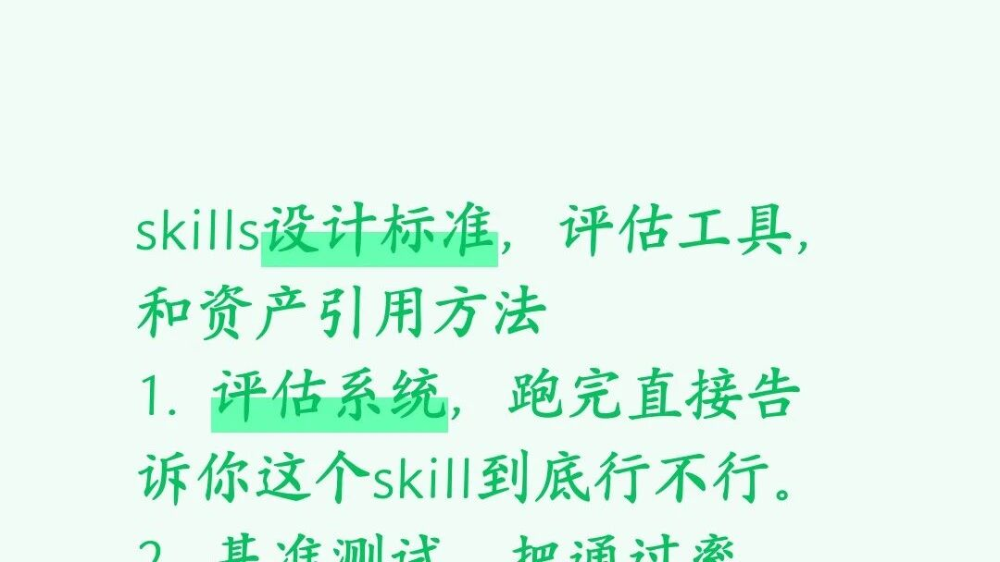

# skills设计标准，评估，优化

> Source: wechat
> Author: 
> Original: https://mp.weixin.qq.com/s?src=11&timestamp=1792740024&ver=7043&signature=kqgSU4h8uxWtM2*T-KQVbsQejtp45QHr2nBNFdwdY9w80K6yezEdvQKcjM1F5I5tbkF7Sf3sZI8Jx4sZJuJUWwKWw4qdDXFBAT-5DwX1nkAyFORBBirKdgCucm2tWe1V&new=1

---

---

## skills设计标准，评估，优化

Anthropic 官方最新版的 到底强在哪，特别是你最关心的那四点。
这个新版本的核心逻辑就是：不要瞎猜1. 评估系统 (Eval Viewer)：跑完直接告诉你行不行
- 机制：新版带了一个完整的本地可视化评估工具
- 怎么玩：当我按照你的要求写完一个 Skill 之后，我会强制生成几个测试用例（Prompt）。然后我会同时生成两个平行的 Agent 跑测试——一个带着你的新 Skill 跑，一个不带 Skill 跑（或者带旧版跑）。
- 结果可视化：跑完之后，我会启动一个本地的网页服务器（或者生成一个静态 HTML），你直接在浏览器里打开，左边是“带 Skill 的回答”，右边是“没带 Skill 的回答”。
-2. 基准测试 (Benchmark)：把通过率、耗时、Token 全量化
感觉不可靠，必须看指标！
- 断言测试 (Assertions)：我会给每个测试用例写死“验收标准”。
- 数据统合：跑完之后，我的聚合脚本 () 会直接生成一份硬核的跑分报告 ()。
- 看什么：
1. 通过率 (Pass Rate)：新 Skill 是不是比旧的通过率高？
2. 耗时 (Time)：新加的工具调用是不是让回答慢了 10 秒？
3. Token 消耗：新写的长篇大论 Prompt 是不是在狂烧你的钱？
这一切都会以平均值 ± 方差的形式明明白白列出来。3. 多代理并行测试 (Multi-Agent Evals)：独立跑，不污染
这是最核心的工程化手段。
- 隔离环境：为了防止大模型被之前的对话“污染”或者产生幻觉，新版强制要求使用子代理 (Subagents) 来跑测试。
- 怎么跑：对于每一个测试用例，我会同时生成多个独立的 Agent 进程（带着不同的 Skill 版本）。它们在干净的沙盒里同时开跑，互相不知道对方的存在。
- 盲评 (A/B Testing)：跑出来的结果，甚至可以再生成一个“裁判 Agent”，让它在不知道哪个是新版、哪个是旧版的情况下，客观地打出优劣分（盲评）。4. 描述调优 (Description Optimization)：解决触发玄学
很多时候你写了个超牛的 Skill，但大模型死活不调用它，这就叫“触发失败”。新版的 专门解决这个痛点。
- 测试集：我会先生成 20 个测试问题，一半是“应该触发这个 Skill 的复杂问题”，另一半是“不该触发的简单干扰问题”。
- 自动对战：脚本会在后台不断调整 SKILL.md 里的 （描述词），每次改完就拿这 20 个问题去轰炸大模型。
- 择优录取：系统会统计每次的命中率（有没有误触？该触发的触发了没？），经过最多 5 轮的自我迭代，它会挑出一个触发最准的描述文案，自动替换掉你原来写的垃圾描述。

 广东,Mar 12,
