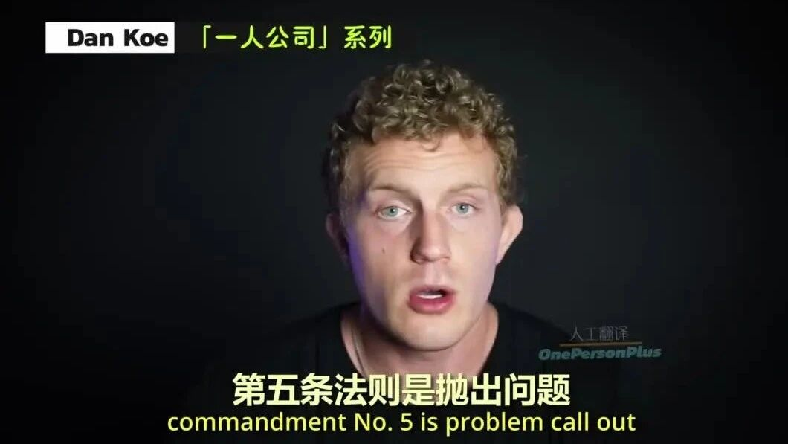

# 「一人公司」第五条法则是抛出问题（就是需要多利用痛点即可）

> Source: wechat
> Author: 
> Original: https://mp.weixin.qq.com/s/i4-9f6ITWozGRgX9XS5bkQ

---

---

第五条法则是抛出问题（就是需要多利用痛点即可）
第六条法则是深入痛点 说明白潜在好处是什么？对于读者而言需要向他回答：这对我有什么好处、
（如果通读你所写的内容，我从中能够得到什么）
第七条法则是 他人的认同
第五条法则是抛出问题（就是需要多利用痛点即可）@#一人公司
