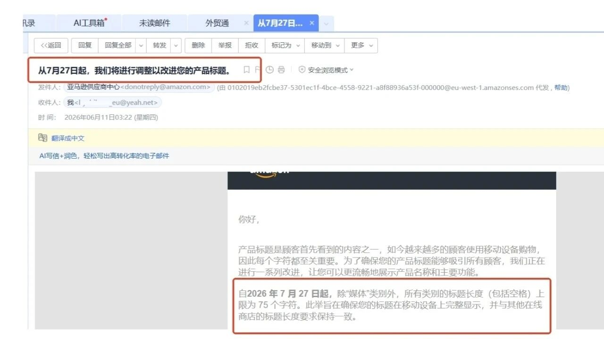

# 亚马逊标题长度不超过75个字符

> Source: wechat
> Author: 
> Original: https://mp.weixin.qq.com/s/aU6ZV7jeKzi9buT5FkhRUA

---

---

## 亚马逊标题长度不超过75个字符

75字标题 启示
1️⃣做好 GEO,AI推荐，
2️⃣结构化属性，后台属性全部填写
3️⃣独创性 差异化标题，描述，
4️⃣适合app移动端，更流畅地展示产品名称和主要功能
5️⃣我们想做一个，给listing 进行AI打分的系统

 广东,Jun 11,
