# 数据分析 - 数据透视表 （结合CPC广告搜索词报告分析）

> Source: wechat
> Author: 天机跨境
> Original: https://mp.weixin.qq.com/s/Bcwj3ae4-POYK34TOdOSMg

---

---

数据分析- 数据透视表  （结合CPC广告搜索词报告分析）

首先，去亚马逊后台下载搜索词报告 ，“数据报告” - “广告”  - “报告类型”选择搜索词（商品推广自动投放报告），另一个关键字（商品推广关键词报告）点击“创建报告” 。

Search Term Report (广告搜索词报告) 报告默认是text格式，复制文本到excel表格中，

鼠标放在文本左上角第一个单元格，全选文本（按住Ctrl+A），在表头“插入”字段，点击”数据透视表“，就出现“创建数据透视表”模块，默认选择“请选择单元格区域”，再选择“新工作表”，然后点击”确定“。

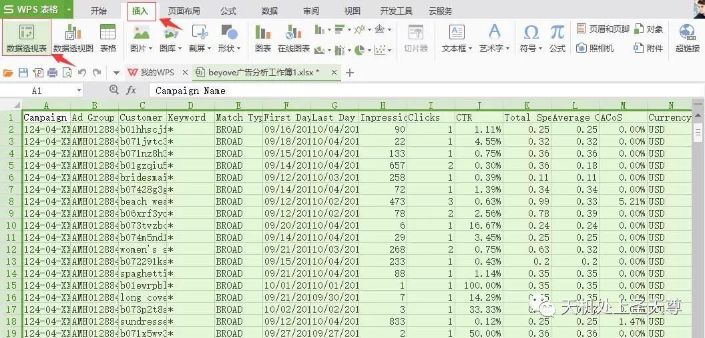

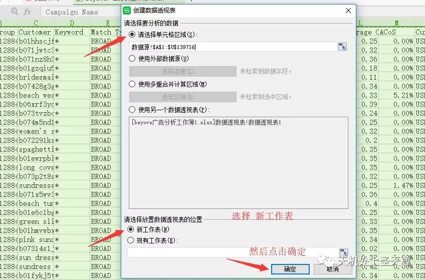

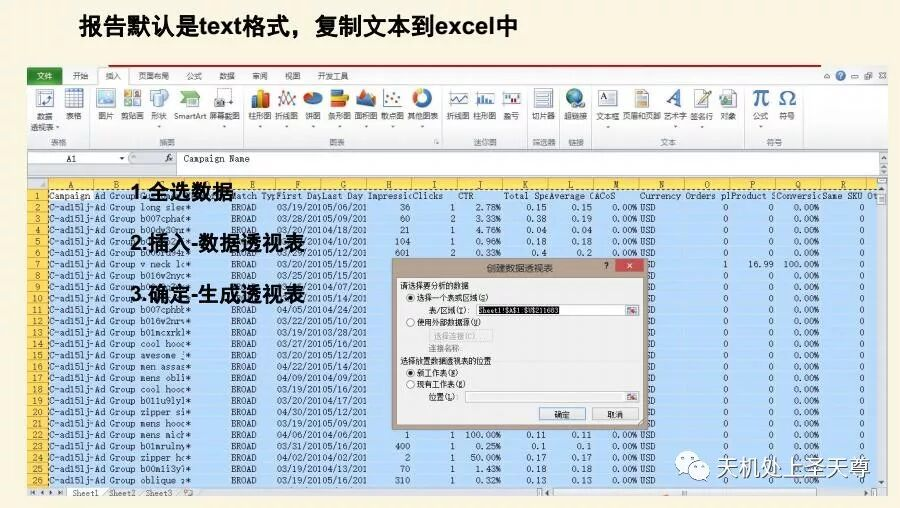

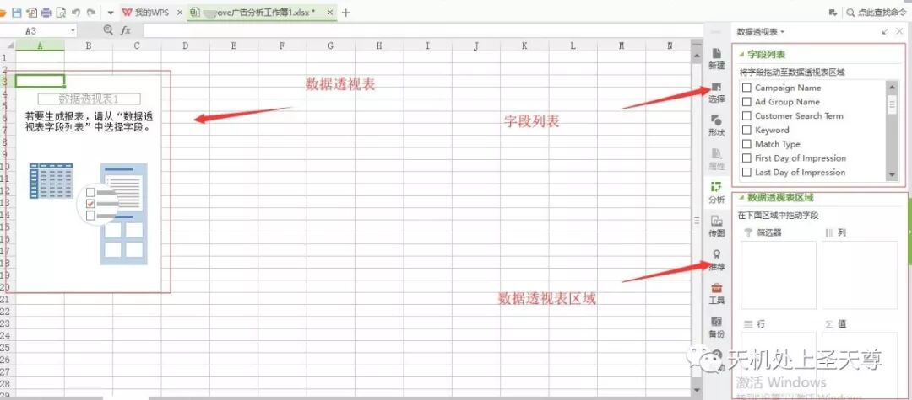

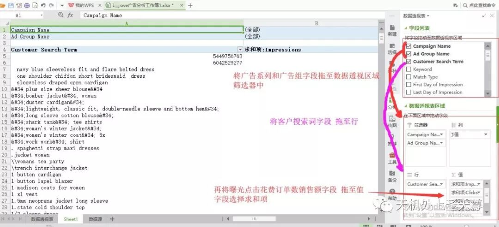

求和项的设置：

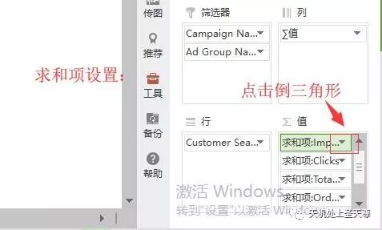

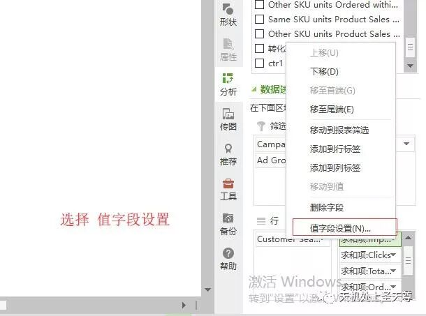

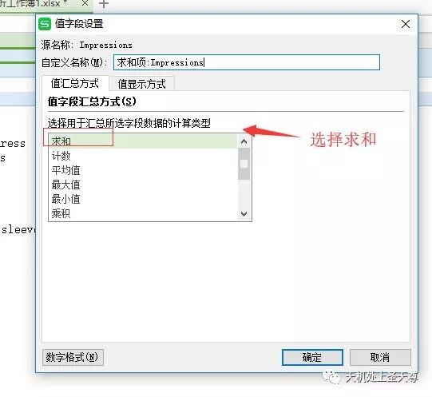

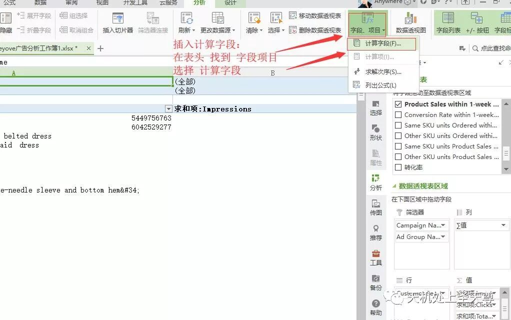

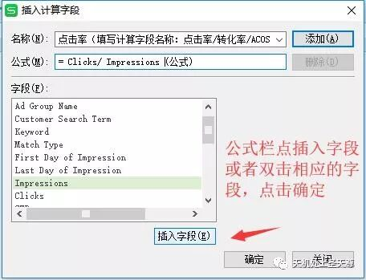

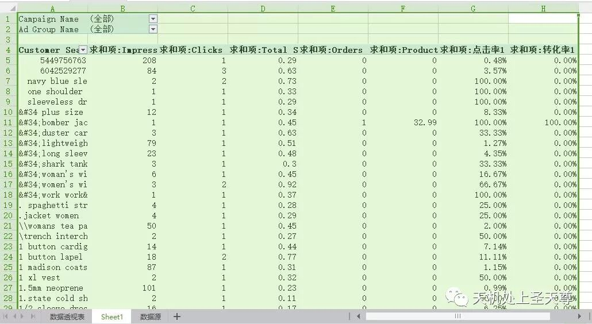

记得字段是比率的，设置字段单元格格式为 百分比 ，小数位数2位

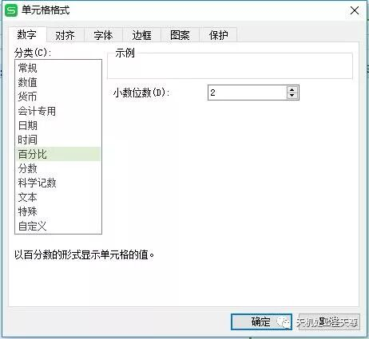

拉取数据参考维度

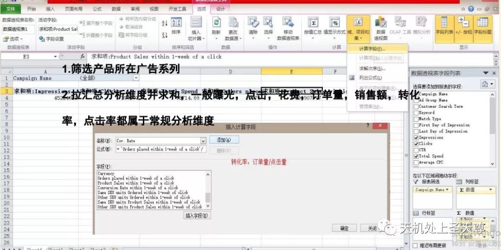

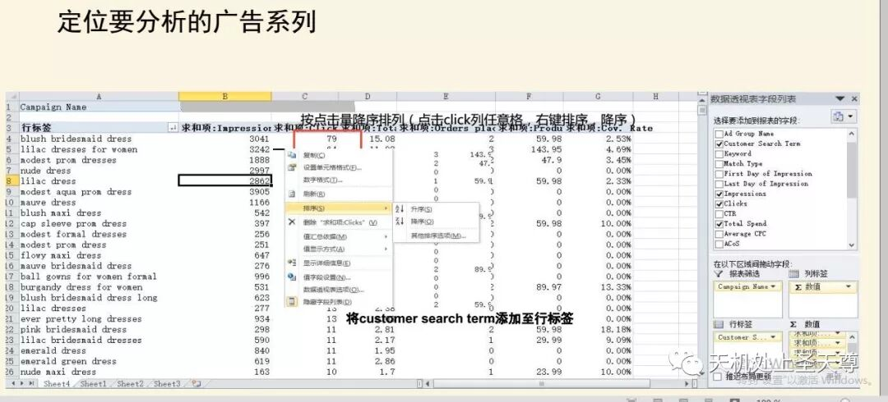

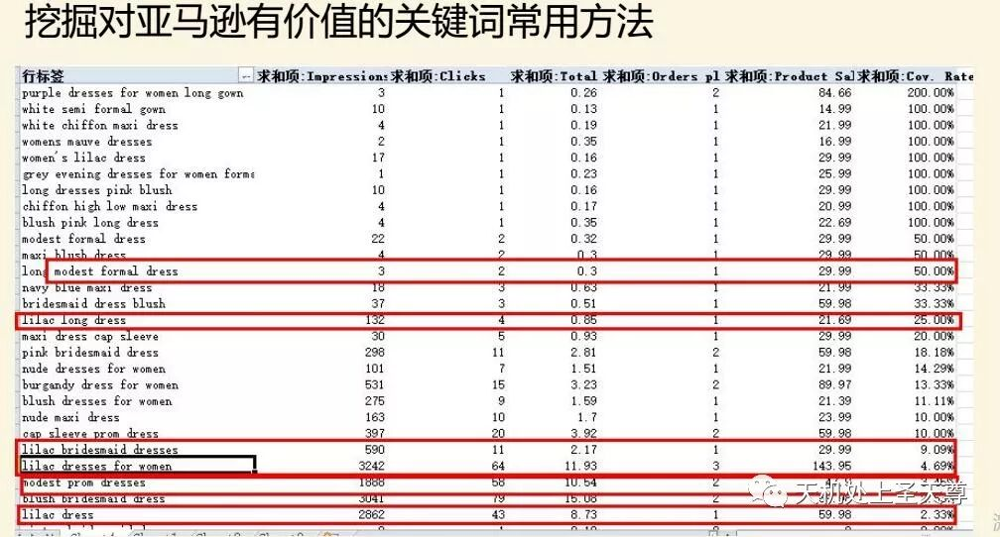

总结分析：

1，转化率降序排序：有转化的词，可以重点关注和拓词

2，点击率降序排序：曝光多点击多的词选择相关性强的，排除偶尔点击，点击为1的词，先开低价跑一段时间，再筛选出点击率高转化率高的，重点关注

3，曝光多的，大词可以手动低价

来自广告部-夏丹

•**目录：**

**•一：手动广告优化**

**•二：自动广告优化**

**一、手动广告优化：**

**手动广告能做的有哪些:**

**拓词，关键词调价，否词，增加匹配方式，Bid+**

**1.首先，确保listing的书写无误（标题和后台五行等），以及广告关键词的相关性。**

**2.子SKU lifetime的花费接近或者超过客单价，0转化的可以停掉该SKU或者高低价。**

**3.关键词lifetime的20个点击左右，0转化的可以停掉该关键词。---若是应季款，结合客单价，查看搜索词报告**

**一、手动广告优化：**

**4. 筛选不同维度—lifetime, month to date, last month, last week, week to date.**

**Lifetime: 随时查看都可以拉。**

**Month to date: 月中后期查看才有意义**

**Last month：月初对比上个月表现**

**Last week: 每周一优化要拉的维度，还有用来对比上周的曝光点击用。**

**Week to date: 每周四优化可用（sales和order延迟48个小时）**

**Spend降序—主要查看哪些词是花费多，无转化的。**

**Sales降序—主要查看哪些词的ACOS高，需要降低出价；哪些词的ACOS低可以提高出价。**

**二、自动广告优化：**

**自动广告能做的有哪些：**

**广告组调价，否词**

**1.首先，确保listing的书写无误，标题及后台五行的相关性。**

**2.子SKU lifetime的花费接近或者超过客单价，0转化的可以停掉该SKU。高低价**

**3.搜索词报告分析：手动添加维度—CR. , CTR, CPC，ROI**

**二、自动广告优化：**

**3.  搜索词报告分析：**

**a.查看click是否集中单个或者几个搜索词或者属性上**

**b.搜索词（属性）对应的点击基数足够（70-100+）情况下，是否产生了订单，转化率是否达到（2.5%以上），是否区隔或词组否**

**c.同一属性下，高点击，高转化，手动可以往这一属性拓展**

**d.高点击，高转化的词-E；中等点击，高转化的词-P；低点击，偶然点击，一个转化的词-B；高CTR≥0.5%，无转化的词-B。同时，高点击，高转化的词可以添加到后台五行。**

**注意事项：**

**1.新品可以做某个词的精确否，不要做词组否。**

**词组否大多数否掉是别人的品牌词和不相关的词。相关的词可以另外拿出来，低价跑。**

**2.大面积否词后，手动要添加关键词，自动要提高出价0.03-0.05，以确保整体流量不会减少太多。**

**3.调价的区间一般情况下是0.03-0.05，极端情况可以是0.08-0.1，如果一下调整太多，listing整体流量会波动很大。**

**a.广告数据很好，转化率≥品类前两周平均1.2倍，推广占比＜品类总体推广占比，退款率＜品类平均值，毛利率却为负的，或者＜10%——不停广告，提高客单价**

**b.广告数据很好，CR., ROI, ACOS, sales各项数据都很好，可是推广占比却很高。—查看 other Asin 报表，是否广告出的其他人的单，而花费算你的。**

**c.集合广告**

**广告分析常用公式：**

**•ACOS = Spend / Sales （ROI和ACOS是倒数关系）**

**•CPC = Spend / Click**

**•CTR = Click / impression**

**•CR. = Order / Click**

**•CPA = Spend / Order**

**B、搜索词报告**

**1.获取搜索词报告**

**2.分析搜索词报告**

**报告默认是text格式，复制文本到excel中**

**1.全选数据**

**2.插入-数据透视表**

**3.确定-生成透视表**

**拉取数据参考维度：**

**1.筛选产品所在广告系列**

**2.拉汇总分析维度并求和，一般曝光，点击，花费，订单量，销售额，转化**

**率，点击率都属于常规分析维度**

**定位要分析的广告系列**

**按点击量降序排列（点击click列任意格，右键排序，降序）**

**将customer search term添加至行标签，其他需要分析的字段拉至值，再添加计算字段**

**挖掘对亚马逊有价值的关键词常用方法， 详细联系百晓堂！**
