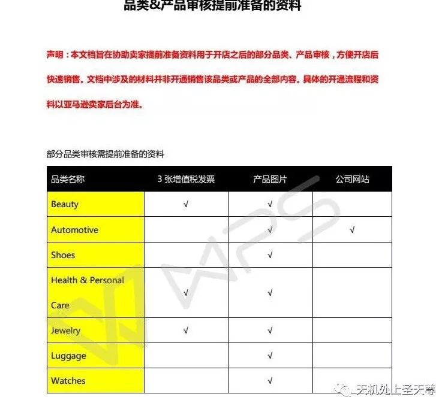
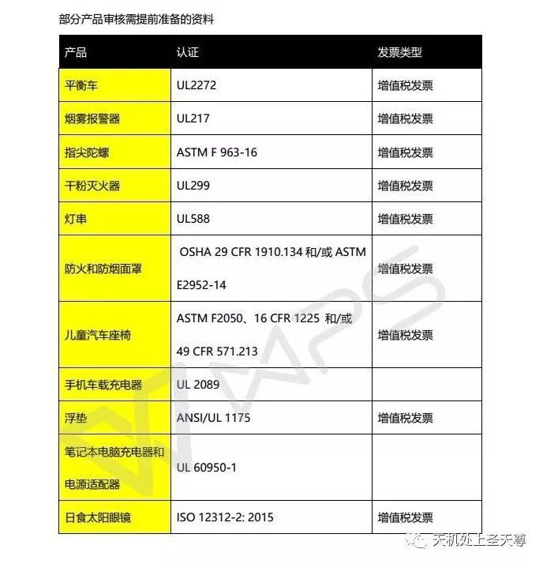
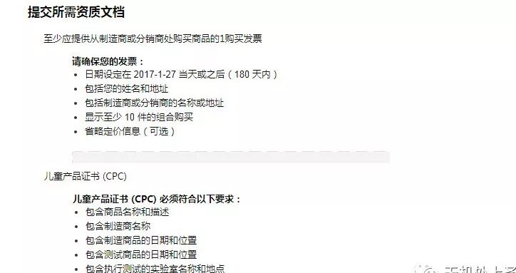

# 认证那些事儿，亚马逊和外贸出口

> Source: wechat
> Author: 天机跨境
> Original: https://mp.weixin.qq.com/s/31cPo1XY-tgOFZym0WuZ6Q

---

---

## 各国玩具认证和外贸出口的21种认证

欧盟玩具准入相关认证

|  |  |
| --- | --- |
| 认证名称 | 认证内容 |
| CE | 产品进入欧盟境内销售的通行证，指尖陀螺所属的玩具类目就在CE认证范围内，欧盟市场CE标志为强制性认真标志 |
| EN71 | 欧盟市场玩具类产品的规范标准，该认证指在对进入欧洲市场的玩具产品进行技术规范，以减少或避免玩具对儿童的伤害 |
| REACH | 要求凡进口和在欧洲进内生产的化学品必须通过注册，评估、授权和限制等一组综合程序，以更好更简单地识别化学品的成分来达到确保环境和人体安全的目的 |
| EN62115 | 电动玩具标准 |
| GS | 出口德国需求的认证，GS认证以德国产品安全法（GPGS）为依据，按照欧盟统一标准EN或德国工业标准DIN进行监测的一种自愿性认证，是欧洲市场公认的德国安全认证标志 |

美国玩具认证

|  |  |
| --- | --- |
| 认证名称 | 认证内容 |
| ASTM F963 | 由美国商务部国家标准局主持制定的美国玩具监测标准，目前最新版本号为ASTM F963-11，并已于2012年6月12日成为强制标准 |

日本玩具准入相关认证

|  |  |
| --- | --- |
| 认证名称 | 认证内容 |
| ST | 1971年.日本玩具协会（JTA）建立了日本玩具安全标识（ST Mark),用以确保14岁及以下儿童玩具的安全，主要包括三方面：机械物理性能，可燃安全性和化学性能 |

澳大利亚及新西兰玩具准入相关认证

|  |  |
| --- | --- |
| 认证名称 | 认证内容 |
| AS/NZS ISO8124 | 国际玩具安全标准，ISO8124由三部分组成，包括机械物理性能、易燃性能及某些元素的转移 |

加拿大玩具准入相关认证

|  |  |
| --- | --- |
| 认证名称 | 认证内容 |
| CCPSA | 2010年12月15日加拿大通过的《加拿大消费品安全法案》，就玩具行业而言，相关的法律主要是（危险产品法案）（HPA）及其实行条例《危险产品（玩具）条列》由加拿大健康产品安全局管理和执行 |

外贸出口的21种认证

外贸单证中心（原信用证专家）

**你知道你的产品在其他的国家需要通过哪些安全认证吗？这些认证标志都是什么含义？让我们来看一下目前全球主流的21种国际知名认证标志和他们的含义，看看你的产品目前通过了以下几种认证。**

**1、CE：** 标志是一种安全认证标志，被视为制造商打开并进入欧洲市场的护照。CE代表欧洲统一（CONFORMITEEUROPEENNE）。凡是贴有“CE”标志的产品就可在欧盟各成员国内销售，无须符合每个成员国的要求，从而实现了商品在欧盟成员国范围内的自由流通。

**2、RoHS：** RoHS是《电气、电子设备中限制使用某些有害物质指令》的英文缩写。RoHS一共列出六种有害物质，包括：铅Pb，镉Cd，汞Hg，六价铬Cr6+，多溴二苯醚PBDE，多溴联苯PBB。欧盟在2006年7月1日开始实施RoHS，使用或含有重金属以及多溴二苯醚PBDE，多溴联苯PBB等阻燃剂的电气电子产品都不允许进入欧盟市场。RoHS针对所有生产过程中以及原材料中可能含有上述六种有害物质的电气电子产品，主要包括：白家电，如电冰箱，洗衣机，微波炉，空调，吸尘器，热水器等，黑家电，如音频、视频产品，DVD，CD，电视接收机，IT产品，数码产品，通信产品等；电动工具，电动电子玩具，医疗电气设备．

Remark:客人问有没有RoHS时要问他是要成品RoHS还是原材料RoHS,有些工厂是做不到成品RoHS的，含RoHS价格一般比普通的产品贵10%-20%左右。

**3、UL：** UL是英文保险商试验所（UnderwriterLaboratories Inc.）的简写。UL安全试验所是美国最有权威的，也是界上从事安全试验和鉴定的较大的民间机构。它是一个独立的、非营利的、为公共安全做试验的专业机构。它采用科学的测试方法来研究确定各种材料、装置、产品、设备、建筑等对生命、财产有无危害和危害的程度；确定、编写、发行相应的标准和有助于减少及防止造成生命财产受到损失的资料，同时开展实情调研业务。总之，它主要从事产品的安全认证和经营安全证明业务，其最终目的是为市场得到具有相当安全水准的商品，为人身健康和财产安全得到保证作出贡献。就产品安全认证作为消除国际贸易技术壁垒的有效手段而言，UL为促进国际贸易的发展也发挥着积极的作用。

Remark:不强制要UL才能进入美国。

**4、FDA：** 美国食品和药物管理局(Food and Drug Administration)简称FDA。FDA是美国政府在健康与人类服务部(DHHS)和公共卫生部(PHS)中设立的执行机构之一。FDA的职责是确保美国本国生产或进口的食品、化妆品、药物、生物制剂、医疗设备和放射产品的安全。“9•11”事件后，美国国内人士认为，有必要切实提高食品供应方面的安全。美国国会在去年6月通过了《2002年公共健康安全及生物恐怖主义的预防及对策法案》后，拨款5亿美元授权FDA制定实施该法案的具体规则。该法规规定，FDA将给每个登记申请者分配一个专用登记号码，外国机构对美国出口的食品，在到达美国港口前24小时，必须事先向美食品与药物管理局通报，否则将被拒绝入境，并在入境港口予以扣留。

Remark:FDA只是要注册登记，不是要认证书。

**5、FCC**：（美国联邦通信委员会）于1934年COMMUNICATIONACT建立是美国政府的一个独立机构，直接对国会负责。FCC通过控制无线电广播、电视、电信、卫星和电缆来协调国内和国际的通信。涉及美国50多个州、哥伦比亚以及美国所属地区，为确保与生命财产有关的无线电和电线通信产品的安全性，FCC的工程技术部（Officeof Engineering and Technology）负责委员会的技术支持，同时负责设备认可方面的事务。许多无线电应用产品、通讯产品和数字产品要进入美国市场，都要求FCC的认可。FCC委员会调查和研究产品安全性的各个阶段以找出解决问题的最好方法，同时FCC也包括无线电装置、航空器的检测等等。联邦通讯委员会（FCC）——管理进口和使用无线电频率装置，包括电脑、传真机、电子装置、无线电接收和传输设备、无线电遥控玩具、电话、个人电脑以及其他可能伤害人身安全的产品。这些产品如果想出口到美国，必须通过由政府授权的实验室根据FCC技术标准来进行的检测和批准。进口商和海关代理人要申报每个无线电频率装置符合FCC标准，即FCC许可证。

**6、CCC：** 根据中国入世承诺和体现国民待遇的原则，国家对强制性产品认证使用统一的标志。新的国家强制性认证标志名称为”中国强制认证”，英文名称为”China Compulsory Certification”，英文缩写为”CCC”。中国强制认证标志实施以后，将逐步取代原来实行的”长城”标志和”CCIB”标志。

**7、CSA：** 是加拿大标准协会（Canadian Standards Association）的简称它成立于1919年，是加拿大首家专为制定工业标准的非盈利性机构。在北美市场上销售的电子、电器等产品都需要取得安全方面的认证。目前CSA是加拿大最大的安全认证机构，也是世界上最著名的安全认证机构之一。它能对机械、建材、电器、电脑设备、办公设备、环保、医疗防火安全、运动及娱乐等方面的所有类型的产品提供安全认证。CSA已为遍布全球的数千厂商提供了认证服务，每年均有上亿个附有CSA标志的产品在北美市场销售。

**8、DIN：** 德国标准化学会Deutsches Institut fur Normung。DIN是德国的标准化主管机关，作为全国性标准化机构参加国际和区域的非政府性标准化机构。DIN于1951年参加国际标准化组织。由DIN和德国电气工程师协会(VDE)联合组成的德国电工委员会(DKE)代表德国参加国际电工委员会。DIN还是欧洲标准化委员会、欧洲电工标准。

**9、BSI：** 英国标准学会BritishStandards Institution英国标准学会(BSI)是世界上最早的全国性标准化机构，它不受政府控制但得到了政府的大力支持。BSI制定和修订英国标准，并促进其贯彻执行。

**10、CB：** 1991年6月中国电工产品认证委员会被国际电工委员会电工产品安全认证组织（iEcEE）管理委员会（Mc）接受为认可和颁发CB证书的国家认证机构。下属的9个检测站接受为CB试验室（认证机构试验室），所有有关电气产品，只要企业取得了委员会出具的cB证书和测试报告，IECEE一ccB体系内的30个成员国将予以认可，基本上免去再送样到进口国测试，这样既省费用又省时地获得该国的认证合格证书，对出口产品极为有利。

**11、EMC：** 电子、电器产品的电磁兼容性（EMC）是一项非常重要的质量指标，它不仅关系到产品本身的工作可靠性和使用安全性，而且还可能影响到其他设备和系统的正常工作，关系到电磁环境的保护问题。欧共体政府规定，从1996年1月1起，所有电气电子产品必须通过EMC认证，加贴CE标志后才能在欧共体市场上销售。此举在世界上引起广泛影响，各国政府纷纷采取措施，对电气电子产品的RMC性能实行强制性管理。国际上比较有影响的，例如欧盟89/336/EEC等。

**12、PSE：** 是日本JET针对符合日本安全规定的电子电器产品所给予的认证标章。根据日本的DENTORL法(电器装置和材料控制法)规定,498种产品进入日本市场必须通过安全认证。

**13、GS：** GS标志是德国劳工部授权TUV、VDE等机构颁发的安全认证标志。GS标志是被欧洲广大顾客接受的安全标志。通常GS认证产品销售单价更高而且更加畅销。

**14、ISO:** 国际标准化组织International
Organization forStandardization国际标准化组织是世界上最大的非政府性标准化专门机构，它在国际标准化中占主导地位。ISO制定国际标准。ISO的主要活动是制定国际标准，协调世界范围内的标准化工作，组织各成员国和技术委员会进行情报交流，以及与其他国际性组织进行合作，共同研究有关标准化问题。

**15、HACCP：** 是”Hazard Analysis Critical Control Point”的英文缩写，即危害分析和关键控制点。HACCP体系被认为是控制食品安全和风味品质的最好、最有效的管理体系。国家标准GB/T15091-1994《食品工业基本术语》对HACCP的定义为：生产(加工)安全食品的一种控制手段；对原料、关键生产工序及影响产品安全的人为因素进行分析，确定加工过程中的关键环节，建立、完善监控程序和监控标准，采取规范的纠正措施。国际标准CAC/RCP-1《食品卫生通则1997修订3版》对HACCP的定义为：鉴别、评价和控制对食品安全至关重要的危害的一种体系。

**16、GMP：** 是英文GoodManufacturing Practice的缩写，中文的意思是“良好生产操作规范”，是一种特别注重在生产过程实施对食品卫生安全的管理。简要的说，GMP要求食品生产企业应具备良好的生产设备，合理的生产过程，完善的质量管理和严格的检测系统，确保最终产品的质量（包括食品安全卫生）符合法规要求。GMP所规定的内容，是食品加工企业必须达到的最基本的条件。

**17、REACH：** REACH是欧盟规章《化学品注册、评估、许可和限制》的简称,是欧盟建立的，并于2007年6月1日起实施的化学品监管体系。这是一个涉及化学品生产、贸易、使用安全的法规提案，法规旨在保护人类健康和环境安全，保持和提高欧盟化学工业的竞争力，以及研发无毒无害化合物的创新能力。REACH指令要求凡进口和在欧洲境内生产的化学品必须通过注册、评估、授权和限制等一组综合程序，以更好更简单地识别化学品的成分来达到确保环境和人体安全的目的。该指令主要有注册、评估、授权、限制等几大项内容。任何商品都必须有一个列明化学成分的登记档案，并说明制造商如何使用这些化学成分以及毒性评估报告。所有信息将会输入到一个正在建设的数据库中，数据库由位于芬兰赫尔辛基的一个欧盟新机构——欧洲化学品局来管理。

**18、HALAL：** Halal，本意是“合法的”，中文译为“清真”，即符合穆斯林生活习惯和需求的食品、药品、化妆品以及食品、药品、化妆品添加剂。穆斯林国家马来西亚就一直致力于halal（清真）产业的发展，他们颁发的halal（清真）认证在国际上具有很高的信誉度，得到穆斯林大众的信赖。包括北美、欧洲市场也逐步意识到halal（清真）产品所具有的巨大潜力，不遗余力地开始相关产品的研发和生产，并且在halal（清真）认证方面也制定了相应的标准及流程。

**19、C/A-tick认证：** 是由澳大利亚通讯局(简称ACA)为了通信设备发的认证标志，C-tick认证周期：1-2周。产品执行ACAQ技术标准测试，向ACA登记使用A/C-Tick，填写“符合声明表”(Declaration of Conformity Form)，并和产品符合记录保存一起，在通信产品或设备上贴上有A/C-Tick标志的标识(label)，销售给消费者A-Tick仅适用于通信产品，电子产品多半是申请C-Tick，不过电子产品如果申请A-Tick，则不需另外申请C-Tick。自2001年11月起，澳大利来/新西兰的EMI申请合并；如果产品要在这二国销售，下列文件在行销前必备齐，以备ACA(Australian Communications Authority)或新西兰(Ministry
of Economic Development)当局随时抽查。澳大利亚的EMC体系把产品划分为三个级别，供应商在销售级别二、级别三产品前，必须在ACA注册，申请使用C-Tick标志。

**20、SAA认证：** SAA认证为澳大利亚的标准机构为Standards
Association of Australian旗下认证，所以很多朋友把澳大利亚认证称为SAA。SAA是进入澳大利亚市场的电器产品须符合当地的安全法规，即业界经常面对的认证。由于澳大利亚和新西兰两国的互认协议，所有取得澳大利亚认证的产品，均可顺利地进入新西兰市场销售。所有电器产品均要做安全认证（SAA）。SAA的标志主要有两种，一种是形式认可，一种是标准标志。形式认证是只能样品负责，而标准标志是需每个进行工厂审查的。目前国内申请SAA认证有两种方式，一种是通过CB测试报告转，若没有CB测试报告，则也可以直接申请。一般情况下，ITAV灯具小家电类常见产品申请澳大利亚SAA认证的周期是3-4周，如果产品质量不达标，可能日期会有所延长。提交报告到澳州审核时需要提供产品插头的SAA证书(主要是针对带插头的产品),不然不给予办理，产品里面的重要的元器件SAA证，像灯具需要提供灯具里面变压器SAA证书，不然澳州审核资料不通过。

**21、台湾BSMI认证：** BSMI是台湾经济部标准检验局的英文“Bureau of Standards, Metrology and Inspection “的缩写。根据台湾经济部公告，从2005年7月1日起，进入台湾地区的产品要实行电磁兼容性和安规两个方面的监管。中国台湾BSMI认证是强制性的，他对EMC和SAFETY都有要求，不过，BSMI目前没有工厂检查，但必须按照标准局的规定办事。

**18种国家认证，亚马逊需要的认证**

**http://tieba.baidu.com/p/5493537369**

**1、CE**

**一种安全认证标志，被视为制造商打开并进入欧洲市场的护照。凡是贴有“CE”标志的产品就可以在欧盟各成员国内销售，无须符合每个成员国的要求，从而实现了商品在欧盟成员国范围内的自由流通。**

**CE认证标志**

**2、RoHS**

**是由欧盟立法制定的一项强制性标准，全称为《关于限制在电子电器设备中使用某些有害成分的指令》。该标准于2006年7月1日开始正式实施，指令中列出了6种有害物质：铅Pb、镉Cd、汞Hg、六价铬Cr6+、多溴二苯醚PBDE、多溴联苯PBB。但凡含有这些有害物质的电子电器设备都不允许进入欧盟市场。**

**RoSH认证标志**

**3、UL**

**是美国保险商实验室的简写。UL安全实验所是美国最有权威，也是世界上从事安全试验和鉴定的较大的民间机构。其主要从事产品的安全认证和经营安全证明业务。UL认证是自愿性的，但产品想要在美国市场上获得消费者认可就必须做，美国人比较认准UL认证。**

**UL认证标志**

**4、FDA**

**是美国食品和药物管理局的简写，主要是确保美国本国生产或进口的食品、化妆品、药物、生物制剂、医疗设备和放射产品的安全。FDA不是要认证书，而是要注册登记。进口美国的食品，在到达美国港口前24小时，必须事先向FDA通报登记，否则将被拒绝入境，并在入境港口予以扣留。**

**FDA认证标志**

**5、FCC**

**是美国联邦通信委员会的简写。通过控制无线电广播、电视、电信、卫星和电缆来协调国内和国际的通信。许多无线电应用产品、通讯产品和数字产品要进入美国市场，都要求进口商和海关代理商申报每个无线电频率装置是否符合FCC标准，即FCC许可证。**

**FCC认证标志**

**6、CCC**

**即3C认证，全称为：强制性产品认证制度。是中国政府为保护消费者人身安全和国家安全、加强产品质量管理、依照法律法规实施的一种产品合格评定制度。认证种类有22大类157种产品，主要包括电线电缆、低压电器、信息技术设备、安全玻璃、消防产品等。**

**CCC认证标志**

**7、CSA**

**是加拿大标准协会的简写。目前CSA是加拿大最大的安全认证机构，也是世界上最著名的安全认证机构之一。它对机械、建材、电器、电脑设备、办公设备、环保、医疗防火安全、运动及娱乐等方面的所有类型的产品提供安全认证。**

**CSA认证标志**

**8、DIN**

**是德国标准化学会的简写。DIN是德国最大的具有广泛代表性的公益性标准化民间机构。DIN发展为两种产品认证标志，即“DIN标志”和“DIN检验和监督标志”，此外还有一种质量体系认证制度。**

**DIN认证标志**

**9、BSI**

**是英国标准协会。是举世闻名的，集标准研发、标准技术信息提供、产品测试、体系认证和商检服务五大互补性业务于一体的国际标准服务提供商BSI倡导制定了世界上流行的ISO9000系列管理标准，注册标准涵盖质量、环境、健康和安全、信息安全、电信和食品安全等几乎所有领域。**

**BSI认证标志**

**10、GB**

**推荐性国家标准，指生产、交换、使用等方面，通过经济手段或市场调节，而自愿采用的国家标准。这类标准任何单位都有权决定是否采用，违反这类标准，不承担经济或法律方面的责任。但是，一经接受并采用，或各方商定同意纳入经济合同中，就成为各方必须共同遵守的技术依据。**

**GB认证标志**

**11、EMC**

**指电磁兼容认证，不仅关系到产品本身的工作可靠性和使用安全性，而且还可能影响到其它设备和系统的正常工作，关系到电磁环境的保护问题。欧共体政府规定，从1996年1月1日起，所有电气电子产品必须通过EMC认证，加贴CE标志后才能在欧共体市场上销售。**

**EMC认证标志**

**12、PSE**

**是日本产品安全标志，针对符合日本安全规定的电子电器产品所给予的认证标章。根据日本的DENTORL法规定，498种产品进入日本市场必须通过安全认证。凡属于“特定电气用品”目录内的产品，进入日本市场，必须取得PSE认证合格证书。**

**PSE认证标志**

**13、GS**

**GS认证以德国产品安全法为依据，按照欧盟统一标准EN或德国工业标准DIN进行检测的一种自愿性认证，是欧洲市场公认的德国安全认证标志，被欧洲广大顾客接受的安全标志，通过GS认证产品销售单价更高而且更加畅销。**

**GS认证标志**

**14、ISO**

**国际标准化组织，世界上最大的非政府性标准化专门机构。主要活动是制定国际标准，协调世界范围内的标准化工作，其工作涉及除电工标准以外的各个技术领域的标准化活动。**

**ISO认证标志**

**15、HACCP**

**是危害分析和关键控制点的简写。HACCP体系被认为是控制食品安全和风味品质的最好、最有效的管理体系。是国际上共同认可和接受的食品安全保证体系，主要是对食品中微生物、化学和物理危害进行安全控制。目前HACCP推广应用较好的国家有：加拿大、泰国、越南、印度、澳大利亚、新西兰、冰岛、丹麦、巴西等国。**

**HACCP认证标志**

**16、GMP**

**是一套适用于制造、食品等行业的强制性标准，要求制药、食品等生产企业应具备良好的生产设备，合理的生产过程，完善的质量管理和严格的检测系统，确保最终产品质量符合法规要求。GMP所规定的内容，是食品加工企业必须达到的最基本的条件。**

**GMP认证标志**

**17、REACH**

**是欧盟规章《化学品注册、评估、许可和限制》的简称，是欧盟建立的，并于2007年6月1日起实施的化学品监管体系。REACH指令要求凡进口和在欧洲境内生产的化学品必须通过注册、评估、授权和限制等一组综合程序，以更好更简单地识别化学品的成分来达到确保环境和人体安全的目的。**

**REACH认证标志**

**18、HALAL**

**本意是“合法的”，中文译为“清真”，即符合穆斯林生活习惯和需求的食品、药品、化妆品以及食品、药品、化妆品添加剂。穆斯林国家马来西亚就一直致力于HALAL产业的发展，他们办法的HALAL认证在国际上具有很高信誉度，得到穆斯林大众的信赖。包括北美、欧洲市场也逐步意识到HALAL产品的巨大潜力，在认证方面也制定了相应标准和流程。**

**19  CPC**

**（Children's Product Certificate）**

**CPC证书需要包含的信息：**

**1、产品信息**

**2、产品适用的所有的法规和条列**

**3、进口商或制造商（美国本土）的信息：包括名称、地址和电话**

**4、支撑证书的检测结果档案持有人的联系信息：名称、地址、邮箱地址 和电话。（通常可以理解为美国本土以外的制造商）**

**5、产品生产日期和地址，生产日期必须到年月，地址必须到城市；**

**6、检测时间和地址或者证书基于的检测报告**

**7、第三方检测机构信息（CPSC认可的实验室）：名称、地址、联系电话；**

## 亚马逊产品认证

## 1 FDA

**英文全称：Food and Drug Administration**

**中文名称：食品药品监督管理局**

**FDA有时也代表美国FDA，即美国食品药品监督管理局，是国际医疗审核权威机构。**

**其它许多国家都通过寻求和接收 FDA 的帮助来促进并监控其本国产品的安全。**

**FDA是美国的一种认证，主要是针对食品和药品以及跟人体接触的东西。包含食品、药品、化妆品和医疗器具、保健品、烟草，辐射产品等产品类别。只有需要这个认证的产品需要认证，不是所有的，不同产品的认证要求可能不同。只有通过FDA认可的材料、器械和技术才能商业化。**

**企业在注册亚马逊时，亚马逊会要求企业提供FDA相关的文件，以下是亚马逊常见问题：1）FDA注册网站截图2）FDA注册号3）必须申明自己的产品和FDA网站截图真实有效4）信息必须一致**

## 2 UPC

**英文全称：Universal Production Code**

**中文名称：通用产品编号(代码)**

**UPC码是美国统一代码委员会（UCC）制定的一种商品通用条码，适用于美国和加拿大。UPC码仅可用来表示数字，故其字码集为数字0~9。UPC条码也有标准版和缩短版两种，标准版由12位数字构成，缩短版由8位数字构成。**

**标准UPC码：系统码（1位）+厂商码（5位）+商品码（5位）+校验码（1位）亚马逊北美站的卖家，在上传产品时需要使用UPC。但是在亚马逊上，不是所有产品都需要UPC码。**

**1）如果你的产品是需要UPC码，而手头上没有，这怎么办呢？**

**亚马逊给出的答复是，向产品的生产商要，如果生产商也没有的话，那有以下几个方法。**

**①向当地的编码中心提出申请。中国的编码管理机构是中国物品编码中心。美国的编码管理机构就是上面提到的UCC。**

**②进行品牌备案，通过后不需要填写UPC**

**注：网上有一种条码生成器，可以免费大量生产UPC码，但是这种生成的条码是没有证书且有很多是被用过的。申请全球开店时一定不能用，因为如果使用假的UPC，一经发现亚马逊会取消开店申请资格，而且在申请的时候亚马逊也有可能需要卖家提供UPC购买时获得的证书。所以，这个法子是有风险的。**

**2）亚马逊规定的不需要UPC码的产品和分类：**

**私有商品**

**非国家注册公司工厂生产**

**拥有特殊功能用途的小的产品零件，配件**

**分销店中的B2B零售商品**

**顾客定制商品**

**EAN**

**英文全称：European Article Number**

**中文名称：欧洲商品编码**

**EAN码是国际物品编码协会制定的一种商用条码，全球通用，是在UPC码的基础上确立的商品标识符号。由于在国际上存在着这两套主流的编码系统，我国商品在出口时，销往美国和加拿大的要使用UPC码，销往其他国家和地区的则需使用EAN码。EAN条码符号有标准版和缩短版两种，标准版是由13位数字构成，缩短版是由8位数字构成，我国于1991年加入EAN组织。（我们日常购买的商品包装上所印的条码一般就是EAN码。）**

**标准EAN码：国家码（2位或3位）+厂商码（5位或4位）+商品码（5位）+校验码（1位）**

**在技术上，EAN系统的光电阅读器可以阅读UPC系统的条码，而UPC系统的光电阅读器却不能阅读EAN系统的条码。所以，UPC码是可以被EAN码代替的。如果一个卖家在Amazon.com 和Amazon.co.uk同时销售，可以将美国站UPC当成EAN填入英国站，这样可以达到同步产品的效果，提高刊登产品效率。**

**PS：在UPC码前面加0，就变成了EAN码。EAN码获取方式见上面的UPC**

## 4 ASIN

**英文全称 : Amazon Standard Identification Number**

**中文名称：亚马逊标准识别号**

**Amazon自动生成用来标识亚马逊商品，相当于一个独特的产品ID，不需要卖家自行添加。每个亚马逊经销的商品都有一个唯一对应的10位的ASIN编码。**

## 5 GCID

**英文全称：Global Catalog Identifier**

**中文名称：全球目录编码**

**Amazon内部生成的品牌标识符，当你品牌在Amazon成功备案后，提供一个key attribute，Amazon会自动分配独一无二的GCID，十六位字符，包括字母和数字。这时候就不需要再购买UPC码或EAN码了。**

## 6 GMP

**英文全称： Good Manufacturing Practice**

**中文名称： 良好生产规范**

**世界卫生组织将GMP定义为指导食物、药品、医疗产品生产和质量管理的法规。**

**GMP是一套适用于制药、食品等行业的强制性标准，要求企业从原料、人员、设施设备、生产过程、包装运输、质量控制等方面按国家有关法规达到卫生质量要求，形成一套可操作的作业规范帮助企业改善企业卫生环境，及时发现生产过程中存在的问题，加以改善。简要的说，GMP要求制药、食品等生产企业应具备良好的生产设备，合理的生产过程，完善的质量管理和严格的检测系统，确保最终产品质量（包括食品安全卫生）符合法规要求。**

## 7 COA

**英文全称：Certificate Of Analysis**

**中文名称：产品分析报告**

**一般是对产品的成分、性能进行检测分析。多用于化工、医药等相关行业，一般是由工厂（生产厂家）开具。**

## 8 510(K)

**一个医疗器械进入商业销售，必须登记，且必须至少90天之前递交一个上市前通知，俗称“ 510（k）”。**

**510(k)文件是向FDA递交的上市前申请文件，目的是证明申请上市的器械与不受上市前批准(PMA)影响的合法上市器械同样安全有效，即为等价器械(substantially equivalent)。申请者必须把申请上市的器械与现在美国市场上一种或多种相似器械对比，得出并且支持等价器械的结论。合法上市器械是在1976年5月28日之前合法上市的器械(preamendment device)，或者从III类器械中分入II或I类的器械，或者通过（510(k)）程序发现与这样的器械等价的器械，或者通过自动的III 类器械定义的评价建立的器械。与之等价的器械被称为“predicate device(s)”。**

**http://www.sohu.com/a/195501408\_805698**

**亚马逊产品认证**

**CE认证**

**CE标志是安全合格标志而非质量合格标志。是构成欧洲指令核心的"主要要求"。CE标志是一种安全认证标志，被视为制造商打开并进入欧洲市场的护照。产品要进入欧盟必须进行CE认证，在产品上加贴CE标志。**

**适用产品：进入欧洲所有产品。**

**FCC认证**

**FCC全称为美国联邦通信委员会。FCC通过控制无线电广播、电视、电信、卫星和电缆来协调国内和国际的通信。涉及美国50多个州、哥伦比亚以及美国所属地区为确保与生命财产有关的无线电和电线通信产品的安全性。许多无线电应用产品、通讯产品和数字产品要进入美国市场，都要求FCC的认可。**

**适用产品：电脑及电脑配件、家用电器、电动工具、灯具、玩具、安防等等。**

**RoHS认证**

**RoHS是由欧盟立法制定的一项强制性标准，主要用于规范电子电气产品的材料及工艺标准，使之更加有利于人体健康及环境保护。**

**适用产品：RoHS指令的涵盖范围为AC1000V、DC1500V以下的由目录所列出的电子、电气产品：家电、灯具、玩具、安防、通讯、电动工具等等。**

**UL认证**

**UL是美国保险商试验所（Underwriter Laboratories Inc.）的简写。UL安全试验所是美国最有权威的，也是世界上从事安全试验和鉴定的较大的民间机构。UL 认证在美国属于非强制性认证，主要是产品安全性能方 面的检测和认证，其认证范围不包含产品的 EMC（电磁兼容）特性。**

**认证标志：右下方的"us"表示适用于美国，左下方的"c"表示适用于加拿大，同时具有"us"和"c"则在两个国家都适用。**

**适用产品：灯具、家用电器、通讯、电动工具、电线电缆等等。**

**ETL认证**

**ETL是北美最具活力的安全认证标志，是产品出口美国及加拿大所需的认证。产品拥有ETL列名标志就意味着，它已经满足了产品安全标准的最低要求。**

**认证标志：右下方的"us"表示适用于美国，左下方的"c"表示适用于加拿大，同时具有"us"和"c"则在两个国家都适用。**

**适用产品：灯具、家用电器、通讯、电动工具、电线电缆等等。**

**UL和ETL的区别：**

**ETL标志认可与UL或CSA标志具有等同的效力，并符合有关的安全标准。但ETL认证的费用比UL认证低，一般只有UL认证的一半；申请ETL认证时间也比UL认证要短一些。**

**EN71认证**

**EN71是欧盟市场玩具类产品的规范标准。其意义是通过EN71标准对进入欧洲市场的玩具产品进行技术规范，从而减少或避免玩具对儿童的伤害。**

**适用产品：玩具。**

**GS认证**

**GS认证以德国产品安全法（GPGS）为依据，按照欧盟统一标准EN或德国工业标准DIN进行检测的一种自愿性认证，是欧洲市场公认的德国安全认证标志。GS认证使用的标准为欧盟相应的EN安全标准。GS认证比CE认证的低电压安全认证（LVD认证），要更严格，有厂检和年检，而CE-LVD则不需要厂检和年检。**

**适用产品：家用电器、家用机械、体育运动用品、家用电子设备、电气、办公设备、其它与安全有关的产品如自行车、头盔、爬梯、家具等。**

**FDA认证**

**FDA的职责是确保美国本国生产或进口的食品、化妆品、药物、生物制剂、医疗设备和放射产品的安全。**

**适用产品：食品、医疗器械等。**

**PSE认证**

**PSE 认证是日本强制性安全认证，用以证明电机电子产品已通过日本电气和原料安全法 (DENAN Law) 或国际IEC标准的安全标准测试。**

**适用产品：电气用品、电线电缆等。**
