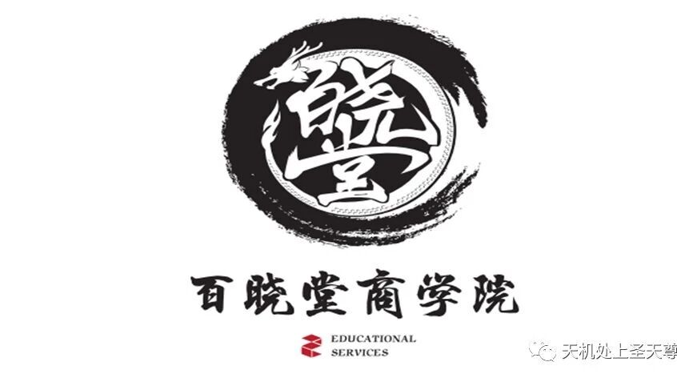
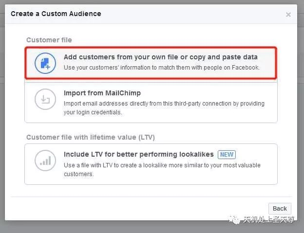
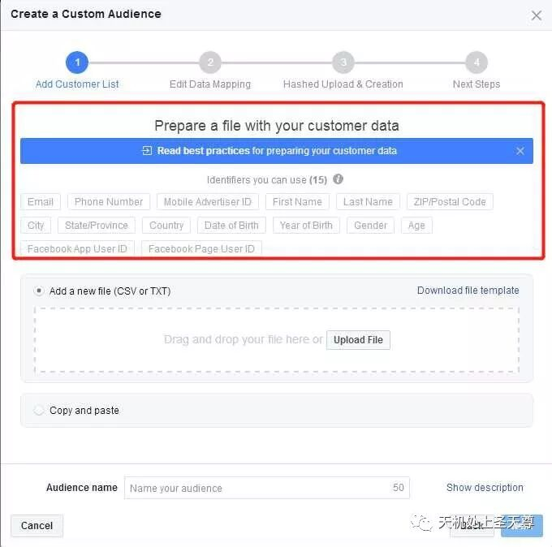
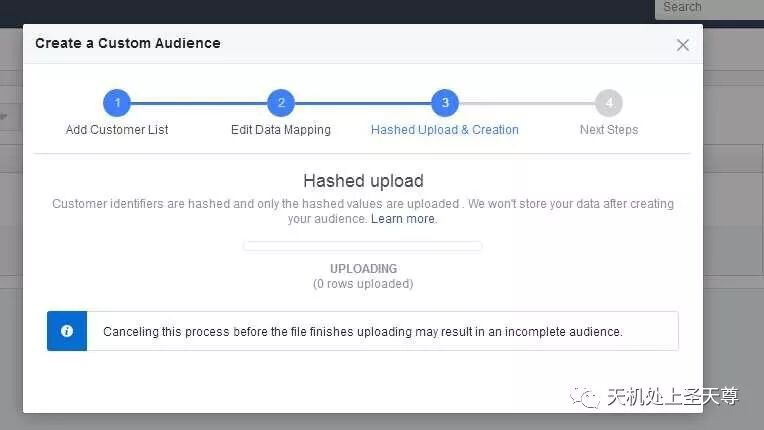
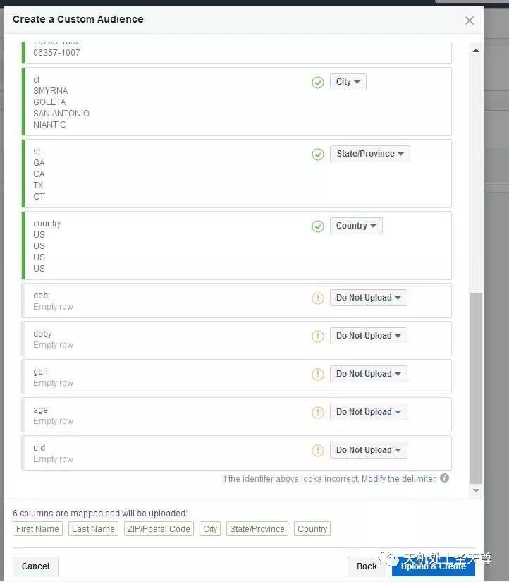
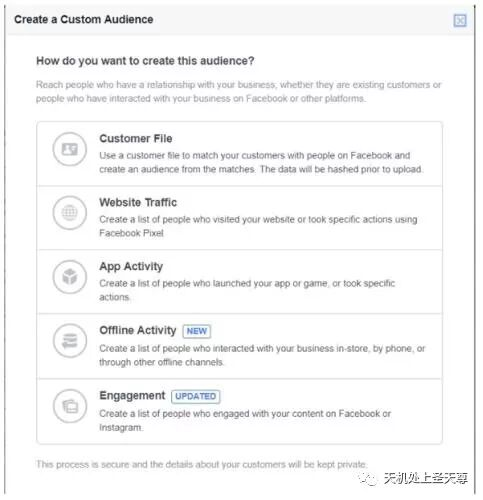
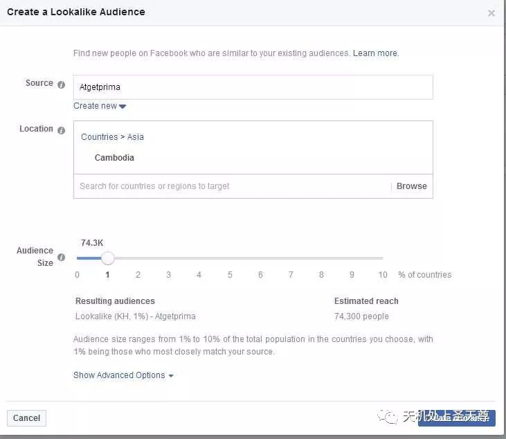

# 亚马逊测评基础内容 Day1- Review

> Source: wechat
> Author: 天机跨境
> Original: https://mp.weixin.qq.com/s/qMAJ4esHZKCeOvwGR2LxjQ

---

---

一，流程和注意事项

二，术语和开发信

三，送测渠道

四，买家数据

.............................................................................................................................

一，流程和注意事项

模式和风险

测评模式：什么是测评？  --订单推广（刷单） 联系买家，送样留评

测评模式 （找到买家资源-正确的购买过程-及时且高质量的留评）

首先，通过各个渠道找到高质量的买家，然后联系好并确定测评细节，拿到达人的profile，审核账号，通过后再下单，填写记录，【下单方式：code（折扣码），paypal,    giftcard,】下单后给订单号，确认付款完成，开始返款，到货催评，存档维系。

找达人的途径？需要注意什么？

社交平台（Facebook,  Twitter,  Instagram,  Pinterest,  Tumblr, Snapchat,Whatsapp Wechat）测评邮箱，真实买家Paypal 账号，微信群，买家数据，买家资源。

Facebook群组，发帖，模板中, 不要出现品牌和店铺名，不要出现Amazon,review和feedback等字眼，不要直接发产品链接，最好是用关键词搜索，或者做链接给他，尽可能地模拟真实的购买

返款方式code，Gift card，refund after ship , refund after order ,refund after review, 亚马逊后台显示由payment pending - payment completed才返款

{不要提前付款给达人，下单确定达人已经付款完成再返款，但是最好建议是产品显示发货，再返款这是比较好的}加上paypal手续费，包含手续费的返款金额=订单价格+手续费率+手续费

全站点标准费率 ：       包含手续费的返款金额 =  订单价格 + 订单价格\*0.044 + 0.3

下单前和达人沟通好是否cover PP fee，如果需要的，只能回答我们会尽量cover，不能保证到账的金额完全正确。经验证，使用最新手续费算法确实会有部分达人收到的金额少零点几到一美金，但是金额都不会太大，如果这样都不能接受的达人建议谨慎合作或者返GC。

网络共享版黑名单：http://mjzj.com/ce-ping-bao-guang-tai/zui-xin-ti-jiao-hei-ming-dan.html

注意事项以及防范措施

1. 送测流程   {详细见 附件}

开发信：写明返款方式，测试产品和图片（不同产品要编上号），送测要求，附上多种联系方式（Facebook，Snapchat, Whats app,Wechat等），推荐赚佣金，如果达人感兴趣，就让他们发自己的profile链接或者截图，以及喜欢的产品图片，编号等信息。

2. 测评达人邮箱，Paypal 邮箱，真实买家账号邮箱

Top Reviewer 邮箱联系 Top标志都不可以用，top1000-10000看profile 质量，最好真实买家（这种一定要看达人账号的质量留评数量和黑名单，测评这种达人需要极其慎重）

详细流程，多维度触及到达人，先要得到profile，审核，通过以后继续询问想测评的产品，详细介绍测评购买的过程和注意事项，搜索主要关键词抵达测评产品，bitly链接，让达人多看图片，多浏览标题描述，和评价，可以让达人提问Q&A，转发，点赞或者点no，加入购物车，或心愿列表，还要打开其他相关产品浏览，对比，购买，给单号，填新三审，pp审核，或者第二天购买，等付款完成，返款，到货后催评维系。

3. 达人下单后发了单号，但是发货前就取消了订单，或者收到货之后退货

防范方法：不需要留评的订单，和达人沟通发货后返款或者到货后返款，需要留评的订单沟通到货后返款或者留评后返款，因为发货后达人马上取消订单一般亚马逊是不会通过的，而且发货后我们也达到了一定的推广效果。

注意：pending状态付款肯定不安全，但是付款成功还未发货也可以取消订单，所以这个状态付款也不够安全。

4. 达人收到货之后不留评。

防范方法：首先合作前先沟通，看达人是否愿意分享购物体验，主要不能使用review，Amazon,feedback等敏感词汇，再就是看达人合作是否积极，如果正常时间段消息都很久不回的，后期催评也会比较困难。另外，达人到货了可以用不需要留评的产品吸引达人留评，但是之后建议就不要继续合作了。

5. 达人到货后留差评。

防范方法：下单后多提醒两句，1-到货了告诉你，2-有任何问题可以随时联系你，你会尽全力解决；如果达人说了产品已到货，先问一下是不是对产品满意，满意再问愿不愿意分享购物体验，不满意先问什么原因，然后尽力解决，同时跟达人说谢谢她的反馈，会尽力改善，希望不要分享她的评论，期待下次合作等等，这样可以有效避免差评。

语言一定要言简意赅 很准确，要委婉客气有礼貌，切记用生硬，强制等语气

...............................................................................................................

第二部分：术语和开发信

什么是术语?  专业名词专用词汇

话术

PP  US only. We could refund you by  Paypal or gift card after we send out the products,  we cover high PP fee, ty.

If you are interested, please  let me know

Please send me your profile first (a screenshot is ok ,and screen shot with products you had reviewed)we need to check ,we will tell u if ok and send u keyword and link, ty

用code下单前要求达人：Before you order the item, plz browse the product page,including title, deascription,pics and  rev(question),then ask a question. Thank you so much.

Code: The discount code will come into force after 4 hours and it can be used only once.Please place the order in a day and send me the order no.

在Facebook发帖: US Only, pp after ship ,cover pp fee If interested, please PM me your amazon profile.Thanks.

Hello,friend.Are you interested to text our new clothes. Direct shipping，or refund after the order by gc or pp，just accept credit card order.)

在 达人留评前 : Could u send your words and  picture to me before u post it? If there is any problem with our products, plz contact me first.I will try my best to help u.

Only for us. If you are interested pls  pm me with your amazon  profile.

下单前：Before u order the item, plz browse the product page,including title, deascription,pics and  rev(question),then ask a question.

Thank you so much.

注意事项：以上规则达人都同意之后，才能把链接给到达人，也可以邀请达人留下自己的问题。

Gift card& paypal: After u placed the order, plz kindly send me screenshot.(Payment page: including order number and payment amount )

Code:The discount code will come into force after 4 hours and it can be used only once. Please place the order in a day and send me the order No.

注意事项：一定要达人发截图，确认单号和金额还有是否使用信用卡下的单。禁止直接使用Gift card下单。

下单后： Could you send me your email which i send u the gift card.或者Could you send me your paypal account?  We will refund you in 12-24 hours.

注意事项：确认好达人下单信息无误后

索评 Could you send your rev to me before u post it? If there is any problem with our products, plz contact me first.I will try my best to help u.

注意事项：    避免差评：收到之后第一时间和我们联系，把review内容先审核一下，假如对产品不喜欢先联系可以避免差评。

YouTube开发信模板一

模板一：

Hello,

How are you doing? This is XXX, the YouTube manager of ACEVI.com. I've checked your video, and was very much inspired by so many fans and views you've got. That is awesome.

I sincerely want to build a kind of cooperative relationship with you, and wonder if you can feature in the video with our products?

Maybe you'd like to check our website:

www.acevi.com

Sincerely look forward to hearing from you soon  : )  Best wish to you !

Best regards

ACEVI Marketing Team

XXX

YouTube开发信模板二

模板二：

Hi there,

This is Shirley!  You are a queen of fashion ,who is deeply loved by your fans. I love your style and wonder if we can be a sponsorship?

Maybe you'd like to check our website:

www.acevivi.com(注意：此链接只能放超链接)

We have fashion women's clothes and other beautiful accessories .feel free to let me know your idea ,your message means a lot for me! thank you very much ,wish you happy everyday!

We will offer you a free order within $XXX ,including the shipping fee and plus $XXX on PayPal. If you interested in this cooperation ,please reply to me soon, your kindly reply means a lot to me!

Details for your confirmation: please make a exclusive brand-focused video just about ACEVI with our links at the top of the description box once receive our products.

If it is fine for you, would you please select items on our site and send the links and you shipping info here to me, I will send the package soon. Also you can select clothing by clicking the brand name at the very top of our site.

Name:

Address:

City:

State:

Country:

Zip code:

Phone number:

Hope to hear from you soon, or you can tell me your ideas, thank you!!

Your kindly reply means a lot to me!

Bests,

Shirley

邮件开发信模板一：

Hello dear friend,

This is Daxia,  so glad to meet you! We have many women's clothes need to test,(https://XXXXXXXXX.com) Plz give me a screenshot about your favorite clothing and send me about your Amazon profile.  We could refund you by paypal or gift card after we send out the products, we cover high PP fee, and u can make more money to recommend your friends to test our products almost $2-3,if you are interested in our new clothes, please feel free to PM me. Looking forward to your reply! Bet wish to you !

Sincerely

Daxia ,

-------------------------------------------------------------------------------------------------

You can contact me with my facebook or wechat

Facebook: yayun yang          link:  https://www.facebook.com/ifixlabscom

wechat:13265758038

附上 图片，图片上写明编号（要求，返款方法 可选填）

邮箱开发信模板二：

Hello dear friend

This is Aminly,  so glad to contact with you!  we have many women's clothes need to test, we need someone who could share their feelings with words,pictures or videos to help other customers. We could refund you by paypal or gift card after we send out the products,we cover high PP fee,the following pictures are some of our new products,if you are interested in our new clothes, please feel free to contact with me.Looking forward to your reply!Bet wish to you !

Sincerely

Aminly

附上 图片，图片上写明编号

邮箱开发信模板三：

Hi  Jack  MC ,

This is a product promotion activity from our store at Amazon.com.  Now ,we are promoting newly releasing items.

Beautiful Clothing Tank Top for women

Please enter these URL    (用你产品核心关键词在亚马逊搜索，并找到你的产品，复制产品链接用来做bitly短链接)

(http://bit.ly/crisscrosstshirt001)

(http://bit.ly/pleatedtunictop)

We want to know whether you are interested in receiving a free sample.

We could refund you by paypal or gift card after we send out the products,   we cover high PP fee, If you'd like to have a test .Please confirm us by replying this  e-mail with your profile if you are interested in it.  Your kindness and support will be highly appreciated!

Looking forward to hearing from you  soon.

Best regards

Yang

（开发信后半部分，加上多种联系方式，方便沟通和达人维护）

-------------------------------------------------------------------------------------------------

You can contact me with facebook or wechat

facebook: yayun yang     https://www.facebook.com/ifixlabscom

wechat:13265758038

图片以附件形式和在邮件显示，图片标号并做简单的文字说明

...............................................................................................................

第三部分：

送测渠道：Facebook ，Instagram ，Pinterest ，Tumblr ，YouTube ， Whatsapp（各个渠道的推广以后用单独的一个篇幅讲解）

.............................................................................................................................

第四部分：买家数据

利用买家数据，在Facebook上创建Lookalike Audiences广告受众

 Facebook广告，特别是Custom Audiences和Lookalike Audiences功能。Custom Audiences允许广告商使用过滤器和条件来创建

    Facebook广告自定义受众群体。在Custom Audiences中，卖家可以上传客户名单，然后Facebook会根据名单数据找到类似受众

第1步：下载报告

1、打开卖家中心“Reports”选项；

2、点击“Fulfillment”；

3、转到“Fulfillment Reports”中的“Sales ”选项；

4、点击“Amazon Fulfilled Shipments”；

5、输入日期范围并请求下载

唯一的问题是它一次不能提取超过30天的数据。如果你有更长的订单历史记录，就需要多次下载，然后合并这些报告

第2步：整理Excel表格

buyer-name  ，  last name ， ship-city  ，ship-state  ，ship-postal-code 五个字段 整理

第3步：创建Custom Audience

1、单击创建Audience（受众）

2、选择Custom Audience（自定义受众）

3、选择“Customer File”（客户文件）选项

4、选择“Add customers from your own file or copy and paste data”（从个人文件添加客户或复制/粘贴数据）

5、上传准备好的客户文件

6，创建广告

|  |  |  |  |  |
| --- | --- | --- | --- | --- |
| buyer-name | last name | ship-city | city-state | ship-postal-code |
| Vania yang | yang | SMYRNA | GA | 30080-9247 |
| Leesan yan | yan | GOLETA | CA | 93117-4234 |
| marissa espinosa | espinosa | SAN ANTONIO | TX | 78203-1832 |
| Isabel siciliano | siciliano | NIANTIC | CT | 06357-1007 |
| Laura Martin | Martin | Manorville | NY | 11949 |
| Dru Held | Held | HUNTINGTON BEACH | CA | 92648-6068 |

最后;

利用买家数据或物流截留的买家电话，在Skype,Snapchat,Whatsapp, Hunter,Linkedin上

通过买家电话和邮箱，多维度查找，建立粉丝群，精准营销

需要字段

buyer-name，last name ，ship-city， city-state，  ship-postal-code

分析讨论

## 需要全品类的买家数据，请联系百晓堂！
