# 亚马逊站外精准引流推广实操

> Source: wechat
> Author: 天机跨境
> Original: https://mp.weixin.qq.com/s/NEP2CutC9i6xCbGfYu5Vuw

---

---

亚马逊站外精准引流

大纲

一、如何借助站外deals网站对亚马逊进行销量推广促进排名；

二、如何安全有效获取亚马逊VP review；

三、Facebook，Instagram和YouTube实操注意事项，如何为Facebook和instagram圈粉和如何找到并和Facebook，YouTube，Instagram合作;如何做Facebook付费广告,和利用买家数据进行精准广告投放；

四、如何找并和PR社交媒体网站编辑合作；

五、论坛如何实操和找红人在论坛上推广产品；

六、如何从站外进去亚马逊的流量和如何跟踪竞争对手，寻找竞争对手在站外到底哪些地方做了推广

七、总结：

亚马逊站外来源有哪些？亚马逊各个流量来源如下图：

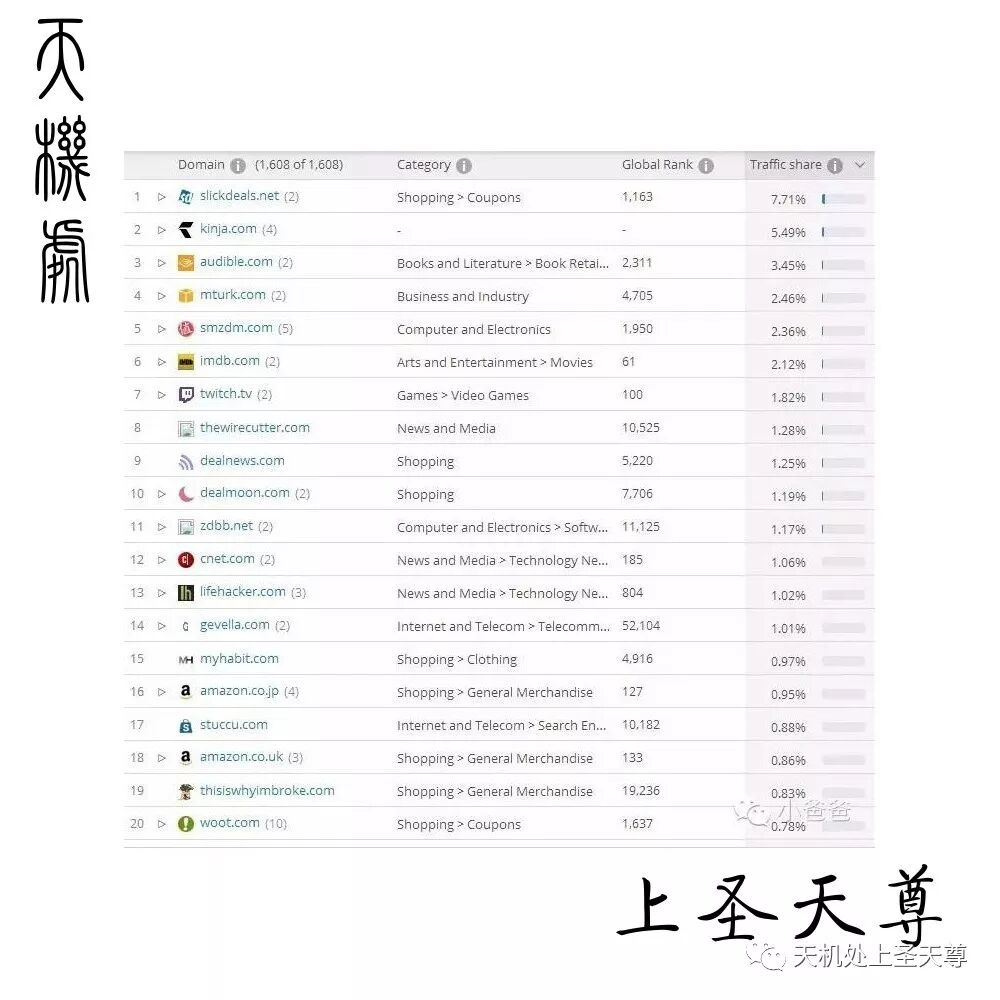

站外引流有哪些？

软文营销推广，Deals, EDM, 社交媒体，博客发帖，联盟，新闻媒体，送测，清仓等等

为什么要做亚马逊站外精准引流？有哪些好处？

站外精准引流，是提高自然流量和产品销量的强有力保障！它是提高品牌知名度，测试市场竞争度，反馈市场反响和客户痛点，也是积累review和Q&A最快速的方法，测试产品，清理库存和抢占市场等等

1.站外精准引流提高产品的页面访问量吸引更多的精准潜在客户；让产品有更多的曝光机会；

2.站外精准引流 提高了消费群体带来的自然好评；

3.站外精准引流降低了站内付费ppc付费成本；

4.站外精准提高了销量；

5.站外精准引流打造了品牌；

主旨思想

一、如何联系红人，借助他们的力量最快速有效宣传亚马逊店铺和产品，冲排名和突破流量和销量，最终达到提升好的品牌和知名度；

二、如何安全有效获取亚马逊VP review和自己做或教测评人做review，打破新品无好的review的僵局；

三、如何跟踪竞争对手比如成人用品在站外做了哪些推广，揭开为什么别人的listing一上就有流量和销量的魔咒

正文

一、如何借助站外deals网站销量推广如何借助站外deals网站对亚马逊进行销量推广促进排名；

DEAL 营销

Deal营销定义？什么是Deal营销？

Deal ： 促销 Promotion，利用亚马逊后台促销工具设置折扣码

即营销者向消费者传递有关产品的各种信息，说服或吸引消费者购买其产品，以达到扩大销售量的目的。

一. 如何借助站外deals网站销量推广

什么是deals网站？

聚集B2C零售网站打折信息帮助买家省钱的网站，促销网站折扣网站

为什么要做deals推广？

（1）清库存

（2）提升有效流量和转化率

（3）提升listing的排名

如何做deals推广

（1）发布deals贴必须知道的五件事情

（2）如何开拓deals网站

（3）如何发布deals

Deal促销的作用：

1，缩短产品入市进程，短期引流

2，激励客户初次/再次购买

3，提高销售业绩

4，提高知名度，带动相关产品

Deal促销的方式：

1，折扣码：Promo Code

2，绑定促销

3，特价

4，买一送一

都有哪些Deal站？

美国： slickdeals, kinjadeal, reddit

德国： mydealz, dealdoktor, mein-deal

英国： hotukdeals, vouchercodes

法国： dealabs

加拿大： redflagdeals

日本： kakaku

**英国DEALS 站点集合**

http://www.hotukdeals.com/

https://www.vouchercodes.co.uk/

https://www.myvouchercodes.co.uk/

http://www.honglingjin.co.uk/

http://www.studentmoneysaver.co.uk/

http://mightydeals.co.uk/

https://ashleighmoneysaver.co.uk/

http://www.discountvouchers.co.uk/

http://www.wowcher.co.uk/deals

http://www.kgbdeals.co.uk/

**德国DEALS 站点集合**

1.http://www.mydealz.de

2.http://www.dealabs.com

3.http://www.deal-fuchs.net

4.http://grosseangebote.de

5. http://scontodeal.de

6.http://www.gutscheine.de

7.http://www.9deals.de

8. http://www.nightdeal.com

9. http://www.dealzeit.ch

**加拿大站点**

http://redflagdeals.com

**法国**http://www.dealabs.com

**日本**http://racoupon.rakuten.co.jp/

http://ponpare.jp/

http://kakaku.com/

**俄罗斯**

**西班牙**

http://es.groupalia.com/

http://es.letsbonus.com

http://tringa.com

**波兰**

http://gruper.pl

http://www.godealla.pl

**丹麦**

http://www.downtown.dk/

http://www.sweetdeal.dk

**比利时**

http://www.outspot.be

**土耳其**

http://www.yakala.co

http://www.grupanya.com

**荷兰**

http://www.ibood.com

如何寻找deal站？

1，利用搜素引擎直接搜索

2，对同行或竞争对手网站或某产品搜索

3，利用工具搜索，如similarweb

1.亚马逊站外deals和coupon折扣网站销量推广

发布deals贴必须知道的五件事情

（1）店铺产品和资质的要求,如对feedback的要求 SD Fatwallet Hotukdeals>=1000 kinjia deals>=500 star>=4 如对review数量的要求 SD fakespot测试 C级别以上 review 要求 fatwallet >=10 kinja deals>=20 SD >=50

（2）价格的要求和打折的方式 coupon和？%off,对比同类型产品在deals上的价格 如dealplus只接受code hotukdeals只能接受直接降价

（3）库存的要求

3.1 跟踪竞争对手估算库存 3.2 询问发帖中介

（4）deals网站的要求

（5）发布时间的要求

5.1 时差  5.2 不同的时间对应amazon平台流量不一样

如何开拓deals网站

（1）similarweb/similarsite

（2）google 关键词（deals web/top ten deals web/where to post deals etc）                     参考网站：http://www.kiplinger.com/article/spending/T050-C000-S001-15-web-sites-for-finding-deals-online.html

（3）google或雅虎等搜索引擎跟踪竞争对手品牌+deals web（aukey deals web）

（1）Similarweb跟踪deals网站

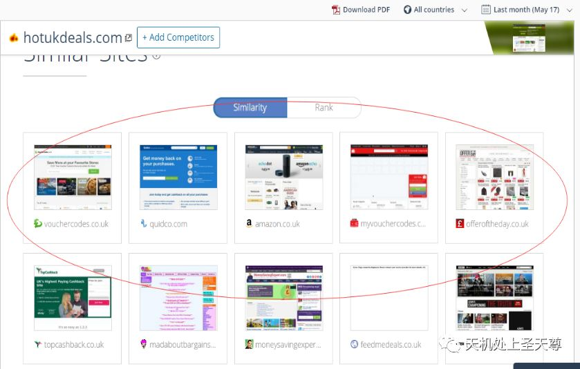

（2）google 关键词跟踪deals网站

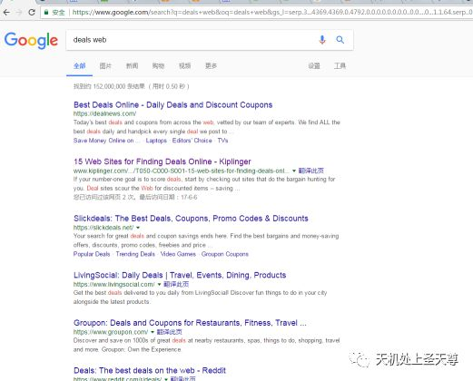

（3）google跟踪竞争对手deals网站

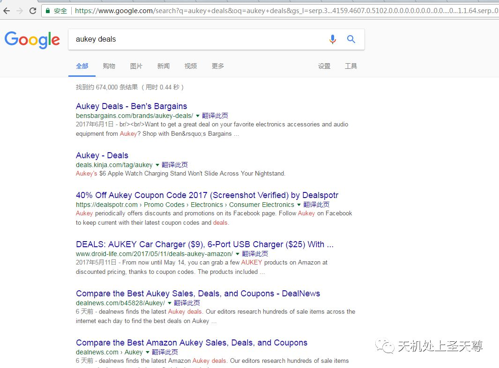

如何发布deals （**Ms.Tian提供分享来源**）

（1）自己发帖 http://www.wearesellers.com/article/10 http://www.wearesellers.com/article/11  http://www.wearesellers.com/article/12

（2）联系编辑或论坛管理人员发帖

SD提交入口 https://docs.google.com/forms/d/1zNXOoERP25gO8-e4QhV6Fr8DGDj3XCUE17ogjCcMqEc/viewform

Kinja 提交入口https://docs.google.com/forms/d/e/1FAIpQLSed6xJQRYvEcz9JehSvBCzNFxNL0jUfOf25zJ\_PdNBK6b5WdA/viewform?c=0&w=1

2.1 通过deals 网站 contact或advertising页面或deals网站Facebook上评论或私信联系

2.2 通过邮件联系

2.3 通过whatsapp skype 电话联系

（3）发布任务 任务网站:fivver ， digitalpoint，warriorforum

（4）联系中介发帖

（1）自己发帖：SD上自己注册账号发帖

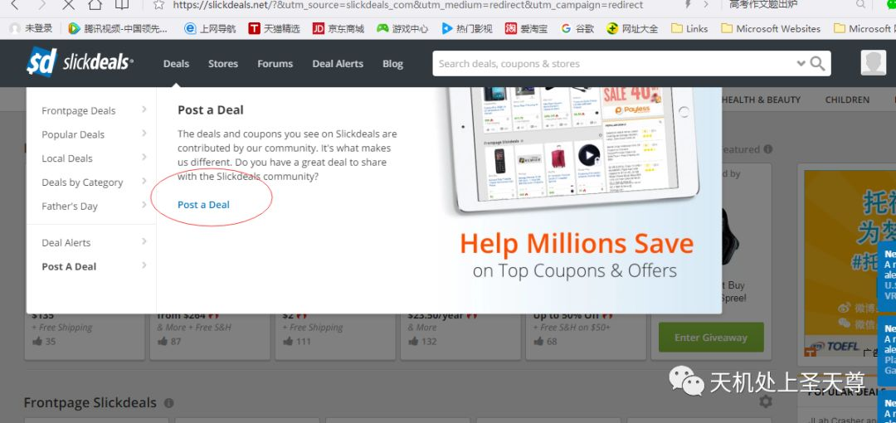

2.1.通过contact或advertising或Facebook

Dealnews点击advertising页面联系

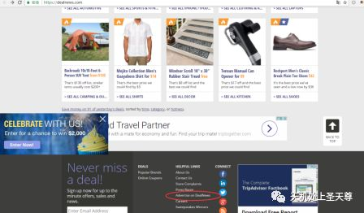

Dealnews advertising页面联系编辑

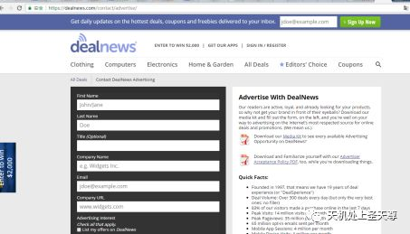

DiscountVouchers fb页面留言

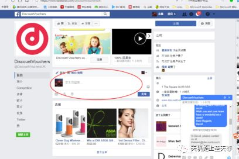

DiscountVouchers fb页面私信

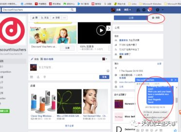

什么是Slickdeals？

Slickdeals简称SD，目前美国最大、最具、影响力的折扣信息分享交流平台。同时也是是AMAZON目前最直接引流的促销网站之一

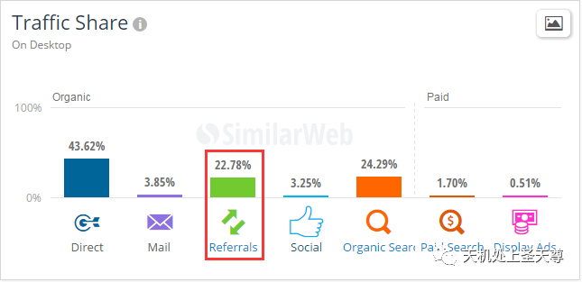

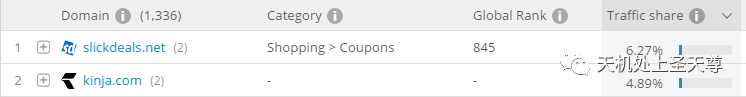

Slickdeals注意事项

满足条件：

1) 店铺Feedback > 1000

2) 单品Review > 50

3) 假评率<20% (fakespot)  后面取消了

关键：确保你的价格是Best Price

Or with Coupon Code

查询工具

http://camelcamelcamel.com/

http://slickdeals.net/newsearch.php

Slickdeals发帖方式：

联系SD的红人发帖

自已操作SD发帖

提交官方审核发帖

影响因素：

1，产品

2，Review

3，折扣力度

4，发帖人

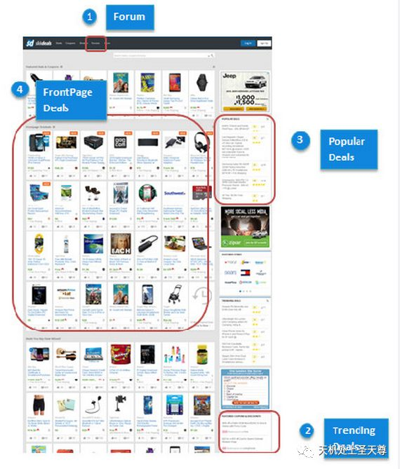

Eg. Tronsmart

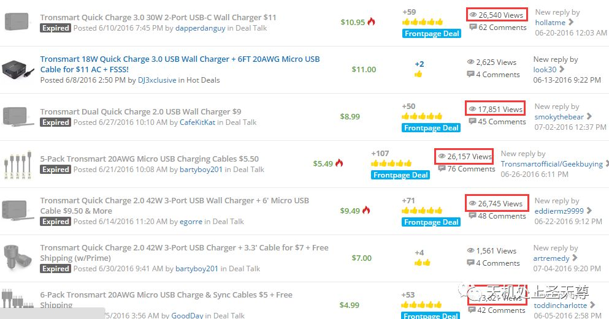

Eg. Deconovo

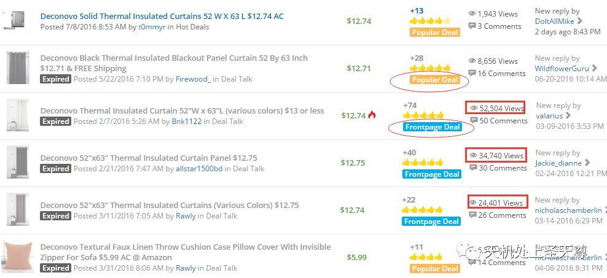

Kinjadeals

偏向品牌类、3C类、创新类产品

满足条件：

同类产品价格最低

Review多、好，容易上

比价工具

http://camelcamelcamel.com/

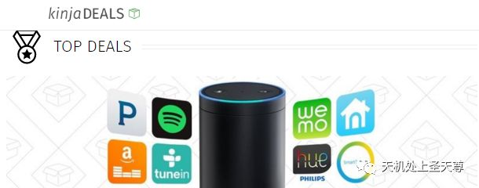

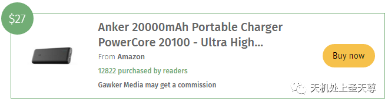

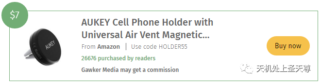

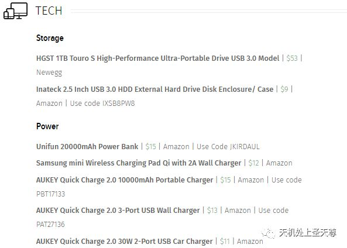

如何跟kinjadeals合作？

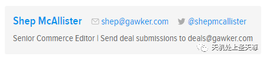

Coupon站

需入驻或加入联盟

Coupons.com

Grooupon.com

Livingsocial.com

可分享优惠码

Retailmenot

DealsPlus.com

Offers.com

Woot.com

Dealsea.com

Recommendations

顾小北的博客

http://www.guxiaobei.com/

创蓝论坛

http://bbs.ichuanglan.com/

2.2.通过邮件联系

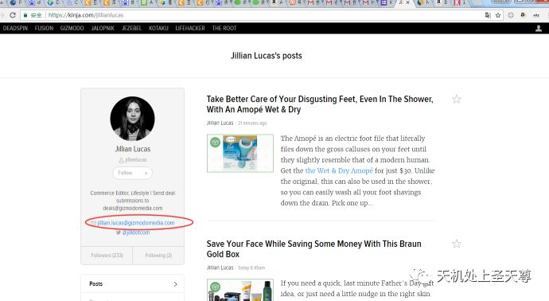

点击进入Kinja deals页面联系编辑人员并获取邮箱

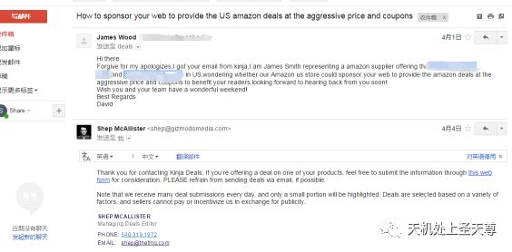

给kinjia deals编辑人员发送邮件

2.3.发布任务

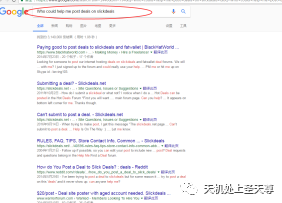

Google搜索到哪里发布deals

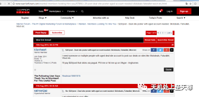

在网站上注册并发布任务

二、如何安全有效获取亚马逊VP review；

在Amazon上安全有效获取VP review的几种方式

2.1.什么是VP review Verified Purchase review

2.2. 为什么要做VP review

（1）提升listing的权重；

（2）说服买家；

2.3.怎么安全有效做VP review；

2.3.1.哪里寻找VP reviewer

（1）reviewer Facebook和wechat群组

（2）跟踪竞争对手review

（3）reviewer介绍

（4）交换reviewer

（5）其他方式

2.如何安全有效获取亚马逊VP review

2.3.2.如何和reviewer合作让他们安全自然下单（针对买家）

（1）：让买家不要给卖家账号review链接和做好的review链接

（2）:要求买家不要在同一店铺同时购买两个产品（除非产品具有互补性如锅和锅铲），如果确实看好此店铺，要在此店铺再下单，至少等第一个单到货留评之后一个月后再下单留评。

（3）：要求同一买家不要使用不同的亚马逊账号在同一个店铺下单，否则直接关联，无法留评。因为同一台电脑和网线还有信用卡等很容易被亚马逊判断为关联的因素。

（4）：要求买家注意留评节奏，一个礼拜最好控制在5个评价以内，多了账户异常导致亚马逊封买家账号不能留评，同时也不要天天去留评，可以一天留两个，同时隔三岔五留一个。同时控制留评的比例，不要买的产品100%留评，这样显得太不正常了。 (鉴于现在发现部分买家确实是一天好几个评价，一个月下来四五十个评价，这样风险太高了 这一点确实需要非常注意！！！所以亚马逊的卖家朋友送测前一定要求查看reviewer的profile。)

（5）：让买家尽量选择自己真的需要的产品，或者非常有兴趣的产品，不要任何东西都要，来者不拒，天天购物的异常行为也是不行的。买家不要把把留评当成给个人情，这样是不合理的，卖家要的是自然购买测评。

（6）：如果关键词有排名，应要求买家要通过关键词搜索到买家告知的相对应的价格和相应位置的产品，不要直接搜索asin或店铺名，如果关键词无排名，给买家店铺名和长尾关键词。买家下单前搜到这个产品前点击阅览三到5个产品，添加一个到购物车（不下单付款），不要怕麻烦，然后找到卖家要下单的产品，尽量停留时间比其他产品时间久点，加入购物车，再点击查看其他类似一两个产品，或此时添加一个到购物车（不下单付款），半个小时或24小时内下单卖家需要测评的产品。如下

6.1.搜索关键词查看同类型产品

6.2.浏览同类型的店铺产品3 到五个，添加一个到购物车（不下单付款），

6.3.找到卖家要下单的产品，尽量停留时间比其他产品时间久点，加入购物车

6.4.点击查看其他类似一两个产品，或此时添加一个到购物车（不下单付款）

6.5.半个小时或24小时内下单卖家需要测评的产品

2.3.2.如何和reviewer沟通让他们安全自然下单（针对卖家）

（1）：合作前先看对应买家的profile近期是否留评过多，其次不要直接发送产品链接，让买家通过关键词搜索。

（2）：根据自己产品的正常出单量来让买家留评。例如：不要一个礼拜100单，一个礼拜就有30个评价 ，一般留评率是20%

（3）：不要猴急地要求卖家收到货到后立刻留评，最好过个一个星期后再留评。

（4）：坚决杜绝让专业刷手多个虚拟IP和账号刷单，否则关联连一片！

（5）：关于review，不要求测评人留的review全部5星，可以来点4星，自然买家其实喜欢看的是改善建议啊！

（6）：为了防止恶意勒索和被亚马逊工作人员钓鱼，paypal账号邮箱千万别用自己或者朋友亚马逊注册邮箱，也别用注册邮箱去找reviewer做review，不要截取后台操作界面给测评人，paypal转账注意一定别填写与任何亚马逊注册地址相关联的转账地址，转账时候别填写地址，地址一栏注意勾选没有地址。

（7）尽量不要提前给买家付款再让买家购买，可以先让买家先购买在paypal转账或买家留评上线后再安排paypal转账，如果不能及时转账一定要及时说明原因，不要用giftcard给买家，以防账号关联。

2.4.如何催评（针对买家）

（1）：我建议大家最好是一个星期后，问他或她有没有收到产品，对产品满意不，有没有需要什么帮助，

Hi,\*\*sorry for my disturbing,do yout get our stuff?

他一般都会回复yes,I do然后你问他do you like it?

如果他不满意reviewer可能不回，但是一般都会回，yes,it is pretty nice,可能他们不好意思说产品不满意，因为免费得到的产品。

接下来你就问他Pls feel free to contact us if you have any questions,他们一般都会回复,Ofcourse，thank you so much类似的语句，

接下来你如果想和他或她聊点别的话题，你可以问他how is your days going,他们一般也回复good,and you?你可以回复，not bad,thank you之类的，

如果你想结束此次对话，你可以说have a nice day,去忙你的事，如果你想和reviwer建立朋友关系，

你可以继续和他聊，至于聊什么，你可以找一个切入点，比如他最近有什么烦心事，还是你有什么有趣的事都可以和他分享。

我之前和一个家庭主妇聊的切入点是他老公睡觉打鼾，聊的很开心，他每次给我review都是千字作文。

我说的这些是第一次接触，如果产品没问题，一般的review也不会及时做，需要你第二次和第三次催，但是有了第一次的基础，第二次和第三次就显得不那么唐突了

(2)和测评人先做朋友再让他们心甘情愿地留评论，在买家留评后不要以后不联系了，节假日给他或她发祝福，问一下对产品使用的怎么样，有什么需要帮助的，问候他家人和他或她过的好不好，有没有可以推荐的reviewer

2.5 如何自己做或教reviewer做测评

一个合格的review至少包含这样几点，

第一点是review对产品的概述；

第二点是对产品卖点的分析；

第三点是产品如何改善会更好；

第四点就是和总结该产品和其他产品的对比；

第五点虽然此篇review没反应出来；但是很重要的是:review可以写刚开始由于自己不知道怎么使用产品或产品出现了什么故障，导致自己不满意，卖家耐心及时解答自己的疑问和教自己如何更有趣地使用产品，我觉得这点也是很有必要写的。（举例说明）

三、Facebook和instagram和YouTube实操注意事项，如何为Facebook和instagram圈粉和如何找并和Facebook和YouTube和instagram合作;如何做Facebook付费广告

2.FB instagram YouTube品牌推广

1.什么是FB instagram YouTube

FB 全球最大的个人分享互动网站 instagram全球最大的图片分享网站

youtube全球最大的观看视频的网站

2.为什么要做ouTube instagram YouTube推广

（1）宣传产品（2）提升亚马逊listing流量和促进销量 (3)塑造品牌

3.Facebook和instagram如何安全操作

（1）使用Facebook和instagram前务必详细阅读规则和注意事项，避免掉坑

（2）Facebook要使用身份证原名和生日注册；

（3）Facebook和instagram注册后与手机号码绑定

（4）保持稳定不变的VPN线路,推荐使用VPS和阿里云或带翻墙的路由器

 (5)进入Facebook后前一个月一天加一到两个review群组和好友；Facebook公司page页面一次邀请5至十个好友followr；instagram一天点赞五到十张图片和四个小时间隔发一两张图片；Facebook一天发一个帖子；切勿频繁点赞和发帖

（6)facebook和instagram切勿发布敏感帖子和图片和tag敏感关键词和被封的主页

（7）Facebook和instagram发帖最好别带连接，instagram comment内容切勿重复

4.fb如何发帖才能获得更多的点赞和转发并圈粉

4.1 Facebook邀请好友follow公司的主页

4.2  Facebook和instagram giveaway活动

4.2.1 giveaway活动预热，节日或推新品前预热，预热贴一般是post帖子关于粉丝对新品或即将推广的产品的材质或颜色或使用方法等是否感兴趣，并及时在下方评论，比如有的粉丝对红色感兴趣，告诉他我们的giveaway活动即将开始，参与活动并有机会赢取礼品。

4.2.2 正式开始giveaway活动，一般要求参与活动者like我们的page主页和帖子，在下发评论tag # 三到五个好友，@公司页面，然后随机抽选获奖者

4.3 发布一些与产品相关的有趣小视频，fb上视频的覆盖率是最高的

4.4 设置有奖问答活动，发布一些与产品相关的有趣智力竞赛题

4.5 发布一些与产品相关的媒体文章，让fans更好地了解我们的产品

4.6 Facebook付费广告吸粉

4.7 Facebook相关群主或行业论坛post主页帖子或把我们帖子关联热点新闻

4.8 邀请产品相关领域的大咖转我们的Facebook和instagram贴

Facebook 如何圈粉

fb如何圈粉

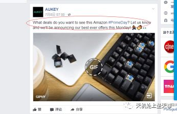

aukey prime day活动预热

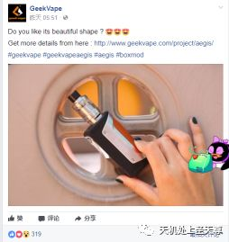

问粉丝对产品形状是否感兴趣

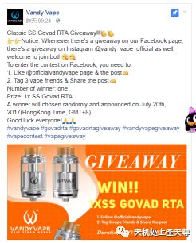

Fb和ins giveaway活动

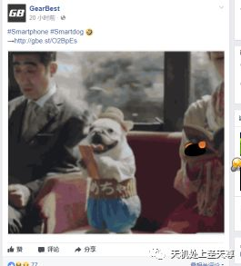

发布一些与产品相关的有趣小视频

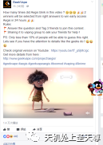

智力竞赛题

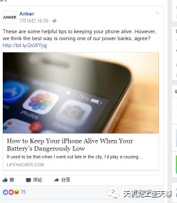

产品相关的媒体文章

5.instagram如何拍图才能获得更多的点赞

5.1多拍一些产品的凸显，大家可以把产品放到平面上，然后俯拍

5.2多拍一些商品被“用”时的照片。特别是针对衣服或首饰

5.3 原始的自然的但又浪漫有逼格和情调的风景最受欢迎

5.4 多和fans互动，让我们的fans分享他们的diy的视频或照片给我们，我们帮他们宣传推广，同时也可以说明我们产品很受欢迎；

如果我们是开餐厅的，不要只分享食物和每天的推荐菜，可以鼓励来用餐的客人分享他们最喜爱食物的照片。

如果我们是市场人员，可以分享一些客户以外的内容，例如分享你们团队与顾客参加活动并互动的图片。

5.5 巧妙的设计背景、灯光、摆设，为照片加入故事、生活的元素；利用图片编辑为产品添加简单的文字说明；保持产品原有的色彩，采用自然的灯光，避免添加过于强烈的效果

instagram如何拍图才能获得更多的点赞

1，凸显细节的近照

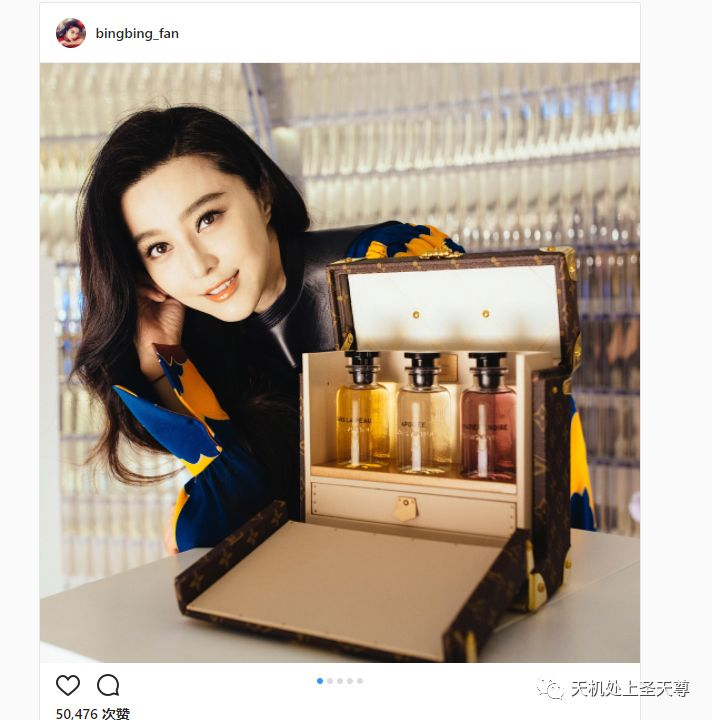

2，商品被“用”时的照片，服饰就是看模特上身效果

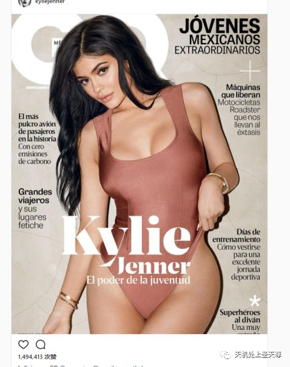

3，原始的大自然的照片

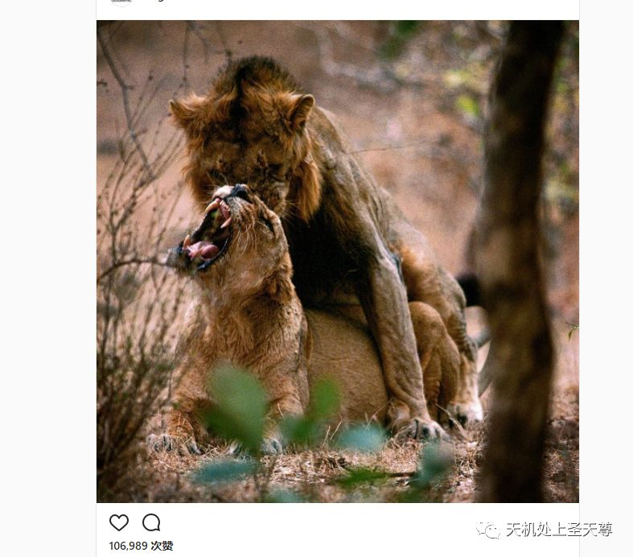

4，浪漫有逼格和情调的风景

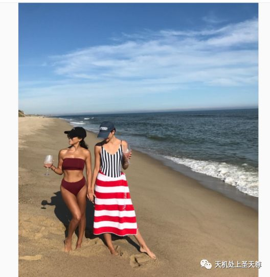

5，手工制作，diy视频

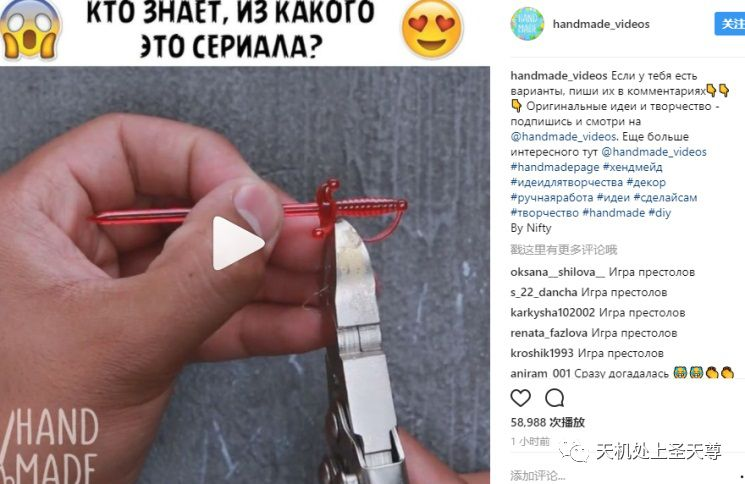

6，为照片加入故事、生活的元素

FB instagram youtube 联系达人推广

（1）为什么要作联系达人推广

 1.1 达人推广又名KOL（key opinion leader）营销推广，KOL推广借助国外行业内影响力的人起到最有效的宣传和推广的作用，同时避免了我们面对外贸推广所遇到的语言不地道导致的语言障碍，自己编辑发布推广没人关注的最根本的两个弊端。

 1.2虽然效果最为直观，但是如何和他们有效沟通，花最少的钱和时间达到最好的效果需要我们不但的实操和摸索。

（2）如何寻找并联系SNS红人

  2.1 Facebook或者Ins里搜索栏里输入产品关键字+review或竞争对手+review,擅于发现FB右下角推荐的相关产品的FB达人或Instagram推荐的相关好友

2.2 红人评判标准：个人认为粉丝5W以上每个帖子的点赞次数超过100次和分享超过50次，这个Facebook的页面算是比较有影响力的

2.3 sns达人红人页面帖子上留言或者留评论或私信

2.4 推广方式：review或giveaways

Facebook如何联系红人

1，Facebook里输入产品关键词

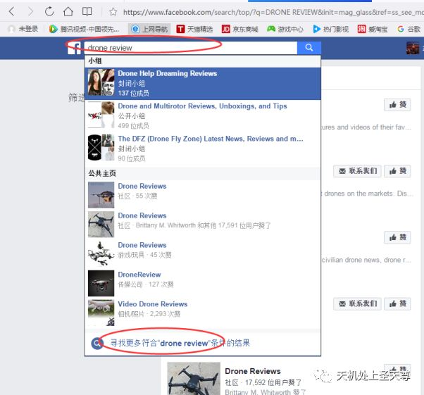

2，竞争对手+review

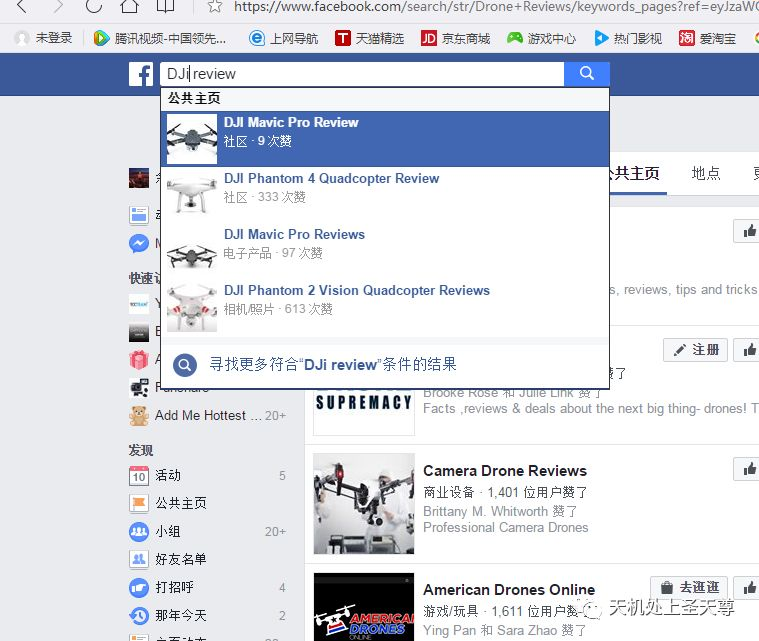

3，查找范围

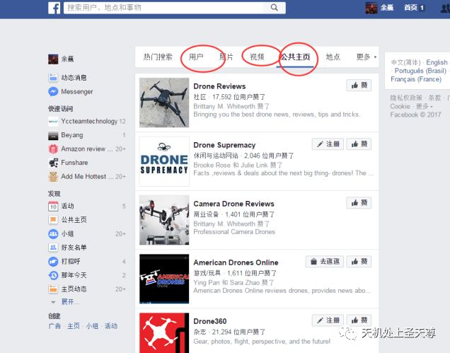

4，筛选达人

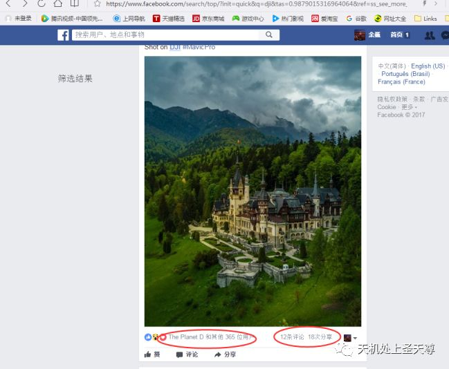

5，Facebook联系达人

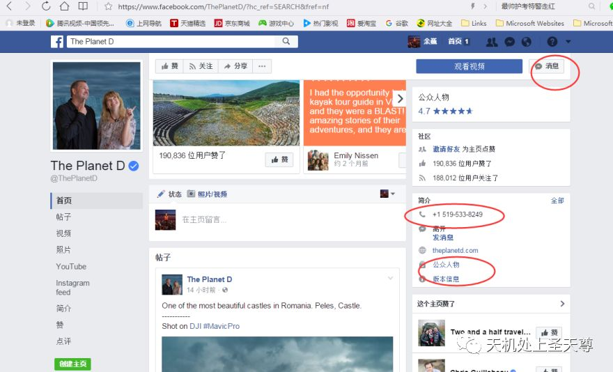

ins如何联系红人

1，ins里输入产品关键词即标签

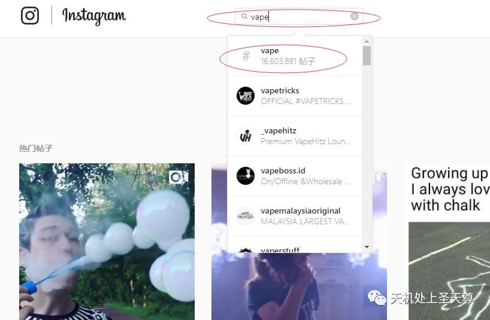

2，剔除竞争对手，寻找点赞最多的个人图片或视频

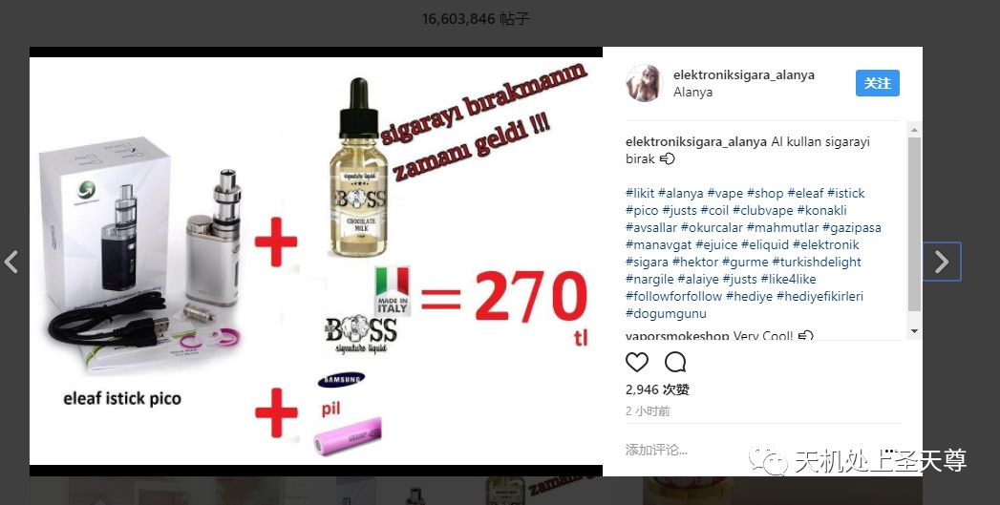

3，筛选达人

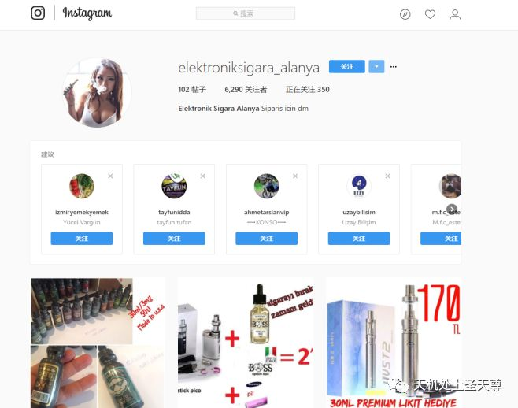

4，联系达人

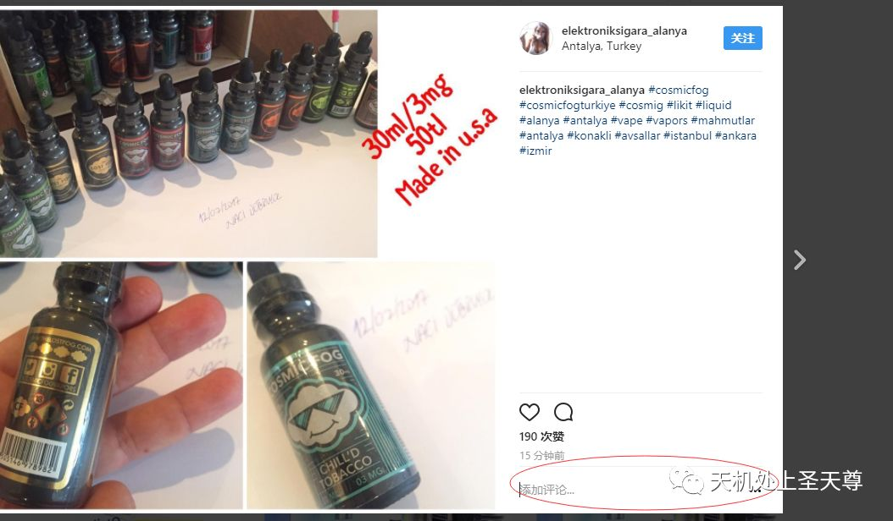

联系youtuber达人

（1）在google里或YouTube页面搜索栏输入相关产品的英语关键词product+review或竞争对手品牌+review；

（2）如何选择YouTuber

   2.1.根据发布产品的视频时间和区域选择合适的达人；

   2.2.达人推广的产品和最近发布的视频时间和达人的邮箱

   2.3.subscribes和views的标准

   不管是免费还是付费的红人的subscribes>10K，每个视频views不少于10K，  擅于发现youtube右侧推荐的相关产品的youtuber                                            （3）发邮件等联系沟通youtuber的技巧

  (4)送评的方式   4.1 给佣金youtuber 4.2 付费或者免费送产品

（5）youtuber推广方式

   5.1 unboxing review单独一个产品或

   5.2 featured review在多个产品中

   5.3 giveaways

四、如何找并和PR社交媒体网站编辑合作；

联系youtuber达人       google或YouTube页面搜索栏搜索

1，Google搜索关键词+review

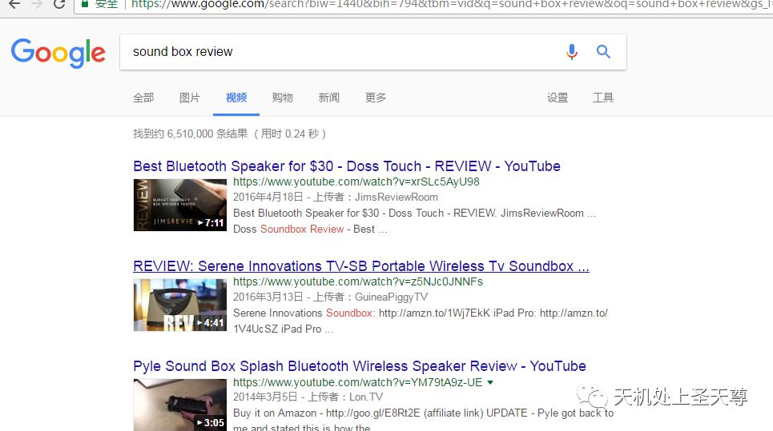

2，Google竞争对手+review

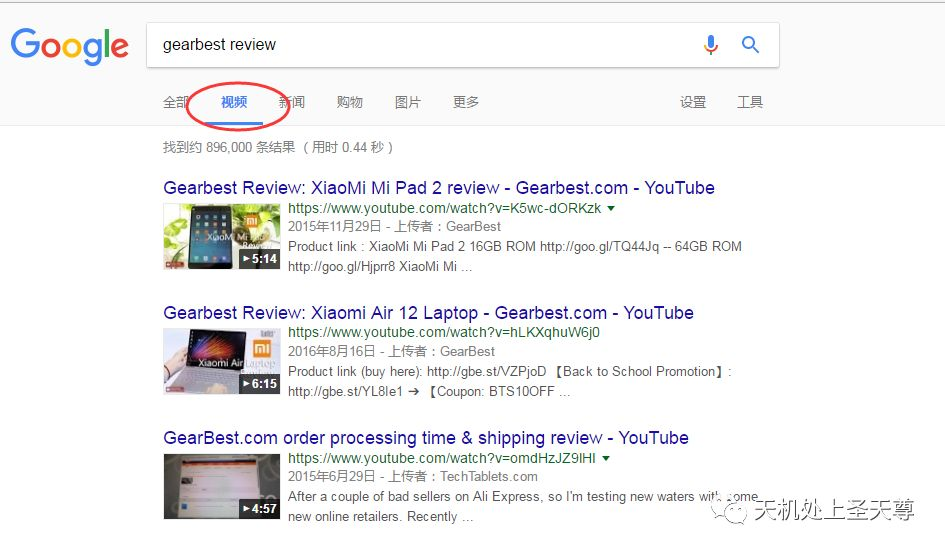

3，YouTube搜索关键词+review

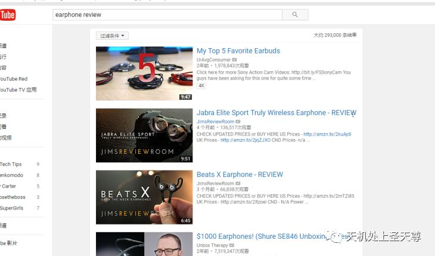

4，Youtube竞争对手+review

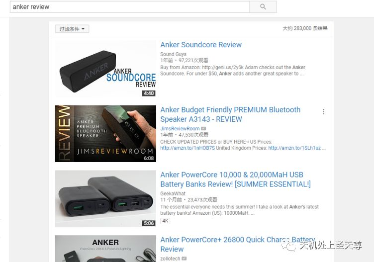

联系youtuber达人 如何选择YouTuber

1，选择产品拍摄时间

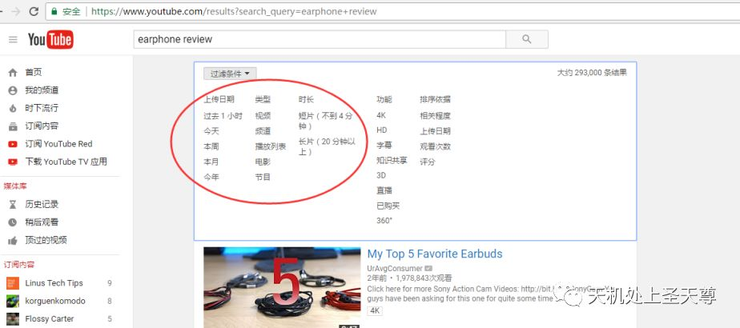

2，语言和面向的区域

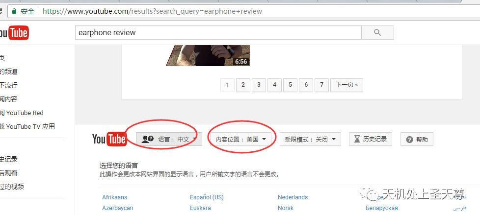

3，推广的产品和最近发布的视频时间

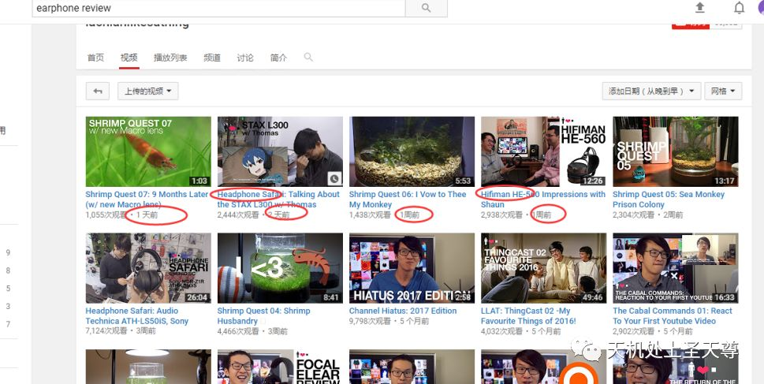

4，Youtuber的邮箱

联系youtuber达人 ，发邮件等联系沟通youtuber的技巧

1，

友善的称呼

2，

简单礼貌的自我介绍

3，

产品亮点的介绍

4，

真诚的邀请

联系youtuber达人 送评的方式和review方式

1，免费产品送并给佣金youtuber

2，免费产品送并付费给youtuber

3，在多个产品中feature review

4，一个产品giveaways

3.论坛联系reviewer推广

为什么要进行论坛推广？

（1）宣传产品，曝光品牌

（2）提升亚马逊listing流量和促进销量

如何借助论坛reviewer推广

(1)通过在谷歌输入关键词查找相关的论坛

(2)在用国外邮箱注册一个账户名

(3)在邮箱激活注册链接，进入论坛，查看论坛规则rules，在introduce一栏介绍自己

(4)在论坛里如何发帖才能不被删贴和如何找水军顶贴 举例说明

（5）如何在论坛找红人推广我们的产品

搜索栏里搜索产品相关的review或竞争对手品牌+review，找到相关的论坛链接，然后点击发布者的用户名，首先看他的profile里有没有留有Skype或者email，如果有就通过这些给他发测评请求，如果没有给他conversation或者PM（personal message)，但是记住没个PM间隔时间最好2个小时以上，且一天不要超过3个PM

五、论坛如何实操和找红人在论坛上推广产品

如何借助论坛reviewer推广：

1，

谷歌输入关键词查找相关的论坛

2，

用国外邮箱使用英文名字注册一个账户

3，

阅读论坛规则

4，

在论坛新手区介绍自己

5，

关键词+review搜到论坛reviewer

4.媒体网站品牌联系编辑推广

为什么要进行媒体网站品牌推广

（1）宣传产品，曝光品牌

（2）提升亚马逊listing流量和促进销量

如何联系媒体编辑给产品review

（1）谷歌搜索,关键词+review，竞争对手+review

（2）disqus留言，带上产品链接，但是一定要注意你留言一定要与这篇测评文章相关的产品，必须以第三者的身份推广，否则广告意图太明显，很容易被删除 或审核无法通过

（3）contact页面联系 cnet

（4）通过点击这些文章的发布者姓名查看到他们留有的邮箱来联系比如theverge、pcmag、digitaltrends.com、forbes等网站会留有邮箱和sns平台，

（5）通过sns平台比如Twitter和Facebook联系

如何联系媒体编辑给产品review

1，

谷歌输入关键词+review

2，

竞争对手+review

3，

disqus留言

4，

advertising页面联系

4，

邮箱联系编辑

六、如何如何从站外进去亚马逊的流量和如何跟踪竞争对手，寻找竞争对手在站外到底哪些地方做了推广

三.如何跟踪亚马逊站外精准引流

如何跟踪亚马逊站外精准引流

（1）自建站，通过亚马逊联盟跟踪站外流量

1.1 自建站

1.2 注册Amazon联盟

1.3 在亚马逊联盟上生成联盟链接

1.4 添加联盟链接到自己站产品锚文本

1.5 添加联盟链接到购买下单处

1.6 通过自建网站流量统计代码跟踪导入到亚马逊listing的路径和时间

Amazon联盟注册链接https://affiliate-program.amazon.com/ 参考网站 anker.com

（2）通过站外达人在视频或论坛上或编辑在文章中添加折扣码跟踪

1，

通过亚马逊联盟跟踪站外流量

2，

通过视频添加折扣码跟踪

七，总结：

推广有效的方法包括软文营销推广，EDM，联盟推广这三种。我们只要精通其中一种方法，就可以爆单。当然，我们可以在这基础上不断开创新的推广方法,对于站外推广，任何的自然的发布的有利于产品宣传和好评的方法都是可取的，谢谢大家!
