# Amazon平台产品优化提高销量

> Source: wechat
> Author: 天机跨境
> Original: https://mp.weixin.qq.com/s/0uBJ5TxOHLL4C-rJsFy6WA

---

---

客户搜索习惯

1.关键词搜索

2.分类节点浏览

3.排行浏览

4.关联推荐

5.搜索引擎及社会化媒体

客户搜索习惯—1.关键词搜索

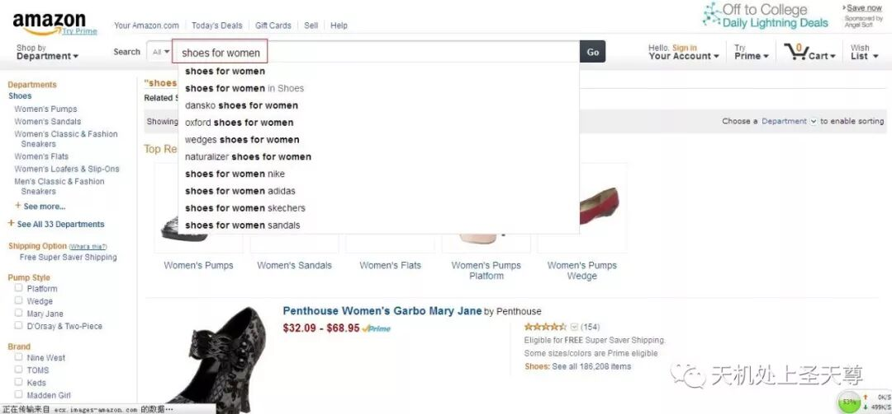

客户搜索习惯—2.分类节点

1.客户想购买一双女士的鞋子或者靴子

2.她会找鞋子，女士鞋子或直接找靴子

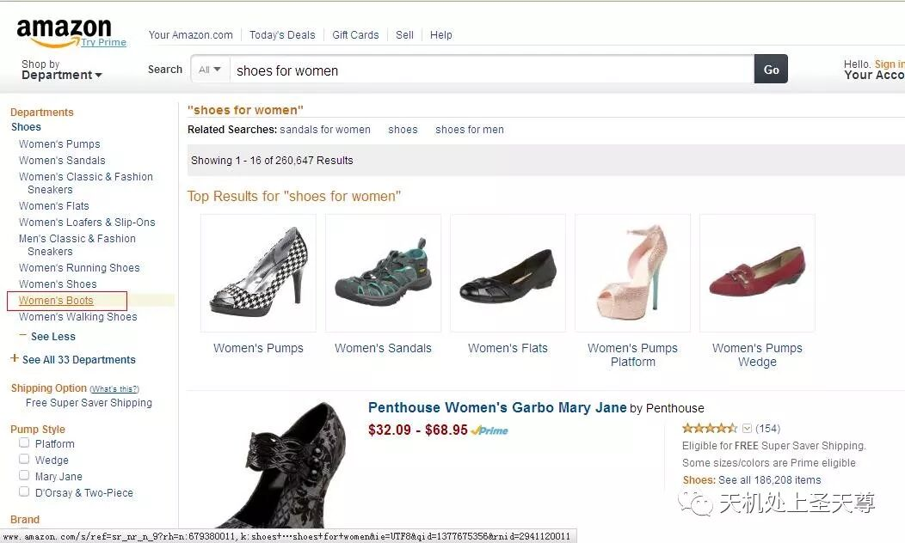

那么她进入靴子节点之后会进一步筛选雨靴

重要：选择细分的节点

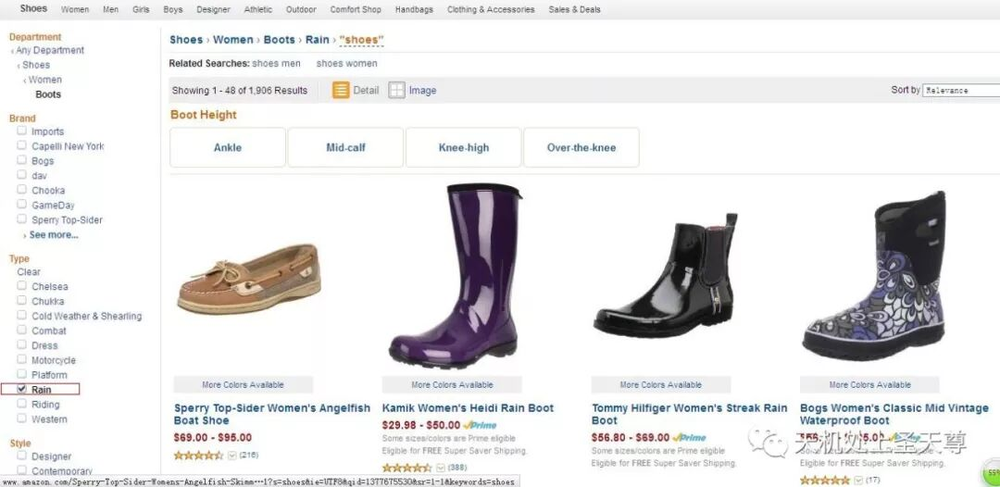

客户搜索习惯—3.浏览排行

根据以下几个排序

1.Bestselling

2.Relevance

3.Price

4.Review

5.New Arrivals

我们能做的：

1.创建准确的节点

2.尽可能降低产品售价

3.调整上架时间

4.使用原价和售价（凸显折扣）

5.丰富价格区间

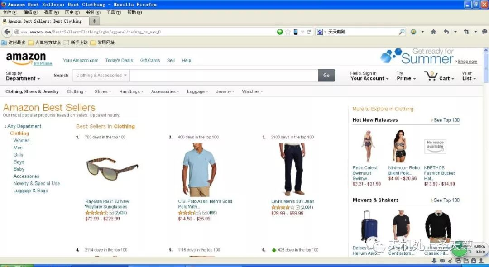

客户搜索习惯—4.关联推荐

首页位置的关联推荐

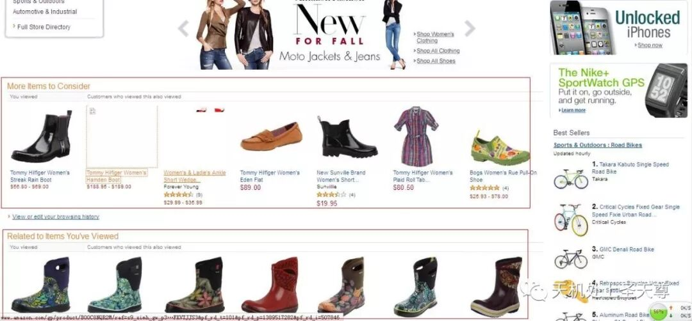

产品页面的关联推荐（看了又看，买了又买）

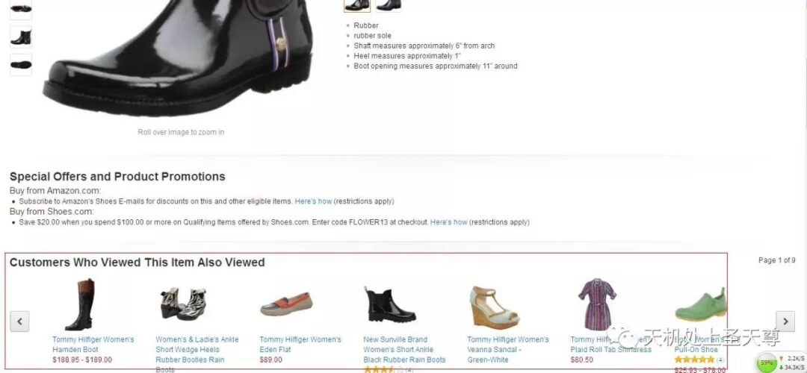

图表显示：销售额和商品数量是正相关的增长。Amazon自动交叉推荐功能能让庞大的商品数量交叉展示，进而获得巨大的曝光

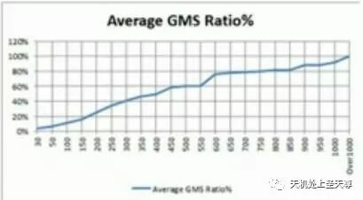

我们要做的：尽可能多的上传各种样式的产品,增加交叉展示的几率,提高产品曝光率，进而提高销量

客户搜索习惯—5.平台外， 站外，社交平台等

1.Google、Yahoo等搜索引擎

2.Facebook等SNS社会化媒体

3.购物分享类网站

4.其他媒体平台

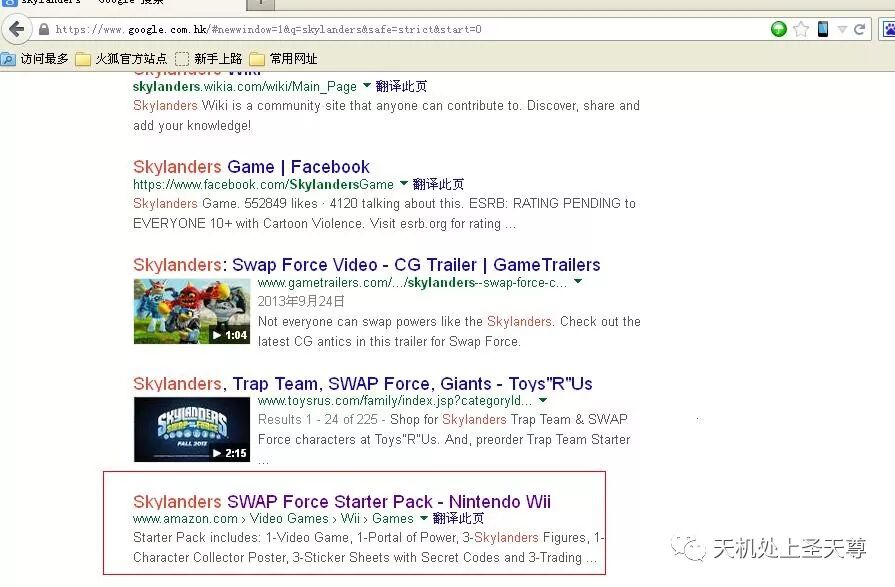

亚马逊排名规则

影响排名的主要因素

1. 产品的数据质量

   2.产品的销量

   3.关键词匹配

   4.用户行为（Feedback&Review、Q&A，点击量）

   5.运送速度（使用FBA发货优先）

   6.广告竞价，广告位，购物车

亚马逊排名规则-用户行为

用户行为通过优化买家评价体系，提高用户行为得分

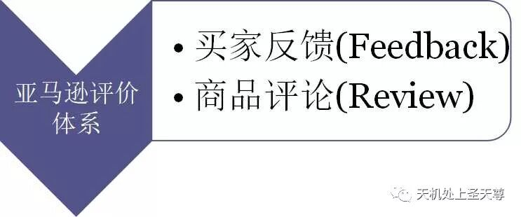

亚马逊排名规则-Reviews&Feedback

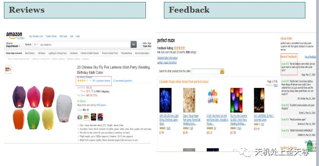

亚马逊排名规则-用户行为

Feedback

及时索要Feedback（发货时附带卡片）

出现差评,及时与客户沟通删除(90天可留,60天可删)

客户沟通无果,可向Amazon申述

遇到无法删除的差评：我们可以点击Respond,写解释来降低对我们影响

Review

找国外达人帮忙自己刷Review（推荐）

注意：注意同一设备和网络环境不要刷太多次

商品页面优化

商品品页面的元素

商品标题

商品关键词

商品图片

其他商品描述、特征

商品页面优化-商品标题

商品标题

品牌

产品系列

材质或成分

颜色

大小

数量

商品页面优化-商品标题

商品标题Do

.使用详尽言简意赅的标题(不要超过150个字节)

2.与商品高度相关3.使用合理的替代词

4.符合逻辑顺序

5.首字母大写除了介词和连词

6.如果是打包卖的。在Title上说明（pack of X）

7.用数字代替（2代替two）

商品页面优化-关键词

查看 -- 亚马逊关键词搜索工具（史上最全的）

关键字定义及注意

什么是关键词:为买家产品的搜索匹配提供帮助

关键词包括:产品属性信息、从另一角度描述产品

我们应该设置丰富、热门、匹配的关键词

注意:不要出现对手品牌、误导性的词

不要出现其他属性出现过的

注意单词的拼写

商品页面优化-关键词

关键字获取亚马逊及其他B2C平台搜索框站外关键词工具（google adwards）

商品页面优化-关键词（魔词,SEO STOACK）

商品页面优化-商品图片

商品图片

清晰尽量使用白底

无水印无LOGO

减少四周留白

主图使用模特展示

优化细节

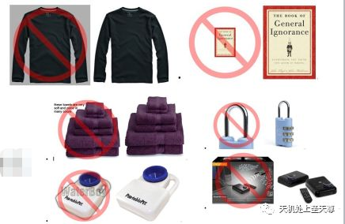

其他优化细节

创建变种产品

创建促销（需是Featured Merchants）

创建跟卖

索取好评

创建CPC广告

商品页面优化-其他优化细节

跟卖产品 Featured Merchants、新卖家New、二手used

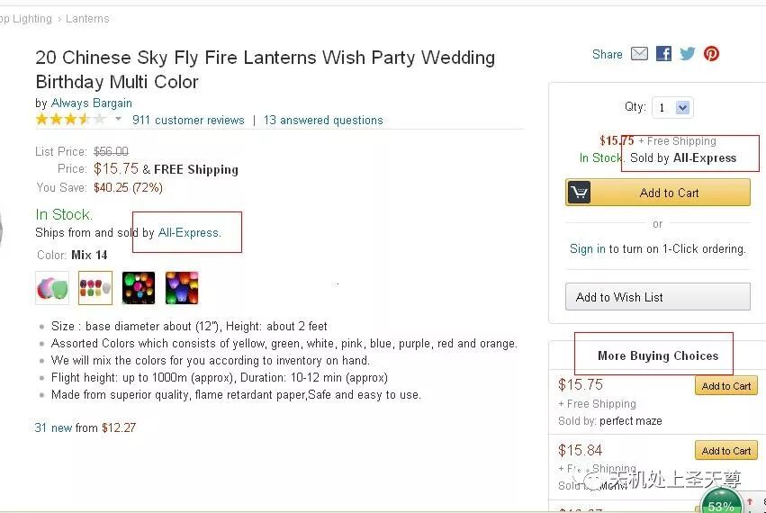

赢得Buy Box的要素

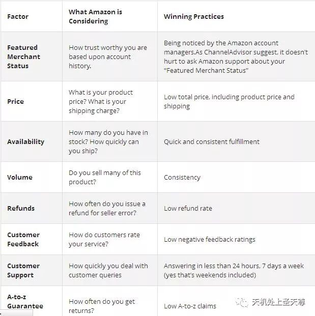

成为Featured Merchants

    Order Defect Rate (this is based on feedback, claims and chargebacks)

    Performance metrics

    Customer service quality (including shipping speed, pricing, fulfillment options, etc.)

    Length of time on Amazon

获得好评的途径

1.可以找朋友刷

     2.可以电话或者短信找客户索取

3.发货包装中夹入卡片发货的包装中可以放置一张卡片，卡片上留上你的Email,写上如果客户给你好的评价。可以让他把订单编号和好评内容发到你的Email。这样他可以得到你Email返还的1美金Giftcard

Amazon CPC广告Clothing & Accessories\*、Jewelry\*这些分类做不了这个没有购物车的产品，做了无法展示二手产品和成人的产品无法做

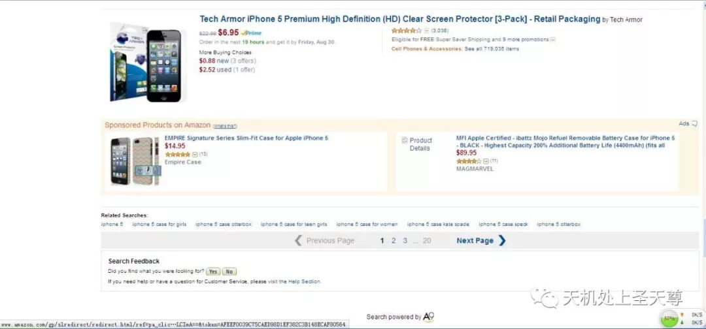

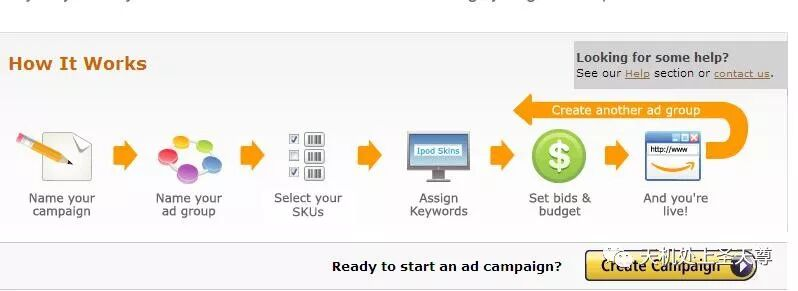

视频教程

http://services.amazon.com/services/sponsored-products-events-tutorials.htm?ld=emspnewsdec2013AS

Amazon CPC广告1.设置的bids最低0.02美金推荐是0.05美金2.每个分类的bids可以通过seller centrl help查询

Amazon CPC广告　　CPC：单次点击消耗费用，当然是越低越好。

　　CTR：点击率，越高越好。

　　质量得分："质量得分"是评估您的关键字质量以及决定您的最低出价的基础。

　　·相关因素：CTR、广告文字相关性、关键字效果的历史记录等因素组成。

　　·质量得分越高，CPC越低。

## A9 核心算法

1 转化率: review, 图片质量，价格

2 相关性：Listing 内容

3 消费者满意度：Feedback, ODR

提醒: 亚马逊会预测你的转化率，然后会根据你的真实转化率来修正。如果你的价格普遍高于类似产品价格，亚马逊会预测转化率较低，然后会根据你的真实转化率来修正。

**影响排名的因素：转化率，相关性，客户满意度。**

## 转化率方面：

     1 Sales Rank，换而言之就是一定周期以内的销量。

  2   客户 Review, 在**达到一定数量**之后，Review 评分比数量更重要，一个 1000reviews 的评分为 4.7 分，很有可能排名超过 2000 个reviews 但是评分只有 4.0 的。且只有 verified reviews 有效。

3 产品问答

4 图片大小和质量，图片最小 1000\*1000，低于的 suppressed listings, 图片数量不是

5 价格，低价格在其他因素类似情况下，更容易获得较好排名

6 捆绑产品：最大化reviews,用户体验更好，亚马逊更喜欢多选项的listing

    7 页面停留时间和跳出率：是否有停留时间看描述，review, 问答。（同样说明了我们为什么要做好描述，review,和问答）（跳出率：返回之前的页面，点击相关产品）

   8 Listing 完整性，listing 信息的完整影响转化和相关性。

9 点击消费率 CTS（Click to Sales），谷歌的一个重要排名指标是 CTR（点击率），亚马逊将这个指标变成了 CTS。打比方：在展示结果里面，A 产品的排在第九位，B 产品排在第十位， 但是 B 产品的点击率更高，对于谷歌来说，就会把 B 产品排名 A 产品之前，而亚马逊则会看点击过去之后的 sales，也就是 CTS，如果 A 产品购买的比例更高，亚马逊还是会把 A 产品排在前面。

## 相关性方面：

9 标题 标题是客户最直观的感受，也是相关性方面权重最高的部分

10 features, bullet points. 不用关键词堆砌，提供有用，完整，Keyword rich 的 features

11 描述 同上。

12 品牌，生产商。标题里面包含品牌的 listing,亚马逊给以更高的权重。

13 参数 详细的参数可帮助亚马逊做出相关性判断，权重相比其他内容较低。

14 分类和子分类 客户有可能选择类目搜索；分类可以帮助亚马逊更清楚你的产品是什么

15 search terms 每个最多 50 个字符尽可能多使用，不重复，关键词变体是无意义的（dress 和 dresses）,使用同义词或者拼写变体是有用的（sun screen 和 sunscreen）

16 source keyword, 其他亚马逊客户搜索你这个 listing 时用到的关键词，可在链接上加搜索跟踪符号来利用

## 消费者满意度方面：

17 负面卖家 feedback, 亚马逊不管你的 positive feedback，他们在意的是负面 feedback 的比率。

18 订单处理速度，订单退款比例，订单取消率（未确认）

19 完美订单比例（POP）,完美订单的意思：从点击购物车到妥投。高 POP 意味着高库存率， 准确的 listing 和可信赖的物流

20 ODR，ODR 基本就是 POP 的另一个极端：负面feedback, A to Z, 物流问题，信用卡退款。必须在 1%以下，客户移除的 feedback 不计算在 ODR。

21 离开率（exit rate）看完你的 listing 然后离开亚马逊的比例。如果你的离开率高于平均值，亚马逊会认为是一个低质量的 listing

22 包装选项，（也有可能不是排名因素）不过亚马逊发现比较多的用户开始注重包装，这一点即使列入算法，权重也应该比较低。

总结：

1 最大化 PRC (Revenue Per Customer)

2 关注转化率，相关性，和客户满意度

3 完善你的 listing

4 用 FBA

5 鼓励用户留review, 并尽量让他们满意

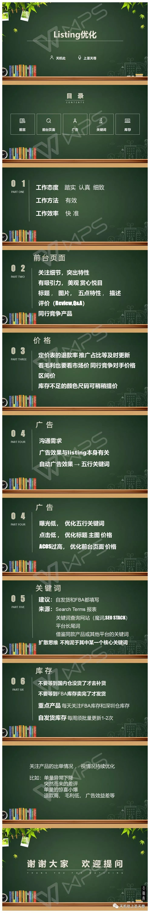
