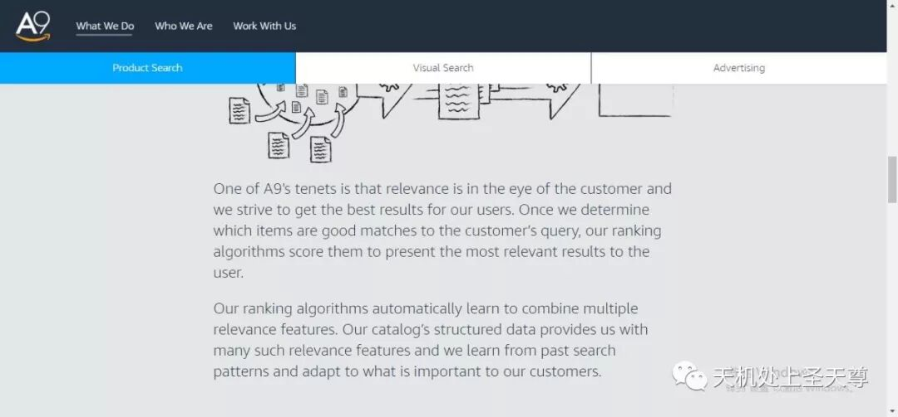
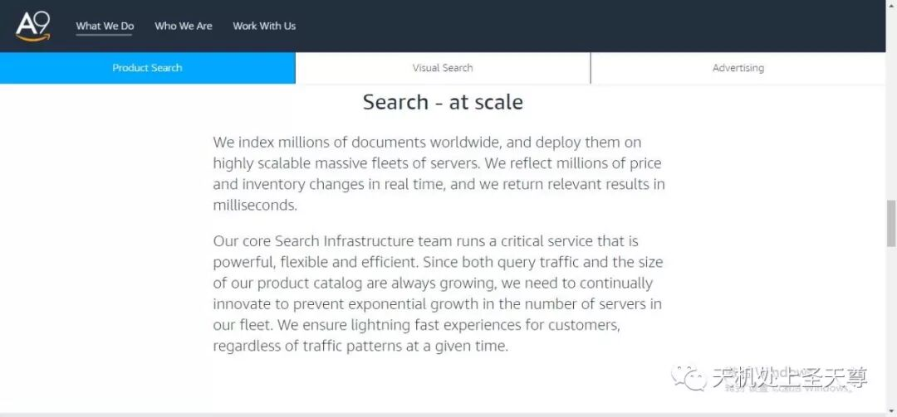
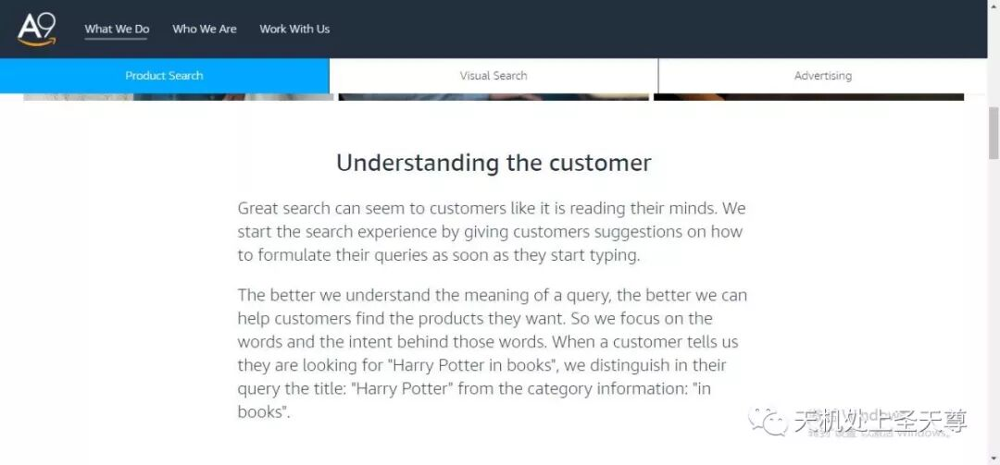
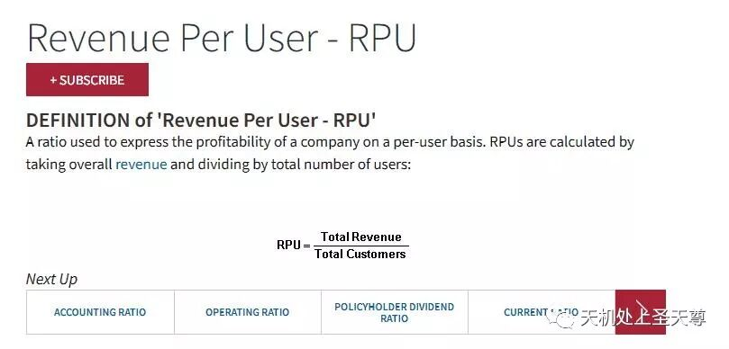

# Amazon SEO A9核心算法

> Source: wechat
> Author: 天机跨境
> Original: https://mp.weixin.qq.com/s/wNEPUT5sofQo1k5Zqb94tA

---

---

## Amazon SEO A9算法讲解

天机学院

特别说明，本篇由 Amazon 品牌运营部 Steven 整理分享

亚马逊的排名算法名为 A9，详细地址：https://www.a9.com/what-we-do/product-search.html

One of A9's tenets is that relevance is in the eye of the customer and we strive to get the best results for our users. Once we determine which items are good matches to the customer’s query, our ranking algorithms score them to present the most relevant results to the user.

Our ranking algorithms automatically learn to combine multiple relevance features. Our catalog’s structured data provides us with many such relevance features and we learn from past search patterns and adapt to what is important to our customers.

以下是中文翻译

A9的原则之一是相关性在客户眼中，我们努力为用户获得最佳结果。一旦我们确定哪些项目与客户的查询匹配良好，我们的排名算法就会对它们进行评分，以向用户呈现最相关的结果。

我们的排名算法自动学习结合多个相关性功能。我们的产品目录的结构化数据为我们提供了许多这样的相关功能，并且我们从过去的搜索模式中学习并适应对客户重要的事情。

我们越理解查询的含义越好，我们可以帮助客户找到他们想要的产品。所以我们专注于这些词语背后的词语和意图。当客户告诉我们他们正在寻找“书中的哈利波特”时，我们在他们的查询中将“哈利波特”的标题与类别信息区分开来：“书中”。

正文

........................................................我是分割线.......................................................................

## A9 核心算法解析

1，转化率: review, 图片质量，价格

2，相关性：Listing 内容

3，消费者满意度：Feedback, ODR

4，总结

提醒: 亚马逊会预测你的转化率，然后会根据你的真实转化率来修正。如果你的价格普遍高于类似产品价格，亚马逊会预测转化率较低，然后会根据你的真实转化率来修正。

影响排名的因素：转化率，相关性，客户满意度。

## 一，转化率方面：

1, Sales Rank，换而言之就是一定周期以内的销量。

2, 客户 Review, 在达到一定数量之后，Review 评分比数量更重要，一个 1000reviews 的评分为 4.7 分，很有可能排名超过 2000 个reviews 但是评分只有 4.0 的。且只有 verified reviews 有效。

3, 产品问答Q&A

4, Listing 完整性，listing 信息的完整影响转化和相关性。图片大小和质量，图片最小 1000\*1000，低于的 suppressed listings, 图片数量不是

5, 价格，低价格在其他因素类似情况下，更容易获得较好排名

6, 捆绑产品：最大化reviews,用户体验更好，亚马逊更喜欢多选项的listing,变体更多的

7, 页面停留时间和跳出率：是否有停留时间看描述，review, 问答。（同样说明了我们为什么要做好描述，review,和问答）（跳出率：返回之前的页面，点击相关产品）

8, 点击消费率 CTS（Click to Sales），谷歌的一个重要排名指标是 CTR（点击率），亚马逊将这个指标变成了 CTS。打比方：在展示结果里面，A 产品的排在第九位，B 产品排在第十位， 但是 B 产品的点击率更高，对于谷歌来说，就会把 B 产品排名 A 产品之前，而亚马逊则会看点击过去之后的 sales，也就是 CTS，如果 A 产品购买的比例更高，亚马逊还是会把 A 产品排在前面。

## 二，相关性方面：

9, 标题 标题是客户最直观的感受，也是相关性方面权重最高的部分

10,  features, bullet points. 不用关键词堆砌，提供有用，完整，Keyword rich 的 features

11, 描述和后台五行，search terms也是一样， 同上。

12, 品牌，生产商。标题里面包含品牌的 listing,亚马逊给以更高的权重。

13, 参数 详细的参数可帮助亚马逊做出相关性判断，权重相比其他内容较低。

14, 分类和子分类 客户有可能选择类目搜索；分类可以帮助亚马逊更清楚你的产品是什么

15, search terms 每个最多 50 个字符尽可能多使用，不重复，关键词变体是无意义的（dress 和 dresses）,使用同义词或者拼写变体是有用的（sun screen 和 sunscreen）

16, source keyword, 其他亚马逊客户搜索你这个 listing 时用到的关键词，可在链接上加搜索跟踪符号来利用

## 三，消费者满意度方面：

17, 负面卖家 feedback, 亚马逊不管你的 positive feedback，他们在意的是负面 feedback 的比率。

18, 订单处理速度，订单退款比例，订单取消率（未确认）

19, 完美订单比例（POP）,完美订单的意思：从点击购物车到妥投。高 POP 意味着高库存率， 准确的 listing 和可信赖的物流

20, ODR，ODR 基本就是 POP 的另一个极端：负面feedback, A to Z, 物流问题，信用卡退款。必须在 1%以下，客户移除的 feedback 不计算在 ODR。

21, 离开率（exit rate）看完你的 listing 然后离开亚马逊的比例。如果你的离开率高于平均值，亚马逊会认为是一个低质量的 listing

22, 包装选项，（也有可能不是排名因素）不过亚马逊发现比较多的用户开始注重包装，这一点即使列入算法，权重也应该比较低。

## 四，总结：

1, 最大化 PRC (Revenue Per Customer)每一个客户的收益

2, 关注转化率，相关性，和客户满意度

3, 完善你的 listing，图片和描述都要做的非常好

4, 用 FBA，获取buy box,也是一种营销手段

5, 鼓励用户留review, 并尽量让他们满意   ‘

6, 重视客户体验，邮件信息及时回复，其次包装也要好，物流运输快等等

本文由百晓堂商学院授权出品，如需了解更多，请联系我们！
