# 亚马逊最新规则揭秘

> Source: wechat
> Author: 天机跨境
> Original: https://mp.weixin.qq.com/s/aZ39WInR7htAcyfPB2YlzQ

---

---

亚马逊最新规则揭秘

1. 市场预判

2. 后台广告页面的更新

3. FBA调整

4. 佣金调整

5. 搜索规则A9算法讲解

6. 总结

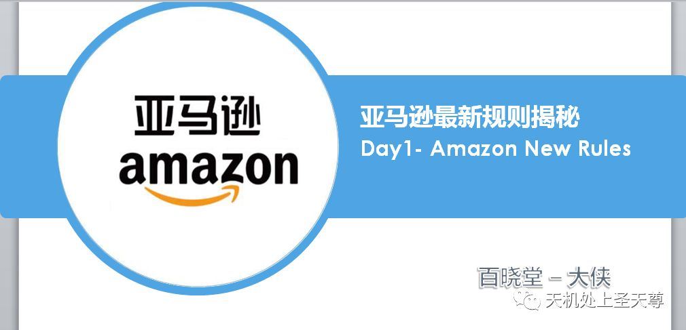

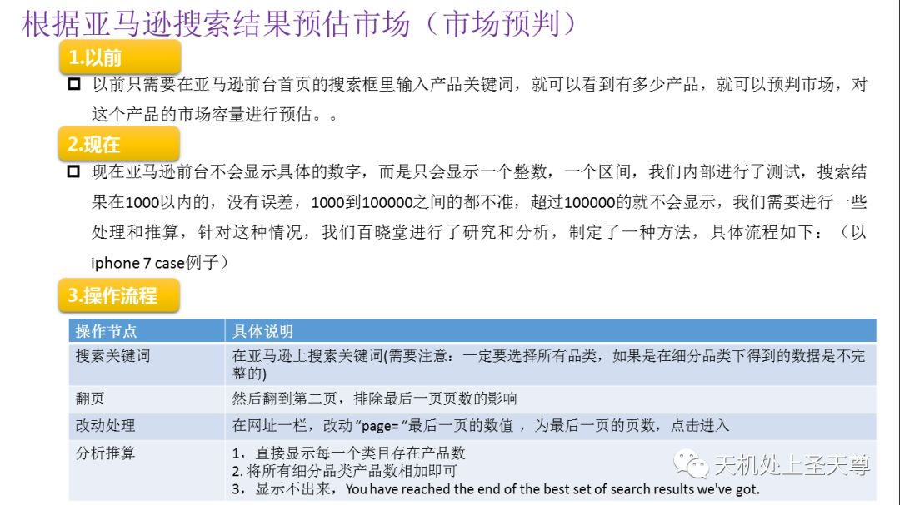

清除上网痕迹（清除cookie），最好用干净的或刚刚下载的浏览器试！

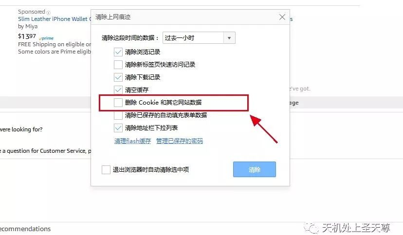

## 一，市场预判

以前只需要在亚马逊前台首页的搜索框里输入产品关键词，就可以看到有多少产品，就可以预判市场，对这个产品的市场容量进行预估。但是，

现在亚马逊前台不会显示具体的数字，而是只会显示一个整数，一个区间，我们内部进行了测试，搜索结果在1000以内的，没有误差，1000到100000之间的都不准，超过100000的就不会显示，我们需要进行一些处理和推算，针对这种情况，我们百晓堂进行研究和分析，制定了一种方法可以查到，这个关键词在亚马逊上搜索的量，具体如下：（以bath booms为例子）

(需要注意：一定要选择所有品类，如果是在细分品类下得到的数据是不完整的)

我们在亚马逊上搜索bath booms,显示16页10000个搜索量，其实是不准确的，我们需要翻到第二页，在网址一栏，改动；两个地方：第一个地方是/ref=sr\_pg\_2，改成最后页数，一般是20页，第二个地方是“page= ”最后一页的数值  ，为最后一页的页数，点击进入，得到市场预估值为 18934

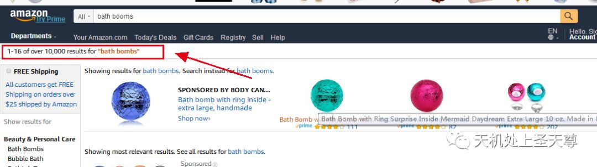

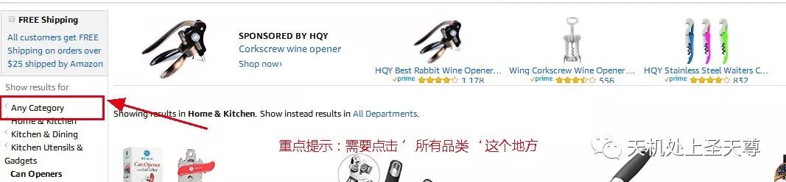

https://www.amazon.com/s/ref=sr\_pg\_2?sf=col&fst=p90x%3A1&rh=i%3Aaps%2Ck%3Abath+bombs&page=2&keywords=bath+bombs&ie=UTF8&qid=1522216753

## ----- 改动细节，对比 -----

https://www.amazon.com/s/ref=sr\_pg\_20?sf=col&fst=p90x%3A1&rh=i%3Aaps%2Ck%3Abath+bombs&page=20&keywords=bath+bombs&ie=UTF8&qid=1522216753

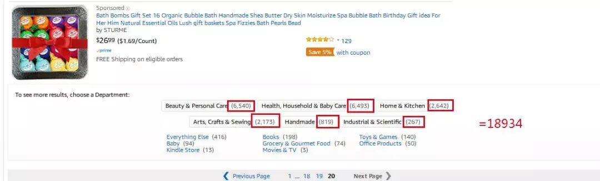

第二个案例，以can opener为例，以前市场容量为 30000多

现在预估市场容量在31268左右！

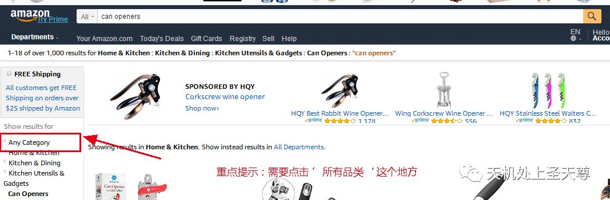

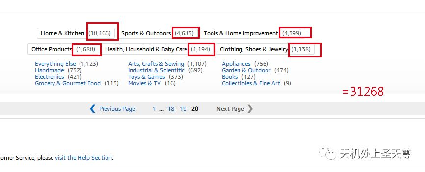

我们再换一个产品关键词试试，iPhone 7 case，现在市场容量大概在149461左右可以看到.

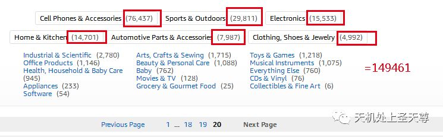

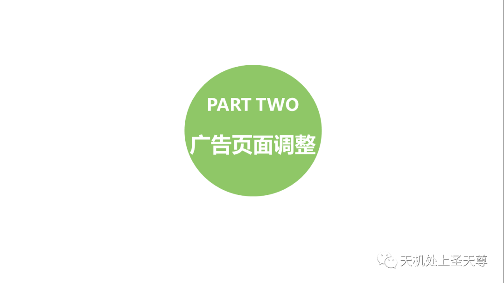

## 二，广告页面调整

亚马逊后台广告页面的调整如下：（请注意以下更新的报告增强功能）

站内广告数据每一小时更新一次，数据不会延迟超过12小时。以前，数据每4-8小时更新一次，48-72小时旧数据随每个度量标准而变化。

站内广告数据不包括取消的订单。

站内广告报告现在在搜索字词和购买产品报告的最近60天内具有自定义日期范围，而产品，关键字和展示位置报告具有90天而非固定的60或90天期间。

头条广告关键字报告现在在关键字报告的最近90天内具有自定义日期范围。

头条广告现在有一个账户级别报告，用于分解每个广告系列中每个关键字的表现。

批量操作下载现在将包含销售数据以及没有点击和展示的关键词

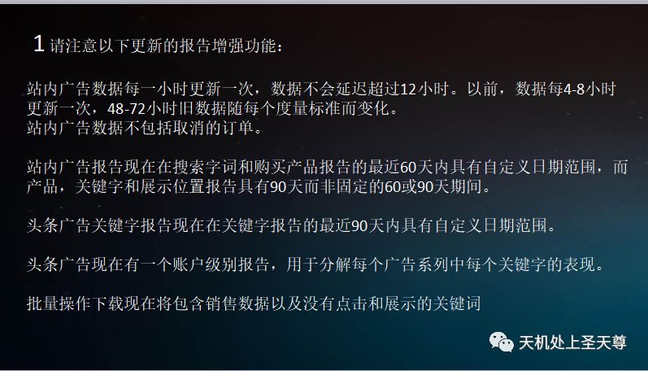

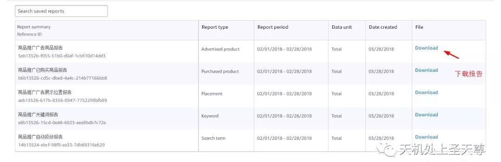

## 广告基础知识讲解：

## 1，报告类型--

报告类型                               报告名称

搜索词                                   商品推广自动投放报告

关键字                                   商品推广关键词报告

已推广的商品                       商品推广广告商品报告

位置                                       商品推广广告展示位置报告

已购买商品                           商品推广已购买商品报告

2，详细解释--

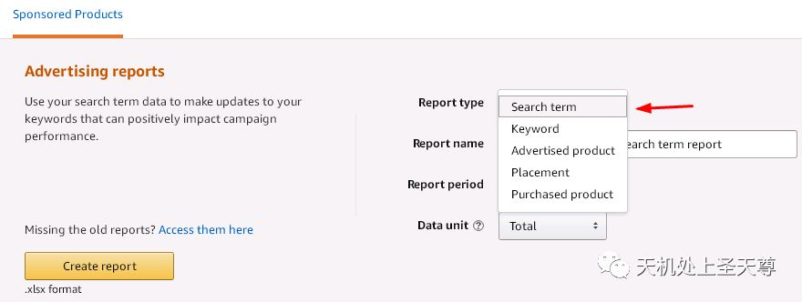

搜索词：使用搜索词数据来更新可对广告活动效果产生积极影响的关键字。

关键字：使用关键字报告查看关键字的搜索频率，并了解搜索量如何随时间变化。然后，缩小您的关键字列表，并为真正需要的关键字设置预算。

已推广的商品：使用广告报告查看商品曝光度和销量

位置 ：使用广告位置报告更好地深入了解在不同位置类型（在亚马逊和其他平台上）置放广告的效果。

已购买商品：使用已购买商品报告可寻找新的广告机会，并深入了解买家在购买什么商品。

3，报告阶段--

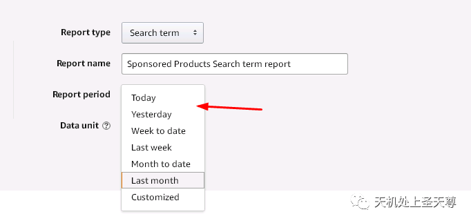

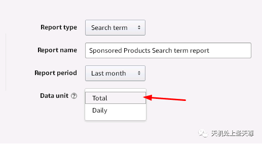

今天

昨天

到目前的周总结

上周

到目前的月总结

上个月的总结

自定义

4，表格字段--

详细介绍每个报告含有的字段，每个字段含义

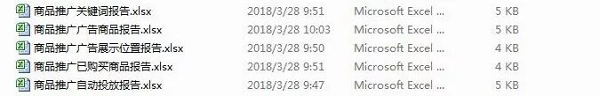

商品推广关键词报告：

开始日期， 结束日期， 货币， 广告活动名称， 广告组名称， 关键字， 匹配类型， 展现量， 点击量， 点击率(CTR)， 每次点击成本(CPC)， 花费， 广告成本销售比(ACoS)， 投入产出比(RoAS) ，7天总销售额(￥) ，7天总订单数(#)， 7天总销售量(#) ，7天的转化率 ，7天内广告SKU销售量(#) ，7天内其他SKU销售量(#) ，7天内广告SKU销售额(￥) ，7天内其他SKU销售额(￥)

商品推广广告商品报告：

开始日期， 结束日期， 货币， 广告活动名称， 广告组名称， 广告SKU， 广告ASIN， 展现量， 点击量， 点击率(CTR)， 每次点击成本(CPC) ，花费， 7天总销售额(￥) ，广告成本销售比(ACoS) ，投入产出比(RoAS) ，7天总订单数(#) ，7天总销售量(#)， 7天的转化率， 7天内广告SKU销售量(#) ，7天内其他SKU销售量(#) ，7天内广告SKU销售额(￥) ，7天内其他SKU销售额(￥)

商品推广广告展示位置报告：

开始日期 ，结束日期 ，货币， 广告活动名称 ，竞价+ ，放置， 展现量， 点击量 ，每次点击成本(CPC) ，花费， 7天总销售额(￥) ，广告成本销售比(ACoS) ，投入产出比(RoAS) ，7天总订单数(#) ，7天总销售量(#)

商品推广已购买商品报告：

开始日期， 结束日期， 货币， 广告活动名称， 广告组名称， 广告SKU ，广告ASIN， 关键字， 匹配类型 ，已购买的ASIN， 7天内其他SKU销售量(#) ，7天内其他SKU订单数(#)， 7天内其他SKU销售额(￥)

商品推广自动投放报告：

开始日期 ，结束日期 ，货币， 广告活动名称， 广告组名称 ，关键字 ，匹配类型 ，客户搜索词 ，展现量 ，点击量 ，点击率(CTR) ，每次点击成本(CPC) ，花费 ，7天总销售额(￥) ，广告成本销售比(ACoS)， 投入产出比(RoAS) ，7天总订单数(#) ，7天总销售量(#) ，7天的转化率， 7天内广告SKU销售量(#)， 7天内其他SKU销售量(#)， 7天内广告SKU销售额(￥)， 7天内其他SKU销售额(￥)

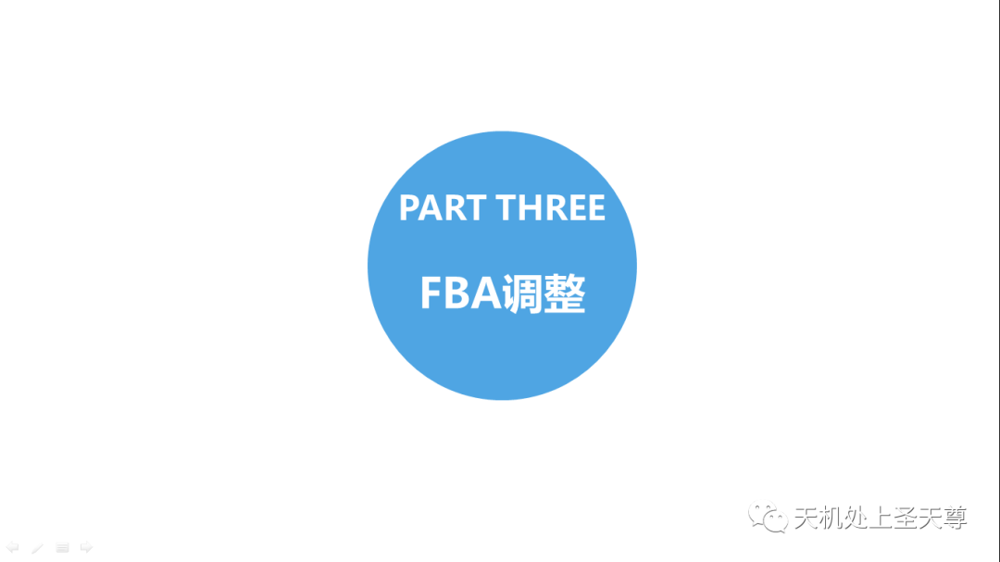

## 三，FBA调整

（https://sellercentral.amazon.com/gp/help/help.html?itemID=201411300）需要登录后台查看

## 2018 年美国亚马逊物流库存仓储费和政策调整

（每立方英尺定义，1英尺=0.3048米，1立方英尺=0.02831685立方米）

| 2018 年 4 月 1 日及之后 | | |
| --- | --- | --- |
| **储存月份** | **标准尺寸** | **大件** |
| 1 月 - 9 月 | 每立方英尺 0.69 美元 | 每立方英尺 0.48 美元 |
| 10 月 - 12 月 | 每立方英尺 2.40 美元 | 每立方英尺 1.20 美元 |

### 长期储存费用

自 2018 年 9 月 15 日起，长期仓储费将实施调整，评估日期将从每半年一次改为每月一次。

这些调整还会影响多渠道配送计划和亚马逊物流轻小商品计划的仓储费。

| 2018 年 9 月 15 日之前 | | |
| --- | --- | --- |
| **库存评估日期** | **已在亚马逊运营中心存放 181 至 365 天的商品** | **已在亚马逊运营中心存放 365 个月或更长时间的商品** |
| 每半年（2 月 15 日到 8 月 15 日） | 每立方英尺 11.25 美元 | 每立方英尺 22.50 美元 |

| 2018 年 9 月 15 日及之后 | | |
| --- | --- | --- |
| **库存评估日期** | **已在亚马逊运营中心存放 181 至 365 天的商品** | **已在亚马逊运营中心存放 365 个月或更长时间的商品** |
| 每月（每月 15 日） | 每立方英尺 3.45 美元 | 每立方英尺 6.90 美元 |

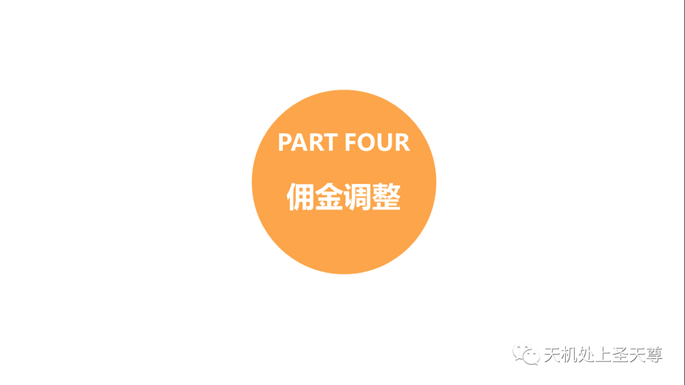

### 四，佣金调整

（ https://sellercentral.amazon.com/gp/help/200336920?ref=ag\_200336920\_shel\_2 ）需要登录后台查看

| 分类 | 亚马逊将扣除基于适用百分比计算得出的销售佣金或适用的每件商品最低销售佣金（取二者中的较高者）。 请参阅上述的“销售佣金”备注。 | |
| --- | --- | --- |
| 销售佣金百分比 | 适用的最低销售佣金 （除非另有规定，否则按件收费） |
| 亚马逊设备配件 | 45% | 1.00 美元 |
| 母婴（婴儿服装除外） | 15% | 1.00 美元 |
| 图书4 | 15% | -- |
| 相机与摄影¹ | 8% | 1.00 美元 |
| 手机设备\* | 8% | 1.00 美元 |
| 电视/音响 | 8% | 1.00 美元 |
| DVD4 | 15% | -- |
| 电视/音响配件 | - 对于总销售价格中不超过 100 美元的部分，收取 15% 的销售佣金； - 对于总销售价格中超过 100 美元的部分，收取 8% 的销售佣金 | 1.00 美元 |
| 家具和装饰 | 15% | 1.00 美元 |
| 家居与园艺（包括宠物用品） | 15% | 1.00 美元 |
| 厨具 | 15% | 1.00 美元 |
| 大家电 | - 对于总销售价格中不超过 300 美元的部分，收取 15% 的销售佣金； - 对于总销售价格中超过 300 美元的部分，收取 8% 的销售佣金 | 1.00 美元 |
| 音乐4 | 15% | -- |
| 乐器 | 15% | 1.00 美元 |
| 办公用品 | 15% | 1.00 美元 |
| 户外 | 15% | 1.00 美元 |
| 电脑 | 6% | 1.00 美元 |
| 软件和电脑/视频游戏4 | 15% | -- |
| 体育用品（体育收藏品除外） | 15% | 1.00 美元 |
| 工具和家居装修 | 15%，但基础设备电动工具为 12% | 1.00 美元 |
| 玩具和游戏² | 15% | 1.00 美元 |
| 解锁手机 | 8% | 1.00 美元 |
| 影视4 | 15% | -- |
| 视频游戏机4 | 8% | -- |
| 所有其他分类³ | 15% | -- |
| 需要批准的分类 | **销售佣金百分比** | **适用的最低销售佣金** |
| 3D 打印商品 | 12% | -- |
| 汽车用品 | 12%，但轮胎和车轮商品为 10% | 1.00 美元 |
| 美容化妆 | 15% | 1.00 美元 |
| 服装与配饰 | 15% | 1.00 美元 |
| 收藏类图书 | 15% | -- |
| 硬币收藏品 | 有关销售佣金，请参阅分类要求。 | |
| 娱乐收藏品 | 有关销售佣金，请参阅分类要求。 | |
| 艺术品 | 有关销售佣金，请参阅分类要求。 | |
| 礼品卡 | 20% | -- |
| 食品\*\* | 15% | -- |
| 个护健康（含个护用品） | 15% | 1.00 美元 |
| 工业和科学（含餐饮服务和清洁与卫生） | 12% | 1.00 美元 |
| 珠宝首饰\*\*\* | 20% | 2.00 美元 |
| 箱包和旅行用品 | 15% | 1.00 美元 |
| 鞋靴、手提包和太阳镜 | 15% | 1.00 美元 |
| 体育收藏品 | 有关销售佣金，请参阅分类要求。 | |
| 钟表 | - 对于总销售价格中不超过 1,500 美元的部分，收取 16% 的销售佣金； - 对于总销售价格中超过 1,500 美元的部分，收取 3% 的销售佣金 | 2.00 美元 |

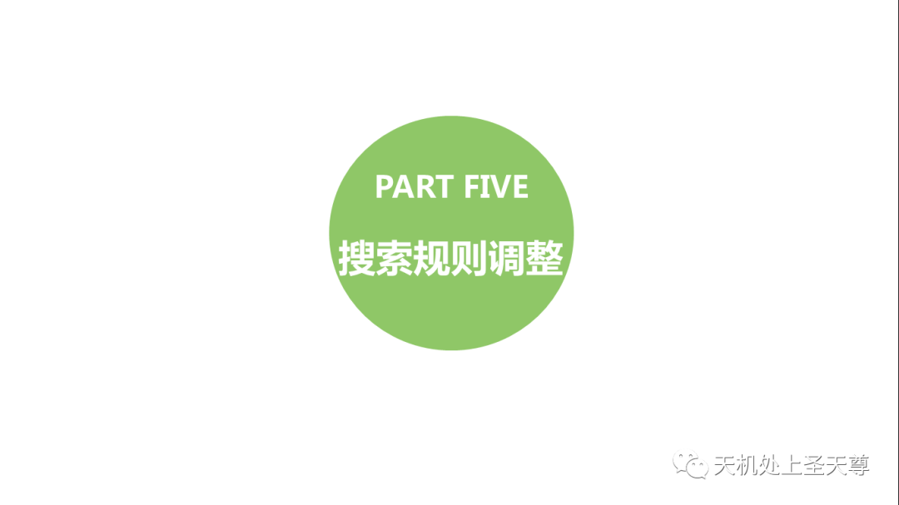

### 五，搜索规则调整

《点YES /NO权重在下降》

详细介绍Amzon SEO A9算法

亚马逊的排名算法名为 A9，详细地址：https://www.a9.com/what-we-do/product-search.html

One of A9's tenets is that relevance is in the eye of the customer and we strive to get the best results for our users. Once we determine which items are good matches to the customer’s query, our ranking algorithms score them to present the most relevant results to the user.

Our ranking algorithms automatically learn to combine multiple relevance features. Our catalog’s structured data provides us with many such relevance features and we learn from past search patterns and adapt to what is important to our customers.

以下是中文翻译

A9的原则之一是相关性在客户眼中，我们努力为用户获得最佳结果。一旦我们确定哪些项目与客户的查询匹配良好，我们的排名算法就会对它们进行评分，以向用户呈现最相关的结果。

我们的排名算法自动学习结合多个相关性功能。我们的产品目录的结构化数据为我们提供了许多这样的相关功能，并且我们从过去的搜索模式中学习并适应对客户重要的事情。

我们越理解查询的含义越好，我们可以帮助客户找到他们想要的产品。所以我们专注于这些词语背后的词语和意图。当客户告诉我们他们正在寻找“书中的哈利波特”时，我们在他们的查询中将“哈利波特”的标题与类别信息区分开来：“书中”。

正文

........................................................我是分割线.......................................................................

### A9 核心算法解析

1，转化率: review, 图片质量，价格

2，相关性：Listing 内容

3，消费者满意度：Feedback, ODR

4，总结

提醒: 亚马逊会预测你的转化率，然后会根据你的真实转化率来修正。如果你的价格普遍高于类似产品价格，亚马逊会预测转化率较低，然后会根据你的真实转化率来修正。

影响排名的因素：转化率，相关性，客户满意度。

### 一，转化率方面：

1, Sales Rank，换而言之就是一定周期以内的销量。

2, 客户 Review, 在达到一定数量之后，Review 评分比数量更重要，一个 1000reviews 的评分为 4.7 分，很有可能排名超过 2000 个reviews 但是评分只有 4.0 的。且只有 verified reviews 有效。

3, 产品问答Q&A

4, Listing 完整性，listing 信息的完整影响转化和相关性。图片大小和质量，图片最小 1000\*1000，低于的 suppressed listings, 图片数量不是

5, 价格，低价格在其他因素类似情况下，更容易获得较好排名

6, 捆绑产品：最大化reviews,用户体验更好，亚马逊更喜欢多选项的listing,变体更多的

7, 页面停留时间和跳出率：是否有停留时间看描述，review, 问答。（同样说明了我们为什么要做好描述，review,和问答）（跳出率：返回之前的页面，点击相关产品）

8, 点击消费率 CTS（Click to Sales），谷歌的一个重要排名指标是 CTR（点击率），亚马逊将这个指标变成了 CTS。打比方：在展示结果里面，A 产品的排在第九位，B 产品排在第十位， 但是 B 产品的点击率更高，对于谷歌来说，就会把 B 产品排名 A 产品之前，而亚马逊则会看点击过去之后的 sales，也就是 CTS，如果 A 产品购买的比例更高，亚马逊还是会把 A 产品排在前面。

### 二，相关性方面：

9, 标题 标题是客户最直观的感受，也是相关性方面权重最高的部分

10,  features, bullet points. 不用关键词堆砌，提供有用，完整，Keyword rich 的 features

11, 描述和后台五行，search terms也是一样， 同上。

12, 品牌，生产商。标题里面包含品牌的 listing,亚马逊给以更高的权重。

13, 参数 详细的参数可帮助亚马逊做出相关性判断，权重相比其他内容较低。

14, 分类和子分类 客户有可能选择类目搜索；分类可以帮助亚马逊更清楚你的产品是什么

15, search terms 每个最多 50 个字符尽可能多使用，不重复，关键词变体是无意义的（dress 和 dresses）,使用同义词或者拼写变体是有用的（sun screen 和 sunscreen）

16, source keyword, 其他亚马逊客户搜索你这个 listing 时用到的关键词，可在链接上加搜索跟踪符号来利用

### 三，消费者满意度方面：

17, 负面卖家 feedback, 亚马逊不管你的 positive feedback，他们在意的是负面 feedback 的比率。

18, 订单处理速度，订单退款比例，订单取消率（未确认）

19, 完美订单比例（POP）,完美订单的意思：从点击购物车到妥投。高 POP 意味着高库存率， 准确的 listing 和可信赖的物流

20, ODR，ODR 基本就是 POP 的另一个极端：负面feedback, A to Z, 物流问题，信用卡退款。必须在 1%以下，客户移除的 feedback 不计算在 ODR。

21, 离开率（exit rate）看完你的 listing 然后离开亚马逊的比例。如果你的离开率高于平均值，亚马逊会认为是一个低质量的 listing

22, 包装选项，（也有可能不是排名因素）不过亚马逊发现比较多的用户开始注重包装，这一点即使列入算法，权重也应该比较低。

### 四，总结：

1, 最大化 PRC (Revenue Per Customer)每一个客户的收益

2, 关注转化率，相关性，和客户满意度

3, 完善你的 listing，图片和描述都要做的非常好

4, 用 FBA，获取buy box,也是一种营销手段

5, 鼓励用户留review, 并尽量让他们满意   ‘

6, 重视客户体验，邮件信息及时回复，其次包装也要好，物流运输快等等

本文由百晓堂商学院授权出品，如需了解更多，请联系我们！
