# 亚马逊送测渠道 Day2-Review

> Source: wechat
> Author: 天机跨境
> Original: https://mp.weixin.qq.com/s/iJD37N1ahsYQxZFiVmXiIA

---

---

亚马逊送测渠道

1-Facebook发帖

登录Facebook，如果没有账号先注册一个账号，需要翻墙，推荐穹顶穿越，9元/月

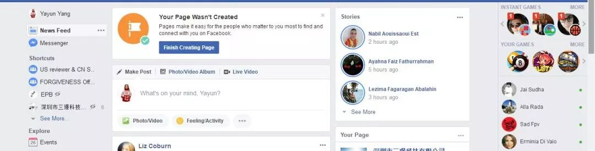

加入Facebook送测群组，Amazon FBA Free & Deals Group -US Only，TOP Amazon Reviewers，Amazon Reviewer，US Amazon Reviewers ~ (Free or Discounted Products)，

US Amazon Reviewers - Free or Discounted Products，Amazon Reviewer Group - FBA Deals & Reviews-Amazon Testers

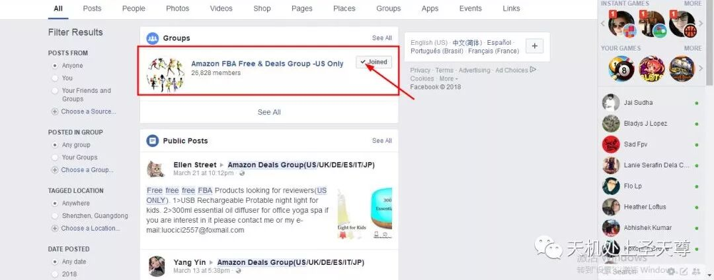

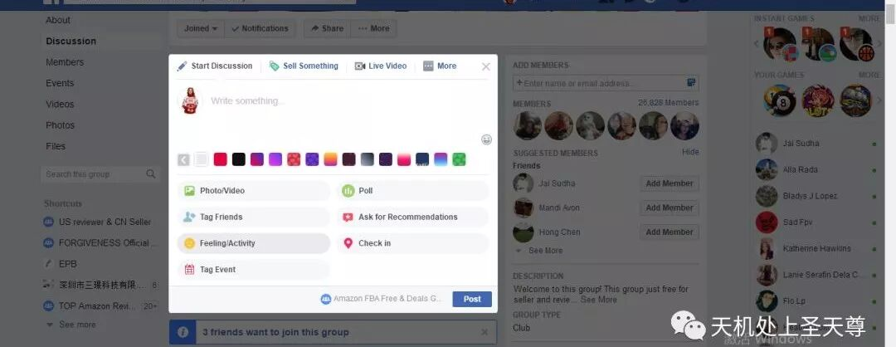

发布内容：

US Only. PP refund after order.If you are interested, please PM me your amazon profile. Thanks.

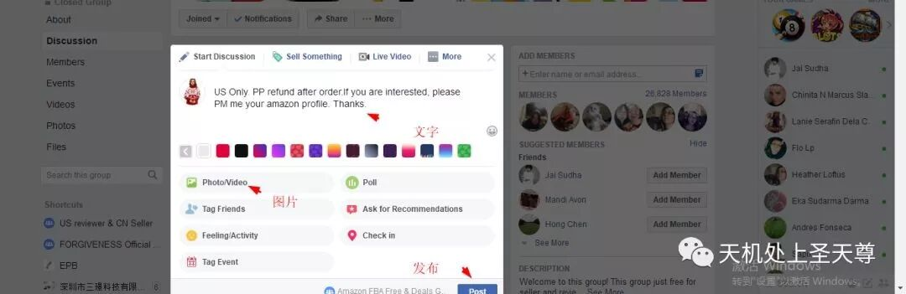

点击  ”Post“

发帖就完成了

最主要的是，群组的质量，怎么找到不错的相关群组，坚持每天发帖，及时回复达人。

还有，达人发的消息在哪里查看，如下图：

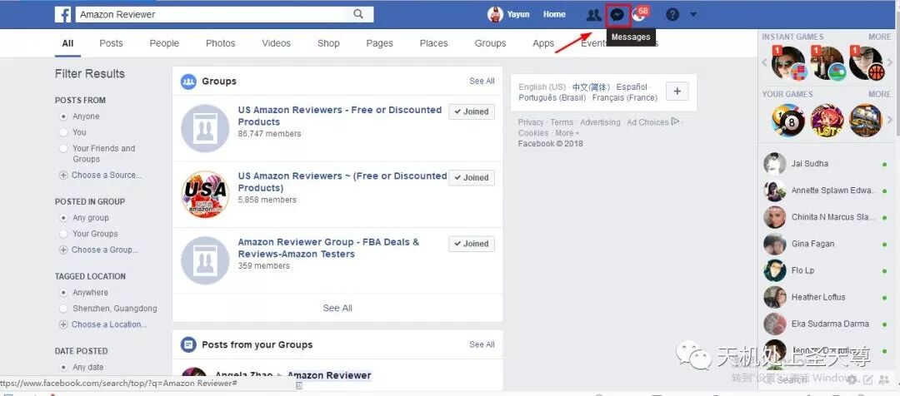

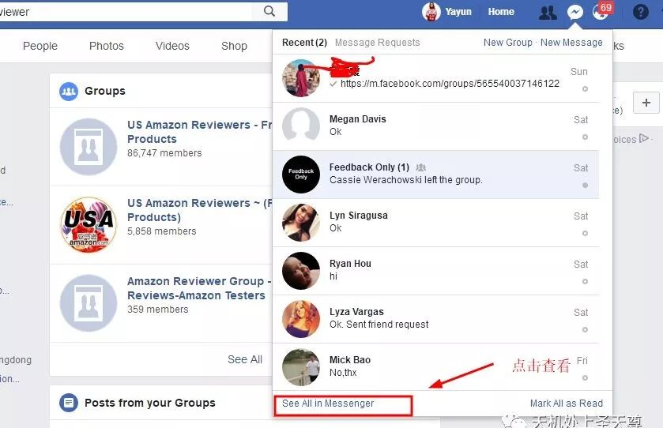

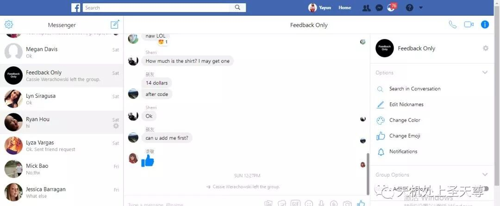

陌生人的消息，在左边最上面，显示信息数量，跟微信差不多，点击进去就可以看到。

..............................................................................................................................

2-Instagram开发达

3-Pinterest推广

4-Tumblr开发

5-YouTube开发达人模板

.................................................................................................................................

送测模板

Hello,

How are you doing? This is XXX, the YouTube manager of XXXI.com. I've checked your video, and was very much inspired by so many fans and views you've got. That is awesome.

I sincerely want to build a kind of cooperative relationship with you, and wonder if you can feature in the video with our products?

Maybe you'd like to check our website:

www.XXXi.com

Sincerely look forward to hearing from you soon  : )  Best wish to you !

Best regards

XXXI Marketing Team

XXX

.................................................................................................................................

TOP REVIEWER 模板

Hi  Jack  ,

This is a product promotion activity from our store at Amazon.com.

Now ,we are promoting newly releasing items.

Beautiful Clothing Tank Top for women

Please enter these URL：

(http://bit.ly/crisscrosstshirt002)

(http://bit.ly/pleatedtunictops)

We want to know whether you are interested in receiving a free sample.

We could refund you by paypal or gift card after we send out the products,we cover high PP fee.If you'd like to have a test .Please confirm us by replying this

e-mail with your profile if you are interested in it.

Your kindness and support will be highly appreciated!

Looking forward to hearing from you  soon.!

Best regards

Yang

-------------------------------------------------------------------------------------------------

You can contact me with facebook or wechat

facebook: yayun yang     https://www.facebook.com/ifixlabscom

wechat:13265758038

图片以附件形式和在邮件显示，图片标号并做简单的文字说明

.....................................................................................................................................

其他模板

Hello dear friend

This is Aminly,  so glad to meet you! We have many women's clothes need to test,(https://weidian.com/?userid=840116265)Plz give me a screenshot about your favorite cloth.  We could refund you by paypal or gift card after we send out the products,we cover high PP fee,and u can make more money to recommend your friends to test our products almost $2-3,if you are interested in our new clothes, please feel free to PM me.Looking forward to your reply!Bet wish to you !

Sincerely

Aminly

..................................................................................................................................

Hello dear friend

This is Aminly,  so glad to meet you!  we have many women's clothes need to test,(https://xxx.com/?userid=1300715211)Plz give me a screenshot about your favorite cloth.  We could refund you by paypal or gift card after we send out the products,we cover high PP fee,and u can make more money to recommend your friends to test our products almost $2-3,if you are interested in our new clothes, please feel free to PM me.Looking forward to your reply!Bet wish to you !

Sincerely

Aminly

Easther Women V Neck

To be honest,

send samples and get review  in China

There are many markets and needs

by the way; I only test women's clothes during this time,after all we need more and more timeand work to find better products

important thing :The first one ,we will build up all of  account right instagrams Twitter  And Snapchat can i touch u? The second one ,u add one piece u can get $3-5

术语集合

PP  US only, We could refund you by paypal or gift card after we send out the products,we cover high PP fee,ty

If you are interested,plz let me know

Please send me your profile first ,we need to check ,we will tell u if ok and send u keyword and link,ty

We could refund you by paypal or gift card after we send out the products,we cover high PP fee,ty

a screenshot is ok ,and with products

............................................................................................................................

Hello dear friend

This is Aminly,  so glad to contact with you!  we have many women's clothes need to test,we need someone who could share their feelings with words,pictures or videos to help other customers. We could refund you by paypal or gift card after we send out the products,we cover high PP fee,the following pictures are some of our new products,if you are interested in our new clothes, please feel free to contact with me.Looking forward to your reply!Bet wish to you !

Sincerely

Aminly

................................................................................................................................

so  glad to contact with you.we have many women's clothes need to test,we need someone who could share their feelings with words,pictures or videos to help other customers. We could refund you by paypal or gift card after we send out the products,we cover high PP fee,the following pictures are some of our new products,if you are interestes in our item,please feel free to contact with me.looking forward to your reply!bet wish to you sincerely

用code下单前要求达人：Before u order the item, plz browse the product page,including title, deascription,pics and  rev(question),then ask a question.Thank you so much.

Code: The discount code will come into force after 4 hours and it can be used only once.please place the order in a day and send me the order no.

在Facebook发帖:If interested, please PM me your amazon profile.

US Only, Thanks.

Hello,friend.Are you interested to text our new clothes.Direct shipping，or refund after the order by gc or pp，just accept credie card order.)

在 达人留评前;Could u send ur rev to me before u post it? If there is any problem with our products, plz contact me first.I will try my best to help u.

Only for us. If you are interested pls pm me with your amaz profile.)

.....................................................................................................................................

测评模式

通过各个渠道找到高质量的买家账号，并且联系他测评，先给profile，审核，通过叫他下单，下单方式code，paypal,giftcard,下单后给订单号，确认付款完成，开始返款，到货催评，

什么途径找达人？需要注意什么？

Facebook群组，发帖，模板 不要出现品牌和店铺名，不要出现review和feedback，不要发链接，用关键词，或者做链接给他，

返款方式code，GIFt card，refund after ship , refund after order ,refund after review, payment pending - completed

不要提前付款给达人，下单确定达人已经付款完成再返款，加上手续费，包含手续费的返款金额=订单价格+手续费率+手续费

全站点标准费率

 包含手续费的返款金额=订单价格\*0.044+0.3

.......................................................................................................................................

利用买家数据，在Facebook上创建Lookalike Audiences广告受众

 Facebook广告，特别是Custom Audiences和Lookalike Audiences功能。Custom Audiences允许广告商使用过滤器和条件来创建

    Facebook广告自定义受众群体。在Custom Audiences中，卖家可以上传客户名单，然后Facebook会根据名单数据找到类似受众

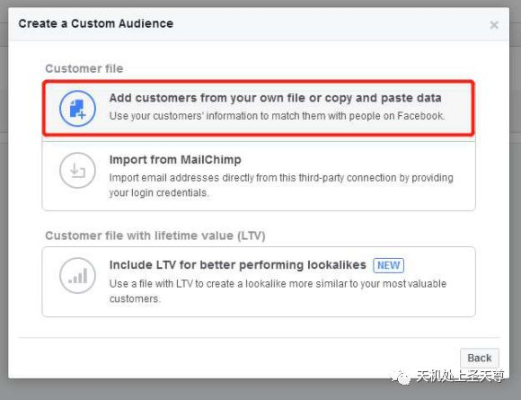

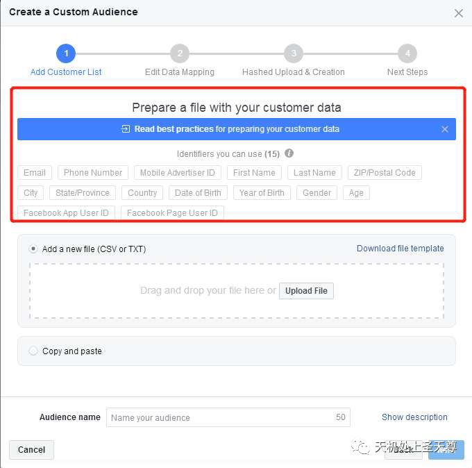

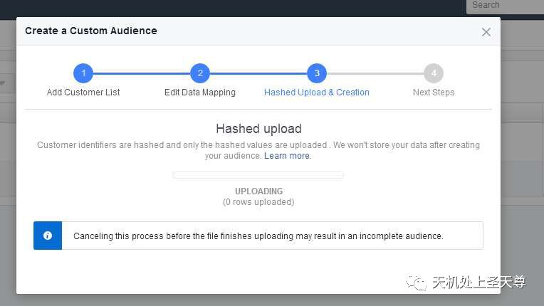

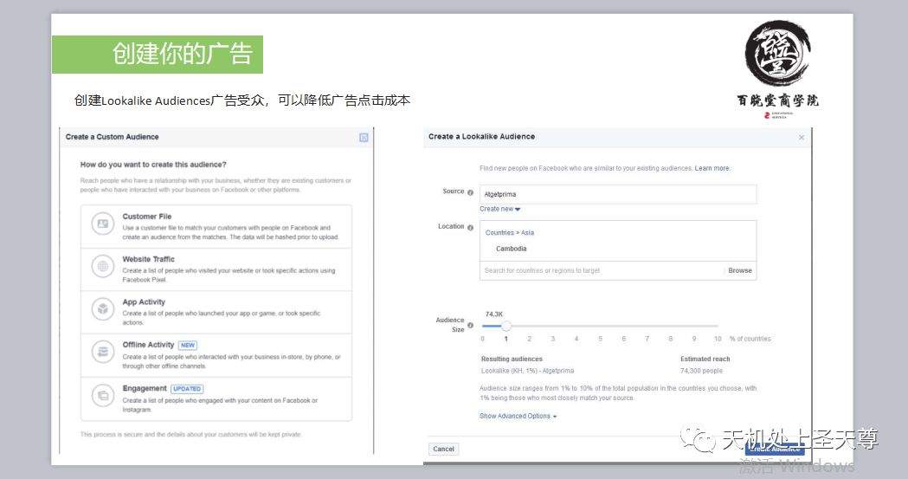

第1步：下载报告，大概流程如下

1、卖家中心“Reports”选项；

2、点击“Fulfillment”；

3、转到“Fulfillment Reports”中的“Sales ”选项；

4、点击“Amazon Fulfilled Shipments”；

5、下载报告，准备整理

第2步：整理Excel表格，需要5个字段

buyer-name  ，  last name ， ship-city  ，ship-state  ，ship-postal-code 五个字段 整理，邮箱和电话可能有些没有。

第3步：创建Custom Audience，大概流程如下

1、单击创建Audience（受众）

2、选择Custom Audience（自定义受众）

3、选择“Customer File”（客户文件）选项

4、选择“Add customers from your own file or copy and paste data”（从个人文件添加客户或复制/粘贴数据）

5、上传准备好的客户文件

.............................................................................................................................

**利用买家数据或物流截留的买家电话，在Skype,Snapchat,Whatsapp, Hunter,Linkedin上**

（ 通过买家电话和邮箱，多维度查找，建立粉丝群，精准营销）

整理得到，buyer-name，last name ，ship-city， city-state，  ship-postal-code等字段
