# 亚马逊美国站和欧洲站后台Amazon Promotion培训一

> Source: wechat
> Author: 天机跨境
> Original: https://mp.weixin.qq.com/s/BTUGMr65b1G0cdvtWLzzdA

---

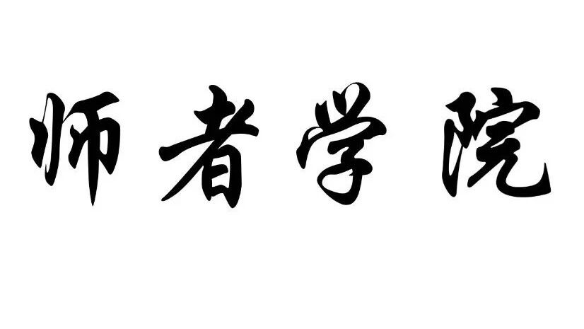

---

亚马逊后台培训Promotion培训一

一.  Manage Promotions

二.  Manage Campaign

在亚马逊欧洲站后台INVENTORY下拉菜单中选择Manage Promotions

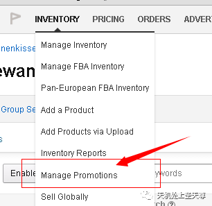

.....................................................................................................................................

美国站点，在ADVERTISING下拉菜单中选择Promotions

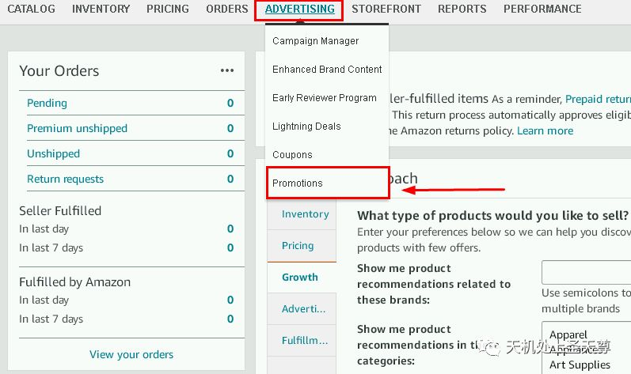

促销管理，可以做一些打折活动，或者做一些promotion code 给一些达人做测评。

     Free Delivery：免运费

     Money Off：折扣

     Buy One Get One：买一送一

     External Benefits：买满送优惠

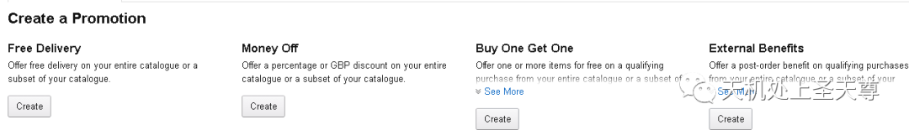

Money Off 使用的比较多，所以简单的介绍下：

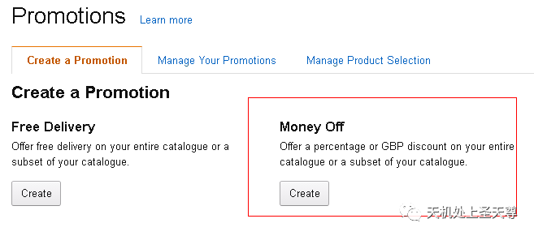

我们现在是对整个店铺做减满的促销（如果要对部分产品或者类目做MONEY OFF 促销，则要单独创建一个products election)

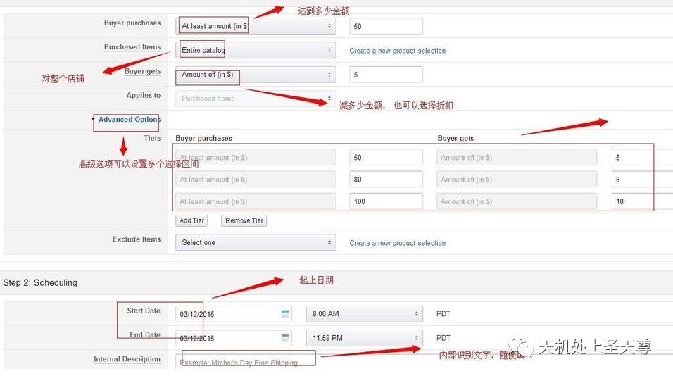

相关选项说明：

一，Buyer purchases ：买家购买

1、At least amount (in $) (至少X金额):表示此促销方案只有在顾客购买至少X金额时方可用

2、At least this quantity of items (至少X样商品): 表示此促销方案只有在顾客购买X样商品时方可采用，您必须填入数字

3、For every quantity of items purchased(每X样商品): 顾客每购买X个商品即可得到此促销方案，这个选项仅适用于Money Off 与 Buy One Get One的促销类别

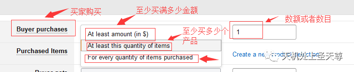

二.Purchased Item：  购买选择要做促销的产品列表，这里选择的是整个店铺。假如需要对单个的ASIN做促销活动点击右边“Create a new product selection” 创建新的清单

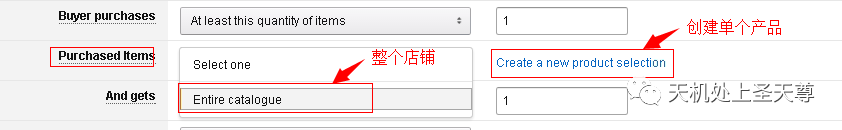

三，Buyer Get 买家优惠项目

Percent off 打折： 如果你想打九七折，后面数字就填3，想打八折，后面填数字20

Amount off (in $)减免：表示你可以享受减免$X金额的优惠，如果你想减6美金，后面数字填6.减10，后面填10。给Reviewer 测评一般多是使用这个条件，可以实现免费送样。

注意：这2个项目一定要正确填写。否则库存会很快被买光。

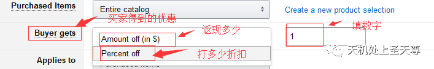

四，.applied to：这个优惠使用于什么样的条件。有如下2种：

Purchased items:购物车里面选择的产品付款时会使用优惠。

Additional item: 购买了A产品后在买B产品优惠才会生效。

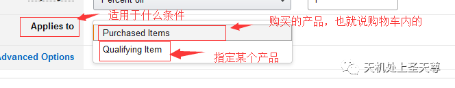

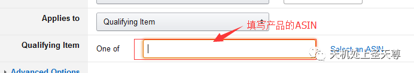

五，.Advanced Option 高级设置区间：可以添加多个促销的区间，我们这里选择了三个区间：（可以根据自己的需要去选择）

   比如：【满50，减5元 】  和 【满80，减8元  】  或【满100，减10元】

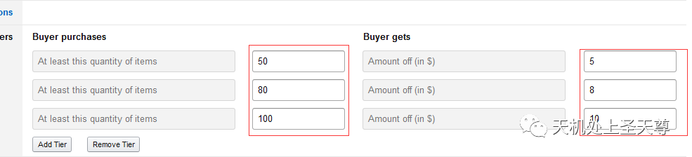

第二步：Scheduling  时程表 设置促销的起止时间

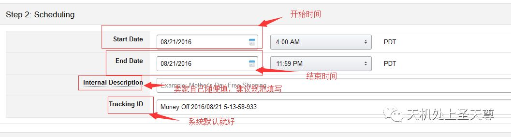

1，Claim code（可以根据自己的需要去选择，可以不用设置,如果设置了claim code，客户需要输入claim code才能享受优惠，如果不设置claim code，客户购买的时候亚马逊会直接给客户优惠）

2，Single-use：优惠码只能使用一次

3，Group：优惠码可以多次使用

4，None：不需要使用优惠码

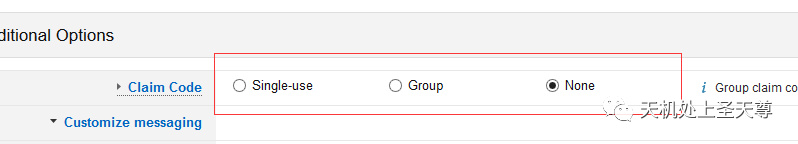

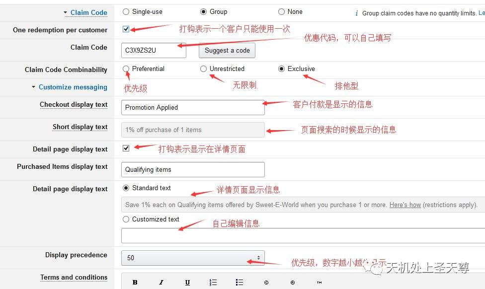

## Claim Code Combinability

一，Preferential：优先使用

组合方式：

  1.假如有prferential promotion,将结合所以Unrestricted promotion/no claim code promotion

比如（1）：一个上衣的prferential promotion是10% off,裤子的Unrestricted promotion是20% off.那么客人得到的优惠是30% off.

   2.假如有多个prferential promotion,会选择最高的promotion 使用。

比如（2）：一个上衣的prferential promotion是10% off,裤子的prferential promotion是20% off.那么客人得到的优惠是20% off.

二，Unrestricted：无限制的优惠码

组合方式：

1. 结合所有 prferential promotion/no claim code promotion。

比如（3）：同上（1）

2.多个Unrestricted promotion，将结合所有组合。

比如：买满50减2，10% Off 上衣，买裤子送一双袜子。

那客户花60美金买了 上衣和裤子，将会得到免费的袜子，10%的折扣和，2美金的优惠。

三，Exclusive：排它型折扣。

组合方式：

1.组合所有no claim code.

比如:10% exclusive 鞋子+20% no claim 裤子，那么客户得到的优惠是30%的折扣。

2.不能和其他code promotion组合。

比如：2个Exclusive promotion:10% off 上衣 和20% off 裤子。那么客户得到较高的20%

比如：Exclusive promotion:10%off 上衣和20%prferential promotion 或者20%Unrestricted promotion裤子。那么客户得到20%折扣。

Money Off

最后点Review-提交，促销一般会在你选择的当地时间4小时后生效。

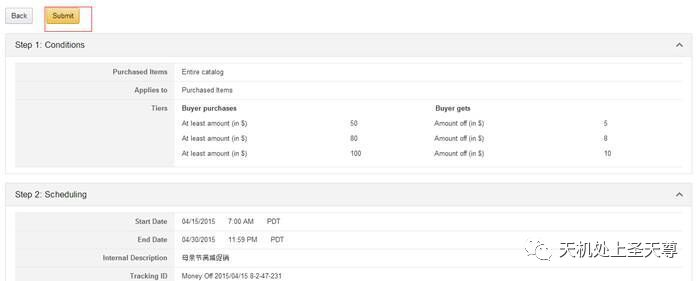

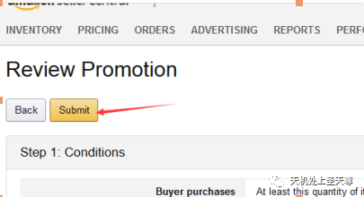

促销活动会显示在产品页面的如下位置，但是假如没有购物车的话，促销活动是不会显示出来的。

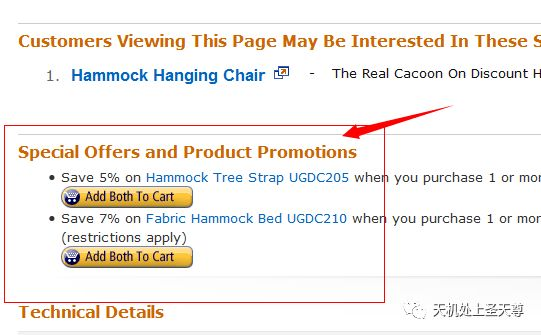

## Product Selection

第一步：可以从Money off 里Create a new product selection 或者直接从manage product selection创建 product Selection

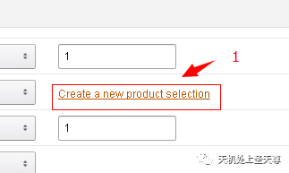

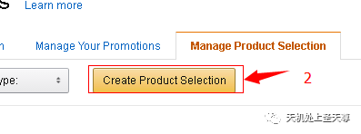

第二步：选择ASIN List后，在点击 Create Product Selection.

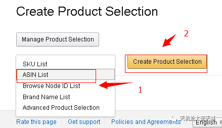

第三步：填写相关信息

Product Selection Name / Tracking ID:商品列表名称

Internal Description: 促销识别名称。

ASIN List：ASIN列表

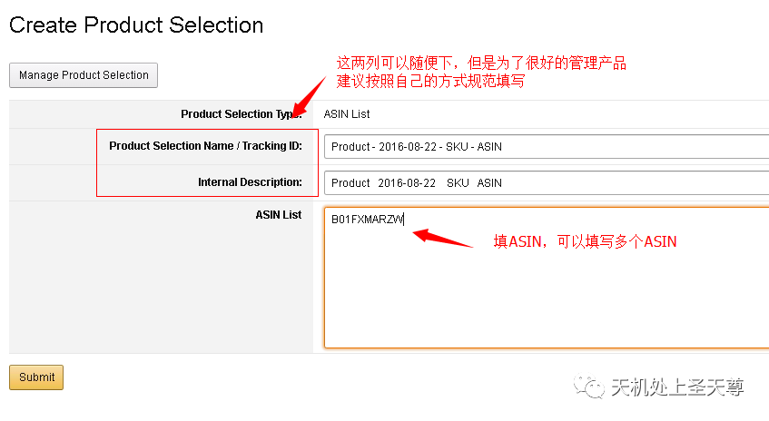

## Manage Campaign

从advertising 功能栏选择 campaign manage

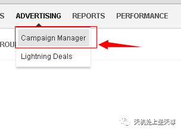

Campaign Name: 广告名称

Daily budget : 每日花费金额

Start Date： 开始时间

End Date：结束时间

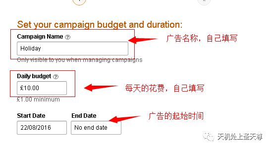

 Automatic keyword campaign: 系统匹配关键词

Manual keyword campaign：卖家填写关键词

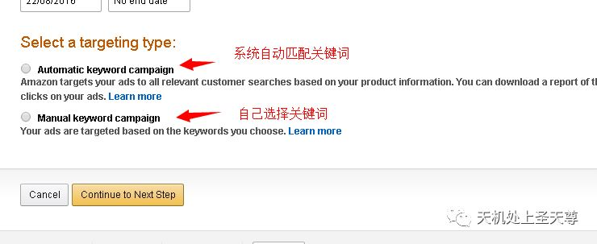

## Automatic keyword campaign

Ad group name : 广告组名称

Default bid ：关键词竞价

Choose products：选择要做广告的产品，可以通过ASIN,SKU和Title搜索。

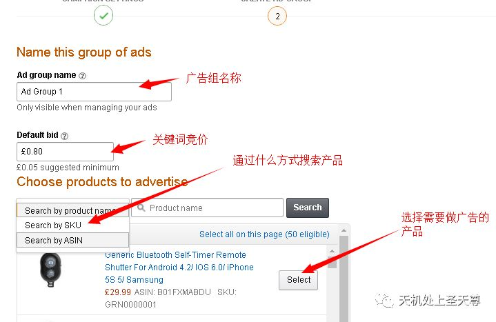

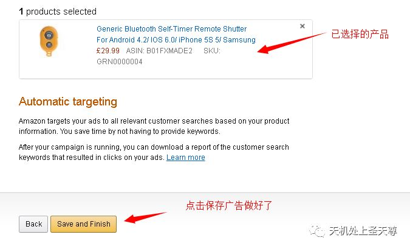

## Manual keyword campaign

Ad group name : 广告组名称

Choose products ：选择要做广告的产品，可以通过ASIN,SKU和Title搜索。

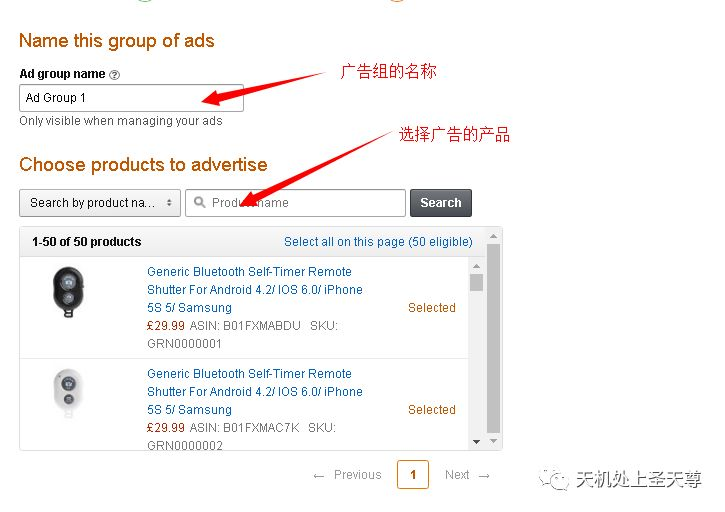

Manual keyword campaign

Default Bid ：关键词竞价

Suggested keywords：系统建议关键词

Provide your own keywords：自己填写关键

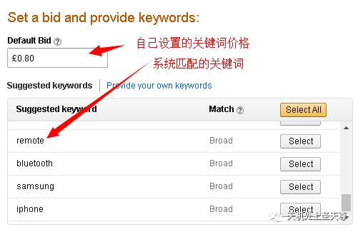

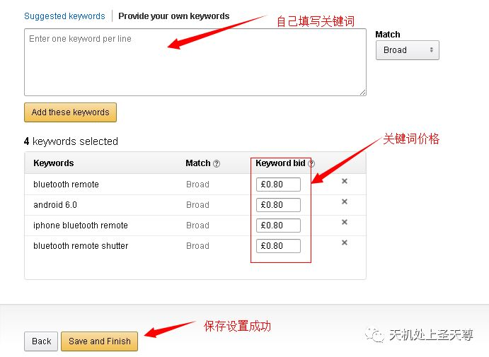

## Amazon Promotions 促销:

促销管理，可以做一些打折活动，或者做一些 code 和giftcard给达人测评。

     Free Delivery：免运费

     Percentage Off：折扣

     Buy One Get One：买一送一

     Giveaway亚马逊抽奖

     External Benefits：买满送优惠

一、Free Shipping 免运费（仅限自配送商品）

二、Percentage Off 满减及折扣

      （有无code码、减免金额或折扣）

三、Buy One Get One买赠，买一送一

四、External Benefits买满再买优惠

五、Giveaway 亚马逊抽奖

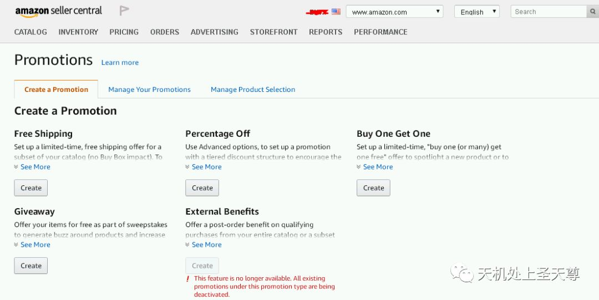

促销入口

Advertising-=》Promotions-=》PercentageOff-=》Create

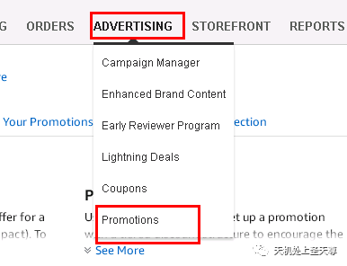

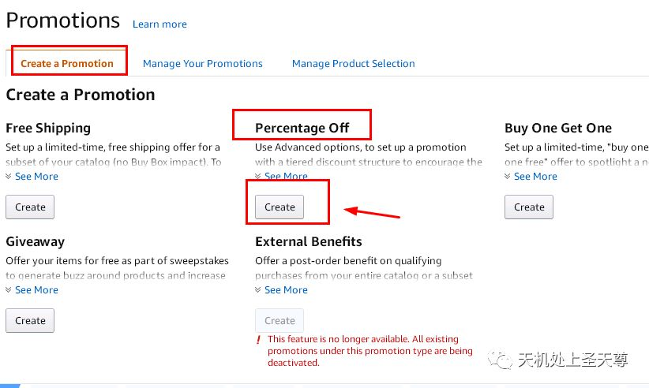

创建商品列表

1.点击按钮Create a new product selection

2.选择类型—点击按钮Create Product Selection

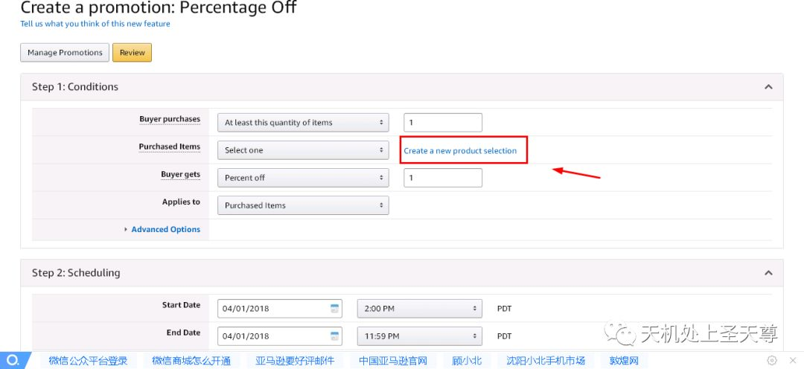

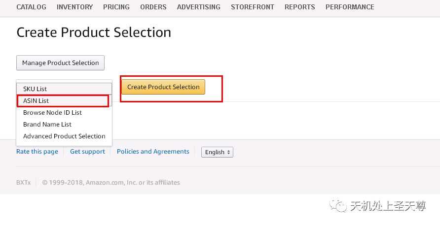

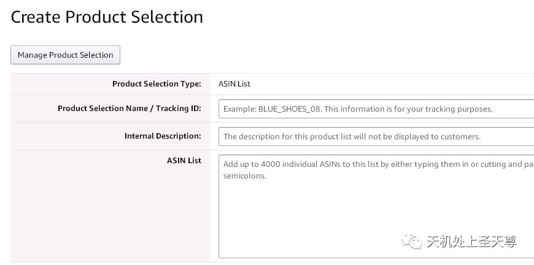

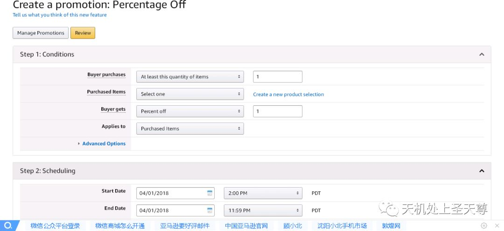
