# 亚马逊美国站和欧洲站后台Amazon Promotion培训二 Amazon Promotions促销设置

> Source: wechat
> Author: 天机跨境
> Original: https://mp.weixin.qq.com/s/7vd2OWhUZ55uSOjWraYsqg

---

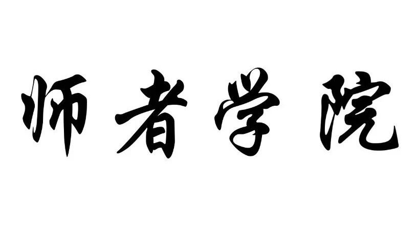

---

## Amazon Promotions 促销:

一、Free Shipping 免运费（仅限自配送商品）

二、Percentage Off 满减及折扣

      （有无code码、减免金额或折扣）

三、Buy One Get One买赠，买一送一

四、External Benefits买满再买优惠

五、Giveaway 亚马逊抽奖

促销入口

Advertising-=》Promotions-=》PercentageOff-=》Create

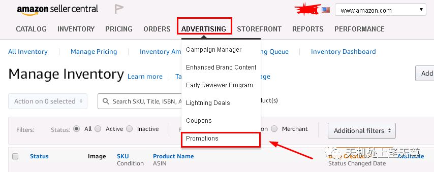

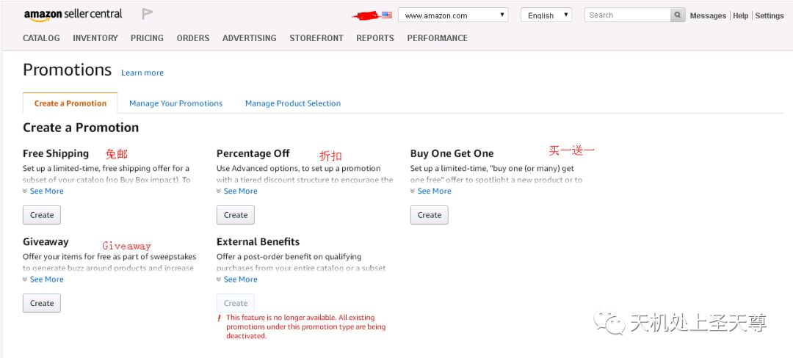

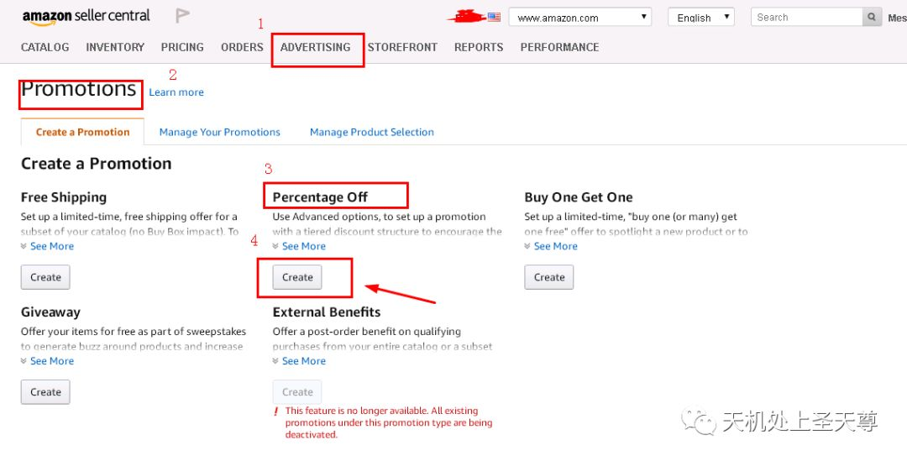

创建商品列表

1.点击按钮Create a new product selection

2.选择类型—点击按钮Create Product Selection

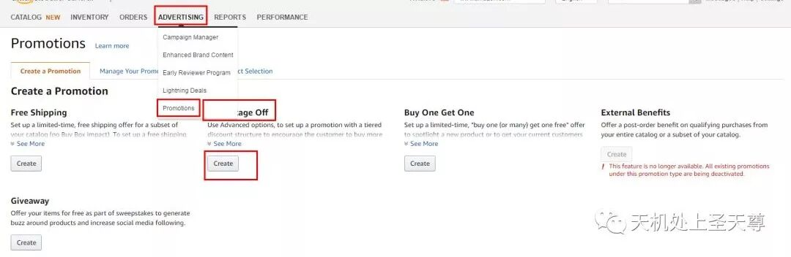

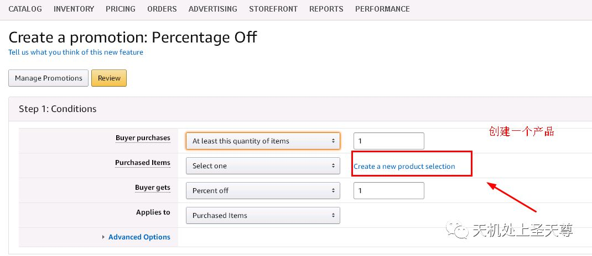

1, ASIN列表

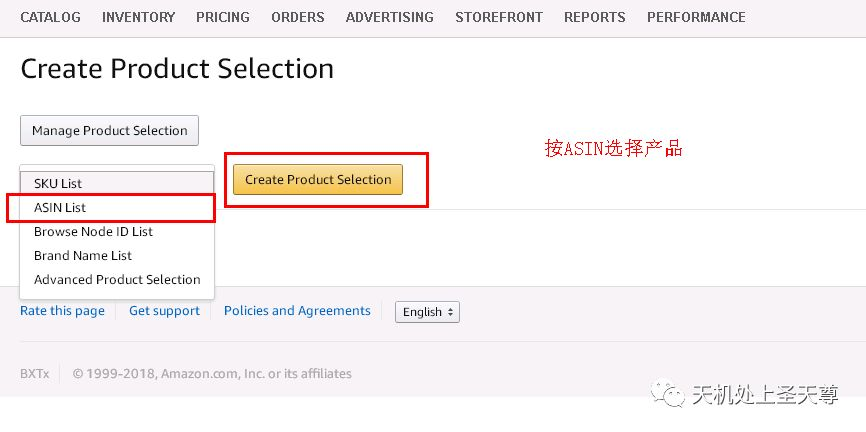

3.编写Product Selection Name和Internal Description—填入需要做促销的ASIN Product Selection Name简单描述该产品，注意为了跟踪目的，一般可以填SPU/SKU,简单产品描述都可以。

Internal Description 它是产品列表的描述，不会展示给客户，可以是父体的，或者子体的，也可以是一款产品的或者多款产品的;如果是关联促销的，放爆款的ASIN。

点击按钮 "Submit" 提交。

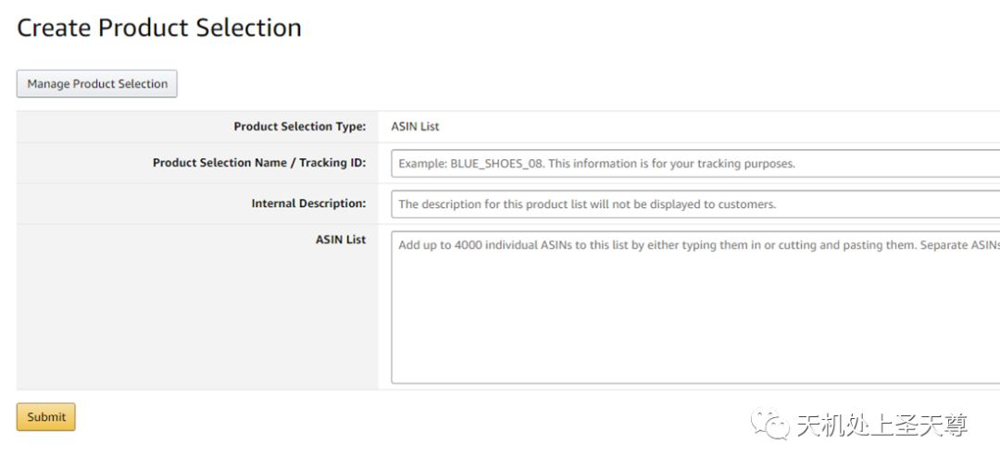

## 管理商品列表：

ASIN列表，SKU列表，浏览分类节点编号列表，品牌名称列表，

最后高级商品列表。

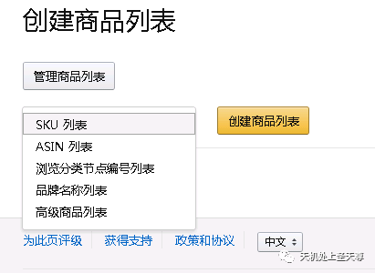

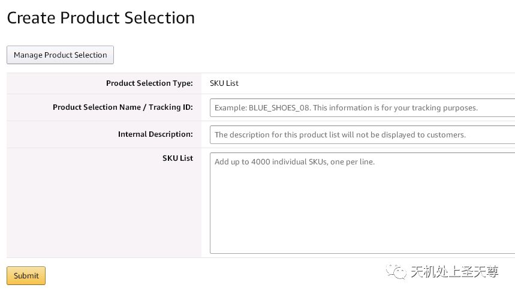

1, ASIN List   ASIN列表

2, SKU List   SKU列表

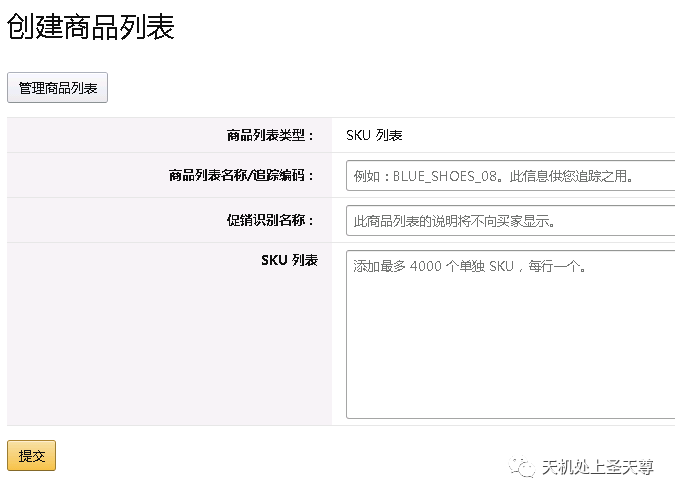

3, Browse Node ID List   浏览分类节点编号列表

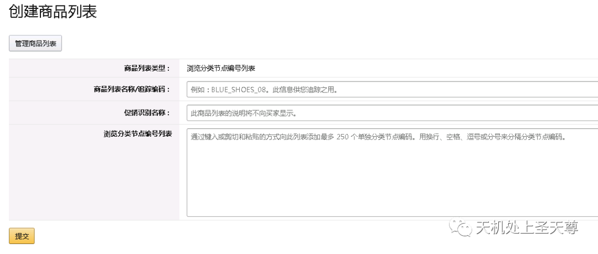

4, Brand Name List 品牌名称列表

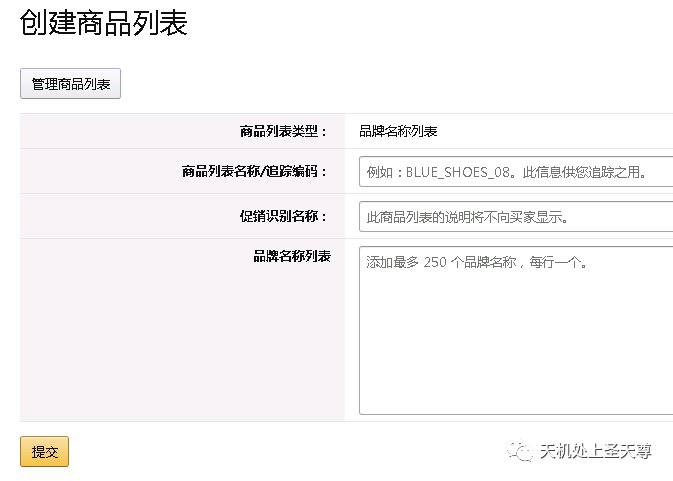

5, Advanced Product Selection 最后高级商品列表

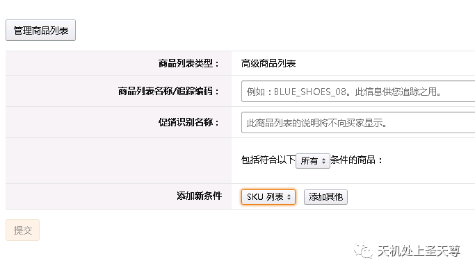

结合多种选择方式

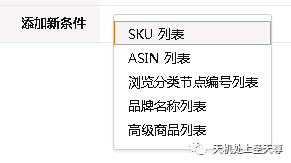

条件选择

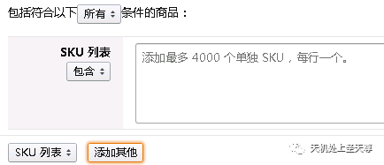

..............................................................................................................................

**一.PercentageOff -NoneClaimCode**

## 1 .单一产品促销

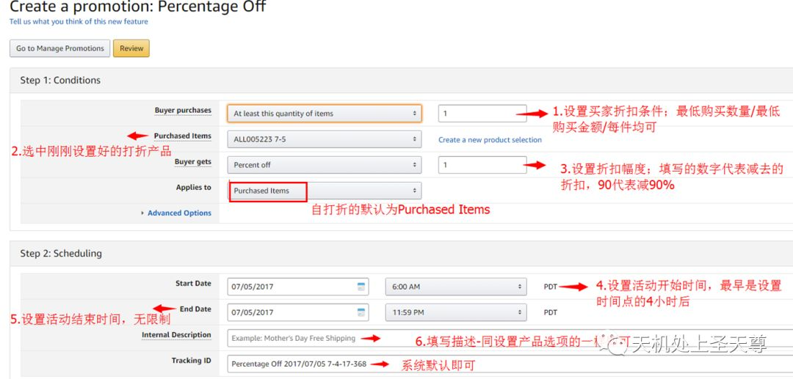

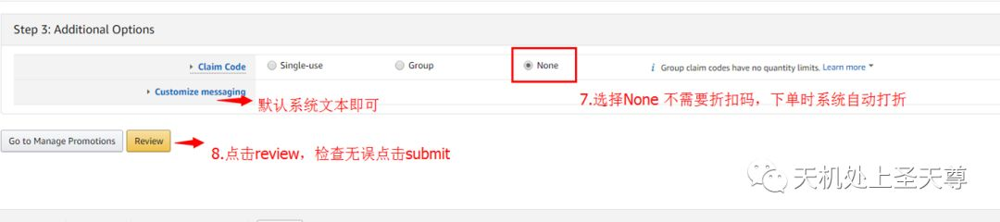

## 2 .关联促销（将流量低的产品放在曝光量大的产品下引流）

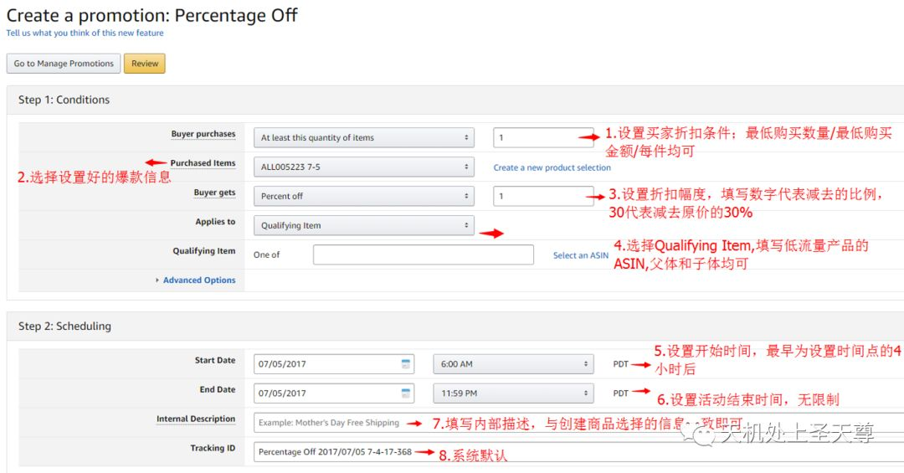

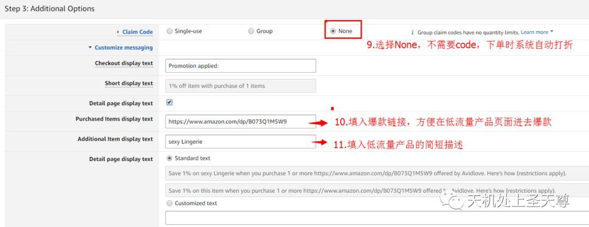

## 注意事项：

同款产品没有code的折扣会全部累加计算

**1.A设置两个折扣，买一件减10%；买一件减15%，客户购买一件A，将得到25%off**

**2.A设置两个折扣:买一件减10%** **；买2件减20%，客户购买2件A，将得到30% off**

..............................................................................................................................

**二.PercentageOff -ClaimCode**

**1.单个产品和关联促销的以下两个步骤和前面的无code的步骤一致，可看前面PPT**

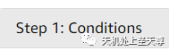

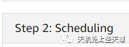

**2.Single-use一次性与Group无限制**

**Single-use一次性**

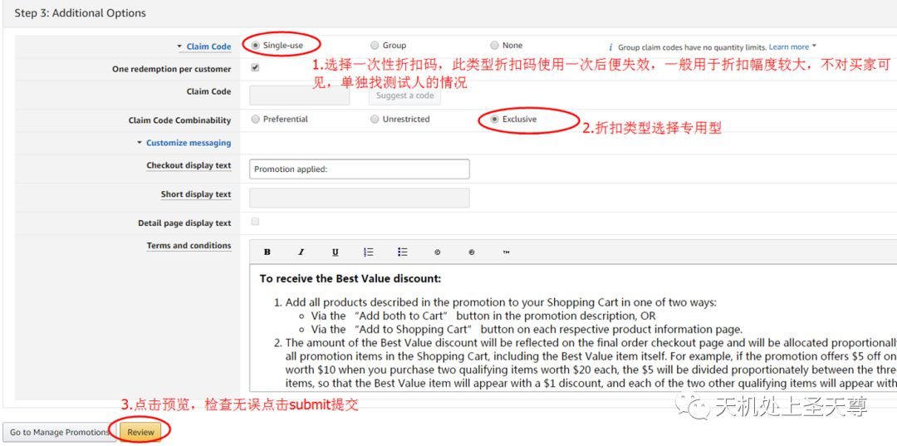

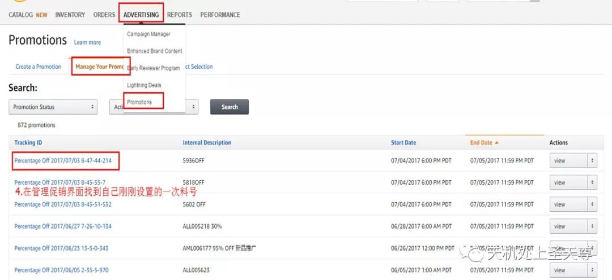

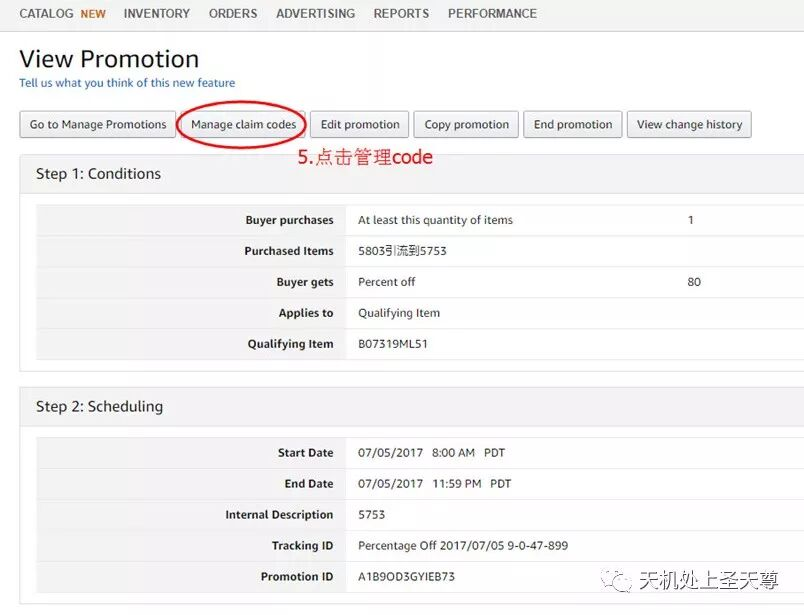

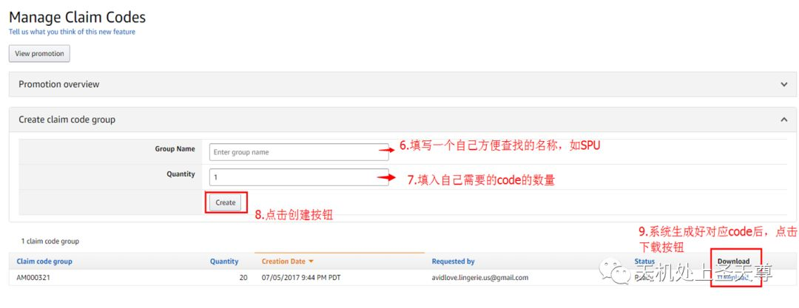

**Group无限制**

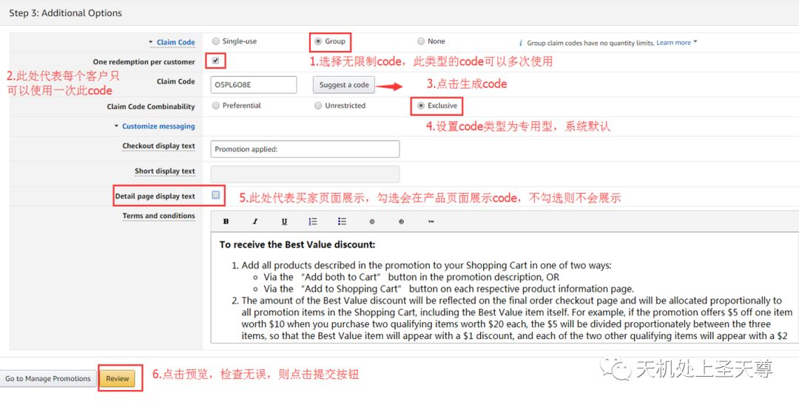

3.优惠码的混合促销--Preferential优先、 Unrestricted不受限、Exclusive专用

..............................................................................................................................

## Preferential优先的混合促销逻辑

1）Combines with all Unrestricted claim codes.

混合所有不受限优惠码

2）Combines with all promotions without claim codes.混合所有不要求折扣码的促销

3）If there are multiple Preferential claim codes, the most beneficial promotion is applied.

如果有多个“优先”折扣码，则将应用优惠度最大的促销

..............................................................................................................................

You run one Preferential promotion:10% off shoes

And one Unrestricted promotion:20% off hats

A customer buys a hat and a pair of shoes and gets both discounts, equaling 30%.

买家购买了一顶帽子和一双鞋子，得到两个折扣优惠 (30%)-10% off shoes + 20% off hats

..............................................................................................................................

## Unrestricted不受限的混合促销逻辑

1）Combines with all Unrestricted claim codes.

混合所有不受限折扣码

2）Combines with one Preferential claim code.

混合一个优先折扣码

3）Combines with all promotions without claim codes

混合所有不要求优惠码的促销

..............................................................................................................................

You run three Unrestricted promotions:

Free shipping for orders over $20

10% off winter coats

Buy a hat, get a free scarf

A customer buys a hat and coat for $100 and receives 10% off the coat, in addition to a free scarf and free shipping

一个买家买了帽子和大衣，总共为 100 美元，获得冬装 10% 折扣优惠，此外还获得一条免费的围巾且免运费

..............................................................................................................................

## Exclusive专用的混合促销逻辑

1）May not combine with any other claim codes.不可混合任何其他折扣码

2）Combines with all promotions without claim codes.

混合所有不要求优惠码的促销

You run two Exclusive promotions:

10% off shoes

20% off hats

A customer buys a hat and a pair of shoes and receives the higher of the two discounts (20%).一位买家购买了一顶帽子和一双鞋，得到两个折扣中较高的折扣 (20%)-20% off hats、shoes不打折

..............................................................................................................................

You run one Exclusive promotion:10% off shoes

And one Unrestricted promotion:20% off hats

A customer buys a hat and a pair of shoes and receives the higher of the two discounts (20%).

一位买家购买了一顶帽子和一双鞋，得到两个折扣中较高的折扣 (20%)-20% off hats、shoes不打折

..............................................................................................................................

You run one Exclusive promotion:10% off shoes

And one non-claim code promotion:20% off hats

A customer buys a hat and a pair of shoes and receives both discounts (30%).

一位买家购买了一顶帽子和一双鞋，得到两个折扣优惠 (30%)-10% off shoes+20% off hats

..............................................................................................................................

**总结：**

**为了避免因为折扣叠加造成的毛利损失，建议一款产品同一时间段只设置一个promotion**

..............................................................................................................................Giveaway的设定

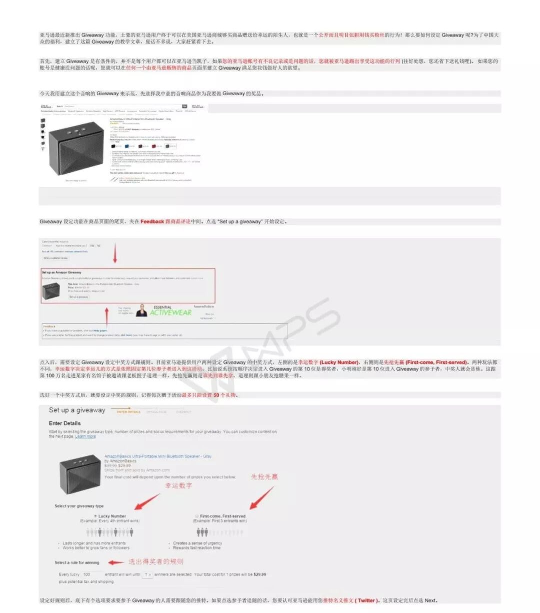

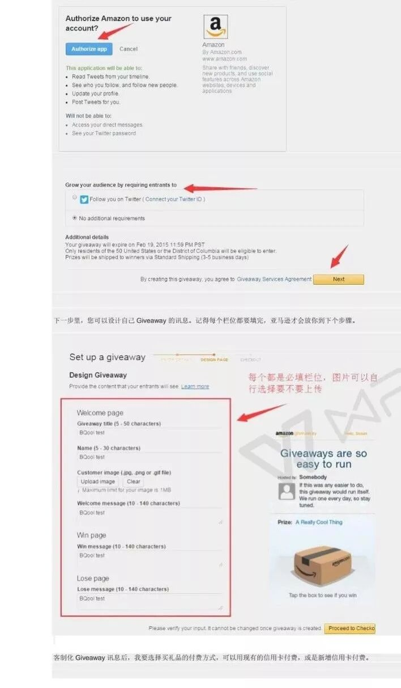

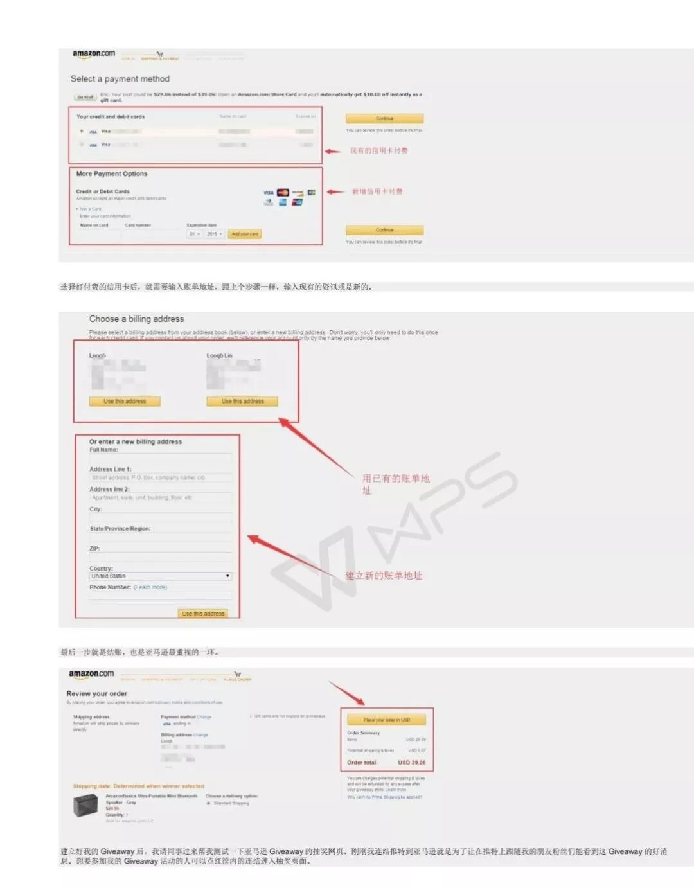

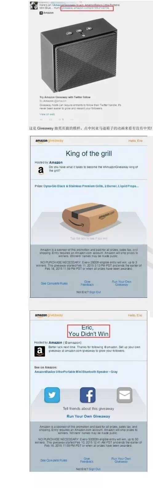
