# 亚马逊测评基础内容Facebook

> Source: wechat
> Author: 天机跨境
> Original: https://mp.weixin.qq.com/s/YwCYFB7uAViAHBDxzqBtww

---

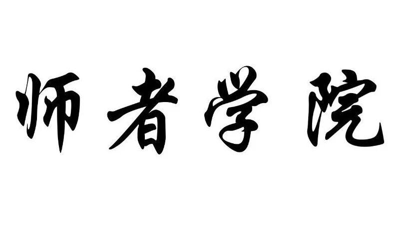

---

师者学院

送测含义： 通过真实购买过程，免费送产品给买家获取客户评论。

什么是送测？  -- 测评，订单推广（刷单）

测评模式： （大概流程如下）

流程：通过各种渠道联系达人，沟通送测各个细节{付款方式留评}，（填写好达人记录表）【下单方式：code（折扣码），paypal,    giftcard,】同意后，达人给到我们profile{亚马逊买家账号简介}，审核{一个月留评数量不超过30个，不要集中留评的，查黑名单}，审核通过后，让达人下单{通过关键词搜索，或者超链接原始链接}，下单过程中注意，不要马上下单，要浏览页面图片，还要对比（货比三家）QA(假聊)，加入购物车，付款或者第二天付款，给单号，审核，后台显示付款完成，或已发货，开始返款，返款加上PP费，下单三天后询问达人是否收到货满不满意，隐晦地提醒他留评，留评后 填记录表，存档，维系以后要使用

找达人的途径？需要注意什么？

社交平台（Facebook,  Twitter,  Instagram,  Pinterest,  Tumblr, Snapchat,Whatsapp Wechat微信群）测评邮箱，真实买家Paypal 账号，，买家数据，买家资源。

Facebook群组，发帖，模板中, 不要出现品牌和店铺名，不要出现Amazon,review和feedback等字眼，不要直接发产品链接，最好是用关键词搜索，或者做链接给他，尽可能地模拟真实的购买

返款方式code，Gift card，refund after ship , refund after order ,refund after review, 亚马逊后台显示由payment pending - payment completed才返款

{不要提前付款给达人，下单确定达人已经付款完成再返款，但是最好建议是产品显示发货，再返款这是比较好的}加上paypal手续费，包含手续费的返款金额=订单价格+手续费率+手续费

全站点标准费率 ：       包含手续费的返款金额 =  订单价格 + 订单价格\*0.044 + 0.3

下单前和达人沟通好是否cover PP fee，包含PayPal手续费，如果需要的，只能回答我们会尽量cover，不能保证到账的金额和达人收到的完全一样。经验证，使用最新手续费算法确实会有部分达人收到的金额少零点几到一美金，但是金额都不会太大，如果这样都不能接受的达人建议谨慎合作或者返GC。

我们的黑名单：

网络共享版黑名单：http://mjzj.com/ce-ping-bao-guang-tai/zui-xin-ti-jiao-hei-ming-dan.html

注意事项：以及防范措施

1. 送测流程   {详细见 附件}

开发信：写明返款方式，测试产品和图片（不同产品要编上号），送测要求，附上多种联系方式（Facebook，Snapchat, Whats app,Wechat等），推荐赚佣金，如果达人感兴趣，就让他们发自己的profile链接或者截图，以及喜欢的产品图片，编号等信息。

2. 测评达人邮箱，Paypal 邮箱，真实买家账号邮箱

Top Reviewer 邮箱联系 Top标志都不可以用，top1000-10000看profile 质量，最好真实买家（这种一定要看达人账号的质量留评数量和黑名单，测评这种达人需要慎重）

3. 达人下单后发了单号，但是发货前就取消了订单，或者收到货之后退货

防范方法：不需要留评的订单，和达人沟通发货后返款或者到货后返款，需要留评的订单沟通到货后返款或者留评后返款，因为发货后达人马上取消订单一般亚马逊是不会通过的，而且发货后我们也达到了一定的推广效果。

注意：pending状态付款肯定不安全，但是付款成功还未发货也可以取消订单，所以这个状态付款也不够安全。

4. 达人收到货之后不留评。

防范方法：首先合作前先沟通，看达人是否愿意分享购物体验，主要不能使用review，Amazon,feedback等敏感词汇，再就是看达人合作是否积极，如果正常时间段消息都很久不回的，后期催评也会比较困难。另外，达人到货了可以用不需要留评的产品吸引达人留评，但是之后建议就不要继续合作了。

5. 达人到货后留差评。

防范方法：下单后多提醒两句，1-到货了告诉你，2-有任何问题可以随时联系你，你会尽全力解决；如果达人说了产品已到货，先问一下是不是对产品满意，满意再问愿不愿意分享购物体验，不满意先问什么原因，然后尽力解决，同时跟达人说谢谢她的反馈，会尽力改善，希望不要分享她的评论，期待下次合作等等，这样可以有效避免差评。

语言一定要言简意赅 很准确，要委婉客气有礼貌，切记用生硬，强制等语气

术语 （terminology）是 在特定领域表示概念的词语 或专门用语

PM  private massage ：私人信息 私聊 给我发私信

ASAP ：尽可能快地

cover pp fee  ：包含PayPal手续费

RAR  refund after review ：留评后返款

refund after order  ：下单后返款

refund after ship  ： 发货后返款

refund after payment completed ：付款完成后返款

giftcard ：亚马逊礼品卡（缩写 gc）

code ：折扣码，优惠券

pp   ： PayPal付款

ty    ：thank you 谢谢你

plz  ： please 请

US Only/only for US ：只限美国

NO. ：编号      Order  NO. ：订单号

PP  US only. We could refund you by  Paypal or gift card after we send out the products,  we cover high PP fee, ty.

If you are interested, please  let me know

Only for us. If you are interested pls  pm me with your amazon  profile.

Please send me your profile first (a screenshot is ok ,and screen shot with products you had reviewed)we need to check ,we will tell u if ok and send u keyword and link, ty

用code下单前要求达人：Before you order the item, plz browse the product page,including title, deascription,pics and  rev(question),then ask a question. Thank you so much.

Code: The discount code will come into force after 4 hours and it can be used only once.Please place the order in a day and send me the order NO.

在Facebook发帖: US Only, pp after ship ,cover pp fee If interested, please PM me your amazon profile.Thanks.

Hello,friend.Are you interested to text our new clothes. Direct shipping，or refund after the order by gc or pp，just accept credit card order.)

在 达人留评前 : Could u send your words and  picture to me before u post it? If there is any problem with our products, plz contact me first.I will try my best to help u.

........................................................................................................................

Hello,

How are you doing? This is XXX, the YouTube manager of VIVIVI.com. I've checked your video, and was very much inspired by so many fans and views you've got. That is awesome.

I sincerely want to build a kind of cooperative relationship with you, and wonder if you can feature in the video with our products?

Maybe you'd like to check our website:

www.vivivi.com

Sincerely look forward to hearing from you soon  : )  Best wish to you !

Best regards

VIVIVI Marketing Team

XXX

...............................................................................................................................

Hello dear friend,

This is XXX,  so glad to meet you! We have many women's clothes need to test,(https://XXXX.com) Plz give me a screenshot about your favorite clothing and send me about your Amazon profile.  We could refund you by paypal or gift card after we send out the products, we cover high PP fee, and u can make more money to recommend your friends to test our products almost $2-3,if you are interested in our new clothes, please feel free to PM me. Looking forward to your reply! Bet wish to you !

Sincerely

XXX

-------------------------------------------------------------------------------------------------

You can contact me with my facebook or wechat

Facebook: yayun yanx          link:  https://www.facebook.com/ifixlabscoxx

wechat:132657580XX

附上 图片，图片上写明编号（要求，返款方法 可选填）

.............................................................................................................................

## 详细介绍Facebook找达人方法

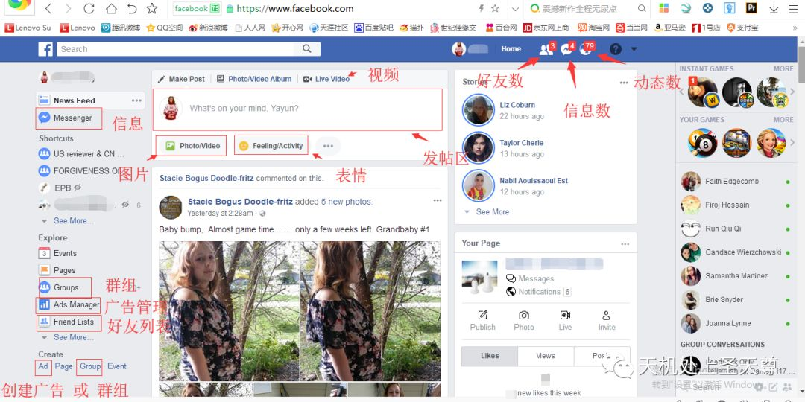

发帖界面

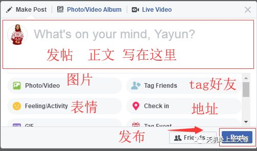

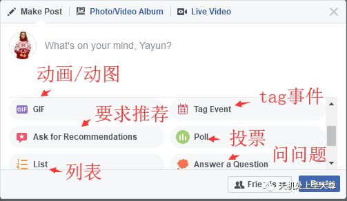

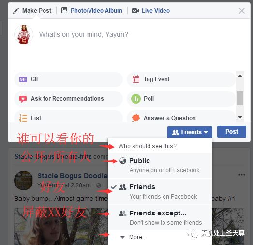

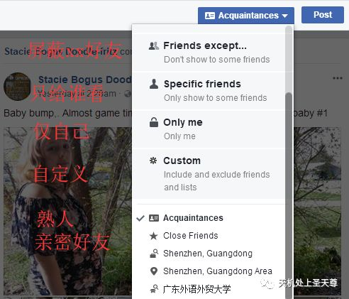

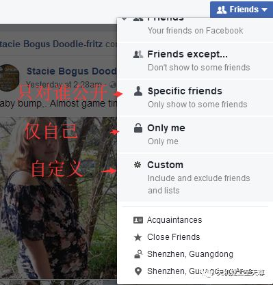

查找和发现Facebook群组，首页搜索关键词，文章末尾有推荐的群组

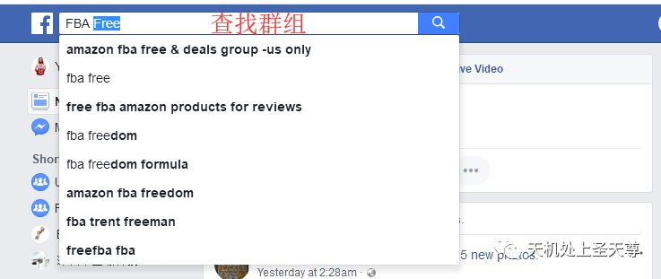

陌生消息和好友消息的查看

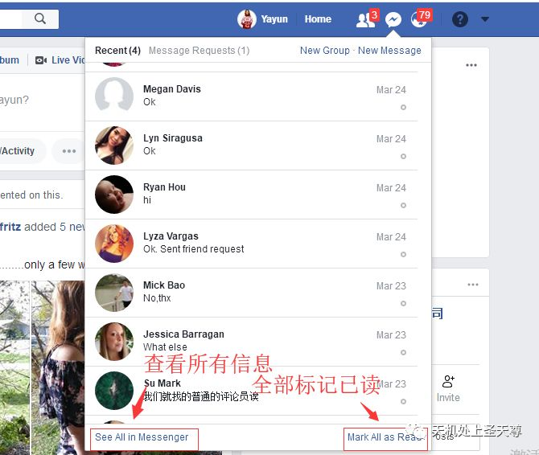

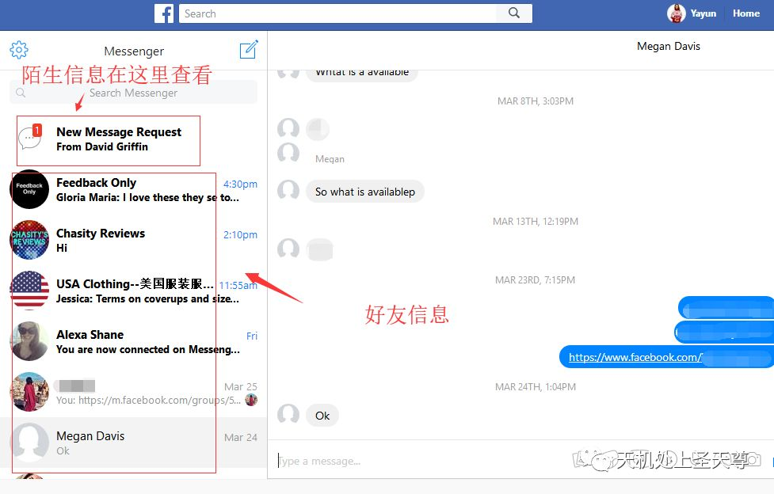

推荐群组 Recommended

Amazon Coupon Codes And Discount Deals

27 friends · 8,995 members

Amazon US Review Group

42 friends · 11,907 members

Top amazon FBA reviewer(US)

42 friends · 11,571 members

Amazon Reviewer Group (Spain and Europe)

9 friends · 1,929 members

Amazon Review Group for US/UK/DE/FR/IT/ES

27 friends · 8,959 members

Universal Amazon Review (NO refund after review!)

46 friends · 9,439 members

Top Suggestions

Amazon US Review Group

42 friends · 11,907 members

Top amazon FBA reviewer(US)

42 friends · 11,571 members

Amazon Reviewer Group (Spain and Europe)

9 friends · 1,929 members

Amazon Review Group for US/UK/DE/FR/IT/ES

27 friends · 8,959 members

Universal Amazon Review (NO refund after review!)

46 friends · 9,439 members

Amazon US Free FBA Review Club

17 friends · 5,121 members

Best USA Amazon Reviewers (Codes & Discounted Deals)

31 friends · 2,751 members

Amazon Promotion US

36 friends · 6,229 members

Amazon Review Group US UK ES FR IT CA MX JP DE

48 friends · 16,076 members

Amazon deals, and steals review group

28 friends · 9,804 members

Semi Trucks and Trailers for sale

2 friends · 86,377 members

AMZ review US

57 friends · 16,780 members

Amazon blacklist

24 friends · 5,102 members

Amazon review,deals, code (US/UK)

20 friends · 6,695 members

Top amazon FBA reviewer(US)

42 friends · 11,571 members

Chihuahua Parents

1 friend · 29,766 members

Amazon Extreme Deals - NO REVIEWS COUPONS AND PP REFUND AFTER ORDER

24 friends · 2,944 members

HDD Repair and data recovery

591 members

Amazon Review Group USA - helping sellers and reviewers since 1949 ;-)

17 friends · 5,478 members

Coupons Deals & Codes

38 friends · 9,418 members

🌟 NO Review Items 🌟

60 friends · 9,937 members

更多推荐的群组，推荐网站（https://www.facebook.com/groups/?discover\_category\_id=212609529249058&order=default）

## 创建Facebook群组

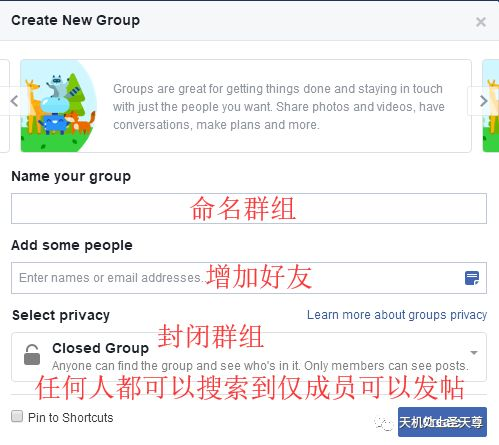

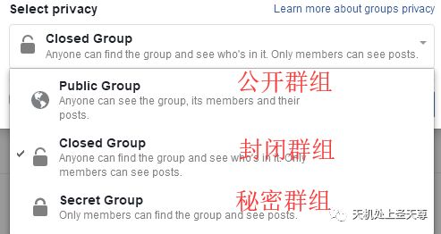

## 创建事件

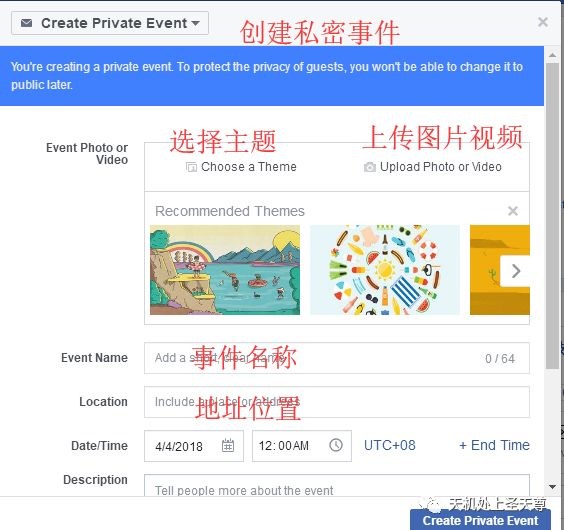

创建公开事件

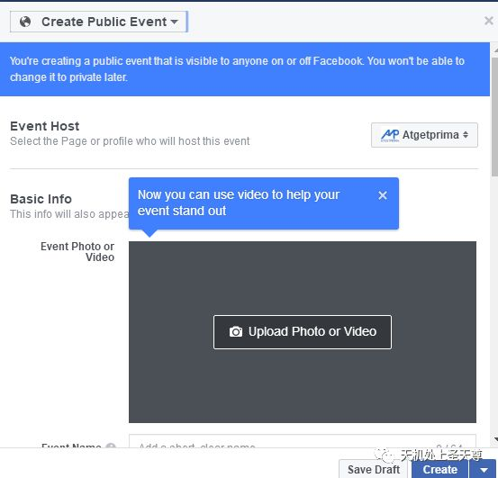

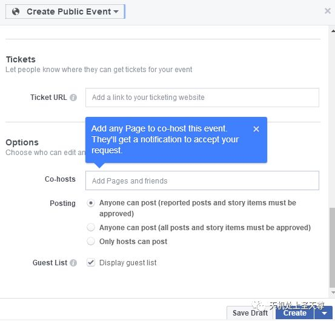

## 创建Facebook广告

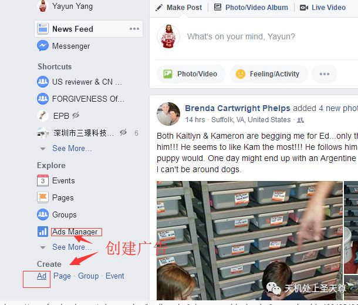

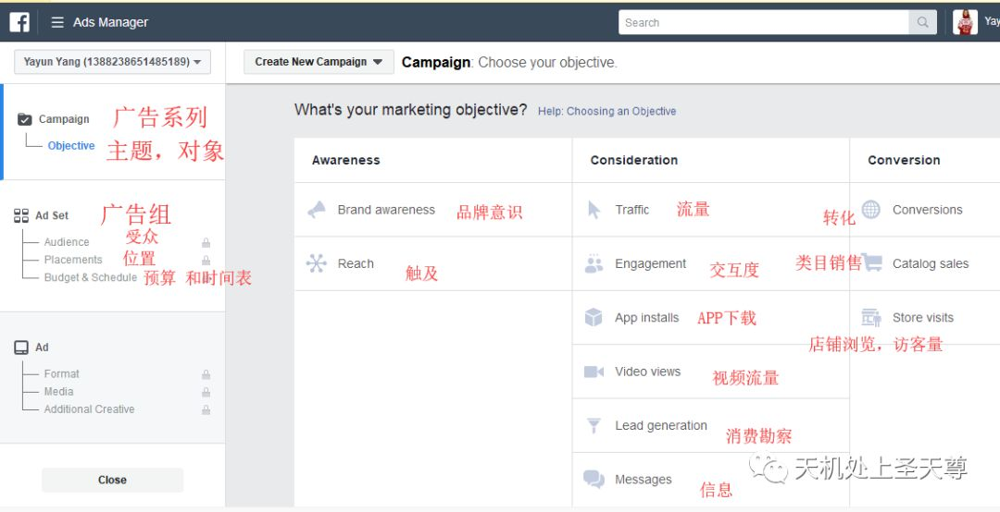

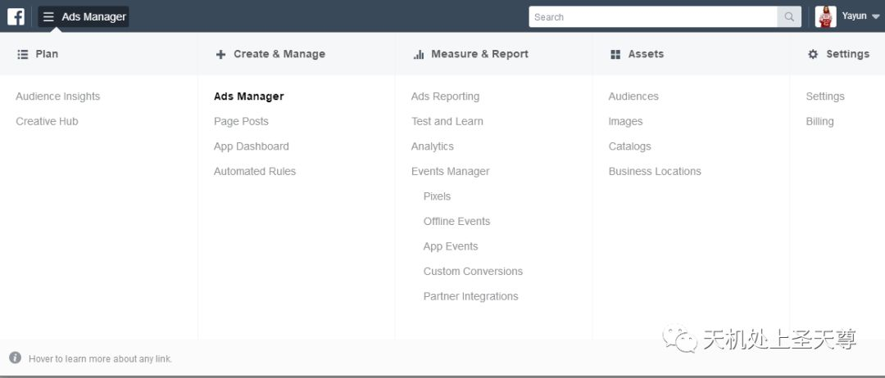

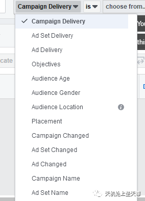

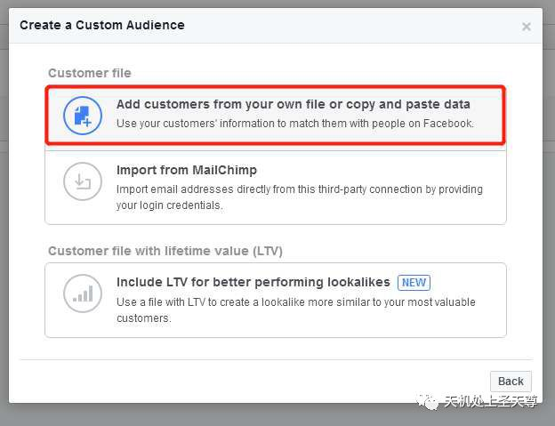

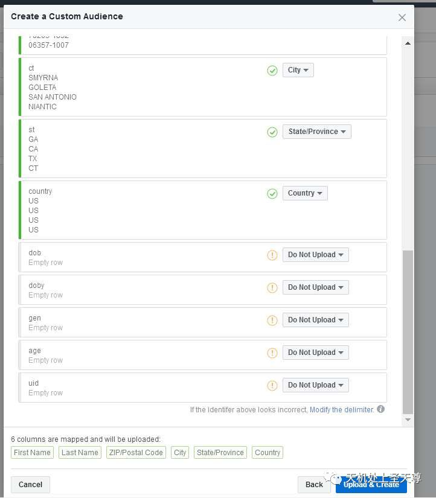

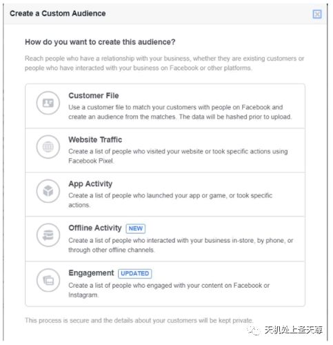

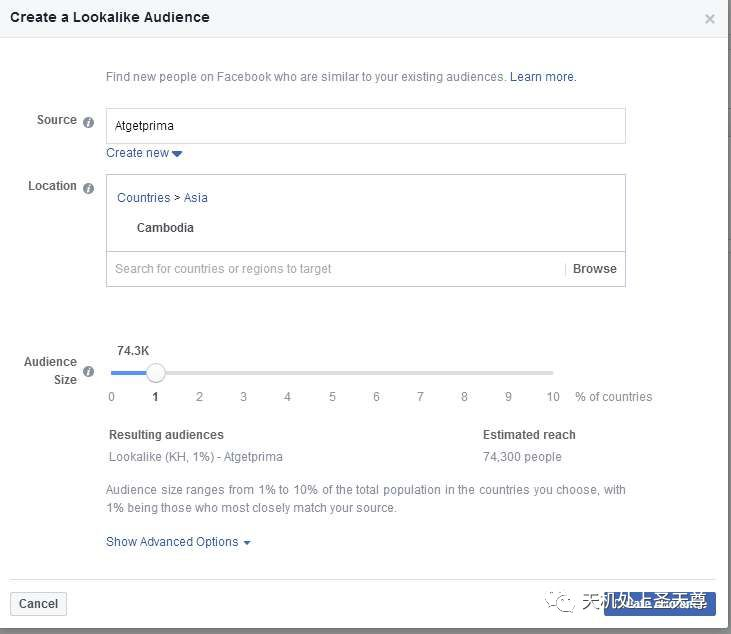

利用买家数据或物流截留的买家电话，在Skype,Snapchat,Whatsapp, Hunter,Linkedin上

（ 通过买家电话和邮箱，多维度查找，建立粉丝群，精准营销）

buyer-name，last name ，ship-city， city-state，  ship-postal-code

接下来 讲解:

Instagram 视频直播

YouTube视频
