# 在instagram和pinterest上找达人方法介绍

> Source: wechat
> Author: 天机跨境
> Original: https://mp.weixin.qq.com/s/wSBSpz6BuC7aniHJ9e0-xg

---

---

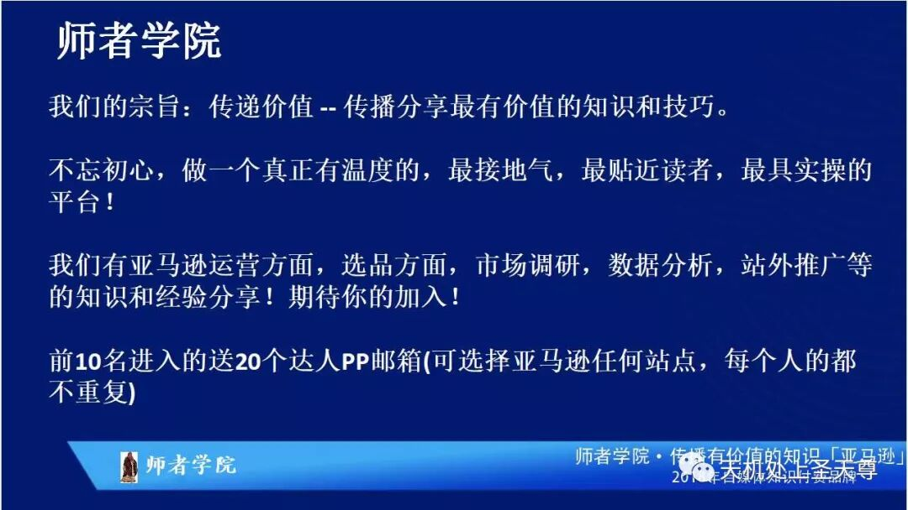

在instagram上找达人方法介绍

简单介绍一下Instagram 是一款免费提供在线图片及视频分享的社交应用软件，于2010年10月发布。

拼好图片+tag#review#reviewer#freebie#等，通过这些tag就可以搜到你，还有自己添加评论说明例如：Only for us, pp gc or code.If you are interested pls pm me with your amazon profile.

Instagram 电脑不能发帖，只能用手机，可以私聊别人也可以在别人的帖子下面评论。

Instagram 找达人技巧分享：

1，如果有之前合作好的达人玩Instagram ，让他帮你发广告recruit reviewers，这是第一步，如果没有，可以在Instagram 上搜索 reviewer或者tester 会出来很多，直接私信问他们是否有兴趣，如下图：

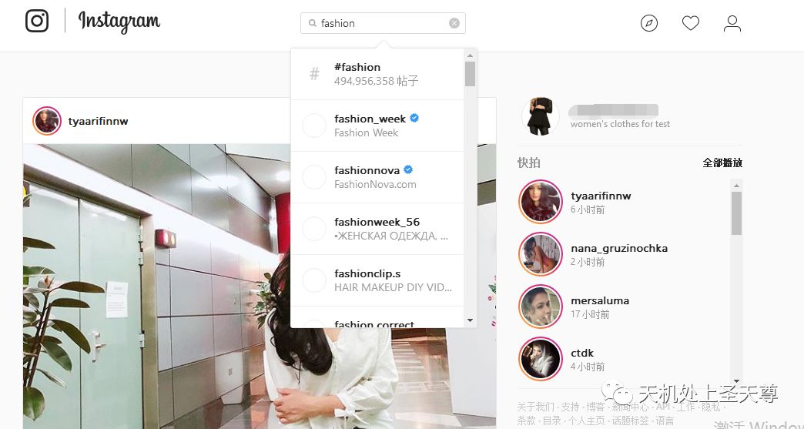

2，开始跟Instagram 上的达人建立合作后，去她的粉丝或者关注的人里找头像好看的人或者名字带产品测评的人私信,

3，Instagram 达人收到产品之后，让他们返图返到Instagram 上，tag你然后帮你recruit reviewers，然后自然而然就会有人私信你。

instagram  上面主要以优美图片和生活情景的视频为内容，所有Instagram 上的图片质量都比较好，所以上面的达人质量也不错，首先在 ins 上利用标签或关键词搜索，像衣服这一类的我们一般会搜fashion，beauty， wearing,outfit 等字眼有关的。

点击进去就可以看到里面热门的帖子

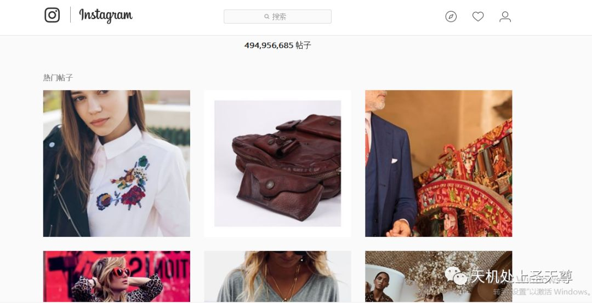

仔细观察达人的信息，建立一个达人的画像，觉得符合自己的送测需求就可以写开发信，主动联系他

把你要测评的产品介绍给他问他是否愿意帮忙测试和发帖，也可以让他点赞或者发帖，还可以通过达人 评论下面的点赞 留评论的人里面找到测评的人，找到目标达人就可以发开发信给他。

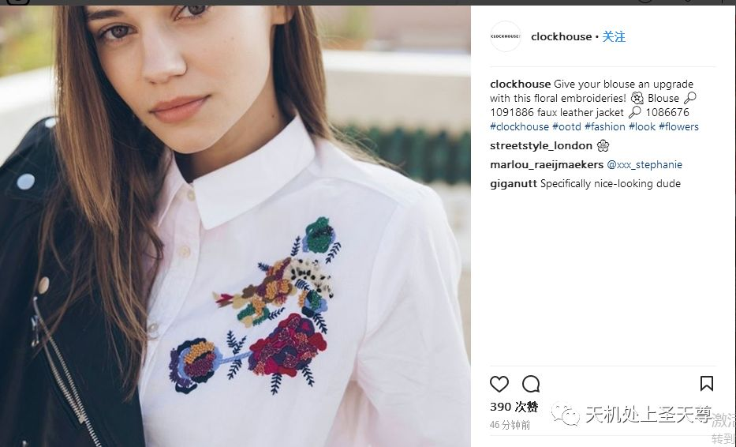

这种达人很会搭配，衣服很好看很讲究，测评质量就非常好，你也可以去 390次点赞里面找到达人。

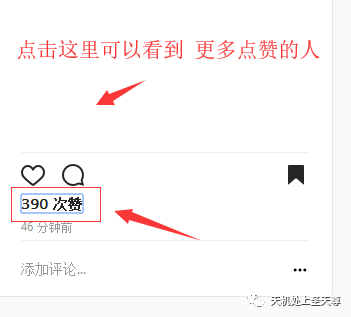

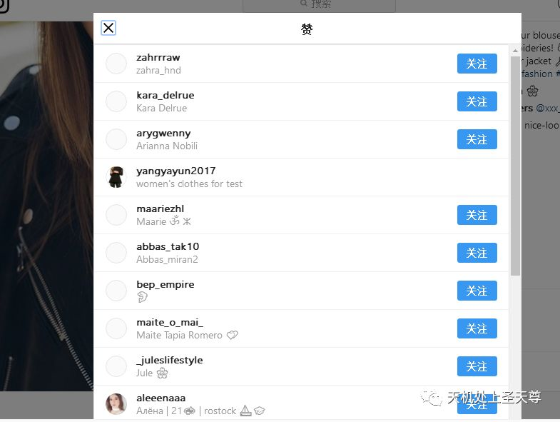

对于那些关注者超过两三千的达人你可以通过 code和GIFt card 的形式送 给达人， 达人可以发帖到社交网站，提高你产品的转化率，这种对 profile 的要求低，成功率高 。

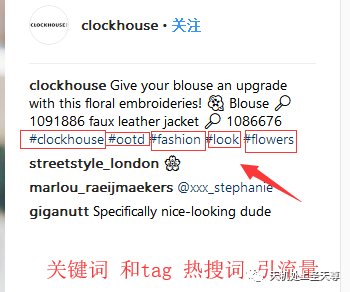

关注者很多的， 能提高转化率，带来流量的可以选择不留评

对profile 要求没那么高   还可以 po 在社交软件，提供关键词和tag, 换种方式做 review

Ins 达人收到产品之后，让他们返图返到 ins 上，tag 你然后帮你

recruit reviewers，然后自然而然就会有人私信你大家可以参考一下

还有 Instagram 只能在手机上面 开直播，到时专门讲一课-

《怎么做 Instagram视频》 。

待续

https://www.pinterest.com/

Pinterest，是一个网络与手机的应用程序，可以让用户利用其平台作为个人创意及项目工作所需的视觉探索工具，同时也有人把它视为一个图片分享类的社交网站，用户可以按主题分类添加和管理自己的图片收藏，并与好友分享。其使用的网站布局为瀑布流布局

可以通过 Facebook 登录

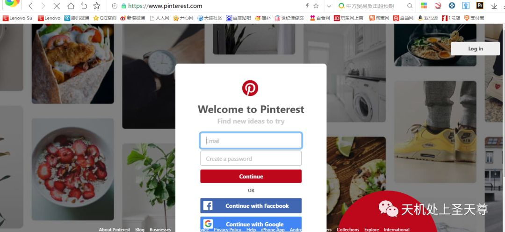

丰富个人主页，发帖吸引达人，编辑自己的主页，创建新的Pin，编辑已创建好的Pin主题，

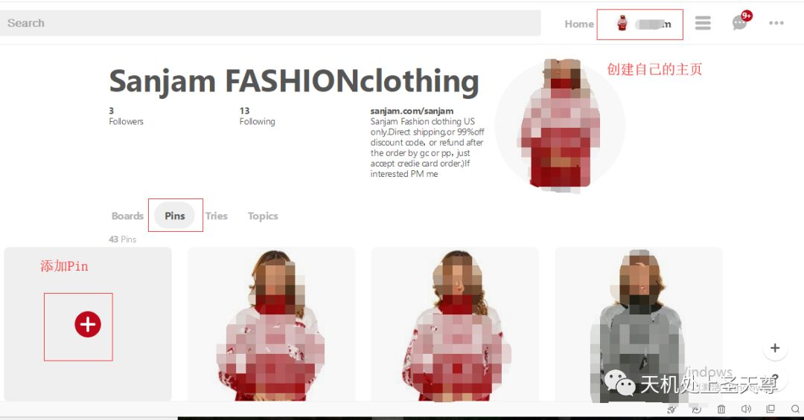

帖子内容编辑尽可能多的信息&tag

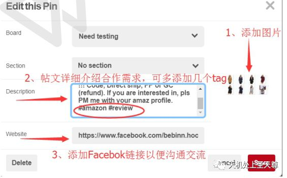

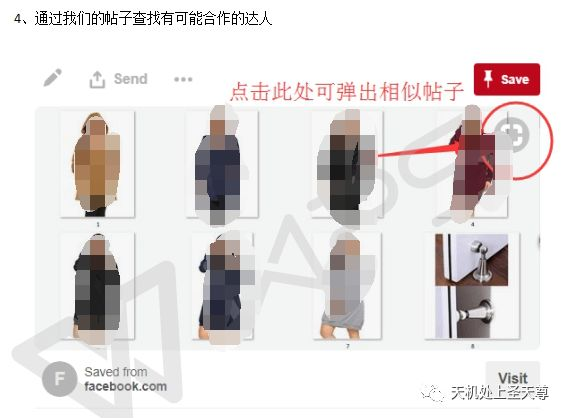

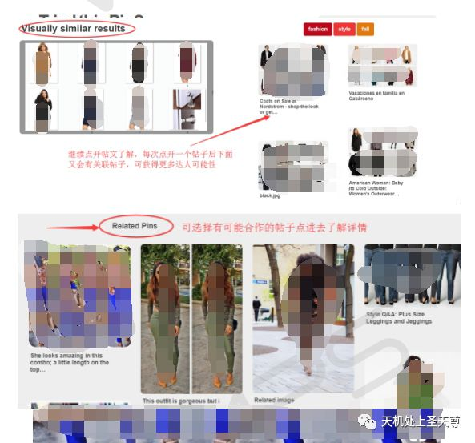

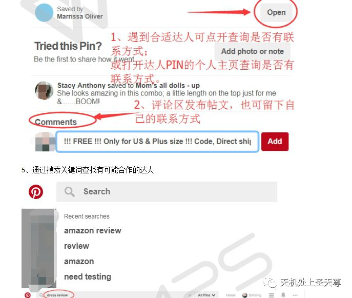

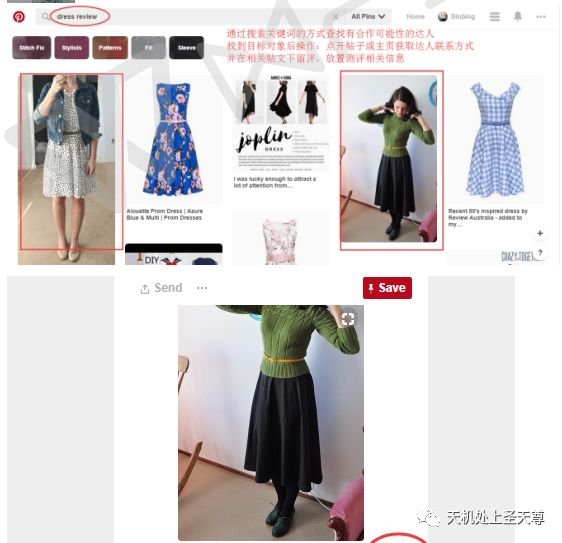

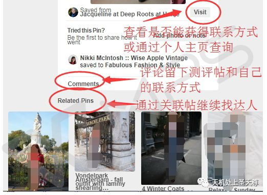
