# 亚马逊站内CPC基础内容 Day1-Advertising Basic

> Source: wechat
> Author: 天机跨境
> Original: https://mp.weixin.qq.com/s/03l6ijhDaeOvTNRcsEC6cg

---

---

## CPC广告基础内容

广告更新

基本概念 含义

创建自动广告

广告搭建策略

搜索词报告分析

批量下载

创建手动广告 ：关键词的填写

关键词匹配方式

Broad：搜索词中包含投放的词，顺序可颠倒；初期用

Phrase：作为词组出现在搜索词中，顺序一致； 优化用

Exact：要求搜索词和投放的关键词完全一致（变体，单复数）；优化用

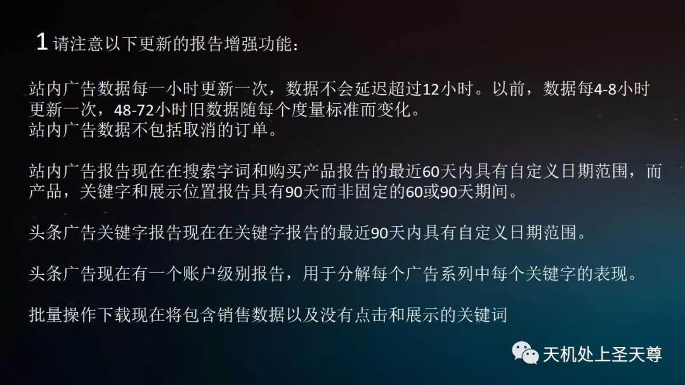

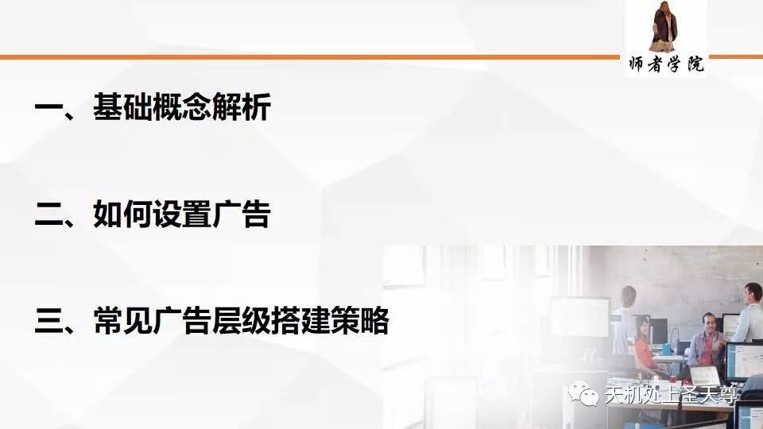

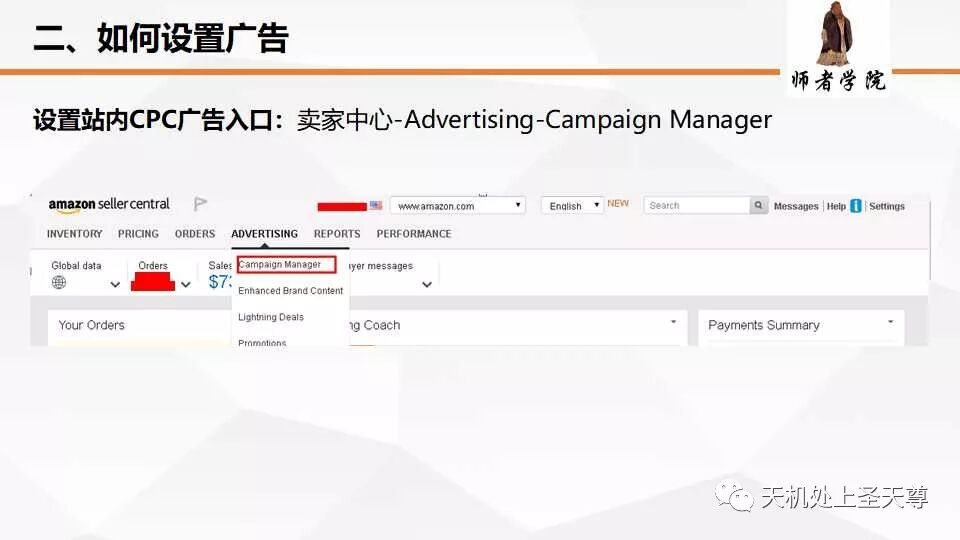

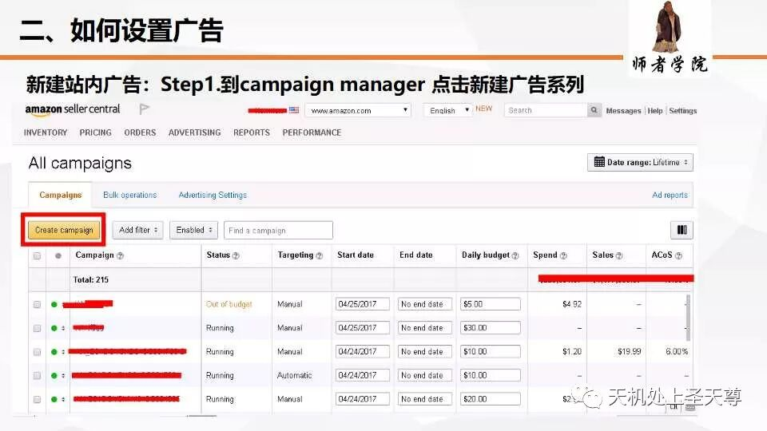

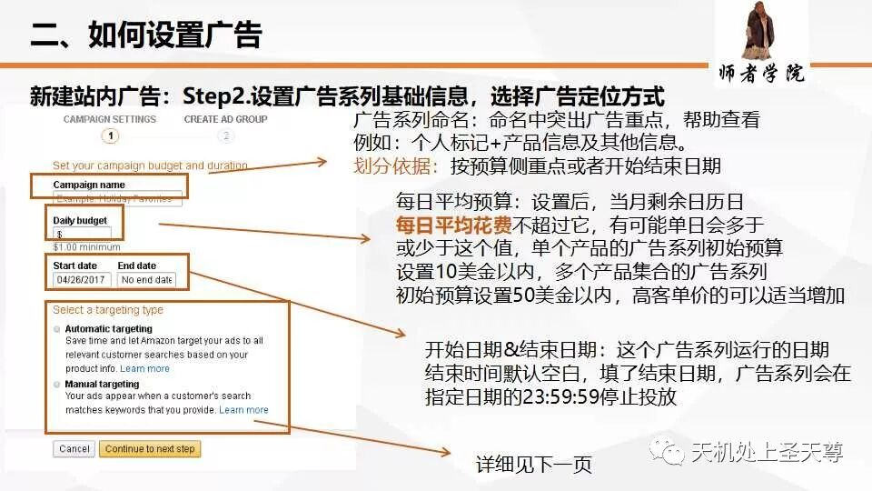

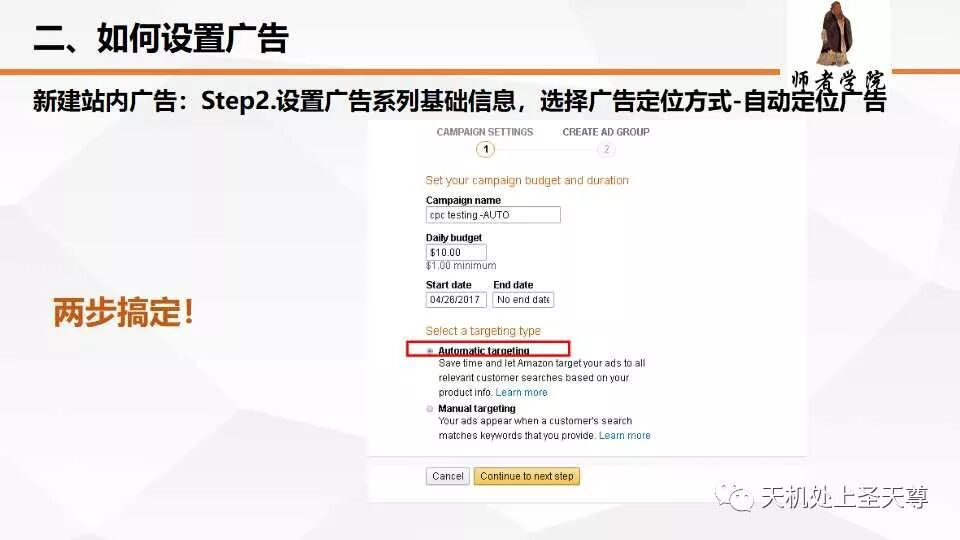

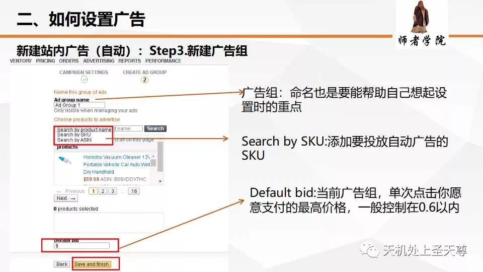

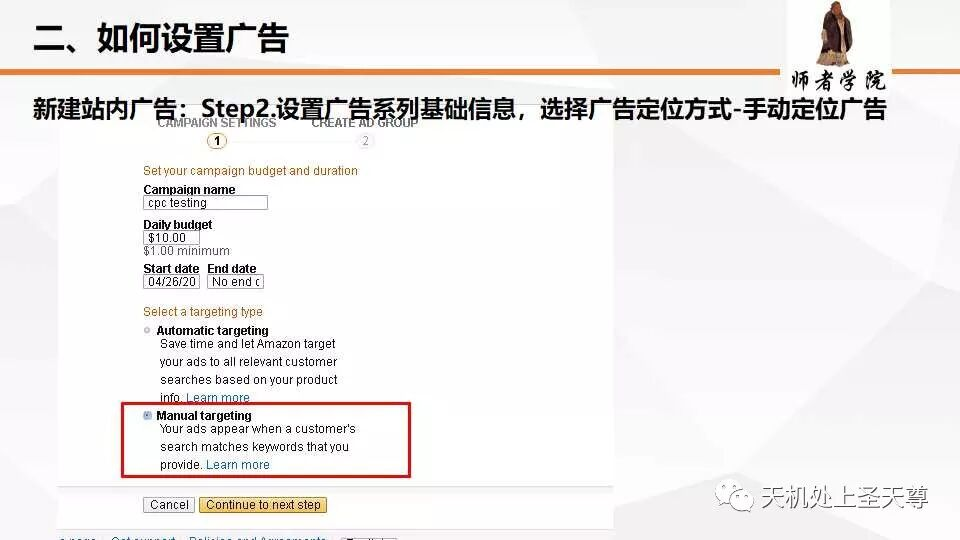

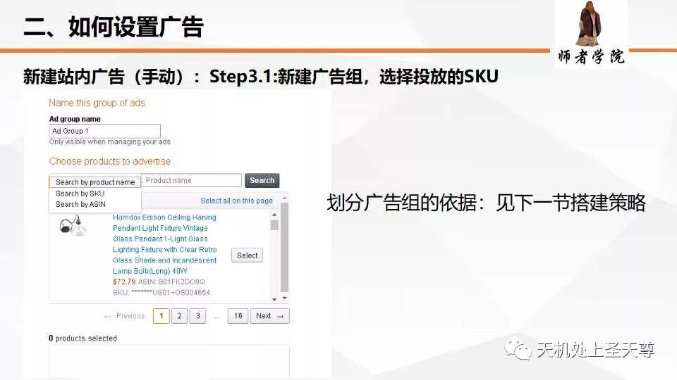

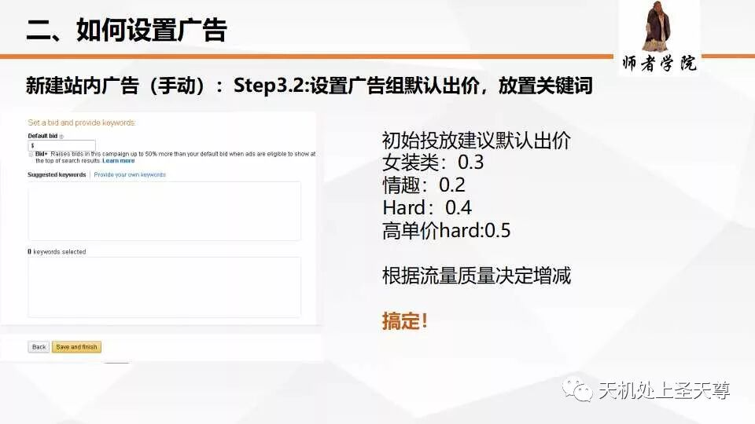

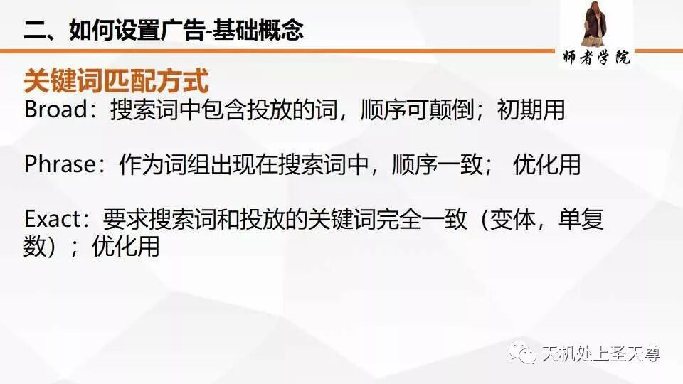

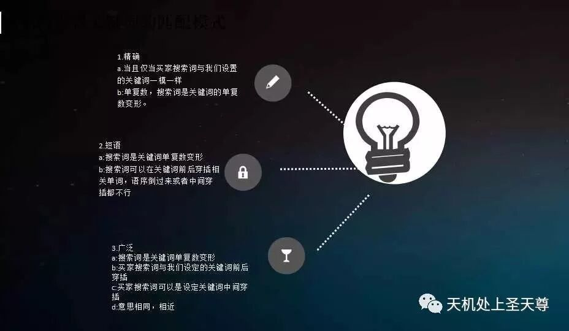

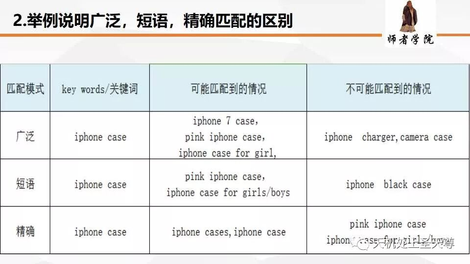

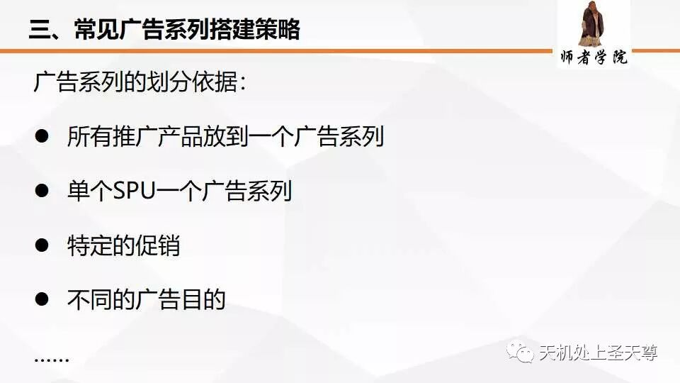

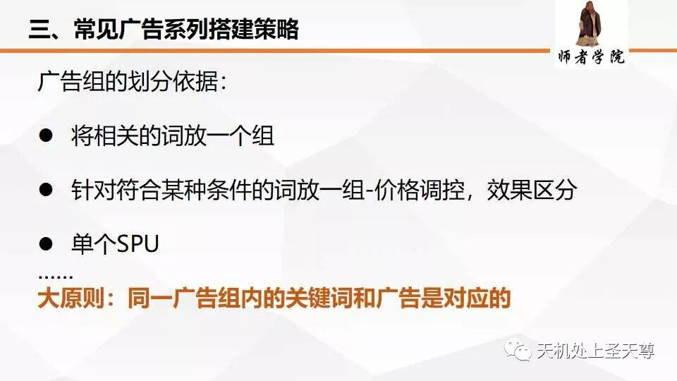

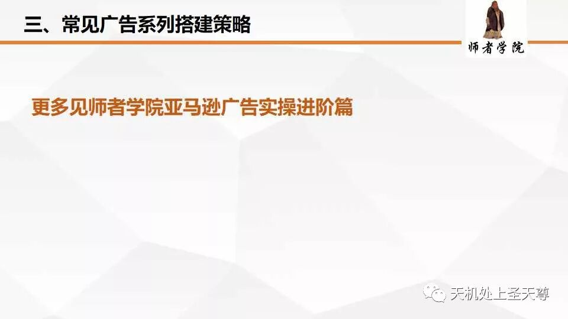

搜索字词报告包含至少会在您的广告上产生一次点击的搜索字词。它包含在过去60天在Amazon.com上搜索时购物者输入的实际搜索字词。此外，它还包括手动和自动关键字定位广告系列的展示次数，点击次数和销售数据。

提示：搜索字词和关键字有什么区别？

搜索词是在Amazon上搜索产品时购物者输入的确切词组。关键字是您在广告系列管理器中针对您的广告定位到客户的字词或一组字词。当您的广告系列至少运行一天时，搜索字词报告可用。

|  |  |
| --- | --- |
| **Field** | **Description** |
| Campaign Name | 广告系列的名称 |
| Ad Group Name | 广告组的名称 |
| Customer Search Term | 客户搜索词（匹配您的广告） |
| Keyword | 与客户搜索词匹配的关键字  注意：在自动广告系列中，关键字列为“\*”，即自动广告无关键词 |
| Match Type | 关键词匹配方式 |
| First Day of Impression | 这是搜索字词数据的第一天，从太平洋时间00:00:00（那  天早上的午夜）开始 |
| Last Day of Impression | 这是搜索字词数据的最后一天，结束于太平洋时间23:59:59（当天午夜） |
| Impressions | 广告获得的总展示次数   注意：亚马逊验证点击和展示数据，并删除机器人或连续生成的无效事件。 验证通常在一天内发生 |
| Clicks | 广告获得的总点击次数 |

|  |  |
| --- | --- |
| **Field** | **Description** |
| CTR | 点击率（点击次数÷展示次数） |
| Total Spend | 您在广告上花费的总金额 |
| Average CPC | 平均每次点击费用为广告付费 |
| Currency | 货币 |
| Orders placed within 1-week of a click | 广告点击1周时间内的总订单 |
| Product Sales within 1-week of a click | 广告点击1周时间内的销售额 |
| Conversion Rate within 1-week of a click | 点击广告1周内的订单的转化率  （订单放置÷点击次数） |
| Same SKU units Ordered within 1-week of click | 对同一个SKU广告的点击在1周时间内，相同SKU的订单总数 |
| Other SKU units Ordered within 1-week of click | 在其他SKU广告点击1周内订购的其他SKU订单总数 |

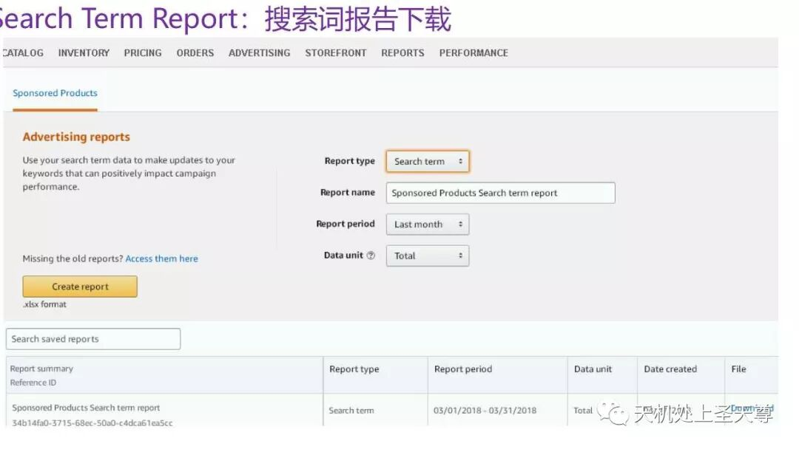

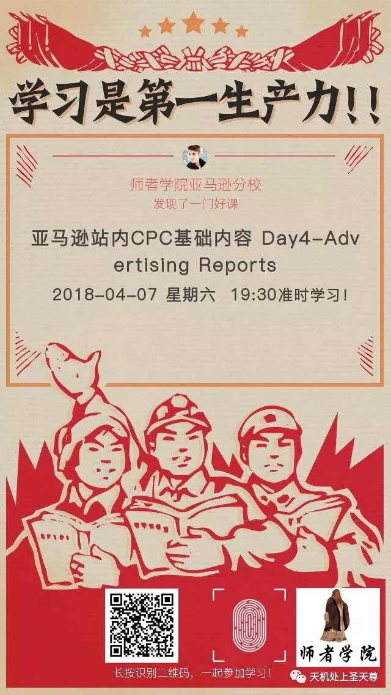
