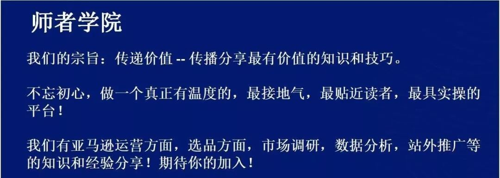
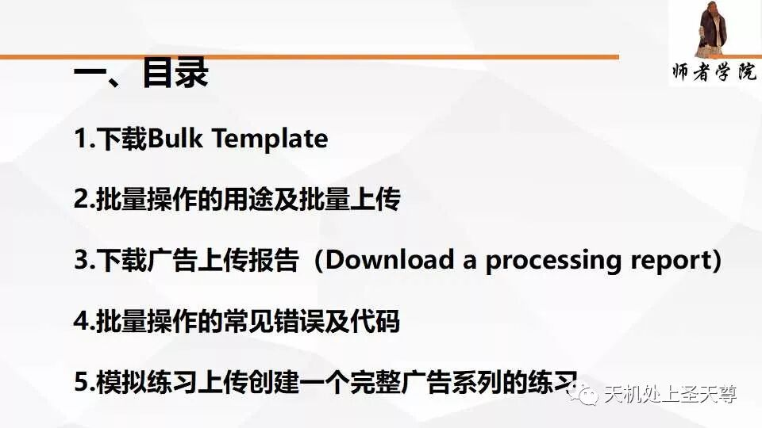
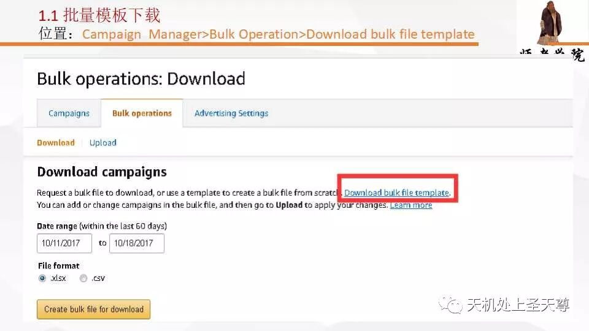
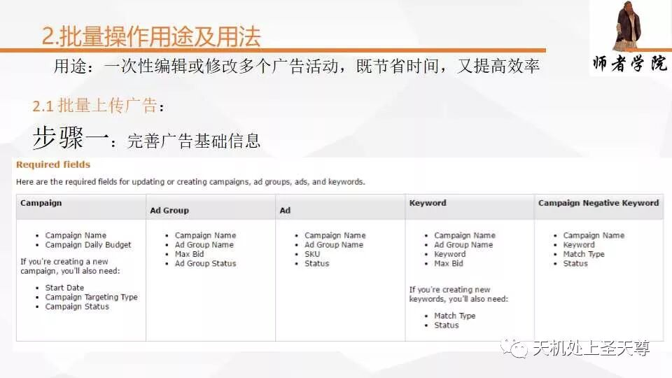
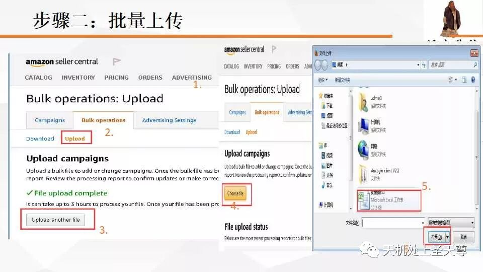
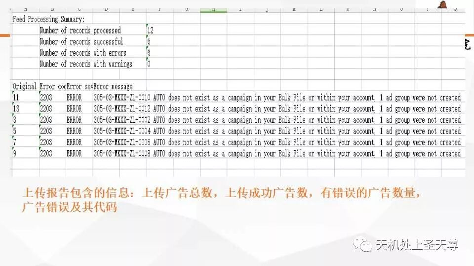
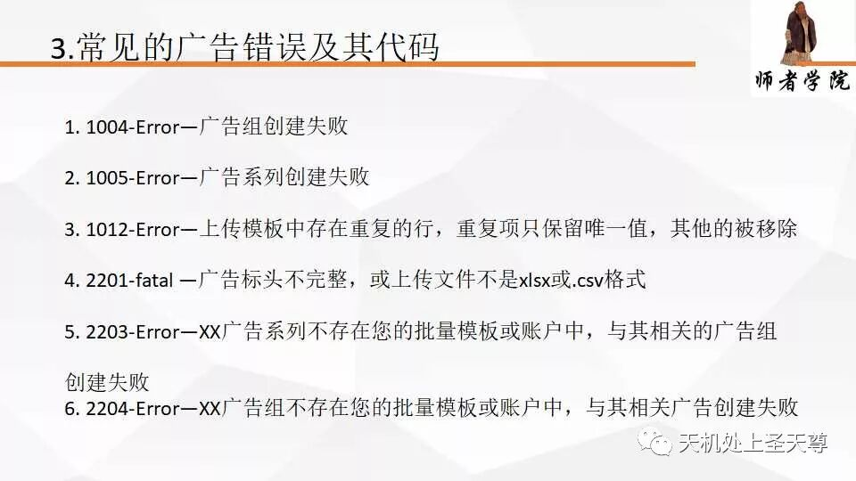
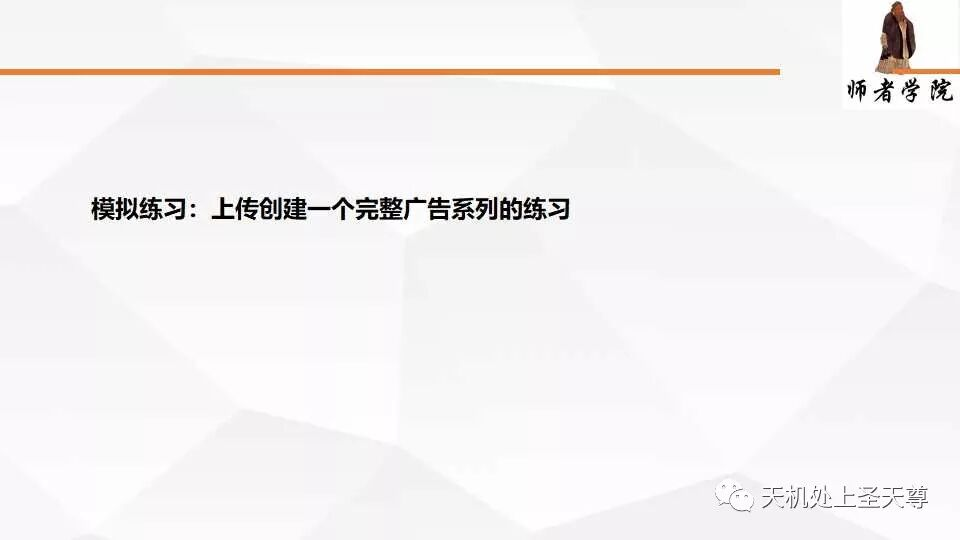

# 亚马逊站内CPC基础内容批量操作 Day5-Advertising Bulk Template

> Source: wechat
> Author: 天机跨境
> Original: https://mp.weixin.qq.com/s/0Kfvs4ICp14UojB84y4byg

---

---

我们的宗旨：传递价值 -- 传播分享最有价值的知识和技巧。

不忘初心，做一个真正有温度的，最接地气，最贴近读者，最具实操的平台！

我们有亚马逊运营方面，选品方面，市场调研，数据分析，站外推广等的知识和经验分享！期待你的加入！

## 前30名进入的送CPC数据报告分析和一份广告分析资料。

站内广告数据每一小时更新一次，数据不会延迟超过12小时。以前，数据每4-8小时更新一次，48-72小时旧数据随每个度量标准而变化。

站内广告数据不包括取消的订单。

站内广告报告现在在搜索字词和购买产品报告的最近60天内具有自定义日期范围，而产品，关键字和展示位置报告具有90天而非固定的60或90天期间。

头条广告关键字报告现在在关键字报告的最近90天内具有自定义日期范围。

头条广告现在有一个账户级别报告，用于分解每个广告系列中每个关键字的表现。

批量操作下载现在将包含销售数据以及没有点击和展示的关键词

