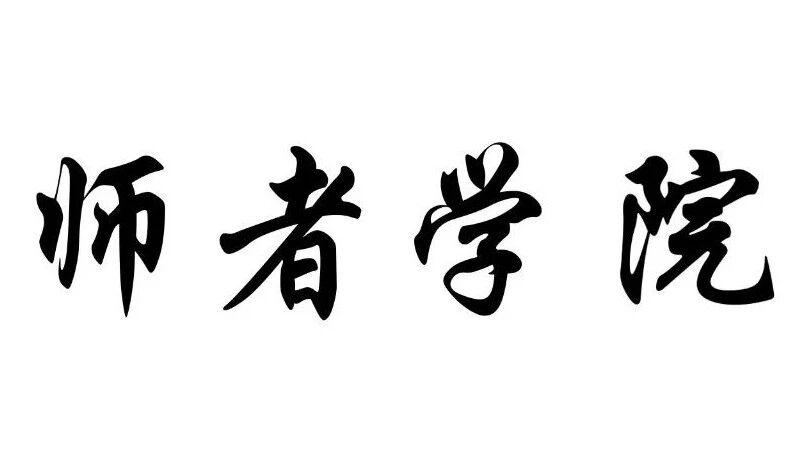
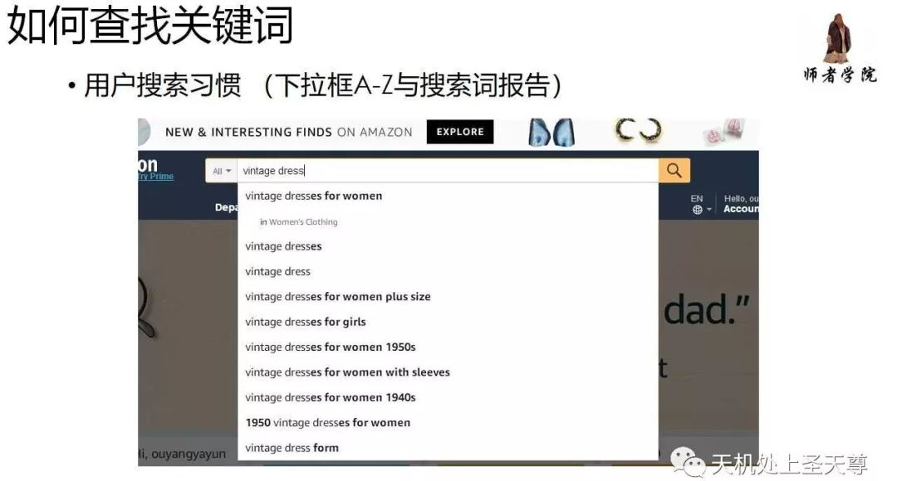
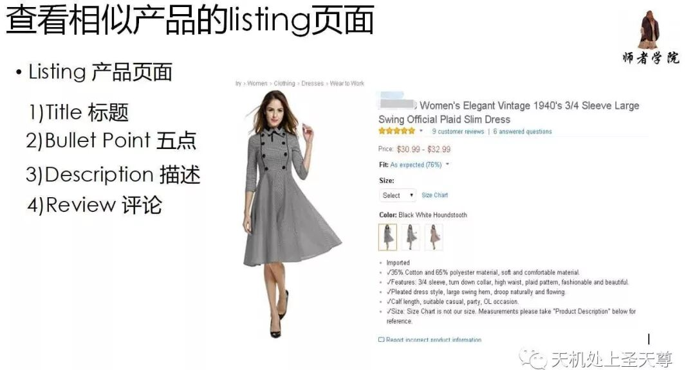
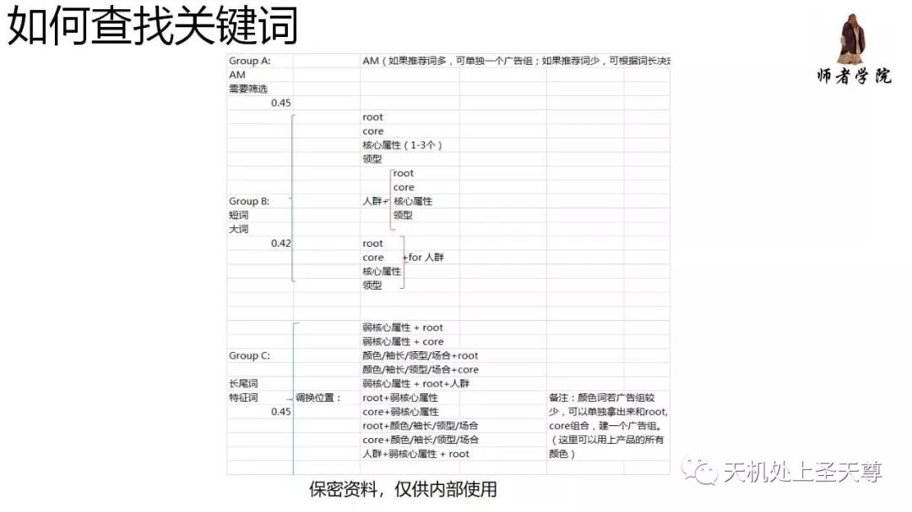
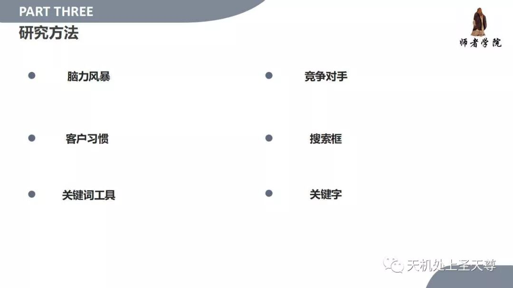

# 如何准确填写手动广告的关键词

> Source: wechat
> Author: 天机跨境
> Original: https://mp.weixin.qq.com/s/NjcpAUwfXJXus6f6YEKlrg

---

---

## 如何准确填写手动广告的关键词

## 客户用来寻找他们目标产品的词

客户在搜索框里面搜索的词

大词，长尾词，属性词，核心关键词，转化词，流量词

关键词挖掘网站及工具

1，Wikipedia

https://www.wikipedia.org/

维基百科解释准确而全面，通过它，可以挖掘出很多老外原汁原味的表达

2，Metaglossary

http://metaglossary.com/

这个工具会给你一些关键字的拓展和衍生。

3，Thesaurus

http://www.thesaurus.com/

利用Thesaurus可以查询关键字的具体定义以及同义词。

4，Soovle

https://www.soovle.com/

利用Soovle可以一次性为你拓展不同渠道的关键字，如wikipedia，Google，

5，Semrush

https://www.semrush.com/

这个网站可以输入竞争对手的网址来获取关键字，BACKLINKS等信息。

6，Keywordtooldominator

https://www.keywordtooldominator.com/

一天可以免费查三次关键字。可以查询关于Google，亚马逊，YouTube的关键字。

7，Keywordtool

https://keywordtool.io/

很好的关键字查找工具，可查询谷歌，Youtube，AppStore等的关键字

8，Answerthepublic

https://answerthepublic.com/

这个工具很强大，可以给你关键字的内容建议。

9，Alexa

https://www.alexa.com/

这个工具可以很容易的查出网站的浏览，全球排名，以及主要的关键字分析。

10，Amasuite

http://amasuite.com/

一款亚马逊工具，能帮助分析亚马逊上的产品，用户是通过何种关键字来购买的

11，Google Trends

https://trends.google.com/trends/

利用里边的Related topics和Related queries可以挖掘一些长尾词

12，Ahrefs

https://ahrefs.com/

Ahrefs的主要功能是查找外链，关键字的挖掘，以及监测竞争对手的行为。

13，Tagblender

http://www.tagblender.net/

做Instagram要用什么样的hashtag，这个工具可以很好的帮到你。

14，Zippy

http://www.zippy.co.uk/keyworddensity/index.php

这个工具可以迅速的分析竞争对手使用单个关键字和两个关键字的频率和密度。

15，Wordtracker

https://www.wordtracker.com/

这个工具为付费工具，但是一天可以查询四次，每次产生10个关键字建议。

16，Seochat

http://tools.seochat.com/tools/suggest-tool/

可以利用它搜索谷歌，bing，亚马逊，YouTube的关键字建议。非常全面！

17，Amazon Best Sellers

https://www.amazon.com/Best-Sellers/zgbs

亚马逊上卖得最好的，也是最热销的产品

18，ST工具

http://t.surtime.com/

查看竞争对手，后台五行关键词，准确率100%

19，Twitter 的 Hashtags

https://twitter.com/hashtags

像国内微博热搜一样

20，谷歌相似搜索

https://www.google.com/trends/correlate

Google Correlate

21，Google AD 谷歌广告，投放量和竞价

22，行业内的论坛网站

23，分析谷歌上搜索最热门的帖子网站博客，关键词+“most popular posts/site/bloger”

24，行业内做客户Review 评论的网站：resellerratings

相似网站查找 https://www.similarsites.com/

下面2个网站非常不错！！

https://resellerratings.com/

https://thewirecutter.com/

25，Yahoo answer

https://answers.yahoo.com/

26，其他电商平台 eBay, Alibaba,Walmart

27，Amazon 同款产品或者相似的产品，他们的评论，标题 ，竞争对手

28，Merchatwords魔词

https://www.merchantwords.com

亚马逊上热度高的搜索词，这个网站可以作为亚马逊搜索热度的参考

29，Scientificseller

https://app.scientificseller.com/

很慢很慢但有用且免费，世界上最慢的关键词工具

30，亚马逊首页搜索栏，下拉框 ，可以用SEO Stack插件

https://chrome.google.com/webstore/search/seostack

http://www.seostack.net/

31，谷歌关键字规划师

https://adwords.google.com/KeywordPlanner

32，Keywordspy

http://www.keywordspy.com/

可以看到广告竞价和月搜索量

33，ASIN Key

https://www.asinkey.com/

亚马逊关键词搜索工具

34，Contentforest

www.contentforest.com/

查黑链

35，KWfinder

https://app.kwfinder.com/

不错

36，SONAR

http://sonar-tool.com/zh/

要翻墙， 一个月 9.99美金

37，KI keywordinspector

http://www.keywordinspector.com/simple/index.php

关键词 专家

38，Findbrowsenodes

http://www.findbrowsenodes.com/

FBN 查看节点，品类，和相似产品

39，比酷bqool

https://www.bqool.com/

bqool，不错

40，yasiv.com

www.yasiv.com

通过关键词找产品

41，FANZLE

http://fanzle.com/

长尾关键词

http://fanzle.com/amazon-longtail-keyword-scraper

41，SEMrush

https://www.semrush.com

谷歌关键词分析工具 – Semrush

SEMRush是一个专门从事搜索引擎优化和搜索引擎营销服务网站。

42，App.scientificseller.com

https://app.scientificseller.com/

免费关键词搜索，类似Keyword Tool的免费部分功能，和关键词工具推荐一样，不过这个也是基于历史搜索数据来决定的，关键词用途用于广告和优化已经部分选品预测参考也可以。 使用效果不错，帮助探索挖掘买家关键词

42，AMZshark

https://amzshark.com/

可以提高选品和辅助运营的软件,查找关键词

强烈推荐

43， http://www.ecom2c.com/main.html

一款免费的评论查询导出工具，类似紫鸟等，缺陷是不可批量导出，排序不利于分析，无法根据差评直接得到差评链接，不便寻找差评ID和联系方式，最重要的是不能分析VP和非VP以及时间变量排列下什么时间段评论比较多等等。导出排列也不利于分析，只适合阅读。

44. Keyword Tool;

https://keywordtool.io

可以查询到关键词的竞价成本等。google,youtube,bing,Amazon，App store均可以搜索到关键词量。类似

45，卖家之家，

http://mjzj.com/mai-jia-gong-ju/guan-jian-ci-cha-xun.html

卖家之家，长尾关键词查找工具，推荐

46，Metaglossary

http://metaglossary.com/

关联长尾词工具

47，webpagefx

http://www.webpagefx.com/seo-tools/faqfox/

问题型关键词工具

48，ubersuggest

http://ubersuggest.org/

关键词拓展工具

不错！ 推荐

49，卖家精灵

https://sellerspirit.cn/w/asin-report#

50，keywordtooldominator

http://www.keywordtooldominator.com/

查询亚马逊, 谷歌，keyeord tool, YouTube, Bing, ebay, etsy上的关键词

www.similarweb.com

CPC拓词之竞争对手网站关键词 - 竞争对手网站

http://www.alexa.com/topsites/category

keywordspy

http://www.keywordspy.com/

2PPC拓词之购物关键词 - ubersuggest

https://ubersuggest.io/

http://keywordtoolaz.com/

Azon Keyword Generator

http://azon-keyword-generator.software.informer.com

keywordinspector.com

Amazon Top keyword

竞争对手ARA

竞争对手ST

2PPC拓词之核心根词

同义词 www.thesaurus.com

英语词典www.thefreedictionary.com

50，分析辅助网站

http://www.ecom2c.com/tool.html

http://review.ecom2c.com/

http://www.ecom2c.com/testec/testmainbtg2.html

分析辅助网站，据了解有数据库跟踪几万的数据进行建模，本图的几个热门类目TP100分布图评论价格等分析。

翻译软件：

https://dictionary.cambridge.org

剑桥英语

https://translate.google.cn/

谷歌翻译

http://www.nicetranslator.com/

翻译

查网站流量

https://www.similarweb.com

查相似网站

https://www.similarsites.com
