# 如何准确填写手动广告中的关键词-师者学院

> Source: wechat
> Author: 天机跨境
> Original: https://mp.weixin.qq.com/s/Q76x7m1jSW2jJAL7w12ZSA

---

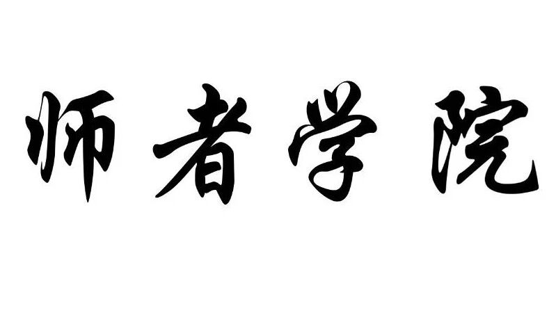

---

## 关于如何查找关键词，大家可以参考我之前写的文章

## “亚马逊关键词搜索工具（史上最全的）

和 史上最全面的关键词查找工具,   60种关键词查找工具”

今天我主要见解的是如何准确填写亚马逊手动广告中的关键词以及广告搭建策略，后面会讲，如何填写search term后台五行，以及listing中的关键词，广告中的关键词和后台五行之间的关系和总的关键词布局。

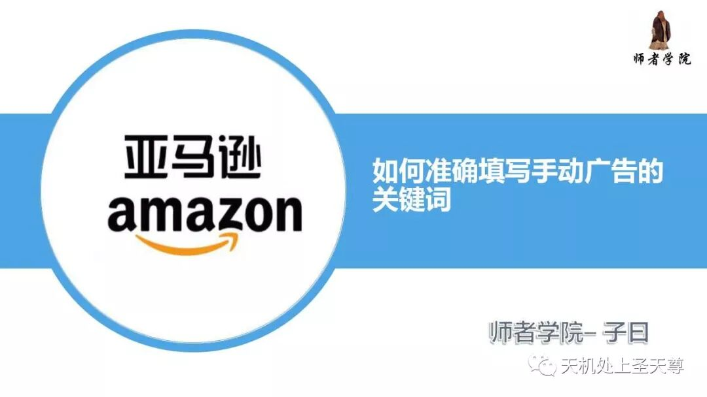

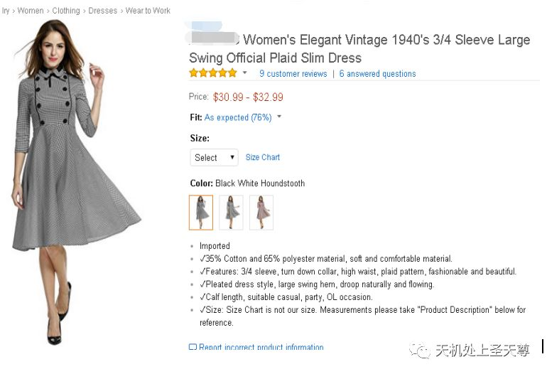

首先通过了解产品，查看相似产品，竞争对手，查找关键词，收集整理

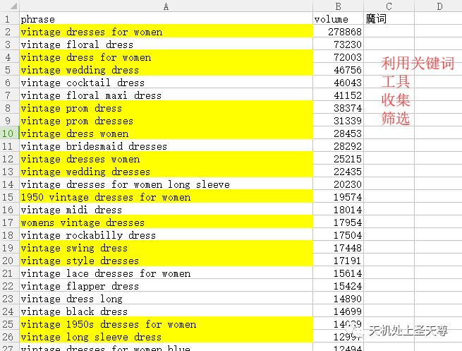

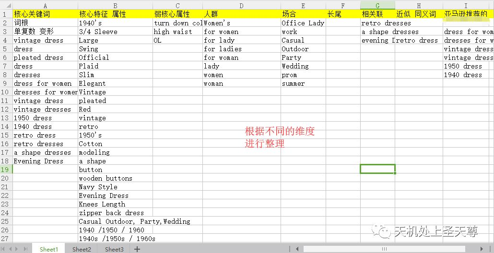

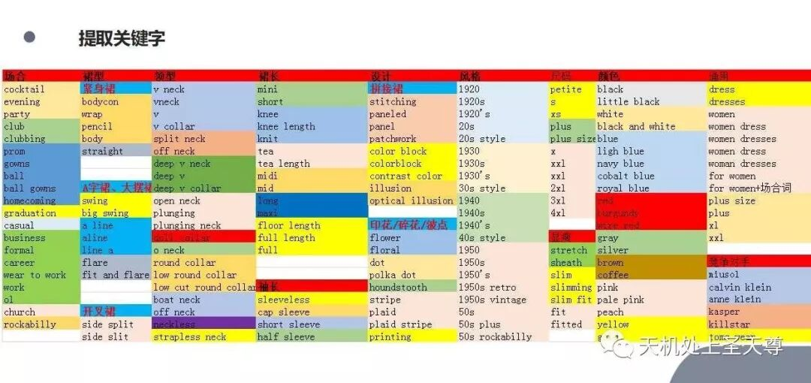

可根据 颜色属性人群等特征 分类别建立广告系列

同一个属性广告系列，下面有不同SKU相同特征属性

同一个SPU广告系列，下面有不同SKU，或者不同属性广告组

不建议广告合集，很多个SPU广告组，建在同一个广告系列

布词阶段

利用关键词排列组合工具，进行布词，详细看布词规则

人群+属性

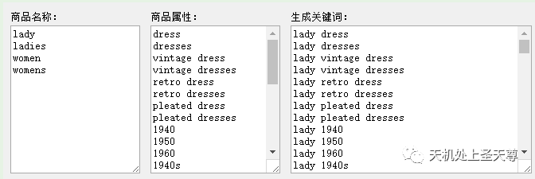

属性 + 人群 /for 人群

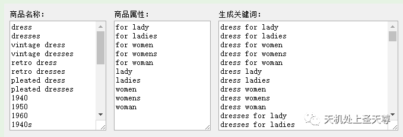

壹，布词阶段需要遵循的规则如下：

一，短词 大词  (建议竞价: 低价, 跑数据 ，再观察)

Group A

1， root（词根）

      core（核心关键词）

      核心属性（1-3个）

      领型，袖长，风格，款式等

2，人群+root/core/核心属性/领型等

3，root/core/核心属性/领型等 + for 人群

二，长尾词 特征词（建议竞价 ：开始低价，跑数据继续观察，后期可以酌情加价）

Group B

长尾词

特征词

弱核心属性+root

弱核心属性+core

颜色/袖长/领型/场合+root

颜色/袖长/领型/场合+core

弱核心属性+root+人群

root+弱核心属性

core+弱核心属性

root+颜色/袖长/领型/场合

core+颜色/袖长/领型/场合

人群+弱核心属性+root

备注：颜色词如果多可以单独拿出来和root，core创建一个广告组（这里可以用上产品所有的颜色）

三：亚马逊推荐词

Group C

亚马逊推荐的一定要进行筛选，选出符合我们产品的关键词，相关性强的关键词

建议竞价，可以参考亚马逊建议的竞价

如果亚马逊推荐词比较多，可以单独建一个广告组，如果推荐词少可根据词长决定

## 贰，精准投放 主打阶段

自动广告中转化好的词

有转化的

点击率高的词

颜色 尺码 款式 集中在某几个属性上的 进行拓词

亚马逊推荐的

季节性的

有高流量的词

手动广告 布词阶段中 表现好的词 1，单独拿出来 高价跑，原来的低价跑，2，原来表现好的集中在哪些属性上进行拓词，原来低价或者停掉，拿出来高阶跑

主打阶段 还是不建议合集 单个SPU/SKU/单独特征属性便于广告数据分析

关于匹配方式】 前期广泛匹配，转化很好，词组匹配，主推 有把握的应季的可以精准匹配

基于listing基础比较好，季节 趋势都比较有优势，review最少10个

领取29.99优惠券，免费听课

https://m.qlchat.com/wechat/page/get-coupon-universal/2000001073297160?couponId=2000001133673524&officialKey=undefined

29.99优惠券获取地址https://m.qlchat.com/wechat/page/get-coupon-universal/2000001073297160?couponId=2000001133673524&officialKey=undefined

千聊优惠券领取地址，点击领取    点击这里文字

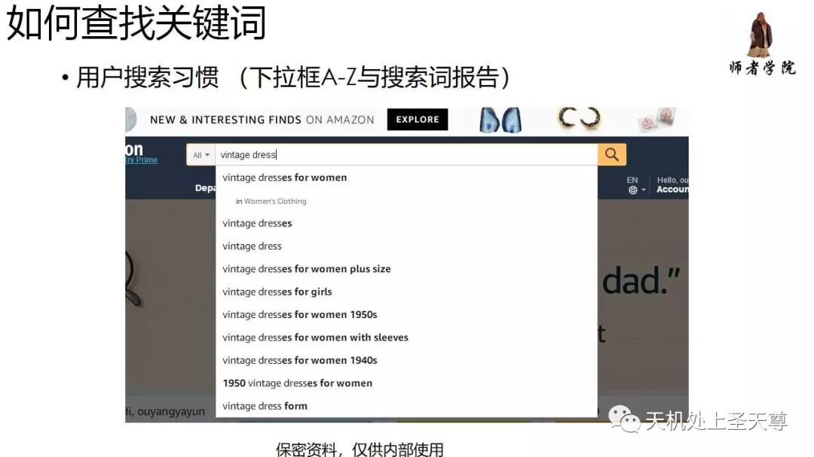

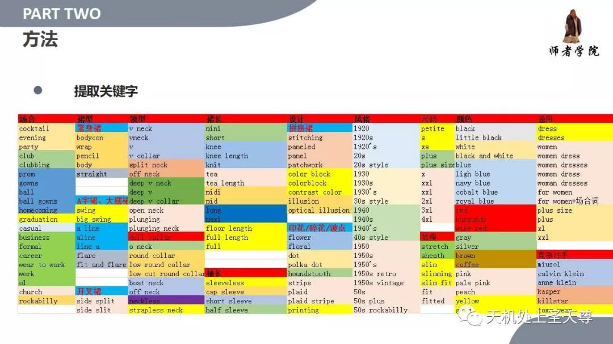

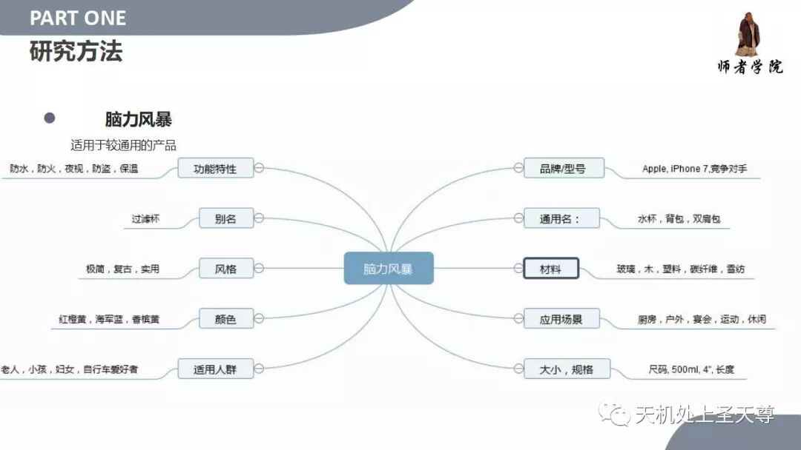

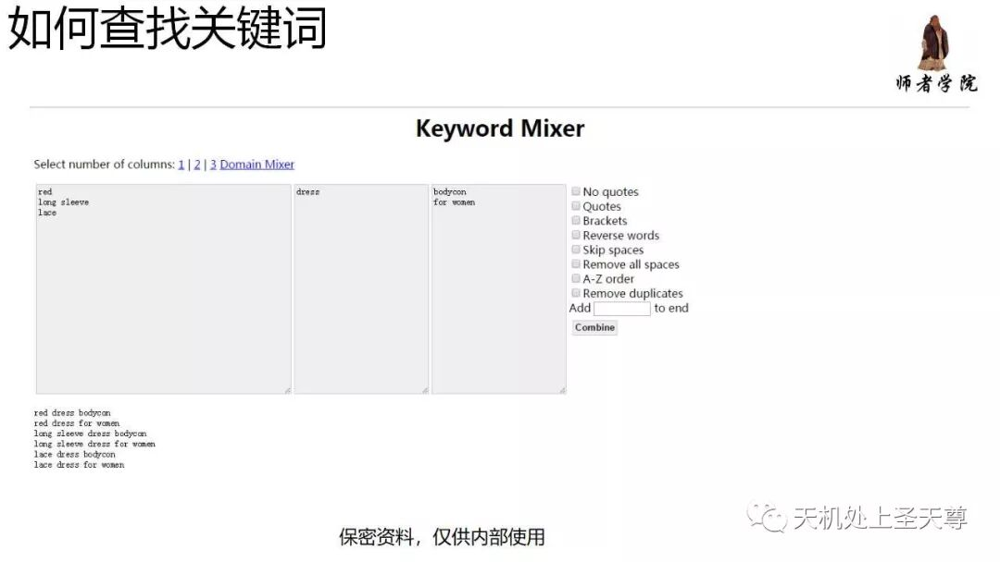
