# 竞争对手分析策略

> Source: wechat
> Author: 天机跨境
> Original: https://mp.weixin.qq.com/s/CjZ3YlZO_sRDpW9KTj8TGQ

---

---

对于竞争对手的分析，我们可以从多个角度来考察，比如：

  ◎ 分析竞争对手的产品策略

  ◎ 分析竞争对手的流量策略

  ◎ 分析竞争对手的关键词分布策略

  ◎ 分析竞争对手的外链策略

  ◎ 分析竞争对手的市场策略

  ◎ 亚马逊上同一个品类Best seller Top100

  ◎ 对标的产品，作为竞争对手的产品

  ◎ 同款相似相关联的产品

  ◎ 分析竞争对手的CPC广告策略

  ◎ 分析竞争对手的站外广告策略

分析竞争对手listing情况

价格 变化
评论 积累
前台标题图片首图五点描述A+
关键词  排位，估算竞价

用品牌，产品关键词，ASIN去Google搜索站外推广情况：
品牌名/ 关键词/ASIN+deals

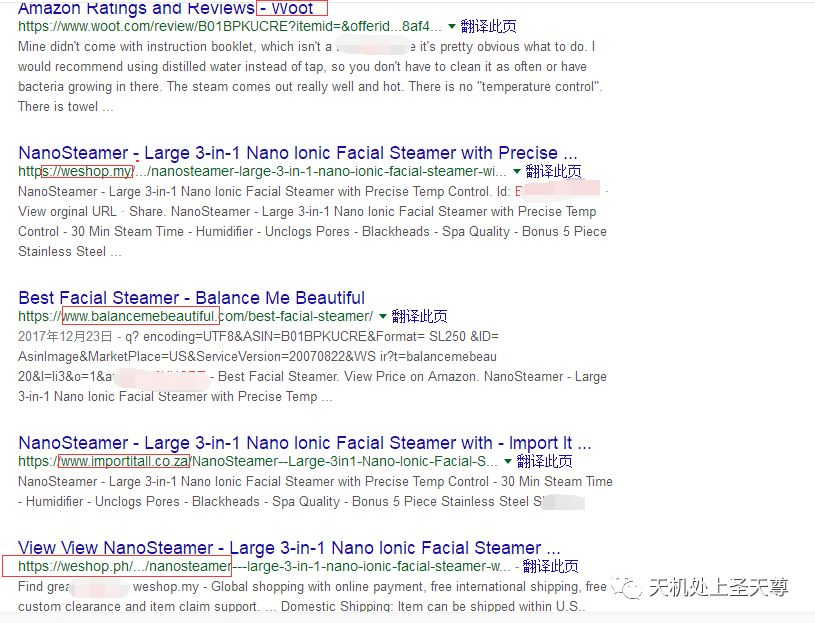

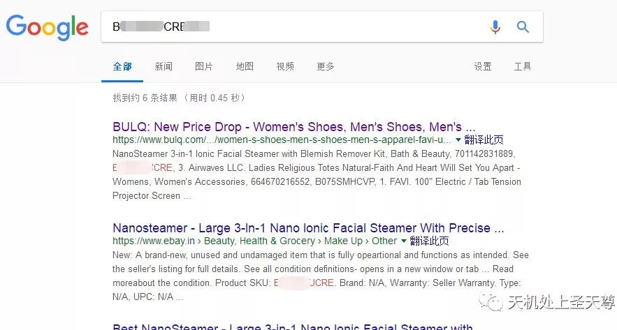

如果有品牌 有官网 可以用品牌网站在similarweb搜索，查看流量分布情况

Similar Web-分析对手网站平台流量

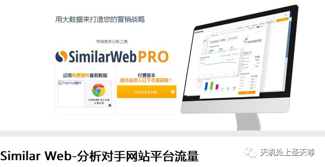

或者品牌名 产品关键词

SEO竞争对手的分析策略

策略一：利用 Moz Bar 工具条
策略二：利用Google站长工具 Google Search Console
策略三：利用Semrush

竞争对手的分析策略

http://www.guxiaobei.com/analysis-strategy-competitors.html

利用产品关键词 品牌名等在

https://moz.com/followerwonk/pro   搜索 查看DA DP

**1，什么是DA与PA？**
DA即Domain Authority，它是衡量一个网站权威度的重要体现。
PA即 Page Authority，它是衡量一个页面权威度的重要体现。

研究亚马逊数据分析工具—Ahrefs的工具
http://www.guxiaobei.com/seo-marketing-tools-of-ahrefs.html

另外一个就是amz4seller这个工具
http://www.guxiaobei.com/review-of-amazon-data-analysis-tools.html

## 爆款分析

## sheet 1 分析汇总

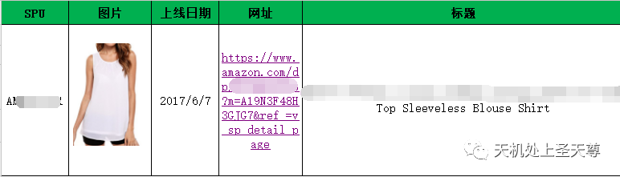

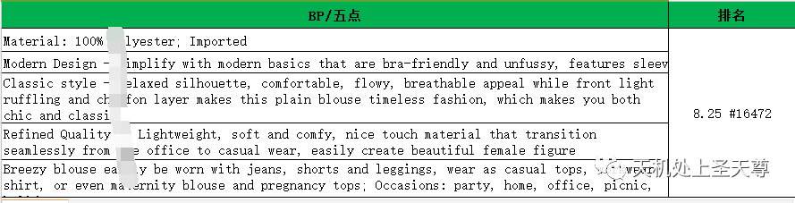

## 用keepa跟踪 价格变化 情况

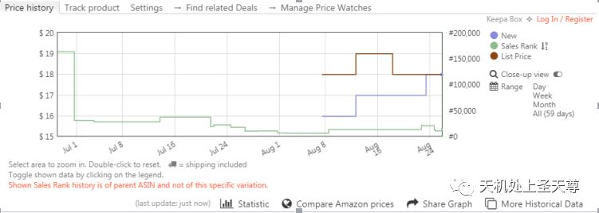

## CPC广告情况

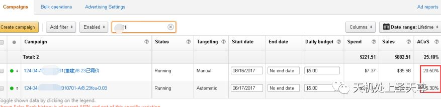

## 具体分析

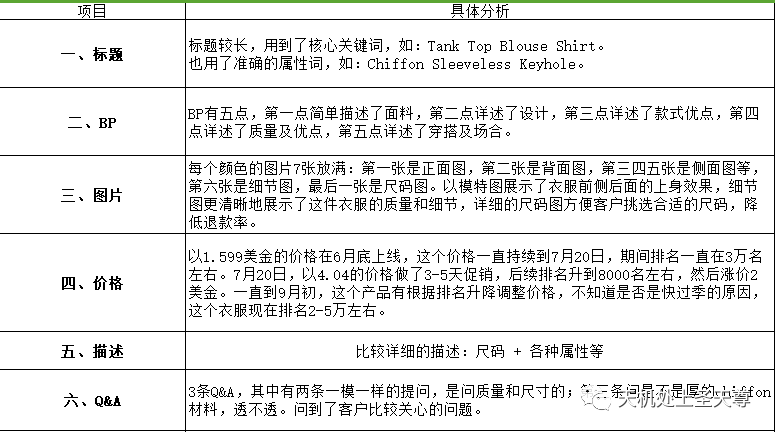

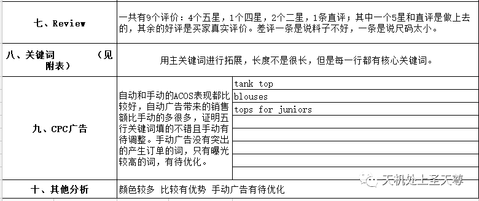

### sheet 2  主关键词

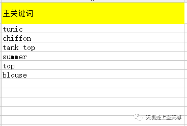

### sheet 3后台五行 关键词search terms

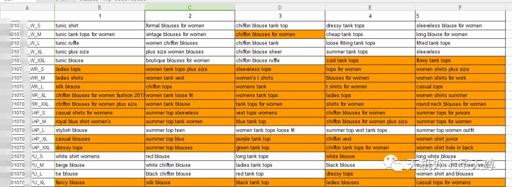

top seller 品类总结

用BestSeller的ASIN在Jungle Scout 搜索

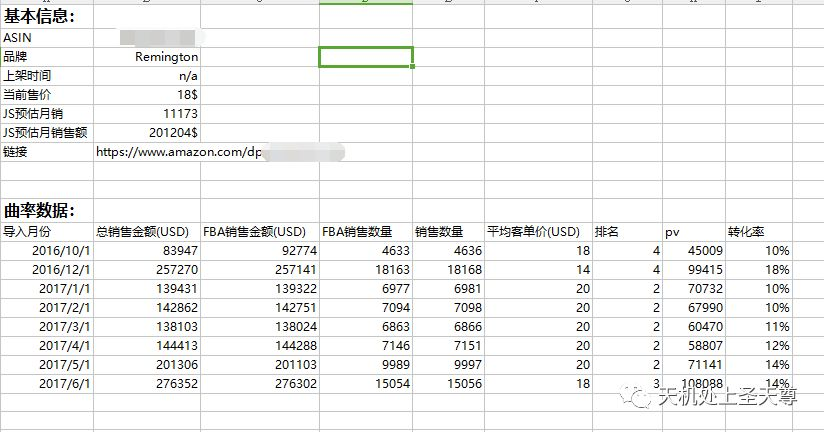

页面情况和卖点提炼

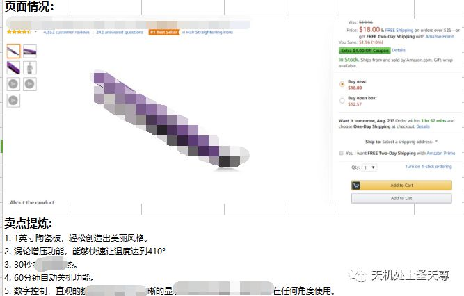

竞品对比分析：

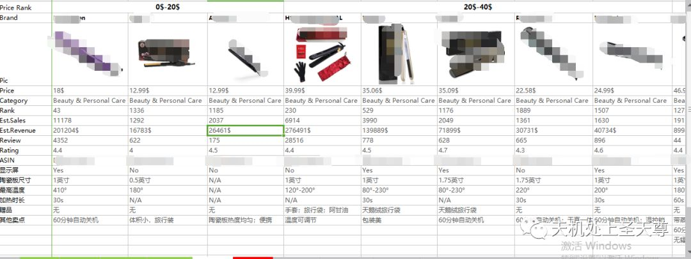

关键词数据，谷歌数据 和类目数据源分析

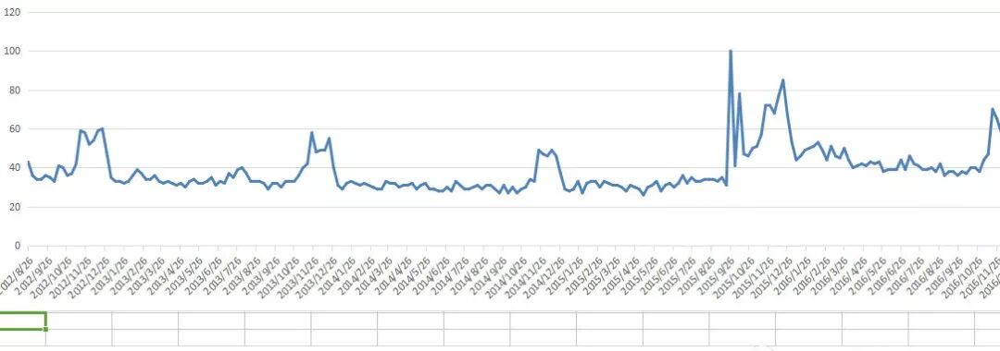
