# Youtube营销必备工具 ， 获取高流量标签/关键词

> Source: wechat
> Author: 天机跨境
> Original: https://mp.weixin.qq.com/s/Bk9Vs1rby2JGtWcMAxeytw

---

---

## Youtube营销必备工具， 获取高流量标签/关键词

2018-04-20 [外贸君](https://mp.weixin.qq.com/s?__biz=MzI2MjI3MTE5MA==&mid=2247484613&idx=2&sn=99ef3e606fb2f9d31a578cf2767cf85d&chksm=ea4cfd7cdd3b746ac28a332ee99c013fd6ef5b7dfa1dadf216b370c3224ddf74e3c5c564e1ec&mpshare=1&scene=21&srcid=0319eiI54tVkPj1IPDcZjCQQ&pass_ticket=WNZPYTeipgJlmxuP nxmLH4/DqzYsvWYZCTkfDnPLdYhMLrodGK/O4GldjeQ5DJc#wechat_redirect)

该文章来自外贸君公众号，感谢外贸君分享

视频营销在数字营销中的角色已经不再是以往的锦上添花，而逐渐转变为必不可少，现在尤其如此。人们往往更喜欢去观看视频，与此同时视频可以更好的帮助我们实现产品或者服务的销售。

事实上，Cisco去年一项研究显示，预计在2020年，消费者网络流量的80%以上将来自于视频。而随着视频消耗增加，视频对消费者购买行为影响也将越来越大。

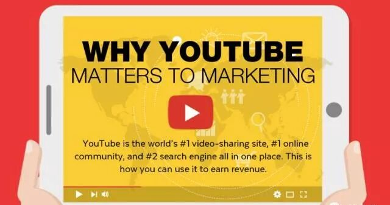

根据市场份额来看，Youtube是第一大视频分享平台，第二大搜索引擎，很多Yoububers非常依赖Youtube视频，他们经常观看视频，甚至会因为各种事情搜索视频，小到如何撬开门，大到学习如何创建Facebook广告。

在我们的全球贸易的电商学院(edu.bossgoo.com) 和会员后台的培训中心，已上传了Youtube频道创建、视频上传等基础操作课程，大家可以尝试打造公司品牌频道，多方面地展示自身的形象和产品。

对于我们外贸企业的Youtube频道来说， 视频的观看流量会比较少，主要来自业务员对客户们的引导（一对一沟通时引导，或者是EDM邮件营销进行推荐）。我们更想获得的是视频的自然排名流量，让更多搜索者看到我们的视频。

Youtube视频排名因素

以上是Youtube视频排名因素规则的视频，另外在之前的文章中有分享过 解析Youtube的搜索排名与谷歌的异同, 大家可以补充阅读。

首先我们必须知道一个残忍的事实，有数据显示每分钟有35小时的视频内容被上传到YouTube，所以没有一块好的敲门砖，即使很好的内容，进入受众视线的几率也会大大降低。

对于新频道/新视频，欠缺频道数据（订阅量，视频平均观看时长等）和视频数据（观看量，观看时长，评论数，点赞数等），**在初期做好视频的元数据（视频标题，描述说明，标签Tag）就显得非常重要。**

元数据可以帮助我们的视频，被算法发现，从而脱颖而出，因此内容创建者应该努力优化元数据以最大限度地提高视频的可见性。如下是创建有效元数据的一些技巧，可以帮助我们的视频更好的被发现。

**第一个技巧，我们需要在创建视频之前研究您的竞争对手正在做什么类型的视频**。没错，对视频进行搜索引擎优化以获得更多观看的最好时间是在你录制视频之前。

一旦我们了解竞争对手的做法：他们正在创建的视频类型，他们的吸引力，他们有多少观看量，他们使用什么样的元数据等等 - 这将使你更容易创建一个更有竞争力的视频，无论是在更好的内容和还是针对Youtube算法更好地优化方面。

创建视频后，就要准备视频上传时需要设置的内容了，准备好关键字，标题，说明，标签和自定义缩略图。

**那获取标签、关键词提示的方式就是今天要分享的第二个技巧，同样是向Top的竞争对手学习，去查看与我们的视频有直接竞争关系的高排名YouTube视频标签。**

但是，YouTube隐藏了视频标签，这使得我们根本看不到他们对视频设置的关键字和标签，从而使我们对竞争对手的“窥探”更为困难。

可幸的是，有一些工具可以让我们更深入得了解竞争对手所做的工作，包括看使竞争对手视频排名高所使用的标签。

这次要推荐的就是这样一款强大的

**视频营销数据分析工具**

**TubeBuddy**

它是一款与YouTube绑定的插件，拥有很多强大的功能，最核心和吸引人的几个免费功能包括：

- 绑定账号后，直接在Youtube界面中进行数据分析
- 标签Tag查询，这个很牛，不仅可以查询标签质量（热度、竞争度）、拓展相关热门标签，还可以直接查看竞争对手的视频标签
- 视频元数据设置优化
- 最好的发送时间
- 评论管理和收藏
- 除此之外， 还有更多强大的功能（或付费），可单击这里 https://www.tubebuddy.com/tools

01

工具安装及账号绑定

在Chrome或火狐浏览器中打开工具网站<https://www.tubebuddy.com/>，在首页就有对应的安装按钮【Install Free on Chrome/Firefox】，单击开始安装。（这里就只演示Chrome的安装过程）

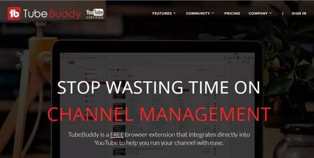

单击右上角的【Add to Chrome】，并确认安装，浏览器就会开始下载并自动安装（约一分钟）

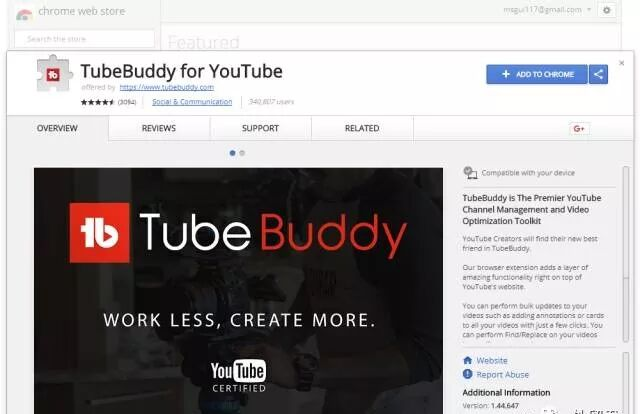

安装成功后，在YouTube.com的搜索框右侧就会出现工具TB的的图标，提示我们单击，在下拉框的底部单击【Sign-in with YouTube】

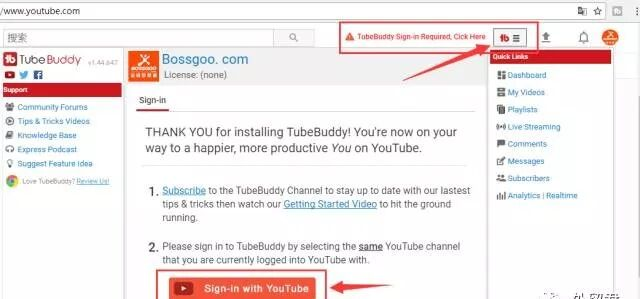

按照提示选择Youtube的账号进行登录，并确认【Allow】

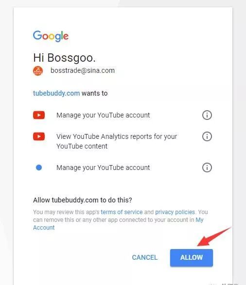

完成之后，再单击TB小图标，下拉栏中就会出现工具的使用教程和常用工具

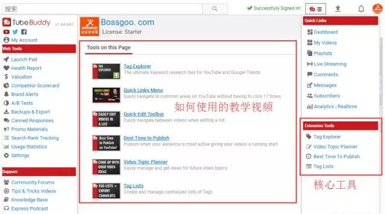

功能1

视频元数据设置优化

- 视频缩略度设置：可选取视频中的任意画面；制作一张可添加广告语的图片；本地上传
- 基本信息中的标题、说明、标签字符数提示
- Tag Tools：标签推荐、拓展、导入等。

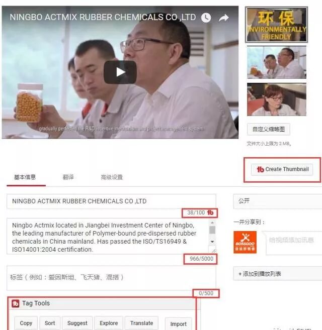

但是考虑到视频信息在google或者youtube搜索结果中的展示，建议大家控制一下字数或将核心关键词或内容放在最前面，以便完全展示。

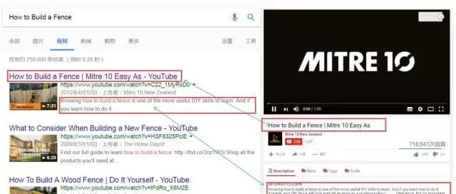

功能2

标签工具

可在视频基本信息中启用，也可在TB小图标的下拉栏中启用【Tag Explorer】，输入要查询的初始关键词，就会出现一系列的提示

「Summary」
热门tags，高热度视频，词的热度和竞争度

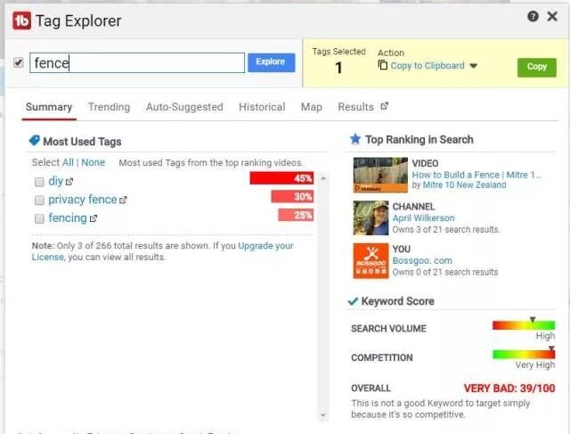

「Trending」

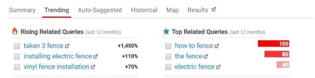

「 Auto-Suggested」

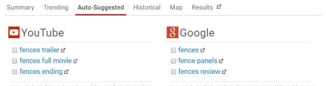

「Historical：谷歌趋势的数据记录」

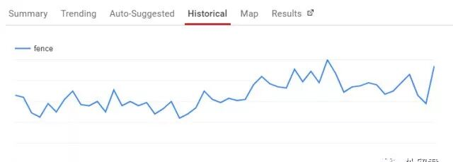

「Map：热门国家或地区」

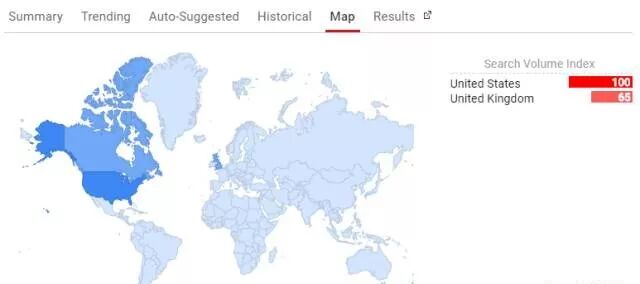

「Results：搜索结果」

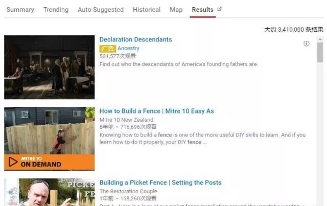

还可以多关键词同时查询，用“,”分隔

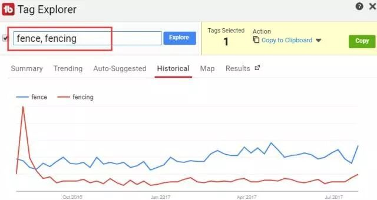

另外在视频编辑页面，可使用标签自动推荐，发现更多热门标签

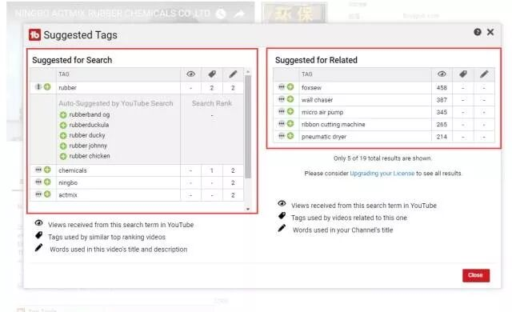

功能 3

竞争者的视频分析

打开Tag Explorer中Results中排名靠前的视频。 我们会发现在Description的右边多出了几个TB的按钮，其中Tags 就可以用来查阅隐藏的视频标签，并且可以一键复制「Copy to」

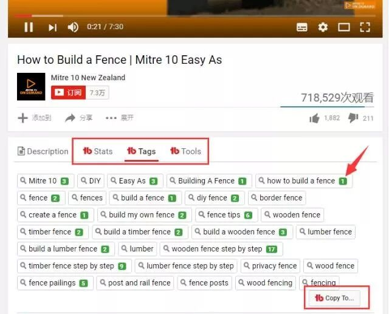

**“关键字后面绿色的数字是代表什么意思呢？”**

这个数字，代表关键字在YouTube上的排名，比如 搜索“how to build a fence”这个关键字，他排在YouTube的第一名，如下图所示：

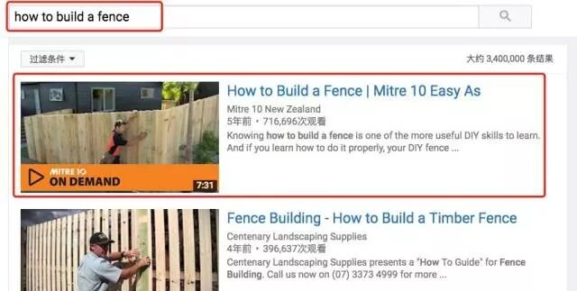

Youtube标签：
不同于产品页面中的关键词设置

我们可以用与视频主题相关的**多字标签（即长尾关键字）**，同时也应使用与视频广泛主题相关的**单字标签和广泛标签**。 （注意：除非拥有使用者的明确许可，否则请勿在元数据中使用商标或版权信息。）

YouTube在标签的语义理解上非常高效，这里有一个关于“如何约会一个男孩”的视频的一些标签的例子：

**Multiple-word tags（多字标签或者长尾关键词）**

- How to ask a boy out on a date
- What to say when you ask a boy out on a date
- How to ask a boy you like out on a date
- Asking out a boy you like

**Single-word tags:（单字标签）**

- How
- What
- Ask
- Boy
- You
- Like
- Date

**Broad-term tags:（广义关键词）**

- Dating
- Dates
- Flirting
- Meet boys
- Meeting boys
- Talk to boys

所以在设置关键词的时候要明确两个目的：**第一，让用户搜得到；第二，让用户想点击**。这需要在标题，关键词和摘要以及详细描述等，里面都要用合理的关键词设置，这样才能达到排名、曝光、精准引流的效果。

该文章来自外贸君，感谢外贸君分享
