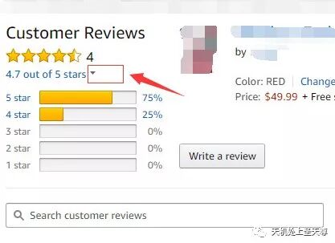
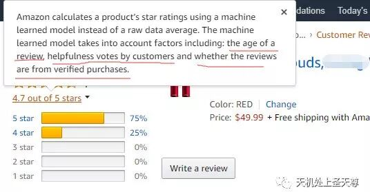

# 最新Review评论星级算法解析

> Source: wechat
> Author: 天机跨境
> Original: https://mp.weixin.qq.com/s/ClD3r8Zv_w23s7YHKzT6TQ

---

---

亚马逊评论

最新亚马逊Review星级算法解析！

亚马逊原文：Amazon calculates a product’s star ratings using a machine learned model instead of a raw data average. The machine learned model takes into account factors including: the age of a review, helpfulness votes by customers and whether the reviews are from verified purchases.

其中就提到了review星级评定的几个重要因素：Review的“年龄”， Review的采纳数，Review是否有VP标志。

。

**Review的“年龄”**

所谓的年龄，就是指review的存在时间，也就是买家留评时间，存在时间越长，这条评论的权重就会越高，对整体星级评定的影响就越大，存在时间越短的review影响力越小。这可以从一定程度上降低某些不良对手刷5星好评对自己产品的冲击。

**Review的点赞数**

也就是review被采纳（点击yes）的次数，被赞yes的越多，权重越大，对Review的整体星级评定影响就越大。

在前几年亚马逊的权重分析还没有现在这么成熟的时候，一个review被点的“yes”“no”的绝对数量可以直接决定这条review是上升还是下降，在当时来说，这是一个机会，于是很多卖家利用此方法收获颇丰；随着亚马逊对操纵评论的打压以及系统的改进，发现被点的“yes”“no”的绝对数量不再是review权重的唯一标准，而是类似于整体星级的评定，从各个方面综合考量“yes”“no”的有效性，

测试包括以下几点：

l 留评review的买家账户的权重以及信誉度等，真实买家权重更大

l 给这条review点赞的买家是否是真实买家，账户的权重以及信誉度等

l 这条review被点赞或者被踩的频率

总的来说就是越真实、越自然的买家点赞，就越容易被系统接纳，越容易使权重增加。

**Review是否带有VP标志**

带有vp标志的review对整体星级影响也很大，有vp标志的一般是全款支付，但全款支付不一定就会有vp标志，因为有些买家账号的真实性被亚马逊质疑，所以，vp越多，权重越大，星级也会随之提高。

系统计算依据

通常系统计算会以如下几方面为计算依据，但具体的占比是由系统确定，人为无法确定具体哪个会占较大的比例：

a.  review 是否有verified purchase的标示
b.  review 的评论时间距离现在的时间
c.  评论的字符数
d.  review 被买家投票很有帮助的次数
e.  review 原始分数
f.  review 被点击次数
d.  有趣且幽默review数量在最新10个 review中的数量

系统会按照如上几个因素去决定每条商品review的分数值，不是单纯简单的相加相除的计算逻辑。

亚马逊对review已经加大监管,所以建议大家不要麻木追求Review数量,因为就算不上Review.只是刷单也能对Listing带来关联流量和关键词权重的提高。刷FBA是目前为止放单最稳定和性价比最高的推广方式。

总结

1，刷关联和关键词流量，注意买家账号的权重和质量

2, 评论整体星级评分在一定程度上要比数量更重要：客户 Review, 在达到一定数量之后，Review 评分比数量更重要，一个 1000reviews 的评分为 4.7 分，很有可能排名超过 2000 个reviews 但是评分只有 4.0 的。且只有 verified reviews 才有效。

3, 产品问答Q&A，点击yes or no

《点YES /NO权重在下降》最近很多卖家反馈亚马逊评论规则又变了，点赞的评论都跑前面去了，差评和直评都跑前面去了，反而VP掉后面去了，这都说明点YES /NO的权重在下降，

4，刷FBA是目前为止放单最稳定和性价比最高的推广方式。

5，对于自己的刷单资源，在这个关键点，主要注意买家账号的质量和送测流程的规范，避免测评雷区。
