# 怎么做Twitter活动

> Source: wechat
> Author: 天机跨境
> Original: https://mp.weixin.qq.com/s/rfi6DLAcMysql-AdYAB1YA

---

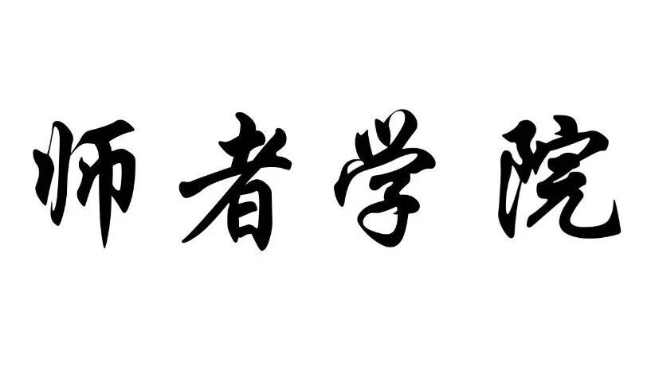

---

所有文章转载于顾小北的博客

Twitter活动怎么做？这么玩就对了

亲爱的小伙伴们，大家好，相信你们已经有做过Twitter竞赛活动吧，这是一种很简单求关注的方式，你可以获取粉丝的e-mail并长期与他们保持联络。

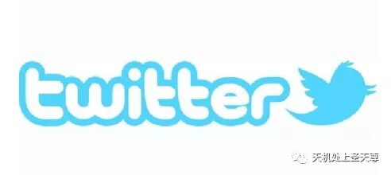

目前有很多不同类型的竞赛活动，从最基础的随机抽取winner到视频竞赛，智力竞赛等，每个比赛都有它的好处，你要根据你的行业、产品等来制定适合你的Twitter contest。那么如何去做一个Twitter竞赛呢？我们可以采取六步走的战略。

**1 选择一个竞赛活动类型**

首先，你需要对你的营销目标制定一个最合适的Twitter contest。如果你的目标是吸引新的粉丝来加入并获取他们的电子邮箱，那么你可以就只做一个简单的抽奖活动，因为门槛越低参赛者也就越多。如果你是想达到销售，那么你可以采取送优惠券或者deal的方式使购买者参与。你如果是想增加互动率，那么你可以提出一个有意思的比赛话题，让受众自己去创造内容参与。接下来，我将会带你剖析高中低级Twitter竞赛，相信你明白之后以后做Twitter contest就会游刃有余啦！

**入门级的Twitter比赛：**

**1.Sweepstakes**

即抽奖，抽奖是最简单的竞赛类型，只需用户提交他们的电子邮箱，点击进入竞赛就可以随机抽取赢得奖品啦，这类没有什么门槛，因此参与者较多。

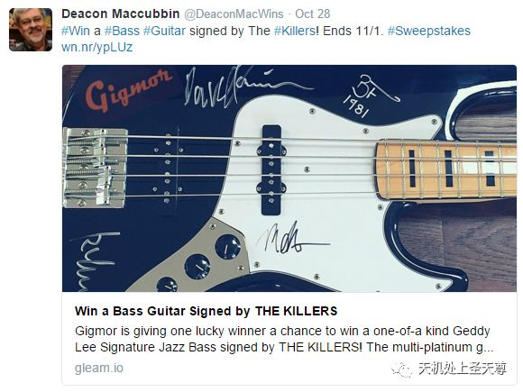

**2.Vote Contest**

即投票，投票活动是让用户与你品牌形成互动一个最简单的方法，你可以让你的粉丝来选择产品名称、哪个产品提前上新等。

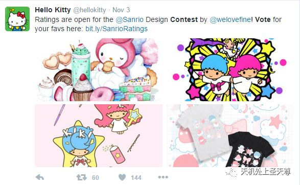

**中级的Twitter比赛：**

中级比赛要求用户提交一张用户生成内容（UGC）来进入比赛，你可以：

**1.Photo Contest**

即摄影比赛，举办一个摄影比赛吸引用户上传自己的照片，并邀请朋友为自己投票，粉丝的创造力是无限的，让他们自己生成内容，邀请好友来使你的主页产生更多的互动量与曝光率。

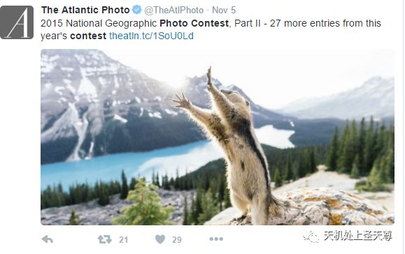

**2.Photo Caption Contest**

即图片描述比赛，它可以吸引用户为你上传的图片写一个标题在评论里，然后粉丝点赞来选出最热门的评论，即为winner。

**3.Essay Contest**

即文章竞赛，参与者可以写出自己的想法、对你Twitter的反馈或者一系列故事，网友选出传播率最高，最热门的文章即为winner。

**高级的Twitter比赛：**

高级Twitter竞赛会要求用户上传一个比较耗费时间和脑力的东西，但是奖品会相对丰盛一点，一般对用户的门槛比较高，因此参与者要比之前的中低级竞赛少。

**1.Video Contest**

即视频竞赛，它可以吸引用户创建视频参与赢得大奖同时也可以为你提供一些高质量的视频等灵感素材，让粉丝选出最热门的视频即为winner。

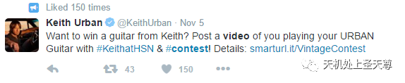

**2.Pinterest Contest**

可以引导用户进去pinterest参加比赛，提交链接进入社区投票选出热门选手即可。

**3.Group Deal**

可以采取简单粗暴的方式如给粉丝优惠和折扣来吸引大家短时间参与。

**2 选择一个奖品**

选择好的奖品在比赛中是至关重要的，它往往是激励因素。你可以看看最近哪个产品卖得最火爆，最热门，然后粉丝在你Twitter上留言希望能得到什么奖品，选一个热门产品然后开始竞赛，这样互动率会更高。

**3 策划好活动**

你需要提前准备策划好一个活动，既简单又要让粉丝有参与的热情，这里分享5个要素来让你的活动更加吸引粉丝关注！

**1.引人注目的标题**

写出一个简短的标题，必须带有明显的号召性，举个例子：“点击赢取限量钻石戒指”、“本年度最大力度折扣，赶快抢购吧”！等，很简单的标题，但是内容直观丰富，能够迅速吸引人参与，同时要在标题上写出你给出的是什么奖品。

**2.给出奖品图**

给出你的奖品图是非常有必要的，因为这很直观的让粉丝看到你给出什么样的奖品，而且会吸引和诱导人们参与，能够产生强烈的视觉冲击。

**3.给出参与网址或者参与信息**

你要说明网友如何才能进入到你的活动页面，以及活动步骤是什么。你需要制定出简短的活动说明流程，别忘了在推文上添加一个活动短网址链接。

**4.作品形式提交**

让参与者提交信息是获取他们信息的关键。对于要求参赛者提交照片、视频或者文字作品竞赛等，它可以包含一个文件上传多个表单文字，你可以要求他们写出姓名、电子邮件、年龄、居住地等等。

**5.共享按钮**

你可以让参赛者分享他们的作品给朋友，这样可以增加你Twitter页面的传播范围。

**4 推广并分享你的活动**

除了活动内容本身，活动过程中的推广也是非常重要的，这会让你的活动吸引更多人的目光，因此你可以尝试以下几种方法来推广你的活动。

1.群发电子邮件：通过电子邮箱的方式群发给你的粉丝，一方面他们能够及时看到你的活动信息，另一方面他们有可能会分享给朋友，但是要注意广告不要做得太硬。

2.分享活动到各大社交媒体上：通过把活动分享到Facebook、pinterest、Google+等各大社交媒体，可以让你的粉丝知道你在Twitter上做了活动，他们就有可能点击查看然后关注你，同时也进一步深化了品牌在各大社交媒体上的黏性。

3.在你的网站上放活动banner：你可以在公司网站上放置活动小广告，当网友访问你的网站就会看到，这样可以增加点击量，如果你们公司是个土豪公司，也可以考虑在你们行业有名气的网站上投放banner。

4.创建一个Twitter广告：之前就在文章中介绍过Twitter广告，所以这部分就不多说，只要你按着我之前教你的方法，选对目标受众，有针对性的去投放广告就行了。

5.在媒体上曝光你的活动：你可以在活动开始前做一个简短的发布会，然后联系好一些知名网站、博客主等让他们为你活动发布信息做预热。

6.列出时下最流行的活动竞赛网站：这可以让目标受众更为集中，去这些网站曝光自己的活动从而吸引粉丝来参与并关注你。

**5 监测活动**

对于每一个活动，你可能有不同的目标或者期望，无论你的目标是获取更多的客户电子邮件还是个人资料等，你都要去检测你的活动使活动效果最大化。你可以采取如下三个Twitter活动监测指标：

1.Google Alerts：即谷歌快讯，相信大家都对它不陌生，你可以用它来监测你的活动。

2.Wishpond活动报告：Wishpond的Twitter活动应用程序包括实时的活动报告并会不断的更新。

3.Hootsuite：这也是一个社交网络的监控工具，你可以看到谁转发、提到了你，也能查看全部的参与者。

**6 活动后期的跟进与推广**

当你宣布赢家，比赛结束的时候，那么互动率就会变低了，那如何才能在活动结束之后，粉丝还是会保持热情呢？你可以：

1.你可以把获奖者在你的Twitter、Facebook、博客等各大社交媒体上宣布；

2.发送具有个性化、创意的邮件给粉丝，并说明我们在某天又会举办一个活动或者促销打折等，让他们继续保持关注；

3.让收到奖品的winner在Twitter上@你并分享给你的粉丝看；

4.和粉丝分享你的下一次活动计划，让他们充满期待感

在instagram上举办活动的4个有效的步骤

http://www.guxiaobei.com/4-steps-to-running-a-successful-instagram-contest.html

今天给大家在讲解一下**如何在instagram上举办活动**的4个有效的步骤

**Okay，我们要明白为什么要做活动?**

增加粉丝。

是的，简单直观的答案，其实也就是这样，举办活动可以增加粉丝，也可以增加品牌的曝光度。举办活动不仅可以增加新粉丝，也可以活跃老粉丝，从而增强页面的参与度.

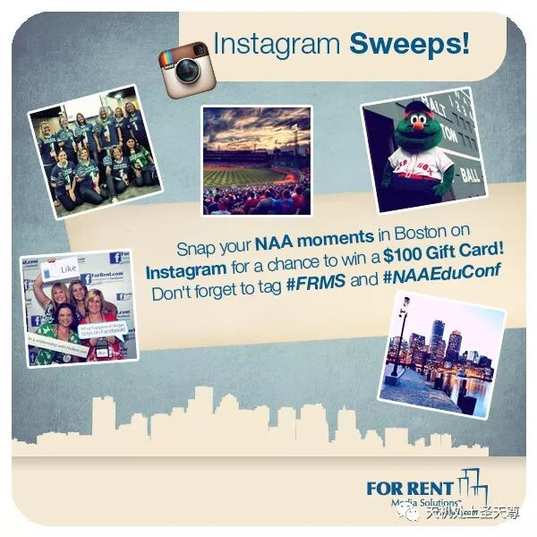

**下面我们就来看看这四个步骤**

**1开始之前要想好奖品礼物**

记住不是所有的奖品都能让用户喜欢，选品的好坏，直接关系到活动的参与度。使用的产品，和你产品契合的产品作为奖品（比如3c产品），甚至是电子书，关于建议（比如如何减肥）的电子书，都是不错的选择。在老外看来关于tips的建议书，也是一个很okay的奖品，我们国人注重实在的，老外不然，及时获得一个小小的奖品也很开心，当然奖品的名额数量，奖品的价值，当然也直接影响了参与度。

和你产品契合的奖励作为奖品，这个是最好的，因为这些粉丝后续你可以在开发，而如果是以不同的奖品作为奖励，有些人可能就是冲着奖励去的，活动结束，就取消关注。当然你可以使用电子券来作为奖励，以便购买的产品

**2标语你要写清楚**

到底你要用户怎样参与，是like to win 和follow to win，还是enter to win，comment to win 甚至是repost

like to win和follow to win：这种形式很常见，粉丝执行的动作也很简单，只要一个点赞，然后一个关注就好。在制定规则的时候也要遵循越简单越好

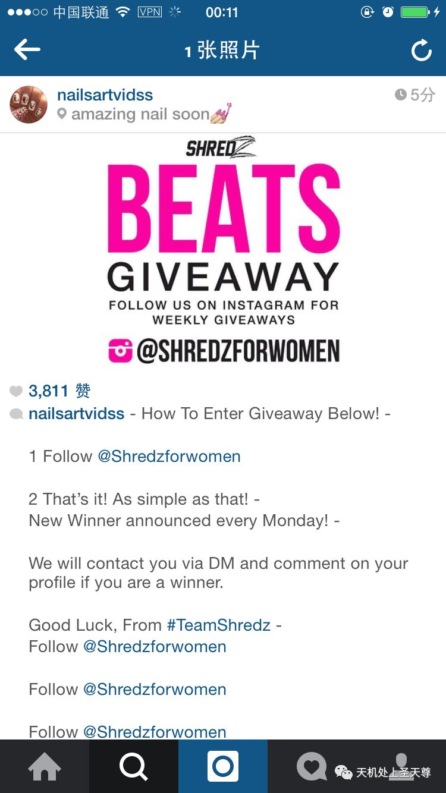

Comment to win：这个步骤是要求所有用户必须要先评论然后才能有机会获得奖品，这个是最直接的能让用户参与的好方法，越多的用户评论就能获得越高的反馈，这个对监控用户的行为很有帮助

Enter to win: 这个规则比上面的步骤要进一步，就是操作步骤需要用户的进一步参与，这样你这个活动可以产生大量的原创内容（UGC）。比如你是一个叫 “ABCD”的生产商，你想让所有的用户拍一个和他们产品相关的，或者有创意的视频，图片，那么你可以要求用户到时候拍完视频或者图片之后做一个hastag 即#ABCD 这样你可以通过这个hastag 追踪到所有关于这个品牌的视频和图片，然后你从中筛选出你中意的用户

Repost：这个要求用户“转发”帖子，用户不管是直接截屏还是用其他软件把你这个活动直接发到他的账号上这个都算是转发。 这里特别说明一点的就是instagram上面是没有转发的功能，所以向前面说的有些用户是直接粗暴的截屏然后转发到他的账号上，（你能做什么？Lol）

**3设定获奖名额和活动截止日期**

这个就不用细讲了，这里特别要说明一下，事先你一定要告诉用户，获奖者是随机挑选的。好了，在废话一句，难道真的就是随机的？怎么可能，当然到时候要送给粉丝多的用户，到时候他们就会很开心的晒在他们的页面上，然后他们会说“Aweome prize，thank you @ABCD for the gift”毫无疑问，这样的你就赢了。

哎呀，还的废话一句，一定要搜集起来获奖人的名单，到时候他们获得奖品的地址（绝大部分的人会分享在他们的instagram账户上，然后你把这个帖子记录下来）以后可以把这些人放在你的博客或者你的website上，做一个“whychooseme”或者做一个产品的review

用户的所有信息你到时候可以展示在你其他的社交平台上，Facebook，twitter，pinterest，甚至直接展示在直接的instagram账号上，一切越真实越好，记得你要做的是一个能够被感知的，可触摸的品牌，而不是高高在上。

懂得我的用意了吧，在现在这个社会，品牌不是自持自雷的，而是让用户去使用然后说好，你到时候搜集了那么多的用户展示地址，到时候就可以进一步利用，这样其他的购买者一看，hmm，很真实啊，下单的概念就会增大。

嗨，我真是为你们操碎了心~~

**4如何让活动得到更好的效果？**

Okay，上面的一切你都做的都很好，那么你不能就把产品单纯的挂在自己的账号上，特别是对那些刚刚建立起来的账号，你千万不要以为只是放一个广告，就能获得很高的粉丝。Of course not！ 现在即使你是做活动，你也要为活动做营销。

我的意思现在我们做的每一个步骤都要营销，整体是一个营销活动，但是这个过程的每一个步骤我们又要对他进行营销。

对上面的步骤，你奖品准备好了，文案也准备好了，时间，获奖名单你也预计好了，可你就是不能单纯的展示在你的账号上，你自己做好了，你还要让别人来说你好

两方面说你好，你这个营销才能好。

在你没有一点粉丝的情况下，你要想办法让你这个活动让更多的人看到，是没错你活动的机制，文案有要求粉丝去参与甚至是tag，但是如果你再引入外部的流量，增加你活动的曝光度，那么这个动作叫“火上浇油”

红人是一个能让你大量增加曝光的一个外部引流机会。

这里请思考一个问题？为什么一定要在自己的账号上做活动？如果可以为什么不直接在红人那边做活动，利用他的影响力，直接引入粉丝到你的账号上，这样不是更好？同时你自己的账号上也有一个相同的活动，两厢配合，这样效果会更棒！

在做活动这件事上，我感觉平常要多看多想，好的素材，好的文案一定要记录起来，你可能是一个新手，但是没关系，你平常要多注意搜集，慢慢的你就会有一种感觉， 这样到时候你自己想要活动就可以信手拈来，站在巨人的肩膀上来发挥你自己最大的潜力，是会很棒的。

okay 最后附上别人家的例子，卖手机壳的，instagram账号lovinacases

看看别人家的活动

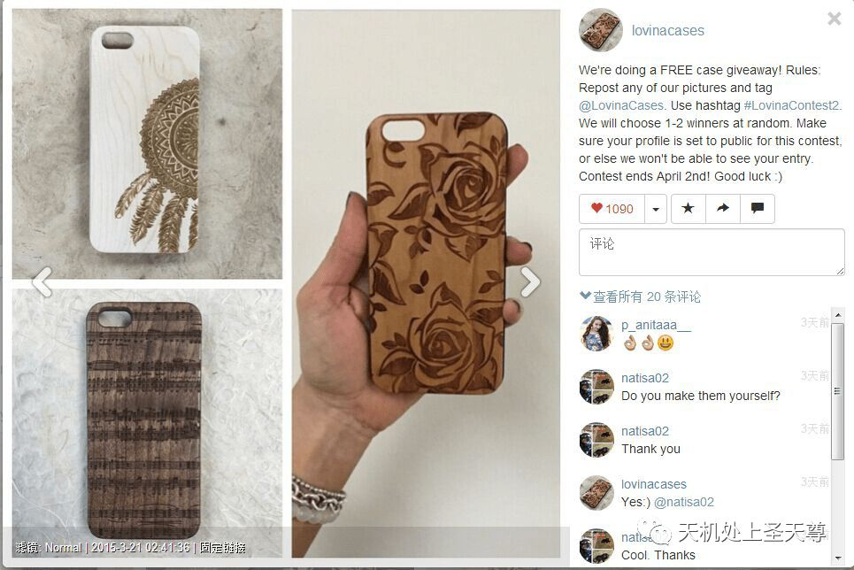

 看看别人家的平常文案

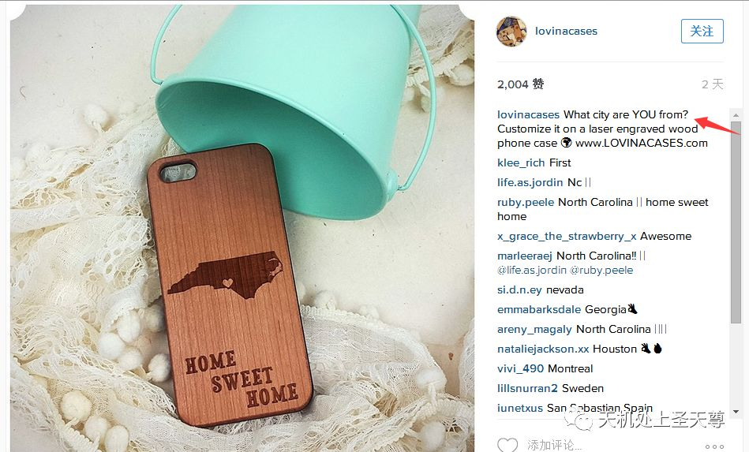

 同样是卖产品的，为什么人家的逼格就这么高呢?

但是，亲们都不要担心，多学学他们的格调，终究有一天你以后也会成为其他人眼中的别人家的！

## 在instagram上成功举办活动的5种方法

http://www.guxiaobei.com/how-to-set-an-scuessful-instagram-contest.html

Why Not?

如何在Instagram上面举办一个成功的活动，这个我在前面一节在instagram上举办活动的4个有效步骤有提到过，今天我就跟大家讲解一下整体的框架（这个我就不举例子了）在你举办instagram活动的时候你必须要有一下几种思考

**1 活动的目标**。做任何东西都必须要有目标，在instagram上面举办活动，你要想清楚你活动的目标是什么？比如如何快速的在Instagram上面获得粉丝 是为了增加网站的销售? 是为了品牌的曝光度?

**2 设置你的活动步骤**
这一点是最重要的，你有时候甚至要花一点时间，下面你要注意到一些细则：

1 举办活动的时间期限
2 谁有资格参赛
3 如何参与
       必须follow你?
      必须repost你的活动图片?
      必须tag你的品牌名?
      使用何种hastag去参赛?
      获奖者如何去挑选?
      图片的主题是什么?
     奖品是什么?
     有其他的的活动要求么?

这里面奖品又是最为关键的，你需要获奖人数多一点的，但是产品价格比较小的，这样就能
吸引大规模的用户
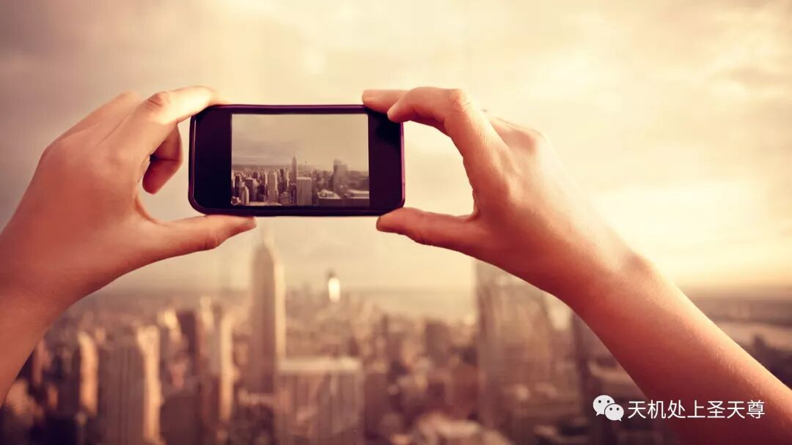

**3推广你的活动**
我一直强调一点现在的营销要对每一个步骤进行营销，你不可能做了一个活动就仍在那边，然后期望一觉醒来，你的帐号就获得了几万的粉丝，告诉你这样是不行的。所以你要学着对活动进行推广

√ 你要利用你的已经有的社交渠道来增加曝光，这包括facebook，pinterest，twitter，linkedin，google+等等，当然也包括利用平台本身的机制如facebook 广告机制
√ EDM营销
√ 在你的网站上挂链接的活动
√ 时刻提醒你的粉丝，你有在举办活动，你可以在facebook上每更新一条消息就带一下ig的活动链接，同样在instagram上你每更新一条新的图片，你都要提及一下你还有活动在举办
√ 上传热门的hastag于你的活动相结合
√ 是否可以考虑在你的facebook或者其他拥有较多粉丝的页面上举办活动（也就是对活动再活动）

√ 利用红人shoutout来增加曝光

**4 监控你的活动效果**
你应该实时监控你的数据， 你可以利用这个工具Iconosquare，利用这个工具你可以监测有多少人在使用指定的hastag，以及这张图片包含的like，share的数量

**5公布获奖名单**
好了，是时候公布获奖名单了，你肯定不能只是真的公布就仅仅公布那几个人就完了，你至少在文案里面要让他们对下一次的活动有期待感（比如，下次将有100人活动100部iphone6s，吊炸天了把，够吸引力了把….可是我是说比如哦）

我肯定不会告诉你神马随机获奖都是扯淡的，我是选那些粉丝数多的人作为获胜者，我也肯定也不会告诉你我是会尽量找美女又有粉丝的人作为获胜者，我怎么可能告诉你这些获奖人的头像我到时候可以利用在facebook上，pinterest上，YouTube上，网站上？

谁说不可以？

## 史上最详细的关于如何成功的在facbeook上举办活动案例

http://www.guxiaobei.com/how-to-hold-an-successful-facebook-event.html

## snapchat？instagram？谁更适合社交营销？

http://www.guxiaobei.com/snapchat-or-instagram-which-is-more-suitable-for-social-marketing.html

## 手把手教你如何用Snapchat做营销（基础篇）

## 精分受众！重新定义你Twitter营销策略的秘密武器

## 手把手教你如何通过twitter找客户

## 如何利用搜索引擎，提高10倍的工作效率（建议收藏）

## 一篇文章看懂Facebook Pixel

## Facebook Pixel中标准事件和自定义转化的代码设置

## 如何监测竞争对手的facebook广告？(2)

## 怎样在Pinterest上高效推广你的产品

## 跨境电商，我能做品牌吗？要怎么做？

## Hashtag的追踪工具

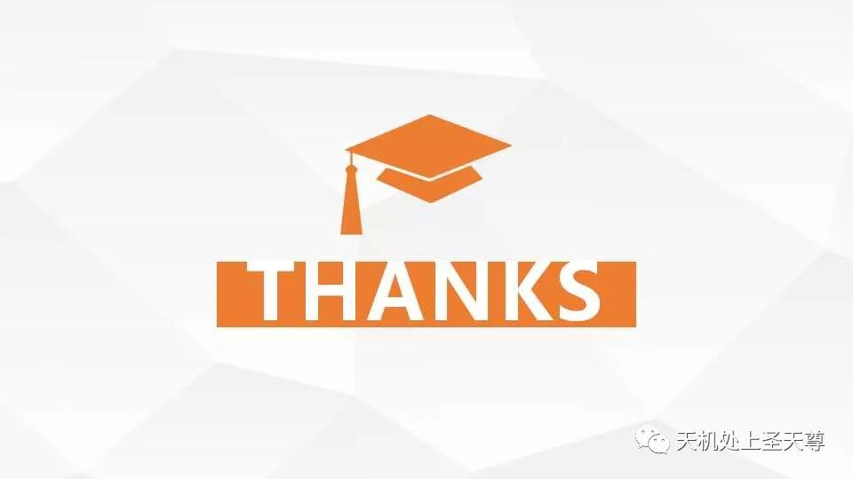
