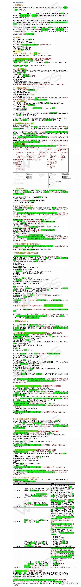

# 客户维护邮件基础以及广告批量操作

> Source: wechat
> Author: 天机跨境
> Original: https://mp.weixin.qq.com/s/DzfZ0pJD0AYz7M-QES2IMA

---

---

订单确认模板文本文档

1. 查看到买家付款完成的订单后，给买家发送订单确认邮件并且告知预计发货时间

Hi, xxx,

Thank you for your payment for ordersxxxxxxx and xxxxxxx. We will be dispatching these items within the next 1 day.

If you have any questions or problems,contact usdirectly for help.

发货后告知买家当前状况文本文档

2. 填写了发货通知后告知买家当前状况，调整买家期望值

Hello, xxx,

We are happy to tell you we have dispatched your order! You cantrack its progress with the following tracking number:

xxxxxx

You can also track the delivery of your order yourself here: www.

It usually takes about     days for your order arrive, but as this isthe shopping season, the logistics companies are very busy and some orders maytake slightly longer to arrive.

If you have any questions or problems, contact us directly for help.

超过5天还未更新物流信息，让买家再等待 文本文档

3. 超过5天还未更新物流信息，让买家再等待

Dear xxx,

As we all know, it’s the busiest part of the shopping season and thelogistics companies are running at maximum capacity.

Your delivery information has not been updated yet, but don’t worry- we will let you know as soon as an update is available.

Thank you for your patience!

货物退回，换物流方式重新给买家发货 文本文档

4,货物退回，换物流方式重新给买家发货，并延长收货时间

Hello, xxx,

Due to the overwhelming demand for logistics this shopping season,the original dispatch has failed.

Don’t worry! We have already dispatched your order with a differentlogistics company. You can track the new delivery of your order here: www.xxxxx.com.

We have also extended the time period for you to confirm delivery.

If you have any questions or problems, contact us directly for help.

货物已经处于签收状态，提醒买家进行确认收货并且给出5星好评文本文档

5,货物已经处于签收状态，提醒买家进行确认收货并且给出5星好评

Hello, xxx,

The tracking information shows that you have received your order! Pleasemake sure your items have arrived in good condition and then confirm satisfactory delivery.

If you are satisfied with your purchase and our service, we will greatlyappreciate it if you give us a five-star feedback and leave positive commentson your experience with us!

If you have any questions or problems,please contactus directly for assistance, rather than submitting a refundrequest. We aim to solve all problems as quickly as possible!

Thanks!

货物在海关

6. 货物在海关

Hello, xxx,

We have checked the tracking information and found your package has nowarrived at your country’s customs agency.

Please let us know as soon as your order arrives at your deliveryaddress.

If your package experiences any delays at customs, please contactthem to resolve any problems.

Thanks!

距离确认收货超时还有1周，依然未妥投，告知买家物流的大致情况，并且告知买家会给他延长收货时间，请买家不要提交纠纷文本文档

7. 货物在海关

Hello, xxx,

We have checked the tracking information and found your package has nowarrived at your country’s customs agency.

Please let us know as soon as your order arrives at your deliveryaddress.

If your package experiences any delays at customs, please contactthem to resolve any problems.Thanks!

 Best Regards！

                                                                                                                                   Yours Sincerely

The EPB Team

8,留评价文本文档

Greetings

Thank you for ordering your iphone cables with us. We hope you are satisfied with the purchase and our total service.  Please kindly take a minute to leave us a positive feedback with an overall Detailed Selling Rating (DSR) of 5.  Your comments is very important in our business success. If you have any questions or comments, feel free to contact us directly.

Once again, thank you and hope you enjoy shopping with us!

 Best Regards！

                                                                                                                                   Yours Sincerely

The EPB Team

长时间在途，确认是否收到货物，文本文档

9. 长时间在途，确认是否收到货物，减少买家未收到的担忧

Hello, xxx,

If you haven’t received your order yet, please don’t worry. We just checkedthe tracking information and it’s on its way!

Don’t worry about your money or your purchase either – if you do notreceive your package, we will resend your order, or you can apply for a fullrefund.

If you have any questions or problems,contact usdirectly for help.

 Best Regards！

                                                                                                                                   Yours Sincerely

The EPB Team

10,测评师模板

Hi  AA,

Greetings from EPB Team, a seller at Amazon.com. Have a great day !

We got your email address in the top 1000 reviewers list on Amazon and glad to know you are very professional with electronic products.

We would be highly appreciated if you could help to make a review for one of our products. The listing at :     http://www.amazon.com/dp/B010G20S3K

Thank you from bottom of my heart !!

Regrads,

EVERPLUS Power Bank, Inc.

11,回复测评给达人折扣码

Hi,AA

Greetings from EPB Team.Have a great day !

Thank you for your email.We sincerely appriciate of that you would love to review for our products. We are much obliged to you for your patience and support.We would like to start our business at Amazon.com. Through the investigation, we found products with more Consumer Feedback and Video have been sold very well.Therefor,Could you make a product video please?We will be very happy If you do this!Thank you from bottom of my heart!Best wish to you!Regards to your family!

Coupon Code: 5EGU-26HF6C-499WN4

The listing is     http://www.amazon.com/dp/B010G20SXX

Cheers,

The EPB Team

## Cn-7.批量操作

## 1 批量操作

使用批量操作功能下载一个批量文档，可以在该批量文档中添加或更改广告系列，然后上传上传文件文档进行处理。

您可以使用批量文档（格式为.xlsx 或.csv ）执行批量下载和上传来代替在广告系列活动管理中一个一个地添加或更改活动修改广告系列，这是一种进行大规模修改现有广告系列、关键词、广告和广告组的有效方式。

例如，假设您要改变几个广告组的关键词出价。您可以下载批量文档，并在文档中更改关键词的出价并且上传此文档，使得所有修改动作在一次操作中完成需要更改的关键词出价能在一次性更改完成，而不是手动地进入每个广告组中更改每个关键词的出价。

您也可以以同样的方式用批量文档进行添加新的广告系列，通过在已下载的批量文档里添加新的广告系列信息，然后把它上传到广告系列管理活动管理器中。如果您想喜欢从零开始创建一个新的批量文档，可以下载一个批量模板，然后输入广告系列信息，接着保存文档，最后把它上传到广告系列管理广告活动管理器中。

**1.1批量操作**

●为推广产品创建一个批量操作文档

●更新多个广告系列的出价

●使用批量操作创建一个新的广告系列

●使用批量操作添加产品到一个广告系列中在广告系列中添加产品

●使用批量操作暂停关键词

●使用批量操作添加否定关键词

●推广产品的错误批量文档错误

●整合广告API

**为推广产品创建一个批量操作文档**

批量文档是更改多个广告系列、广告组、广告和关键词的理想选择。

**2.1用批量操作创建广告系列创建一个含有广告系列的批量文档**

有两种方式可以创建一个批量操作文档有两种方法：

1.可以在下载标签按键处下载一个现有广告系列的批量操作文档，然后更改广告系列，最后上传。

2.直接下载一个批量操作模板，输入广告系列信息，最后上传。

**2.2下载批量操作文档**

您可以下载批量操作文档来分析您现有广告系列的表现情况，然后可以批量编辑您的广告系列，并最后批量上传。

下载批量操作文档的步骤如下：

1.进入**广告**>广告活动管理器系列管理

2.进入**批量操作**>**下载**

3.设置日期范围

4.选择文档格式：.xlsx 或者 .csv.

5. 当报告准备就绪它将会出现在**批量文件下载**中，点击**下载**即可。

批量文档只显示所选时间范围内至少获得一次曝光的广告系列，广告组，关键词和广告。

**2.3下载批量操作模板**

1.进入**广告**>**广告系列管理活动管理器**

2.进入**批量操作**>**下载**

3.点击**下载批量操作模板**链接。

您将会被提示打开或者保存该文档件

4.点击**可以**按键

批量操作模板有使用说明、定义,一个例子批量操作模板案例和批量操作模板选项卡，您将在批量操作模板中输入您的广告系列信息您将输入您的广告信息。

**2.4上传批量操作文档**

一旦您把所有想要添加的广告系列信息填入批量操作文档里后，您就可以准备上传文档。

1.进入**广告**>**广告系列管理活动管理器**

2.进入**批量操作**>**上传**

3.点击**选择文件并**和选择文档上传上传文档的格式（.xlsx 或者 .csv）上传

4.点击**上传并且应用更改**

当您的批量操作文档被成功上传，您可以在**广告**>**广告系列管理活动管理器**>**文件上传状态**中查看。报告也将会把所更变的内容展示出来。

当整个文档上传的过程完成时，您的变更信息将会被更新到广告系列中。一般情况下，您的批量操作文档会在将最多30分钟内完成更新；但有时可能候完成更新需要几个小时。

**2.5批量操作文档的组成部分结构**

批量操作文档由四个部分组成：

**广告系列** — 广告系列由是一个或者更多的多个广告组组成。每个广告系列都可以体现特定的标记着特殊的产品分类，例如，运动用品，电子产品，前1000个最佳产品，顶尖产品，或和耐克

**广告组** — 广告组是将广告系列划分到更具体领域的东西是广告系列的分支，里面含有更特别的领域。例如，一个是属于运动类型的为运动用品创建的广告系列可能会含有诸如阿迪达斯，耐克，锐步，网球，长曲棍球，棒球或和篮球的广告组

**广告** — 您打算推广的在亚马逊平台上现有的产品链接页面广告是您打算从您在亚马逊现有产品中选择投放广告的产品。

**关键词** — 关键词是（字词组合相关的词和词组）用于将您的广告与客户用于寻找产品的搜索词匹配匹配用户寻找产品的搜索习惯和您的广告

**2.6请求文档所需字段**

这里是请求文档是用于上传或者创建广告系列，广告组，广告和关键词。这些是上传或创建广告系列，广告组，广告和关键词所需的字段。

|  |  |  |  |  |
| --- | --- | --- | --- | --- |
| **广告系列** | **广告组** | **广告** | **关键词** | **广告系列否定关键词** |
| · 广告系列名称  · 广告系列每日预算  如果您准备新建一个广告系列，则还需要：  · 开始日期  · 广告系列投放类型  · 广告系列状态 | · 广告系列名称  · 广告组名称  · 最高出价  · 广告组状态 | · 广告系列名称  · 广告组名称  · SKU  · 状态 | · 广告系列名称  · 广告组名称  · 关键词  · 最高出价  如果您准备新建一个关键词，您还需要：  · 匹配类型  · 状态 | · 广告系列名称  · 关键词  · 匹配类型  · 状态 |

**2.7下载流程报告**

批量操作文档流程生成的报告提供关于上传文档上传的详情，包含一些上传无效信息包括一切上传错误，这些错误无效信息帮助您查找问题并解决且修改它，这样您就能重新上传然后再次上传批量操作文档。

您可以通过下载流程报告来查看上传的批量操作文档的状态。

下载流程报告的步骤：

1. 进入**广告**>**广告系列管理活动管理器**.>**批量操作**>**上传**

2.在**文件上传状态**，点击**下载流程报告**

### 3 更新多个广告系列出价

您可以运用批量操作同时进行更新多个广告组或者关键词的出价，而不是以此代替在广告系列管理活动管理器中一个一个更新出价。下载批量**操作**文档请参考为推广产品创建一个批量文档。

**提示：** 当您下载了批量操作文档，都可以以电子表格的方式打开，如excel。一旦您下载好了文档，您就可以在EXCEL等表格应用中打开该文档。您可以创建一个筛选器以整理筛选数据，让您轻易的找到所需信息。

**用批量操作文档在批量文档中更新广告组的预设默认出价**

1.打开批量操作文档并将**记录类型**筛选为**广告组**且填入**广告组**的**记录类型**

2.在最高出价**默认出价**栏编辑您每一个广告组的出价。

3.把文件保存到您的硬盘里

4.上传文档到广告系列管理广告活动管理器请参考为推广产品创建一个批量文档。

**用批量操作文档在批量文档中更新关键词出价**

1. 打开批量操作文档并将**记录类型**筛选为**关键词**且填入**关键词**的**记录类型**

2.在**默认最高出价**栏编辑您每一个关键词出价。

3.把文件保存到您的硬盘里

4.上传文档到广告系列管理广告活动管理器操作指南请参考为推广产品创建批量文档。

**提示：** 删除任何一行您没有在保存文档之前更新的信息，上传文当前删除一切不需要上传的行列可以减少流程时间。任何一行不包括当您上传文档时即将改变的信息上传文档时不会改变任何不包括在内的行列。

**4使用批量操作创建新的广告系列**

您可以把创建新的广告系列加入批量操作文档中并且上传这个文档。您可以在批量文档中添加并创建新的广告系列并上传该文档。

首先，下载批量操作文档操作指南请参考为推广产品创建批量文档’。

**4.1在批量操作文档中创建新的广告系列**

1.以电子表格方式打开批量操作文档，如excel用EXCEL等电子表格软件打开批量文档。

**注意：** 当您编辑批量文档时，不能编辑文档的第一行，留下留白记录ID栏为空白。广告活动管理器广告系列管理会在您上传您的批量操作文档时自动生成一个ID。

2.在第一行空白行输入含有以下栏目信息的广告系列信息：

**广告系列名称**

**广告系列每日预算**

**广告系列开始日期**

**广告系列匹配定位类型：**“自动”或者“手动”

**广告系列状态：**“开启”或者“暂停”

3.在接下来的那下一行中至少输入一个含有以下栏目信息的广告组

**广告系列名称：** 必须与第二步的广告系列名称匹配

**广告组名称**

**最高出价**

**广告组状态：**“开启运行”或者“暂停”

4.在接下来的那下一行中至少输入一个含有下列栏目信息的广告：

**广告系列名称：** 必须与第二步广告系列的名称匹配

**广告组名称：** 必须与第三步广告组的名称匹配

**SKU**

**广告状态：**“开启”或者“暂停”

5.如果您要创建一个是建立自动广告，直接跳到第六步。如果您创建的是手动广告，您接下来的那在下一行中至少要输入一个含有下列栏目信息的关键词字：

**广告系列名称：** 必须与第二步的广告系列名称匹配

**广告组名称：** 必须与第三步的广告组名称匹配

**最高大出价：** 如果您将该处留着空白，则广告组的最高大出价就是关键词的最大出价

**广告组状态：**“运行开启”或者“暂停

6.保存文档到您的硬盘中

7.上传文档到将文档上传到广告系列管理广告活动管理器中，请参考按照操作指南为推广产品创建批量文档。

**5使用批量操作在广告系列中添加产品添加产品到广告系列中**

您可以通过上传批量操作文档在现有广告系列中添加新的产品来添加新的产品到现有的广告系列中。

每个产品代表着一个广告，产品以广告的形式添加在广告中，而广告组又是广告系列的一部分。以广告的方式把产品输入广告系列的一部分广告组中，您可以添加一个或者更多的多个产品到一个广告组中。了解更多请参考“广告组”

**5.1怎样如何添加新广告**

首先，下载批量操作文档，按照操作指南‘请参考为推广产品创建批量文档。

提示：当一旦您下载了批量操作文档，就您可以以在Excel等电子表格中的方式（如Excel）打开并使用。创建筛选器，整理并筛选数据，让您轻松找到所需信息。更好的查找分类和输入您需要查询信息的日期

**5.2使用批量文档操作把广告添加到现有的广告系列中在现有广告系列中添加广告**

1.以电子表格Excel的形式在Excel等电子表格软件中打开批量操作文档。

**注意：** 当您要编辑批量操作文档时，不要编辑表格的第一行，留白空记录ID栏，广告系列管理广告活动管理器会在您上传文档时自动生成记录ID

2.找到您需要添加广告进去的广告系列

3.如果您要添加广告到现有的广告组中，跳到第4步。如果您要创建一个新的广告组，请输入含有以下信息到空白栏中

**广告系列名称：** 必须与第二步的广告系列名称匹配

**广告组名称**

**最高大出价**

**广告组状态：**“运行开启”或“暂停”

4.在任意的接下的任何空白行中输入您的含有以下信息的广告中含有下面栏目信息

**广告系列名称：** 必须与第二步的广告系列名称匹配

**广告组名称：** 必须与第三步的广告组名称匹配

**SKU**

**广告状态：**“运行开启”或“暂停”

5.如果您创建的是一个自动广告，请跳到第6步，如果您需要是创建一个手动广告，您可以通过输入以下一个含有下列栏目信息的输入关键字：

**广告系列名称：** 必须与第二步广告系列的名称匹配

**广告组名称：** 必须与第三步广告组的名称匹配

**最高大出价：** 如果您将此处留着空白，则广告组的最大出价就是关键词的最大出价

**广告组状态：**“开启运行”或“暂停

6.保存文档到您的硬盘中

7.将文档上传上传文档到广告系列管理活动管理器中，按照操作指南‘为推广产品创建一个批量操作文档’。

**提示：** 删除任何一行您没有在保存文档之前更新的信息，上传文当前删除一切不需要上传的行列可以减少流程时间。任何一行不包括当您上传文档时即将改变的信息上传文档时不会改变任何不包括在内的行列。

**6用批量操作暂停关键字运行状态使用批量操作暂停关键词**

您可以使用上传批量操作文档暂停在手动广告系列中的关键词

首先，下载批量操作文档，按照操作指南请参考为推广产品创建批量文档。

**提示：** 当一旦您下载了批量操作文档，就您可以以在Excel等电子表格中的方式（如Excel）打开并使用。创建筛选器，整理并筛选数据，让您轻松找到所需信息。更好的查找分类和输入您需要查询信息的日期

**注意：** 一个关键词有三种状态：运行，暂停，归档。但是，关键词一旦归档，就不能修改为运行或暂停。一旦您存档了关键词，您就不能操作他的另外两种运行和暂停的状态了。归档的关键词可只供以后参考。如果往后还想运行它，可以选择‘暂停’而不是‘存档’

在现有广告系列中暂停关键词暂停现有广告系列的关键词

1.以电子表格Excel的形式在Excel等电子表格软件中打开批量操作文档。

2.在‘记录类型’栏输入关键词并且找到您要暂停的关键词将记录类型筛选为关键词并找到您想暂停的关键词。

3.在需要暂停的关键词的**状态**栏输入‘暂停’

4.保存文档到您的硬盘中

5.上传文档到广告活动管理器中，按照操作指南在广告系列管理中上传文档，请参考为推广产品创建批量文档。

### 7 用批量操作添加否定关键词

您可以往广告系列或者广告组中添加否定关键词阻止这些关键词展现您的曝光广告。

首先，下载批量操作文档，请参考按照操作指南‘为推广产品创建批量文档’。

提示：当一旦您下载了批量操作文档，就您可以以在Excel等电子表格中的方式（如Excel）打开并使用。创建筛选器，整理并筛选数据，让您轻松找到所需信息。更好的查找分类和输入您需要查询信息的日期

**7.1添加否定关键词到现有的广告系列中在现有广告系列中添加否定关键词**

1.以电子表格Excel的形式在Excel等电子表格软件中打开批量操作文档。

2.找到要添加否定关键词的广告系列，您可以往手动或者自动的广告系列中加入否定关键词。

3.在空白行中输入每一个的否定关键词都需要含有以下信息：

**广告系列名称**：必须匹配已使用的广告系列名称

**关键词**

**匹配类型：** 两种‘广告系列否定精准匹配’或者‘广告系列否定词组匹配’

4.保存文档到您的硬盘中

5.上传文档到广告活动管理器中，按照操作指南在广告系列管理中上传文档，请参考为推广产品创建批量文档。

**7.2添加否定关键词到现有的广告组中在现有广告组中添加否定关键词**

1.以电子表格Excel的形式在Excel等电子表格软件中打开批量操作文档。

2. 找到要添加否定关键词的广告系列和广告组，您可以往手动或自动广告系列中添加加入否定关键词。

3. 在空白行中输入每一个否定关键词，且都需要含有以下信息：

**广告系列名称**：必须匹配已使用的广告系列名称

**广告组名称：** 必须匹配已使用的广告组名称

**关键词**

**匹配类型：** 两种‘否定精准匹配’或者‘否定词组匹配’

4.保存文档到您的硬盘中

5.上传文档到广告活动管理器中，按照操作指南在广告系列管理中上传文档，请参考为推广产品创建批量文档。

**提示：** 删除任何一行您没有在保存文档之前更新的信息，上传文当前删除一切不需要上传的行列可以减少流程时间。任何一行不包括当您上传文档时即将改变的信息上传文档时不会改变任何不包括在内的行列。

### 8 推广产品的错误批量操作文档

下面列出亚马逊推广产品以下是亚马逊Sponsored Products批量上传文件时常见错误代码,以及建议的解决措施并建议如何解决它们。

|  |  |  |
| --- | --- | --- |
| 错误代码 | 错误信息 | 解决措施 |
| 1004-错误 | 创建广告组失败，【广告组名称】， 【广告数量】没有广告被创建广告创建失败 | 我们无法创建您想添加的广告组,所以我们也无法添加广告组相关的广告,广告组。确认所有必需的字段都包含在您的广告组中并重新提交文件。 |
| 1005-错误 | 创建广告系列失败，【广告组名称】，【广告数量】没有广告被创建广告创建失败 | 我们无法创建您想添加的广告系列,所以我们也无法添加广告系列相关的广告,广告系列。确认所有必需的字段都包含在您的广告系列中并重新提交文件。 |
| 1012-错误 | 重复行位置，【位置】仅第一行被使用，其他行都被忽略占用了，其他行也被忽略了 | 我们您的批量文件有一行重复列出在行位置列出一个重复的行位置,所以这一重复行就被忽略忽视了。当您提交相同的多行信息我们会接受第一行,忽略其他所有行。在这种情况下不需要采取措施行动。 |
| 2201-高级 | 标题行标头不完整或者批量操作文档不是以.xlsx或.csv格式上传 | 批量文档操作文件标题标头无法识别头不匹配。这通常是因为文件丢失广告系列信息或上传格式不正确。确认文件的标题头是完整的,至少有一个广告系列,并且文件是Excel(.xlsx)或者(csv)格式,然后重新提交。审查的推广产品模板结构和所需字段的更多信息。请参考Sponsored Products模板获取更多指示信息和需要的信息 |
| 2203-错误 | 未知广告系列：【广告系列名称】，这个广告系列没有存在在不在批量操作文档中或者没有存不在在账户中，【广告数量】没有广告被创建广告创建失败 | 您查阅的广告组批量文件上传不存在批量上传文档中不存在您提及的广告组,且一行都没有这里不包括正在上传的广告系列,所以我们没有做任何修改。要创建一个广告系列,您必须添加一个广告系列行且包含以下字段给您上传包括以下字段的广告系列：          · 广告系列名称                · 广告系列每日预算                 · 广告系列的开始日期               · 广告系列的结束截止日期               · 广告系列定位的匹配类型               · 广告系列状态                    加入广告系列这一行后再次提交文档 |
| 2204-错误 | 未知广告组：【广告组系列名称】，这个广告组没有存在不在批量操作文档中或者没有存在不在账户中，【广告数量】没有广告被创建广告创建失败 | 您查阅的广告组批量文件上传不存在批量上传文档中不存在您提及的广告组，且一行都没有,这里不包括正在上传的广告组,所以我们没有做任何修改。创建广告组需添加广告组行且包含以下字段您必须添加一行给您上传包括以下字段的广告组：          · 广告系列名称：现有的或者正在创建一个的广告系列  · 广告组名称                 · 默认最大最高出价          · 广告组状态                   加入广告组这一行后再次提交文档 |

**9整合广告的API结合使用广告API**

亚马逊的推广广告的API允许第三方应用程序代表卖家在亚马逊平台管理广告系列。您可以通过编程方式同步数据和创建和管理广告系列，广告组，广告，关键词，出价和预算。该应用程序也可以有一个报告界面来帮助您分析您的数据。

移除授权

如果您提供了授权一个积分器,服务提供者,或机构来管理您的账户给您,如果您已经向集成商，服务提供商或代理机构提交了授权以管理您的账户，您可以删除这些授权通过访问<https://www.amazon.com/ap/adam>移除授权。与使用您的凭证登录并选择您想要的连接删除授权的链接。

