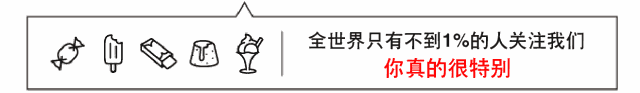
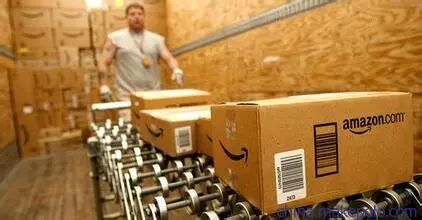

# 断货之后，listing的销量怎么了?

> Source: wechat
> Author: 天机跨境
> Original: https://mp.weixin.qq.com/s/qCq4H78wlWLvlEcLnqD9dA

---

---

## 断货之后，listing的销量怎么了?

三头六臂

相信不少卖家都有过这样的经历，由于某种原因，销售不错的产品，**突然面临断货。**

好不容易优化好的Listing，因为断货导致排名直线下滑，一朝回到解放前！

而且更重要的是，断货这种事情有时候是**不能避免**的，因为FBA海外仓模式的原因，即使库存计划做的再好，你也会遇到断货的情况发生。

随着仓储费越来越高，亚马逊**抽风概率**越来越大，卖家们都不太敢压货在FBA， 那么造成库存计划不太好做，备货越来越谨慎，最终导致断货**几率倍增**的情况。

那么，怎样防止断货影响销量呢？今天，小编给大家推荐几种方法。

 小程序

首先跟大家介绍几种**用的最多**的FBA产品断货后的处理办法：

**1. 将断货的产品提价**

这是很多卖家管用的手段，通过提高产品**销售价格**来减少订单量。

这样虽然能降低一定的损失，但提价的同时也会**降低listing的转化**，影响店铺权重，而且亚马逊后台是能监控库存数量的。

如果FBA仓库断货了卖家**不及时补货**，而盲目提高价格的话，还可能会带来其他一些风险。

**2. 跟卖自己的Listing**

跟卖自己的listing也是很多卖家在断货后的一种**紧急处理**方式，跟卖后采用**自发货**的方式来保证排名不会下降太多。

这样做的好处是不会对**关键词排名**产生什么影响，但是可能会由于到货的时效问题**影响销量**。

**3. FBA紧急补货**

大部分卖家都会采用上面的两种方法，但也有一些比较精明的卖家会利用一些**讨巧的办法**。

因为亚马逊一般会有几天的**缓冲期**，卖家可以利用这几天的缓冲期做**紧急补货**，用红单快速发货入仓。

不出意外的话，正好能在缓冲期补货到仓库，对于一些**单价比较高**，而且**确实比较急**的订单可以采用这种方法。

上面几种方法可能是我们卖家看到最多，用的最多的方法。

但是小编之前在Moss的精神家园里看到一篇文章，给的方法是这样的：

**4.断货时间在两周之内，可以这样做**

这种断货属于**周期比较短**的，大概你能估摸两周之内产品能够上架 。

这个时候你需要估计一下你的**listing剩余的货还能卖多久**，如果只能支撑一周的时候，你就要开始行动了。

☞首先，你需要的是给你的产品**降价**。

**这里强调一下是降价，不是加价。**

降价的幅度可以根据自己**产品情况**来，保证小赚不亏即可。同时广告这一块一定要**加大广告预算**，让广告在这段时间跑的**猛烈一些**。

降价以后必然会**加速卖完**，特别是从20倒计时的时候，卖的会非常之快，原先预估的一周可能3-5天就能卖完。

☞然后，**彻底断货以后**，一定要让listing处于**currently unavailable的状态，一定不能去FBM跟卖**。

如果这个时候有amazon warehouse deals跟卖的话，最后花钱给他买掉，反正也没几个。

两周之内补货上架以后，你会发生一个神奇的现象，产品的排名没有变化，甚至还**更高了**。

产品的广告再开了也和断货之前区别不大，一切都能做到和断货之前**高效的衔接**，运气好的话，会发现甚至比断货之前还要强。

文中写到，可能大家对这个方法会比较疑惑，但是其中的**逻辑很简单：** 就是先通过更大的销量刺激去冲高自然排名权重和广告权重。

然后再保持listing不受拉低流量和转化拉低的干扰，因为大家都知道，**非FBA转化会被拉低很多的**。

等到补货上架以后，自然就能有不错的自然排名权重和广告权重，就算不会高，至少也不会比之前低太多。

**5.断货时间大于两周，可以这样做**

这种情况**比较麻烦**，特别是做海运的卖家，备货计划出了问题，一断货就超过两周，甚至更长。

这种情况上面的招数可能就不管用了，毕竟时间太长了，**权重也都流失了**。

如果是这种情况的话，Moss建议最好的模式就是**重新按照新品来打造**，不要继续刺激老品了。

老品要想去做刺激，需要几倍于用来做**新品刺激**的销量才有效果。

具体做法是先做一个和**原来listing一模一样的新listing**，然后补货的FBA直接发到新的listing上面去，就不要把库存再放到老链接上面了。

然后，等货入仓以后，做一个**新老合并变体**，老的listing**直接库存调为零**，前台就不展示了，但是原有的Q&A和Review都会挪过来新listing这边。

最后你需要做的，就是用之前新品的推广手段去打造这个**全新的listing**了。

重新补货到仓后，怎样让**listing排名销量再次提升**？

按照亚马逊平台的规则，影响Listing权重最重要的因素包括销量、转化率、Review星级和数量、总销售额等。

所以，要想让Listing的销量和排名恢复，卖家就需要从上述要素入手，展开重新打造的征程。

**1.可以调低Sale Price**

补货入仓后，卖家如果发现销量**没有明显的恢复**，可以调低Sale Price。用价格因素来拉升销量，价格降低，销量一般会有较大幅度的恢复。

▷ 如果销量能够连续3-7天都保持稳定增长的趋势，卖家可以适当的提升产品的售价。

上调价格时，一定要坚持“**小步慢跑**”的原则，即每次都是小幅度上调，上调后观察销量变化。

▷ 如果销量稳定或者增长，可在3-7天后继续调整。

当调整到某个价位销量有了**明显的下降**，说明价格到了一个影响销量的**敏感区**。

此时，卖家要把价格降低一下，给Listing的销量和排名增长留一个缓冲的余地。

**2.卖家可以量力而行进行广告投放**

在listing权重恢复的过程中，站内广告可能会出现阶段性的投入产出比**偏高甚至不划算**的情况。

卖家可以量力而行进行广告投放，广告的投放成本也会随着Listing各项权重的提升而降低。

**3.合理的增加review**

如果卖家能够在整个运营的过程中，配合销量通过安全可靠的渠道按比例增加Review，Review的星级和数量也会反过来推动Listing权重和销量的快速恢复。

**THE  END**
