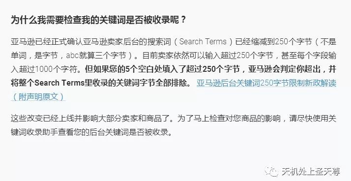
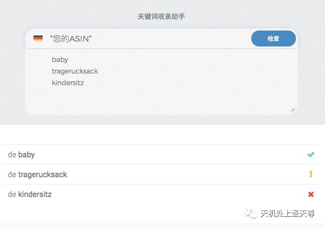
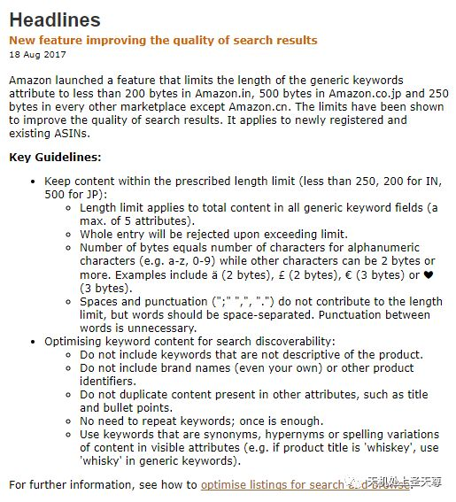
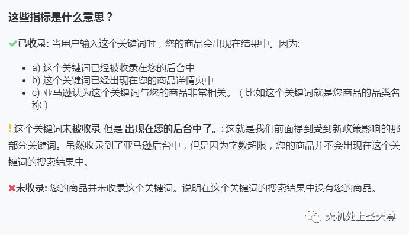
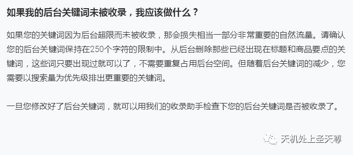
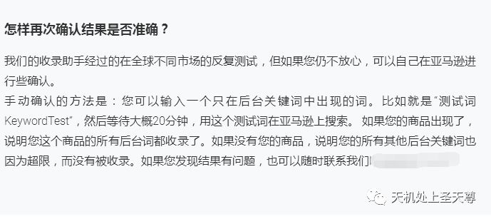
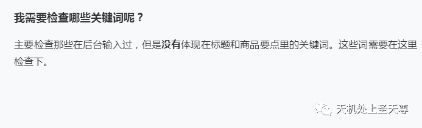

# 亚马逊后台关键词250字节限制新政解读（附声明原文）

> Source: wechat
> Author: 天机跨境
> Original: https://mp.weixin.qq.com/s/OD6Jn2Aefej4efOexaCFow

---

---

## 亚马逊后台关键词250字节限制新政解读（附声明原文）

从2017年8月18日开始，亚马逊正式宣布卖家后台的后台关键词正式限制在250个字节以内！此限制针对美国和欧洲市场。**超限的后台关键词将被全部取消收录资格**，也就是超过字符的后台关键词将全部作废，全部都无法搜索到相关商品！

事实上，自从4月以来，新的限制就已经开始悄悄实施了。我们建议所有用户检查您的后台关键词，是否超出了限制。

我们针对这个限制中常见的问题做出了解答：

- **我并没有在我的卖家后台里看到这个声明，是不是我就不受影响了？**

这个声明目前近发布在了亚马逊欧洲的卖家后台中。我们目前还没发现美国后台中发布了类似的声明。但是声明确实说明此限制会同时影响美国和欧洲市场。

而且这些限制已经在几个月前就影响了很多美国卖家。现在发布的仅仅是一个针对已经上线很久的限制规则作出的公众声明而已。

- **这250个字节限制对我的商品来说有什么意义？**

**因为如果您的商品后台关键词超过250个字节的限制。那么所有的后台关键词将失效**。全部都无法搜索到相关商品！您会损失相当一部分自然搜索流量。

- **目前都有哪些亚马逊市场收到了影响？**

目前除了印度（200字符），日本（500字符）和中国（无限制）之外，全球其他市场都使用了新规定。

- **全部一共250个字节，还是每行250个字节？**

全部5行加起来**一共只能**输入250个字节。

- **250个字节和250个字符有什么不同？**

请注意，声明中特指250个字节bytes，而不是250个字符characters。因为通常一个字符character等于一个byte。但是有些特殊字符‘é’, ‘ä’ 或者 ‘&’ 都是算作2个或以上字节的。虽然不常用，但是请注意这点区别。

但是‘,’ 或者 ‘;’ 以及空格，是不算到字节中的。因此我们建议您用空格分隔您的关键词。

- **我还可以输入1000个字符在后台，那是不是这个规定也不影响我呢？**

虽然您可以输入更多的关键词，但是依然**不能超过限制**，一旦超限就是所有关键词不被收录。

- **我虽然超过限制了，但是仍然有搜索结果不受影响，我应该怎么做？**

这项新规定会逐渐影响到所有商品和所有卖家。但是亚马逊通常都是不同程度和范围的实施新规定，所以依然会有少数卖家和商品可以暂时继续使用多字节。

但我们依然建议所有卖家都尽早采取必要的措施，以适应新规定，以防万一。

- **针对新规定，我应该用关键词短语代替独立单词吗？**

目前，我们依然没看到任何迹象表明关键词短语的效果要比独立单词好。独立单词您可以输入更多且更智能的字符匹配，尤其是排除了重复单词。

- **我怎么知道我的后台关键词是不是违规了呢？**

针对这种情况，我们快速上线了一款独立工具，帮助您检查是否已经受其影响：

关键词超限检查助手

**使用方法：**

1. 输入您要检查的ASIN
2. 输入几个关键词，主要检查那些在后台输入过，但是没有体现在标题和商品要点里的关键词
3. 如果显示未被收录，说明您的后台关键词已经因此限制政策受到影响。所有后台关键词都将不能搜索到您的商品。

如图所示，一旦出现叹号或插号，请及时检查您的Search Terms是否超过了250字符的限制。

**手动检查：**

您可以在亚马逊直接搜索您的后台关键词，（仅使用没有出现在标题和商品要点里的后台关键词），查看您的商品是不是出现在结果中了。

*声明全文：*

字数统计 - 在线字数计算器  http://www.mingmu.net/zishu.html

