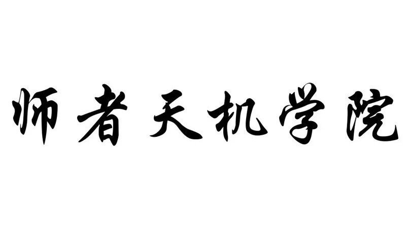
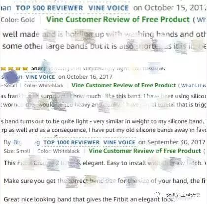
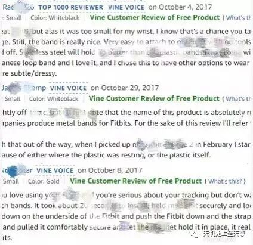
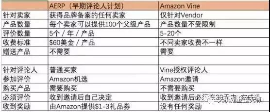

# 考虑以下这些安全获取Review的方式

> Source: wechat
> Author: 天机跨境
> Original: https://mp.weixin.qq.com/s/n9d5HDaLJatHqXIe8-Wl4Q

---

---

大促过了，旺季还会远吗？亚马逊还没有停止删Review的动作，2018年下半年怎么办?

都说做亚马逊没有不刷单的，所谓小刷怡情，大刷伤身，可是现在刷着刷着账号就刷没了。

其实不找红人刷单也还是有很多合理的渠道让我们获得Review，看看这位卖家，旺季前夕listing悄悄增加了满屏的Vine Customer Review，导致后两个月旺季销量蹭蹭上涨。

**一、满屏Vine Customer Review**

小编今天发现一位卖家，listing首页慢慢的五星Vine Customer Review of Free Product标志，集中出现在9月底和10月，如图

**二、什么是Vine Customer Review**

1、2016年10月份向卖家启动Vine Voice项目

2016年10月，亚马逊发布测评新规定，不能使用第三方机构(比如fb小组测评，各大测评网站测评等)发出带折扣或者免费的产品给reviewer来换取评价;只有通过亚马逊Vine Voice项目组的人来做折扣码或者送测，是合规的。

2、Vine Customer

1)Vine Voice项目组，是一个邀请制的Group(Vine Review Group)，亚马逊对于诚信度高的买家采取邀请入驻来做测评。

2)Vine 评论是Vine Voices成员独立的意见。不能受卖家影响，更改或者编辑。只要符合发贴政策，亚马逊也不会更改或者编辑 Vine评论。

3)亚马逊每个月会给加入Amazon Vine项目的会员发两次待评论产品清单，评论者们每次可以从清单中选择两款产品进行评论。只要他们在30天内写出有建设性的评论就有机会免费获得该产品，但是决不允许将其在亚马逊卖掉或转让出去。

4) Vine Voice的review相对普通的review权重会更高，并且每条review都有一个绿色文字“Vine Customer Review of Free Product”标记。

3、Vine Customer的排名受其他客户对评论者所提交的评论的质量与帮助的判定影响。

**三、Vine Customer Review 有什么好处**

1、“ Vine Customer Review of Free Product"标志永久留在商品页面上!亚马逊不会给予干扰。

2、因为Vine Customer 都是具有公信力、专业的 Reviewer，所以这样的Review可信度更高、更有说服力，对于产品转化率有更大帮助。

3、Vine Customer Review 在亚马逊Review占有最高的权重，优质的VineReview可以让你快速建立产品可信度和品牌声誉。

**四、如何参加Vine Voice项目**

1、将货出给 Amazon 的供应商，拥有 Vendor Account 的卖家是 Amazon 主动邀请的合作厂商。

2、第三方卖家 ( Seller ) 若想要加入 Vine Program 计划，则须申请加入 Vendor Express，通过 Amazon的审核。 Vendor Express 成本较高，适合制造商或是有专利商品生产线的卖家。

3、卖家收到亚马逊的Vine Program 邀请，但是每次上架ASIN需要收取一定费用，而且每次促销参加Vine Customer Review的ASIN数也是有限的。

**五、早期评论人计划和 Vine 的区别**

除了Vine Voice 项目获取安全Review，今年2017年6月亚马逊还推出了早期评论人计划，即Amazon Early Reviewer Program(简称：AERP)。

1、主要针对已经拥有亚马逊品牌备案的第三方卖家。

2、每个卖家可以提供最多100个父级产品 (Parent SKU)。

3、每个SKU收取$60美金的费用，如果有消费税产生也需要卖家支付。

4、1年或者每个父级产品获取5个评价，满足其中任何一个条件后计划结束。

4、获取评论的方式是由Amazon选取买家， 成功参与的买家将获得由Amazon提供的$1-3美金的礼品卡。

AERP项目和 Vine Voice 项目区别：

亚马逊Review仍然在listing权重中占有举足轻重的位子，有的卖家看得长远，对自己的产品有信息，愿意花钱去获得这些安全、高质量的Review，这样的选择已经让自己的产品脱颖而出，所以建议有资金的卖家在面对刷单风险高的情况下，也可以考虑这些安全获取Review的方式
