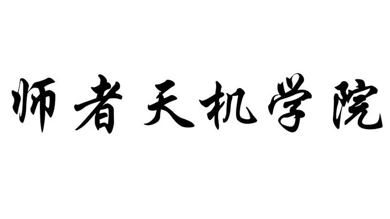

# 亚马逊最新动向

> Source: wechat
> Author: 天机跨境
> Original: https://mp.weixin.qq.com/s/xVDwXQQCnAXo_isQKtvbPg

---

---

微信公共

1.

访问日本站卖家平台的暂时解决办法

如果您遇到无法访问日本站卖家平台的情况，请改由以下网址 ：http://go.amazonsellerservices.com/e/229492/2018-08-13/4tm92hd/621275115

访问卖家平台。及时操作您的店铺，确保账户绩效健康。

https://sellercentral-japan.amazon.com/merchant-picker/status

2.

亚马逊优惠券(Coupons)上线至8大站点

助力销售提升的又一“酷·棒”工具—亚马逊优惠券现已开放至美、加、英、法、德、意、西、日站点。您可以自助设置商品优惠金额或折扣，提升商品的转化率

 http://live.vhall.com/611510273?refer=em\_news0818

3.

欧洲站销售佣金7折，您享受了吗？

是的，销售佣金直降30%！助您快速提升欧洲各站点的销售增长。我们为您挑选了热销商品，只要在8月31日之前将符合条件的ASIN添加到适用的站点，便有可能享受此优惠。

https://sellercentral.amazon.co.uk/gc/sell-online/30-percent-fee-promotion?ref=SC\_RFP\_MAINCNE\_NEWS0818&

4.

亚马逊仓储限额新政：

影响旺季库容的IPI您达标了吗？

自7月1日起，亚马逊物流 (FBA) 调整了仓储限额政策，全新引入库存绩效指标IPI (Inventory Performance Index) 的季度考核机制，以帮助您优化库存管理。IPI分值需要达到多少？每个季度考核的时间节点是什么？IPI如何影响下季度库容？IPI分数如何提高？关于IPI的最新完全解读，我们已经为你划好了重点，仔细看，一点儿都不难！

https://mp.weixin.qq.com/s/KzXBHQlIppMYfuCXjZlPrQ

重要政策通知，亚马逊物流仓储限额政策的重点都在这一篇！

亚马逊8月课表，  预约相应课程

https://gs.amazon.cn/resources.html?ld=EMCNAGSNEWS201808\_EVENT
