# 亚马逊销量与排名之间的关系以及亚马逊整体广告投放策略

> Source: wechat
> Author: 天机跨境
> Original: https://mp.weixin.qq.com/s/5WPWX5bc4CEfUggKM6xqMQ

---

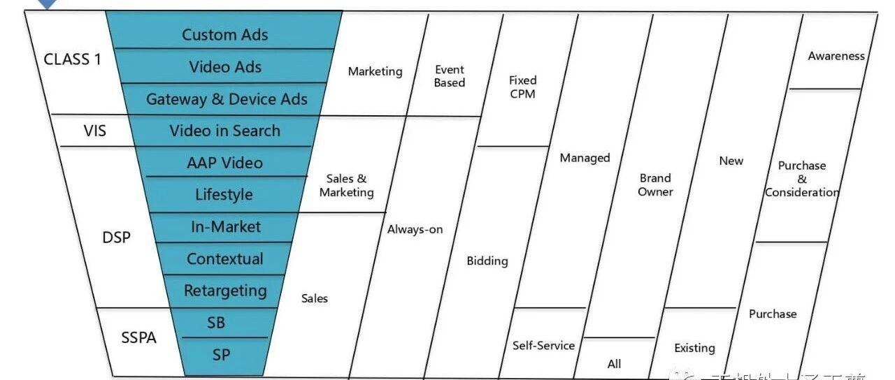

---

**销量与排名之间的关系**

销量与排名是一个相互循环的环节，销量越好，排名越靠前，当然如果产品的排名很高，销量也会突飞猛涨。卖家们想要销量提高，把排名提升上去也是种好方法。那么究竟怎样可以提高排名呢？今天我整理了一些关于如何提高搜索排名的方法。

第一个，价格：价格是永恒的话题和手段。具有竞争优势的价格，排名自然靠前。当亚马逊首页展示的产品与卖家的相同，不妨将自己的产品价格定的略低一些，前提是不能低于产品实际价格。不过当排名靠前后，卖家是可以逐渐将产品价格提升回来的。

第二个，关键词的优化：在亚马逊平台上，你不仅在Title、Listing、5 点keywords、Description上要做到关键词的优化。它的后台中，你也要能够付费去做一些关键词的广告，借此来增加曝光度，拥有更多的展示机会。其实在Google Adwords里拥有免费的“关键字规划师”功能，卖家们也可以使用它来学习关键词是如何优化的。

第三个，产品的评价：产品的评价对于排名来说可是至关重要的。好评越多，排名越靠前。那么怎样才能拥有更多的好评呢？

当然小编我认为最基本的前提就是产品的质量，优质的产品是获得好评的不二法则。

其次还要有体贴的服务。

买家询问时要积极，产品包装时要仔细，快递运送要留意。

做到这三点，卖家的服务就已经相当不错了。

第四个，提高转化率：转化率是需要依靠流量的，提高转化率也就是提高流量的转化率。然而流量又分为内部流量和外部流量。

内部流量主要涉及两个方面：一个是“关键词”，另一个是站内“付费广告”。外部流量则更多的是通过社交媒体，例如Facebook、Twitter、Pinterest等。亚马逊DSP广告（参考以下广告投放策略内容） 寻求他们发布一些软文，推广一下品牌和产品，排名也能得到很大的提升。

第五个，使用FBA：亚马逊一直鼓励卖家使用FBA仓储，它在排名中也会更加支持使用FBA的产品，卖家们在亚马逊排名中也能发现，大多数靠前的卖家都是亚马逊自营或者使用FBA。另外，在亚马逊平台消费的买家经常使用货到付款的方式，卖家想要博得这部分消费者就需要使用FBA仓储了。

第六个，跟卖：在亚马逊平台上是允许卖家跟卖的，而跟卖也是快速提升排名的好方法。卖家们可以在第一时间里跟卖平台中非常靠前的产品，当然时间是关键，错过了时间，再跟卖效果就没那么好了。小编认为，卖家想要提高排名，不仅要做足相关的工作，还要做好相关的细节，当然最重要的还是产品的质量。保证了质量，排名的提升才会更快。

获得购物车，提升购物车赢得率，主要靠以下几点：保持有竞争力的价格，FBA，足够的库存，没有人跟卖，状态可售，不是冗余库存或者滞销品，好的销量和转化率，客服问题积极回复，账号活跃........

-------------------------------------------

广告知识补充

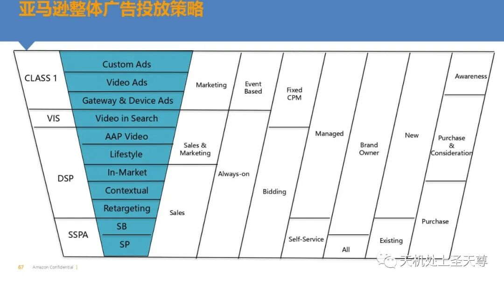

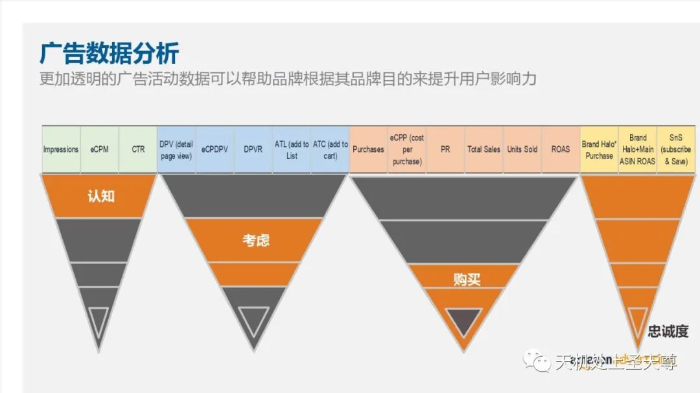

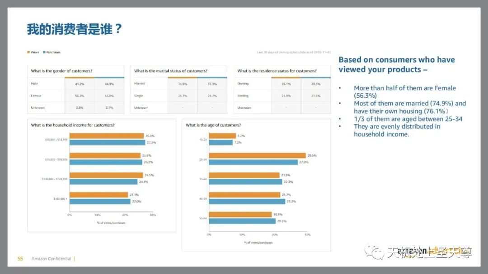

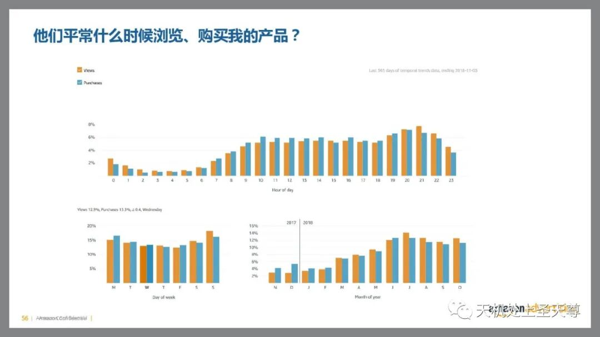

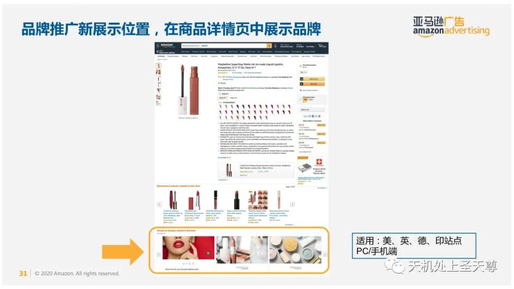

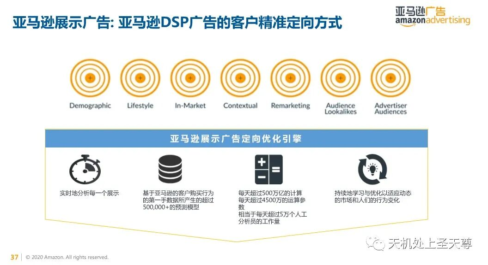

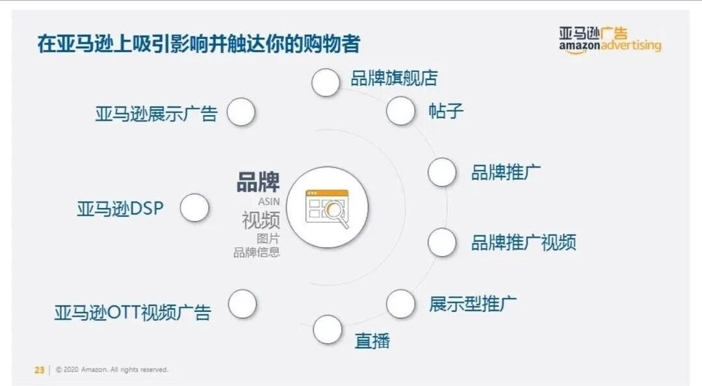

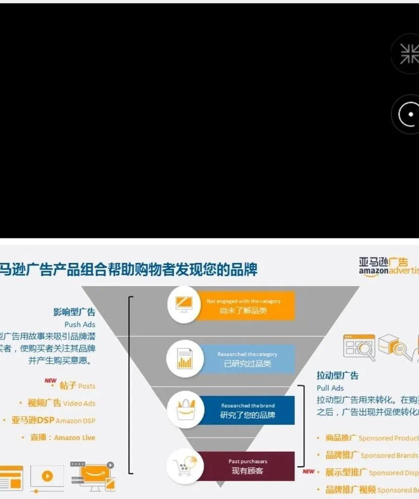

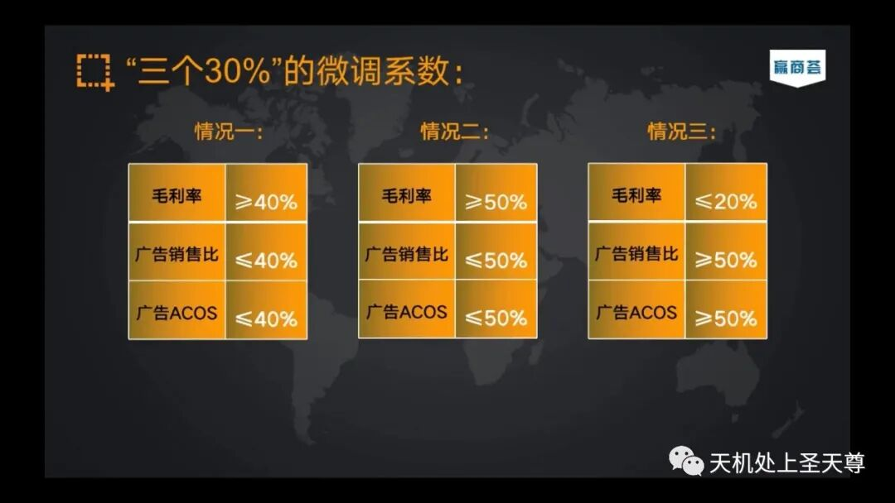

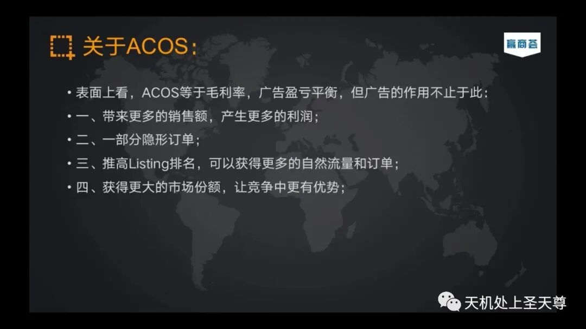

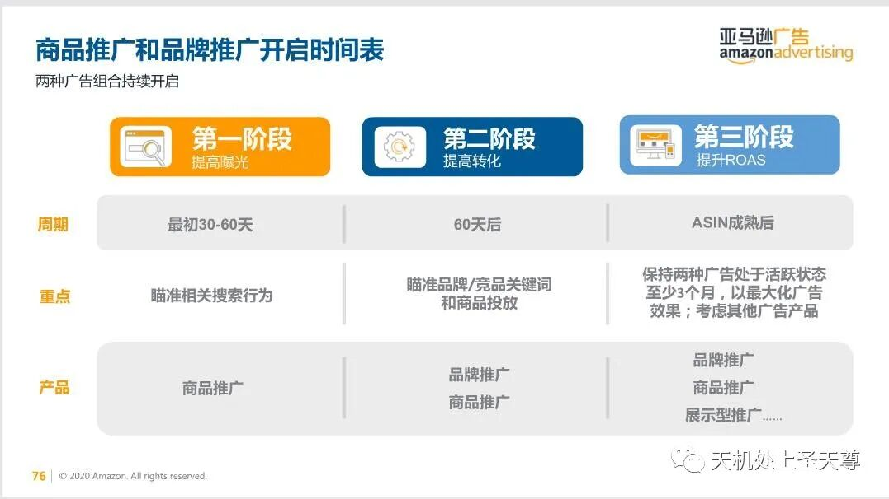

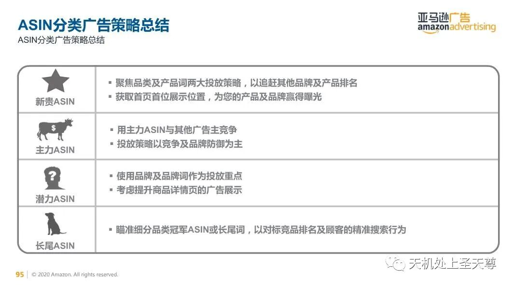

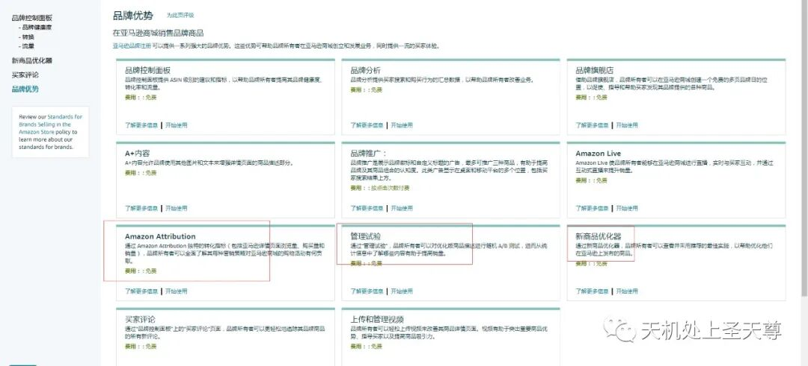

-------------------------------------------

