# 亚马逊广告技巧--万字总结（二）

> Source: wechat
> Author: 天机跨境
> Original: https://mp.weixin.qq.com/s/dVepd40GxsAy05etKHz90A

---

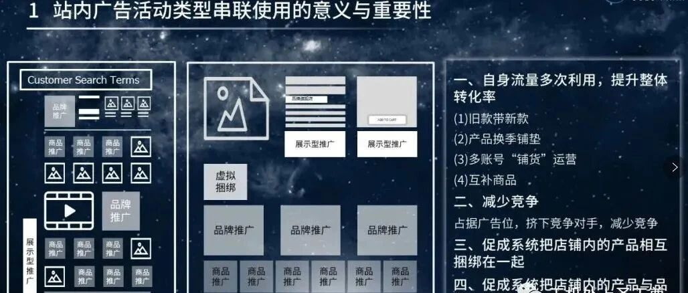

---

**三、站内广告活动类型串联使用的意义与重要性**

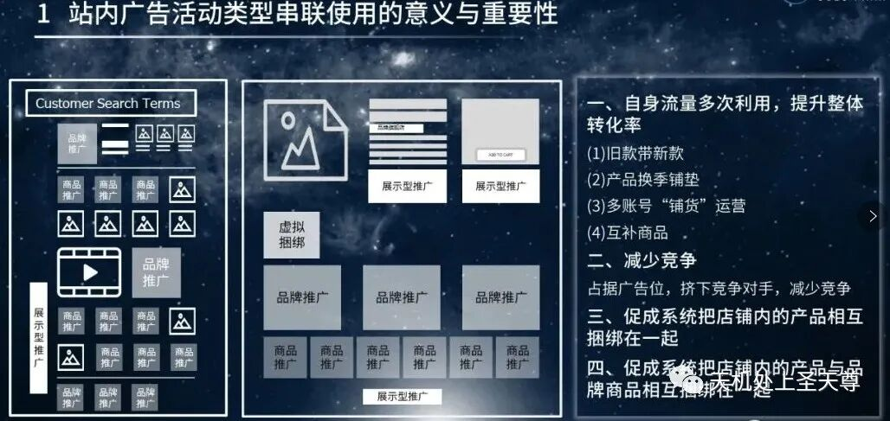

**1、真正了解解决流量与转化的流失问题，我们应该思考，在平时的运营工作中是否有进行产品的流量布局？**

   不同广告类型的存在意义不仅是为了满足不同纬度如产品、品牌等的展示需求，更多在于实现产品与品牌之间正向、有序的流量内循环。我们可以考虑通过以下不同投放方向，控制流量的走向：

自身流量多次利用，提升整体转化率（旧款带新款、产品换季铺垫、多账号“铺货”运营、互补商品）

减少竞争：占据广告位，挤下竞争对手

促成系统把店铺内的产品相互捆绑在一起

促成系统把店铺内的产品与品牌商品相互捆绑在一起

   经过对不同展示页面的广告结构进行剖析之后，我们可以通过对自身产品流量的多次利用，提升整体的转化率。

**2、商品推广、品牌推广与展示型推广的联合使用**

**防御型打法：**

  当我们的品牌开始有了一定的认知度，具体的表现可以通过广告搜索词中出现我们品牌名的频率逐渐增多进行大致判断，即代表我们的产品与品牌开始得到客户的认可，那么这个时候，就需要我们开始防御品牌的流量了。

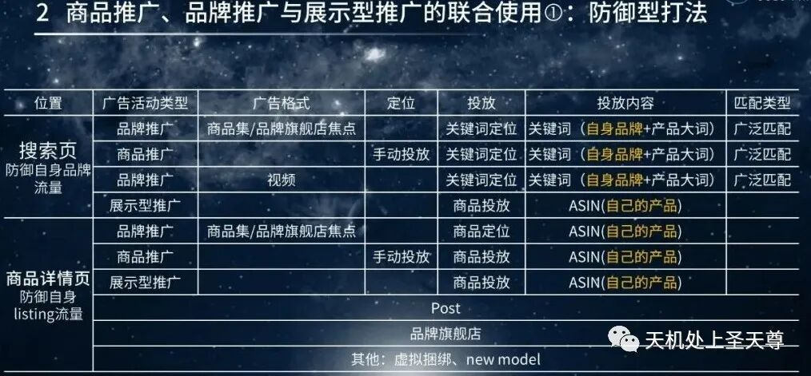

当我们进行防御型广告布局时，在搜索页面的表现为：商品推广与品牌推广的投放方式基本以自身品牌+产品大词为主，而展示型推广由于没有关键词投放的选项，只能进行商品投放，所以需要投放自身产品ASIN。

如果客户搜索品牌名与产品关键词时，此刻出现的不止是我们的商品推广广告位，同时还会触发展示型推广，这样一来，我们的产品能够通过多次出现增加曝光机会。

而在商品详情页面这里，更多是围绕着我们的listing页面构建流量闭环，基本布局思路也与搜索页面策略较为接近：投放同一店铺内的产品或者在A店铺产品页面投放B店铺产品广告，这样一来，无论客户点击的是哪个产品，实质上都是为自己的店铺产品导流。

**进攻型打法：**

  “防御型打法”我们可以理解为保护自己产品的流量，避免受到其他产品的影响，被瓜分点击与转化。“进攻型打法”则是反向而行，比如说通过投放竞品品牌+产品大词的关键词组合，主动争夺竞品在搜索页面的流量，增加转化的机率。

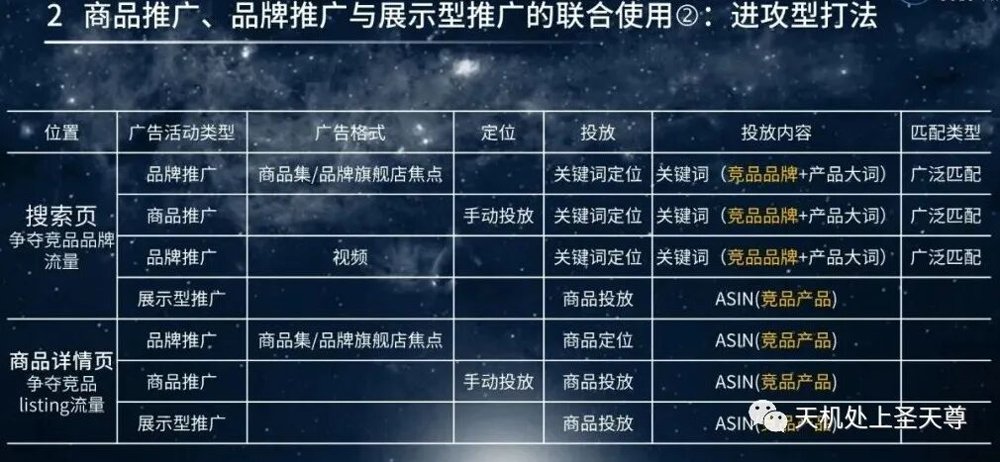

获取竞品品牌：可以通过后台的品牌分析（Amazon Brand Analysis）获取搜索量较大的品牌词。如此一来，在投放这些竞品的品牌词之后，我们能够主动“蹭”到它们的流量。而在商品详情页中，通过投放竟品ASIN同样可以获取这方面的流量。

**注意：** 进攻型的投放策略需要建立在产品具有竞争优势的前提下，否则容易造成高投入高曝光低转化的尴尬局面。

## 四、品牌推广的不同方法

**1、品牌推广在搜索结果页顶部&底部**

**商品集。**

创意设置：

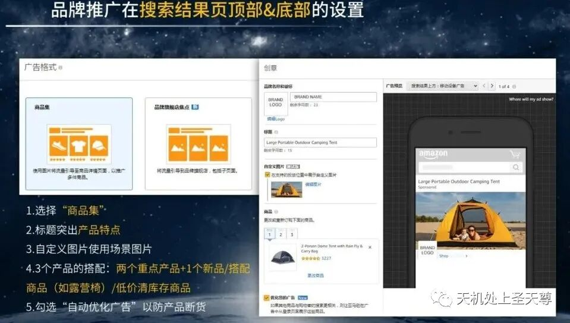

品牌名称与Logo：根据自身实际情况进行基础设置，而当我们的品牌认知度处于初期阶段时，无法通过品牌直接获取客户的主动流量，品牌名称同样可以考虑设置为产品名称。

标题：突出产品特点。编辑标题时，可以通过展示产品的亮点和记忆点，撬动客户的好奇心与购买欲

自定义图片：建议使用场景图片。通过标题的产品特点与使用场景图片的搭配，能够让买家更容易产生联想，激发购买欲。

产品的搭配：两个重点产品+一个新品/搭配产品

自动优化广告：建议勾选。“自动优化广告”的选择，可以预防断货或者某个展示产品无法展示时的缺失，亚马逊将通过补位的方式自动展示旗舰店其他产品。

投放设置：

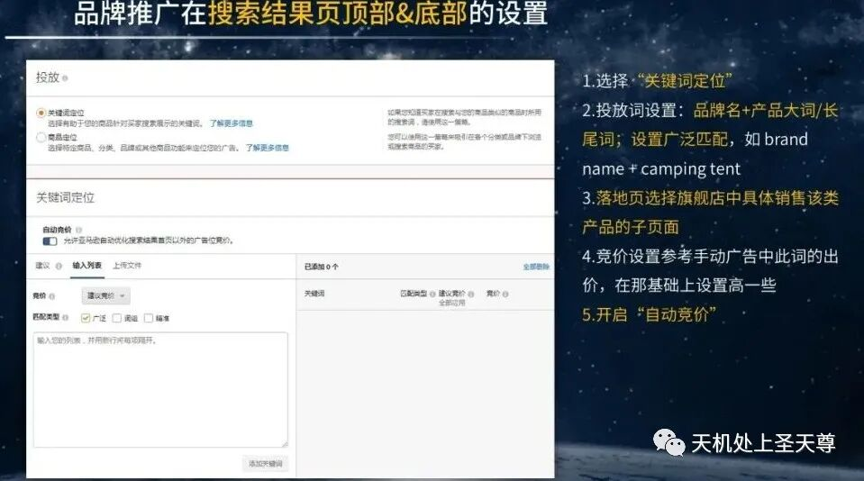

选择关键词定位。

投放词设置：品牌名+产品大词/长尾词，设置广泛匹配。

落地页：选择旗舰店中具体销售该类产品的子页面。

竞价设置：可参考手动广告中此词的出价，在此基础上略高一些。

开启自动竞价：相当于"动态竞价-仅降低"的竞价策略，在一定程度上可以减少广告花费。

**品牌旗舰店焦点。**

创意设置：

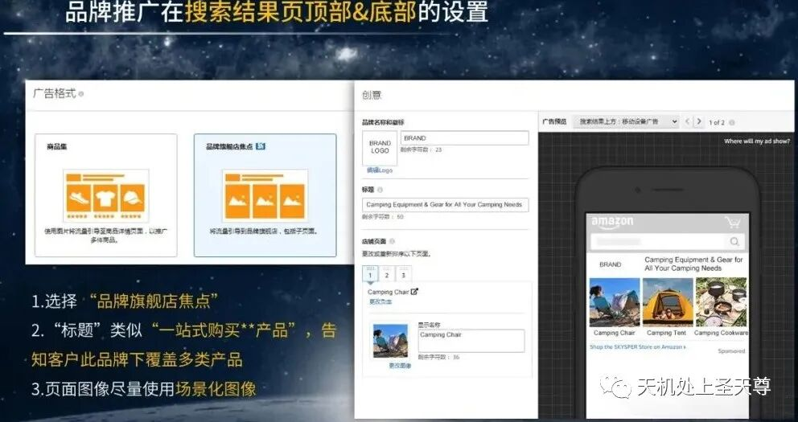

品牌名称与Logo：根据实际情况进行基础设置。

标题：可参考"一站式购买XX产品"。通过此类标题，能够告知客户此品牌下覆盖的产品类别，轻松满足他们的多产品购买需求。

页面图像：ASIN首图。（只能使用产品首图）

产品的搭配：两个重点产品+一个新品/搭配产品/低价清库存商品。

投放设置：

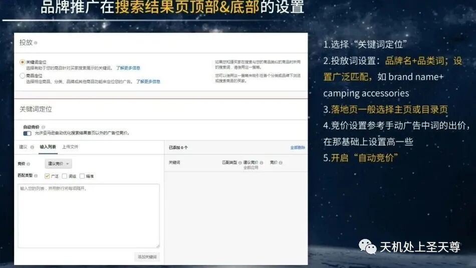

选择关键词定位。

投放词设置：品牌名+品类词，设置广泛匹配，通过品类词扩大搜索流量的入口。

落地页：一般选择主页或者目录页。

竞价设置：可参考手动广告中此词的出价，在此基础上略高一些。

开启自动竞价：相当于"动态竞价-仅降低"的竞价策略，在一定程度上可以减少广告花费。

**2、品牌推广在搜索结果页中部**

**视频推广。**

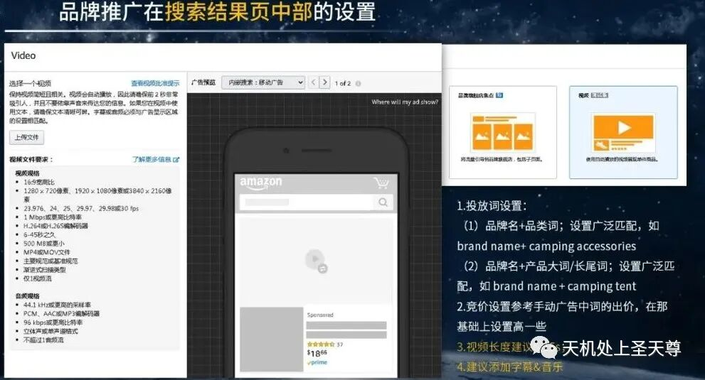

视频长度：建议6-15s。

视频亮点：建议添加字幕&视频（A/B test），通过后期的投放数据不断优化视频，升级视觉效果。这里的A/B test的意思是指多做几个视频广告，再通过广告数据测试不同的视频效果。

投放设置：

投放词选择，设置广泛匹配，通过品类词扩大搜索流量的入口。

竞价设置：可参考手动广告中此词的出价，在此基础上略高一些。

**3、商品推广在搜索页**

投放设置：

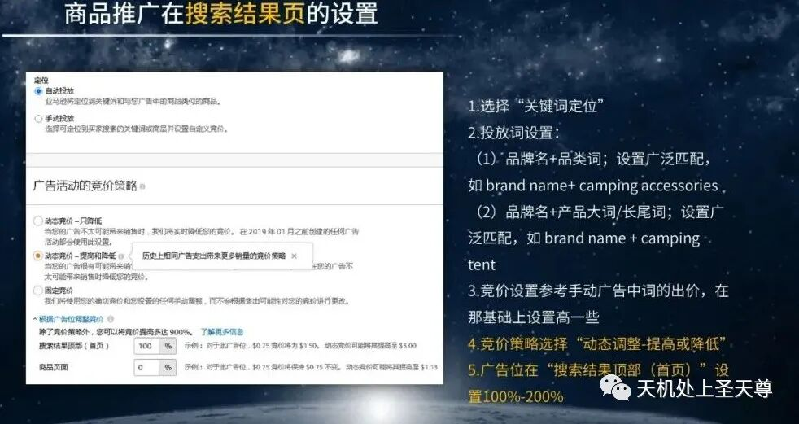

选择关键词定位

投放词设置：

品牌名+品类词；设置广泛匹配，通过品类词扩大搜索流量的入口。

品牌名+产品大词/长尾词。

竞价设置：可参考手动广告中此词的出价，在此基础上略高一些。

竞价策略：选择"动态竞价-提高或降低"，增强抢位弹性。

广告位：在"搜索页面顶部（首页）"设置100%-200%在一定程度上可以减少广告花费。

**4、展示型推广在搜索结果页&商品页面**

投放设置：

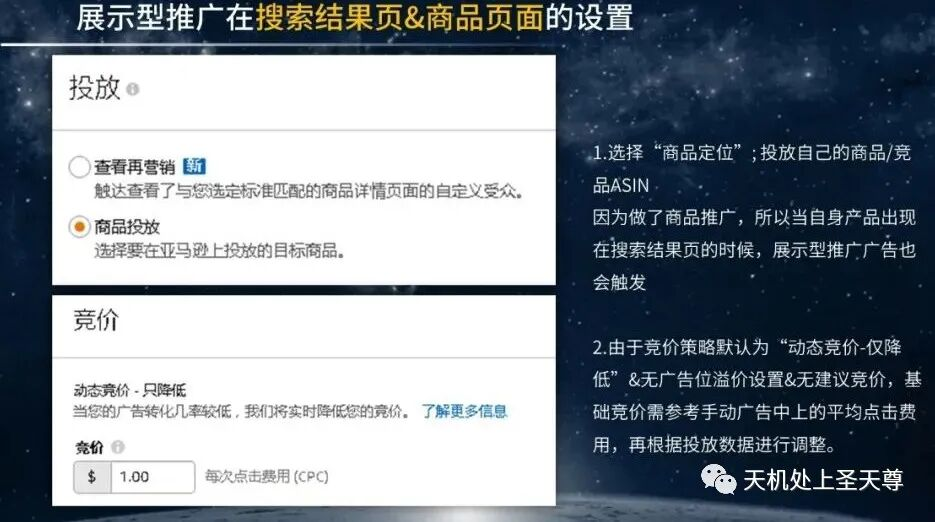

选择"商品定位"，投放自身产品（防御型打法）/竟品（进攻型打法）由于前期已投放了商品推广，所以当自己身产品出现在搜索结果页时，会同时触发展示型推广广告。

竞价策略：由于展示型推广的竞价策略默认为"动态竞价-仅降低"，且无广告位设置，同时没竞价，基础竞价需参考手动广告中的平均点击费用，后期根据投放数据再进行灵活调整。

商品推广在商品页面

投放设置：

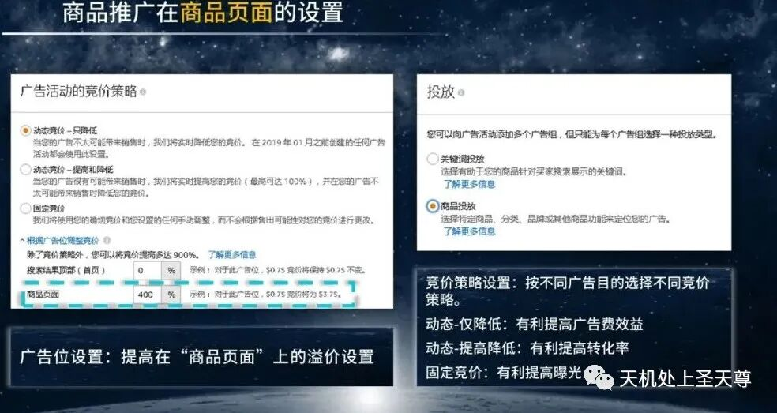

选择"商品投放"。

竞价策略：根据不同的广告目的进行选择。

动态-仅降低：有利提高广告的花费效益。

动态-提高与降低：有利提高转化率。

固定竞价：有利提高曝光。

广告：提高在"商品页面"的溢价设置。

**5、品牌推广在商品页面**

投放设置：

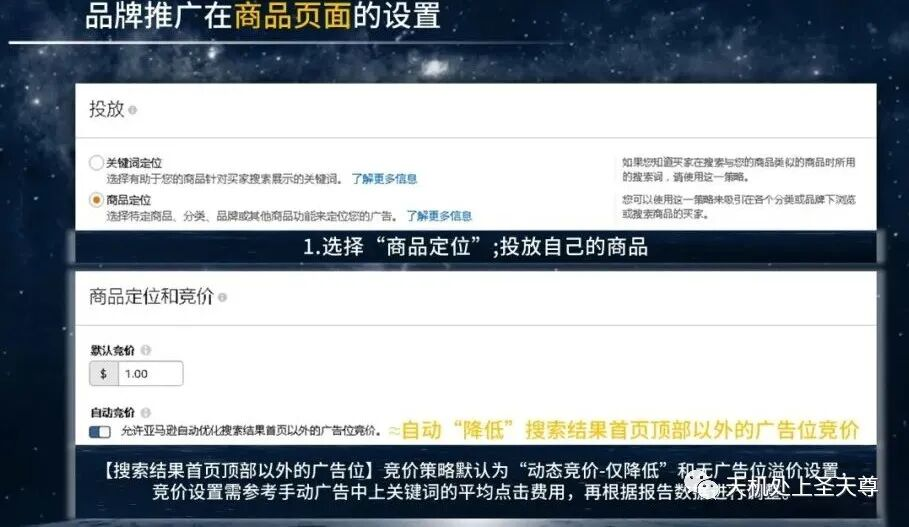

选择"商品定位"，投放自身产品

竞价策略：由于品牌推广的竞价策略默认为"动态竞价-仅降低"，且无广告位设置，基础竞价需参考手动广告中的平均点击费用，后期根据投放数据再进行灵活调整。

本文内容来源于咕噜公园

------待更新-------

‍
