# 第一章，针对广告活动不同设置的优化&案例分析。亚马逊PPC广告高阶培训系列(一)--附上全部大纲。

> Source: wechat
> Author: 天机跨境
> Original: https://mp.weixin.qq.com/s/ms90LM48Vgj_wFgRycKjuQ

---

---

**第一章针对广告活动不同设置的优化&案例分析**

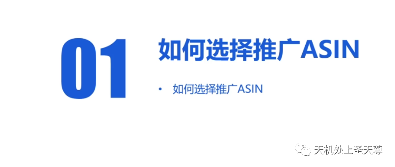

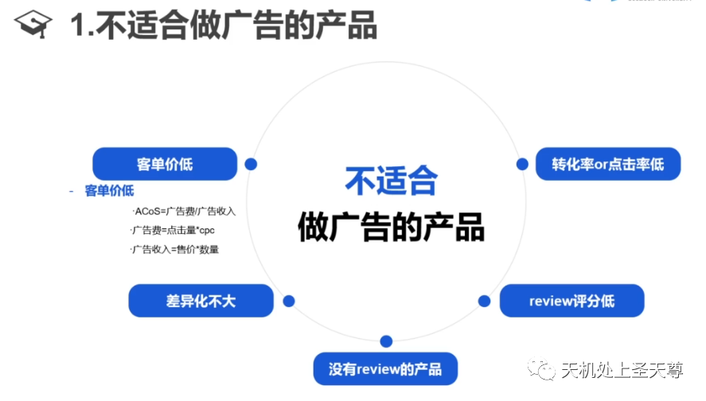

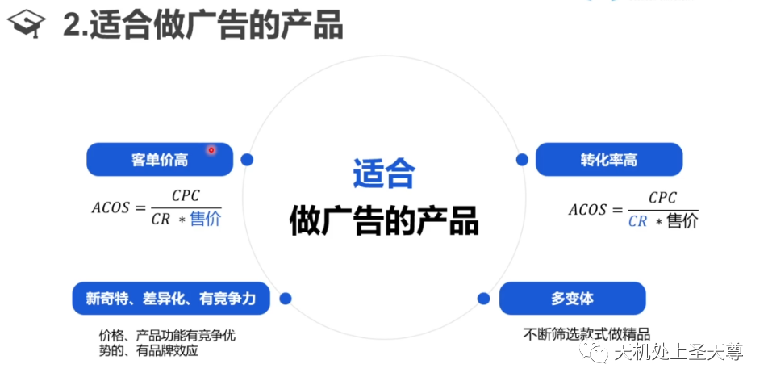

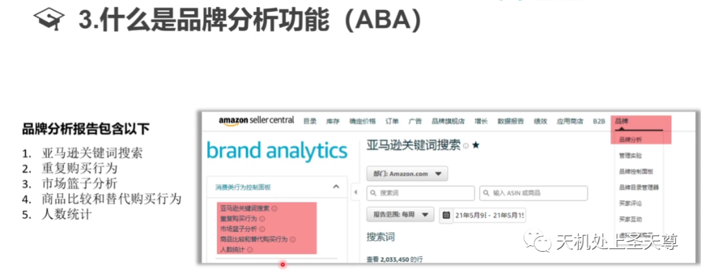

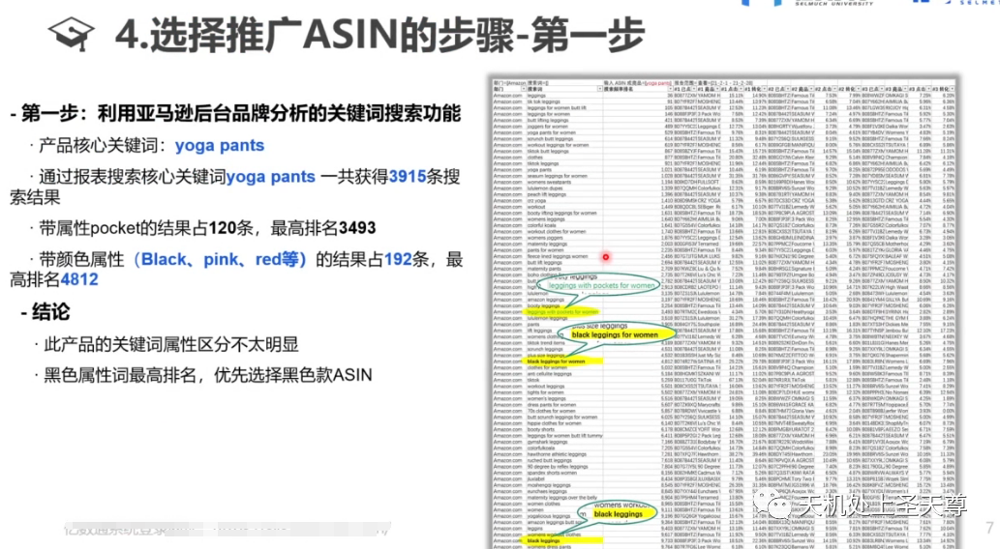

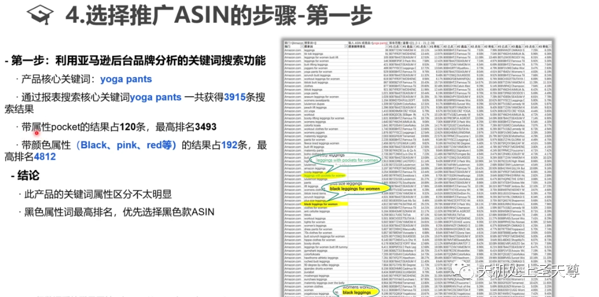

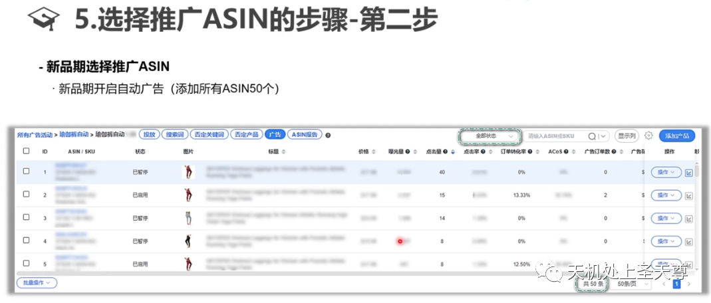

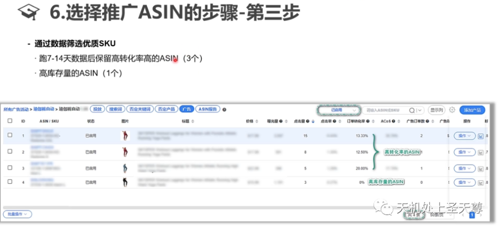

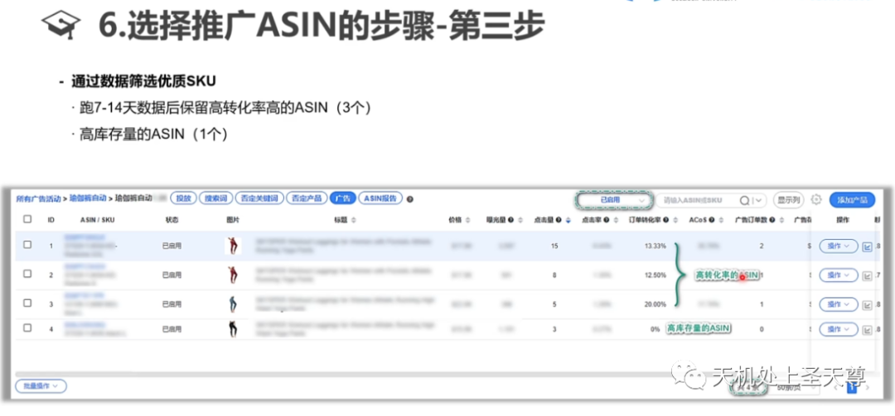

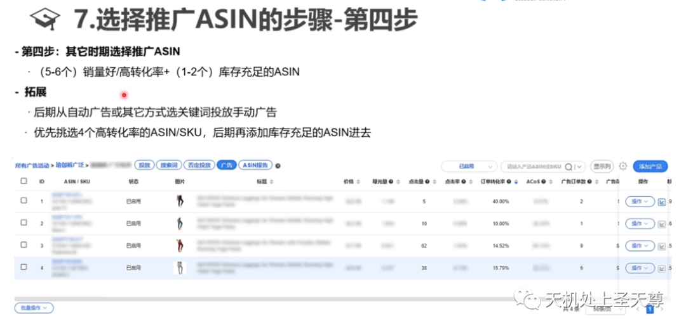

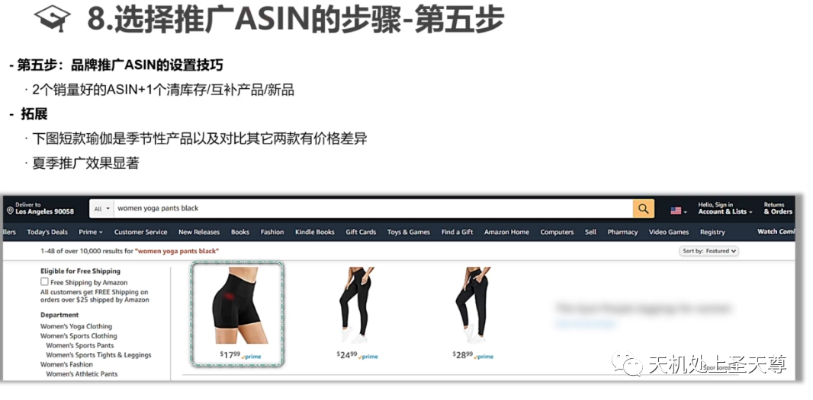

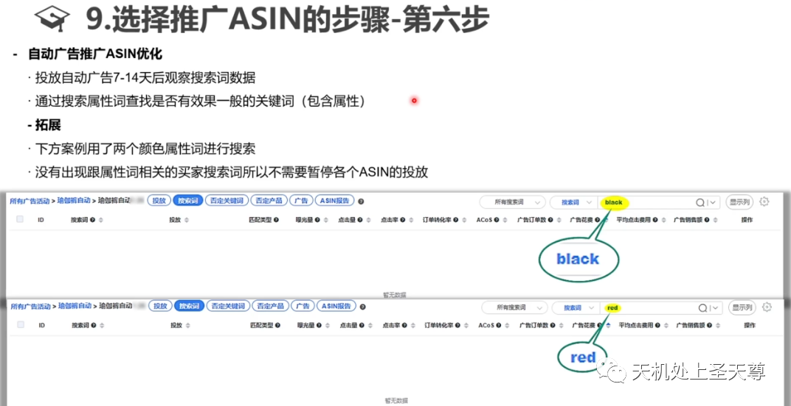

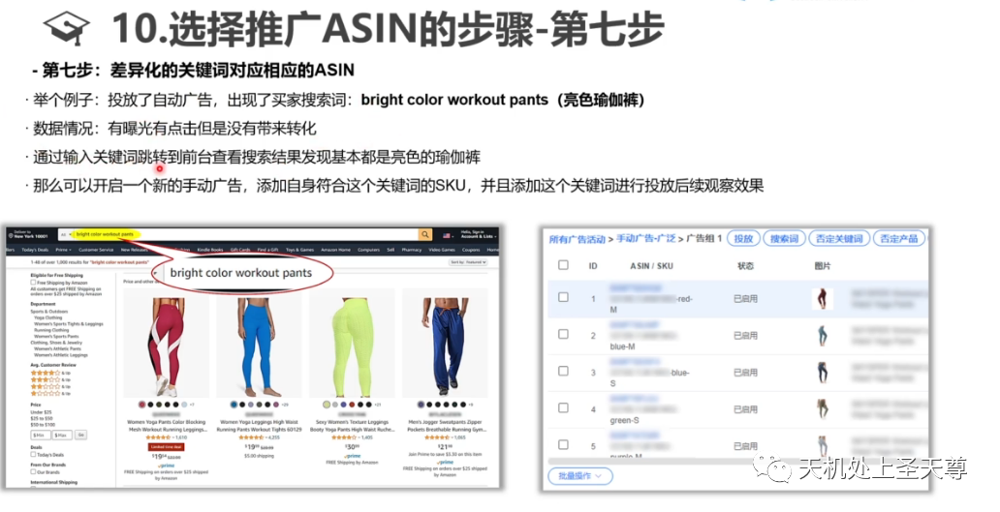

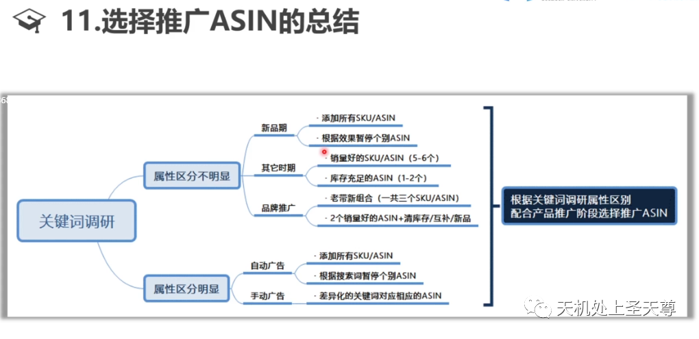

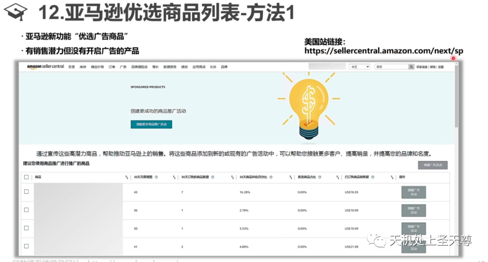

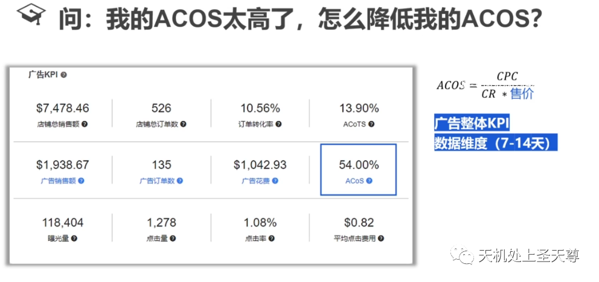

‍**ACOS=CPC/( CR \* 售价 )**

-----待更新-----

-------------------------------------

亿数通亚马逊PPC培训课程大纲

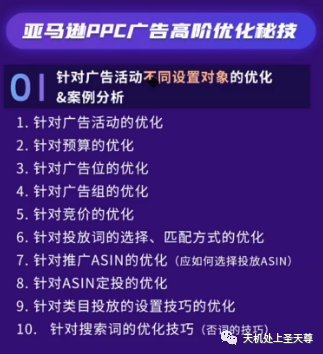

01 针对广告活动不同设置对象的优化&案例分析

1.针对广告活动的优化

2.针对预算的优化

3.针对广告位的优化

4.针对广告组的优化

5.针对竞价的优化

6.针对投放词的选择、匹配方式的优化

7.针对推广ASIN的优化(应如何选择投放ASIN)

8.针对ASIN定投的优化

9.针对类目投放的设置技巧的优化

10.针对搜索词的优化技巧(否词的技巧)

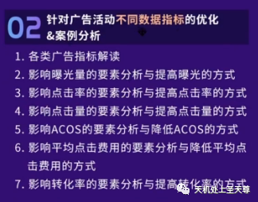

02 针对广告活动不同数据指标的优化&案例分析

1.各类广告指标解读

2.影响曝光量的要素分析与提高曝光的方式

3.影响点击率的要素分析与提高点击率的方式

4.影响点击量的要素分析与提高点击量的方式

5.影响ACOS的要素分析与降低ACOS的方式

6.影响平均点击费用的要素分析与降低平均点

击费用的方式

7.影响转化率的要素分析与提高转化率的方式

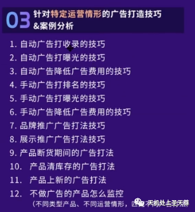

03 针对特定运营情形的广告打造技巧&案例分析

1.自动广告打收录的技巧

2.自动广告打曝光的技巧

3.自动广告降低广告费用的技巧

4.手动广告打排名的技巧

5.手动广告打曝光的技巧

6.手动广告降低广告费用的技巧

7.品牌推广广告打法技巧

8.展示推广广告打法技巧

9.产品断货期间的广告打法

10. 产品清库存的广告打法

11. 产品上新的广告打法

12.不做广告的产品怎么监控

(不同类型产品、不同运营情形，匹配不同广告打法)

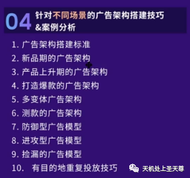

04 针对不同场景的广告架构搭建技巧&案例分析

1.广告架构搭建标准

2.新品期的广告架构

3.产品上升期的广告架构

4.打造爆款的广告架构

5.多变体广告架构

6.测款的广告架构

7.防御型广告模型

8.进攻型广告模型

9.捡漏的广告模型

10.有目的地重复投放技巧

05 亚马逊广告优化常见的10个问题剖析解答

本内容来源于亿数通
