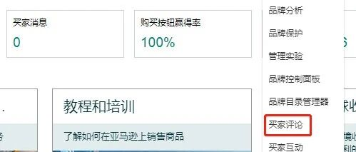
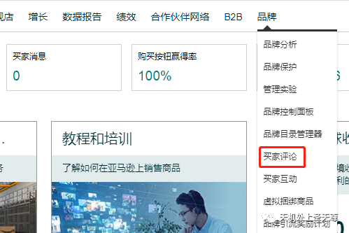
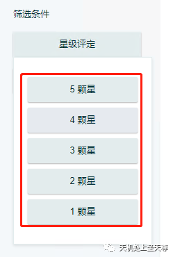
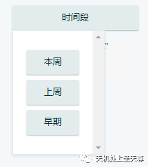
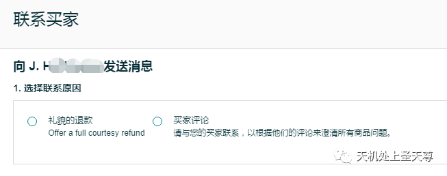

# 品牌卖家新功能，可联系卖家删除差评！！！

> Source: wechat
> Author: 天机跨境
> Original: https://mp.weixin.qq.com/s/NAbsc-nuhymnVUoxv_Umbw

---

---

品牌卖家新功能，可联系卖家删除差评！！！

近期，亚马逊推出了一款新工具，能够让品牌卖家在客户给出1星、2星或3星的产品评价后，与他们取得联系。现在，卖家可以通过提供全额退款或请求他们的订单的详细信息来帮助解决他们的问题。
优秀的品牌所有者应该向所有客户提供卓越的服务，尤其是在客户有不满意甚至失望的情况下。现在卖家可以通过亚马逊后台的“品牌”-·>“买家评论”来使用这个新功能。
卖家在这里可以查看自己任何产品的所有评论，或者可以通过星级评定以及时间段筛选评论。可以在符合条件（1~3星）的评论旁边选择“联系买家”。

关于“联系买家”：
1、“联系买家”工具可让品牌所有者通过电子邮件渠道回复买家的批判性评论（1-3 星评论），直接与买家互动。

2、资格条件：必须注册自己的品牌并将其关联到信誉良好的专业卖家平台账户。账户需要拥有从品牌注册中分配的“品牌代表”角色。品牌所有者还必须是与评论相关的订单的登记卖家。

**3、请注意，必须遵守卖家平台中的沟通指南。卖家不允许询问客户的个人信息，包括电子邮件或电话号码，也不希望客户因为这种联系或任何暗箱操作而改变他们的评价。**
“联系买家”功能详细步骤：
· 第 1 步：导航至“买家评论”；

品牌 =·>买家评论。

· 第 2 步：筛选;

按“星级评定"：可选择1~5星；

按时间段：可选”本周“、”上周“、”早期“。

· 第 3 步：联系买家
如果品牌所有者是导致批判性评论的交易的登记卖家，批判性评论右上角看到”联系买家“选项。

点击”联系买家“后，品牌所有者将看到两个选项：
1）礼貌退款：提供全额退款
2）买家评论：与买家核对，了解有关订单的其他详情
· 第4步：选择联系原因
如果品牌所有者选择”礼貌退款“，系统将自动生成一封电子邮件，向买家提供换货商品或全额退款。
如果品牌所有者还想收集更多信息，然后才能帮助买家，请选择”买家评论“作为联系原因。系统将自动生成一封电子邮件，请求买家允许通过买家与卖家消息服务联系。
点击”发送“，继续向买家发送此电子邮件。
· 第 5 步：买家收到品牌消息
买家可以在“我的账户”页面的“消息中心”内查看消息。当买家回复品牌所有者的消息时，将会在卖家平台主页的“消息”页面中生成一条买家与卖家消息。

**再次强调，必须遵守卖家平台中的沟通指南。卖家不允许询问客户的个人信息，包括电子邮件或电话号码，也不希望客户因为这种联系或任何暗箱操作而改变他们的评价。**
