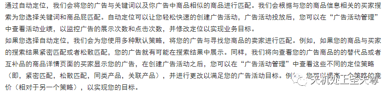

# 亚马逊广告-自动广告个人总结（一）

> Source: wechat
> Author: 天机跨境
> Original: https://mp.weixin.qq.com/s/YnujwDTaVL3thLpDd7a2Nw

---

---

**亚马逊广告技巧个人总结**

**一、自动广告作用**

1、可以增加曝光与收录；
2、可以帮助检测listing的质量；

3、可以为手动广告关键词建立词库。

**二、自动广告持续开启的原因**

1、自动化

*从亚马逊的定义看*：亚马逊会根据我们的商品信息，自动为广告匹配相应的关键词与相似的商品。
所以开自动广告是非常简便快速的，我们无需像开手动广告那样，要对投放关键词或ASIN精挑细选，只需等产品状态合适之后，直接开启即可。同时正因自动广告是自动匹配的，这个属性可以帮助我们检验listing的质量：当自动广告开启一段时间后，我们可以通过自动广告的搜索词看到系统对我们的产品是否定位正确。如果发现搜索词与产品不太相关的话就指示我们要优化listing了。有些卖家朋友直接打手动，然后投放了很多词都没有效果，可能就是没有通过自动广告去验证亚马逊是否已经把这些词与产品关联在一起，我们发现在自动广告中出现的词提出来打手动，手动广告的数据是会积累得很快的。
2、智能化
亚马逊不仅是自动化地为自动广告匹配关键词和ASIN，且还是智能化地匹配。我们知道亚马逊是遵循平台利益最大化的规则的，所以从利益来看，如果我们通过广告出的订单多的话，平台收益也多，所以广告系统是会根据转化、点击等情况智能化地为广告匹配关键词和ASIN的；如果关联一段时间后仍没产生一定的收益，产品与关键词或ASIN的关联就会停止，所以我们发现自动广告开的时间越长，它所带来的效益是越来越好的。
3、优化方便
自动广告优化重点在搜索词的优化，而对搜索词的优化无非就是否定表现差的搜索词，或把表现好的搜索词提出来打手动广告，不像手动广告，要重点对投放词、投放词的匹配方式和搜索词进行综合分析优化。

**三、自动广告在不同的产品阶段的不同作用**
1、新品期打收录
新产品开广告的第一目的就是让亚马逊收录我们listing中的关键词，这个阶段，自动广告是我们的首选
新产品的关键词收录的依据主要是根据曝光，点击率，转化率，但是新品的转化率很低，所以我们重点放在曝光和点击率上面。
我们知道搜索结果首页（顶部）的点击率是最高的，所以我们选择将广告尽可能曝光在搜索结果首页（顶部），最快的将关键词收录。因此我们可以关闭同类产品和关联产品，减少ASIN出现（不能完全阻止ASIN出现）。
我们可以将广告的竞价设置为建议竞价的50%，竞价策略选择固定竞价，广告位搜索结果首页（顶部）溢价根据实际情况设置（参考：200%-300%）。
2、成长期打曝光
自动广告可以快速为产品带来曝光。有了流量之后，我们就可以从自动广告的数据看出市场对产品的认可程度了。
在产品初期，产品已经出了一些订单并且还有几个评论，此时listing已经有了一些权重，在这个阶段我们的目的就是用有限的预算最低的竞价获得更多的曝光。
我们根据大多数的广告数据可以知道，商品页面和搜索结果其余位置这两个位置曝光相对更大且竞价更低,所以增加曝光主要考虑这两个广告位。
我们可以将竞价设置为建议竞价的150%，竞价策略选择动态竞价-提高或降低。由于我们的产品处于新品期，这样我们广告的实际竞价一般建议竞价的75%，但是亚马逊会根据转化率提高我们的竞价。
目的：获取大量曝光，花费相对较低。
3、稳定期打转化
在产品进入稳定期，我们呢这时要重点考虑广告的收益了，如何提高转化率？
我们从两个方面着手：1、降低CPC；2、控制预算。
我们将广告的竞价设置为建议竞价，竞价策略选择动态竞价-提高或降低。在这样的设置下，三个位置的流量相差不大，竞价会相对较低一点。
预算设置：根据超预算时间以及整体转化率调整，如果超预算时间比较早，而且广告的转化率还不错的情况下，我们是会增大预算并且配合分时调价去分配预算的。可是当广告转化率一般的话就要优化好转化率的问题再去调整预算了。
4、成熟期降低花费
在产品成熟期，listing的权重已经比较高了，自动广告可以降低广告花费，用最低的CPC获得最高收益。
我们可以将广告的竞价设置为建议竞价的80%-100%，竞价策略选择仅降低，预算充分给足，让广告持续整天开启，实现低竞价捡漏。

------持续更新------
