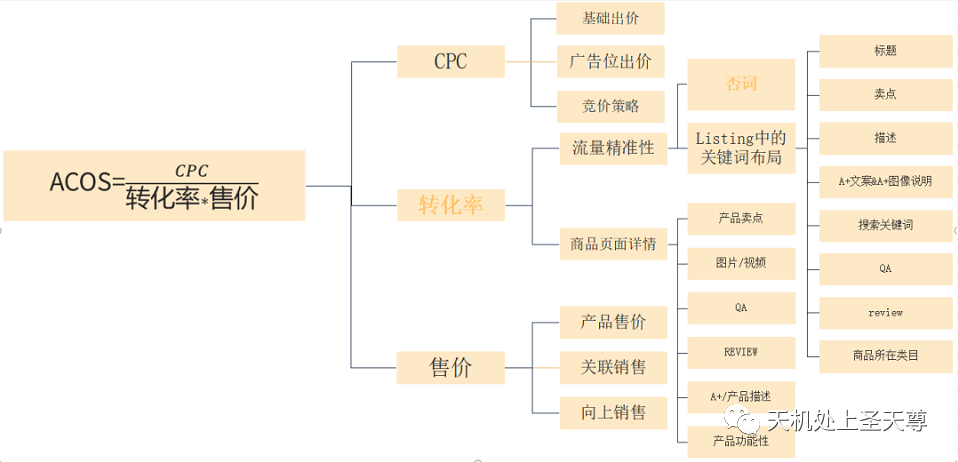
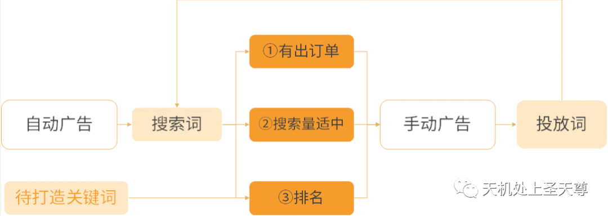
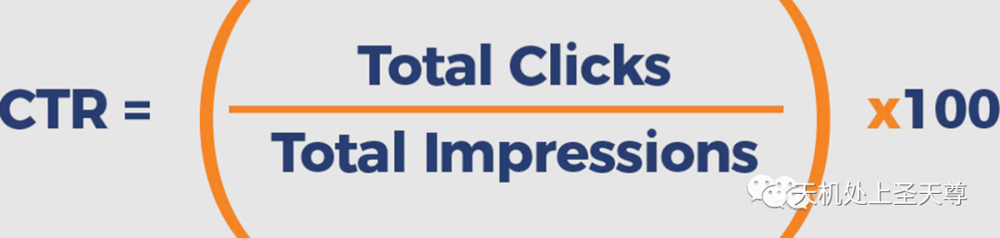
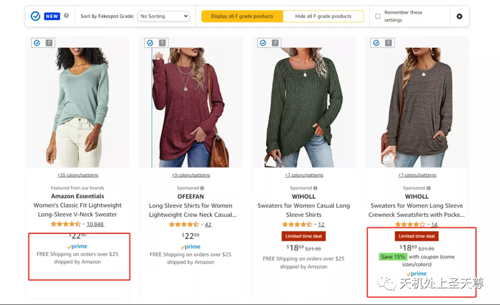

# 亚马逊广告-自动广告个人总结（二）

> Source: wechat
> Author: 天机跨境
> Original: https://mp.weixin.qq.com/s/AZmebb6eo4nI3c7TXgxBsQ

---

---

## 自动广告个人总结（二）

**四、自动广告的持续优化 （文章最后部分有详细总结，建议看完全文）**

1、点击率
点击率的影响因素：
广告位：
曝光出现在广告位的不同位置是与竞价的高低有关联的。不同的广告位曝光量、点击率、和转化率也是不一样的。
曝光量：
商品页面的曝光量一般最大，
搜索结果其余位置次之，
搜索结果顶部（首页）最低；
点击率：
搜索结果顶部（首页）最高，
搜索结果其余位置，
商品页面的点击率最低；
转化率：
搜索结果顶部（首页）最高，
搜索结果其余位置，
商品页面的点击率最低；

2、流量精准度
自动广告是自动匹配词的，所以当发现跑出来的词与产品不相关时，我们就要及时检测listing的问题，及时优化listing的表述。在优化的同时，及时做好关键词否定和商品否定。
否词规则：
不相关的词及时否定。
相关的词，制定定一个目标值，ACOS、转化率，再根据点击情况或者花费情况判断（结合自身产品毛利率），判定搜索词是继续观察还是精准否定。
搜索词从自动广告活动移出去了打手动投放，等新广告跑出一定数据后，再看该词在旧广告上的表现再决定是否要否定。在旧广告上的表现良好，则保留，表现差即否定。表现差的界线是该词在旧广告活动的转化率比新广告活动的转化率低。

3、搜索结果listing质量
产品主图、review、rating、价格以及一些标志（例：Coupon，Amazon Choice, Best Seller）这些都会影响点击率。所以我们打广告的时候，一定要留意附近的竞品情况，主图设计上不输别人；善用coupon吸引客户点击等。

**五、如何优化自动广告ACOS**

影响ACOS的核心可以分为：竞价、转化率、售价。我们可以分析，如果降低竞价则会让广告位下降，肯定会影响转化率，同样提高售价一样影响转化率，这样对于降低ACOS都不是良策，甚至会产生反效果。
如果提高转化率，随着转化率提升，我们可能不需要那么高CPC就能获得比较靠前的广告位，那我们的CPC就会自然下降。到那时，转化率高，CPC自然下降，那ACOS就会下降。
如何优化转化率：我们先根据自己产品制定一个目标值，ACOS、转化率，再根据点击情况或者花费情况判断（结合自身产品毛利率），判定搜索词是继续观察还是精准否定。

**六、自动广告手动广告结合**
自动广告的首要目的就是打收录和拓词，当自动广告积累足够多的数据的时候，我们就可以有选择性将符合条件的搜索词输送到手动广告。

我们根据搜索量判断开启的手动广告选择什么匹配类型：
1、对于搜索量大的并且很相关的的搜索词我们可以选择精准匹配，精准匹配是为了快速将广告排名提高上去，带动自然排名，从而提升转化。
2、对搜索量小的并且不够精准的词，我们选择广泛匹配或者精准匹配。目的是为了拓词，寻找大流量且相关的词。

------持续更新中------

文章总结如下：

PS:

## 亚马逊广告点击的影响因素大致有哪些？随笔一

1、首图质量，附图，A+，视频质量

2、广告标题（产品标题）

3、产品和投放词的匹配度

4、产品的价格

5、产品的评分和评价数

6、广告的竞价

7、匹配方式，否词

8、广告的位置

9、用户的可选择性
广告位置周边的竞品情况，有无竞争优势，尽量展示我们的优势

10，品牌**知名度**：用户对于品牌的信赖感这一方面,
11，显示的要素（促销折扣，秒杀，亚马逊标签，广告显示多颜色尺码）
12、配送方式
13、配送时效

14, 库存情况

15, 其他账号情况，产品listing状态，是否有购物车等等

总结：我们作为电商卖家，应该深入的去分析数据和产品的展示环境来决定优化的细节而不是盲目的只从单一维度来衡量，影响点击率和转化率的维度事实上还有很多很多，譬如：关键词的匹配方式在关键词的选择上面，关键词的相关性，词性，月搜索量，需求竞争度等等品牌知名度，商品价格，评分，评论数量，显示的要素（促销折扣，秒杀，亚马逊标签，广告显示多颜色尺码）如下图第四款

显示的要素不同，因为亚马逊广告投放的基础是以ASIN为单位的，第一个因为没有设置折扣所以广告里并没有显示多颜色和尺码，第四个就清晰的显示了该商品具备多颜色多尺码的属性，这些细微的差别对于转化率就会产生不同的影响，再比如说，第一个商品品是亚马逊的一个子品牌，其他商品则是并不知名的品牌，用户对于品牌的信赖感也会影响点击率和最终的转化率。

整体来说，*广告因素和产品因素*

产品因素：

**·** 产品主图，图片质量，（商品推广，展示型推广），

·视频，视频的质量（品牌推广中的视频广告）

·品牌共通性，logo设计，广告标语slogan, （品牌广告中的商品集及聚焦品牌旗舰店的主页和子页面广告）

·标题

·售价，优惠券coupon，折扣Save xx%,30天最低价的展示，(删除线 划掉最低价显示 Lowest price in 30days)

·亚马逊的标签显示  Best Seller的标签,Amazon Choice的标签，Hot New Release的标签

·Review评价数量，

·评分Rating评分质量

·秒杀标志limited Deals,Best Deals,DOTD  ( LD BD DOTD)

·产品的亮点差异化，与众不同 产品的功能

广告因素：

1. 流量的精准性， 与广告投放的关键词 选择和匹配方式有关，还有否词相关 在关键词的选择上面，在关键词的选择上面，关键词的相关性，词性，月搜索量，需求竞争度（有大词和长尾词的区分，大词上尽量用广泛匹配，低价去跑）跑出更多长尾词，转化率好的关键词再加价 2.匹配方式上的选择有广泛匹配，短语匹配，精确匹配
2. 广告位，广告位应该攻打广告搜索结果页面顶端
3. 广告竞价，PPC的出价，竞价低，广告位置靠后，就会变差，广告流量的质量就不好
4. 广告预算，当CPC越高，预算越低，曝光就越低 还有否词方面，否词的数量太多，否定了大流量的词，否定的匹配方式，词组否定，曝光就越低，自动广告没有否定不相关的词 最后  对广告点击有影响的因素还有，
5. 广告投放的时间段， 库存（是否低库存），有没有获得购物车，有没有别人跟卖，获得购物车赢得率，账号绩效安全问题，listing有没有无在售信息等等因素
6. 其他综合因素

   关注我的博客（打开浏览器，复制粘贴网站即可）

https://weneedmold.com/
