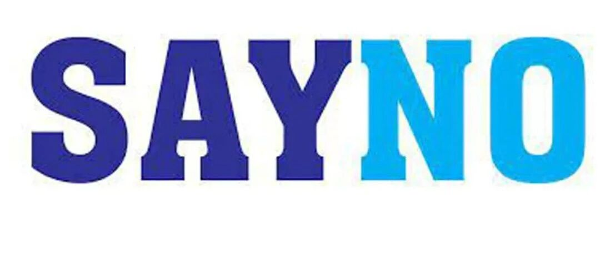
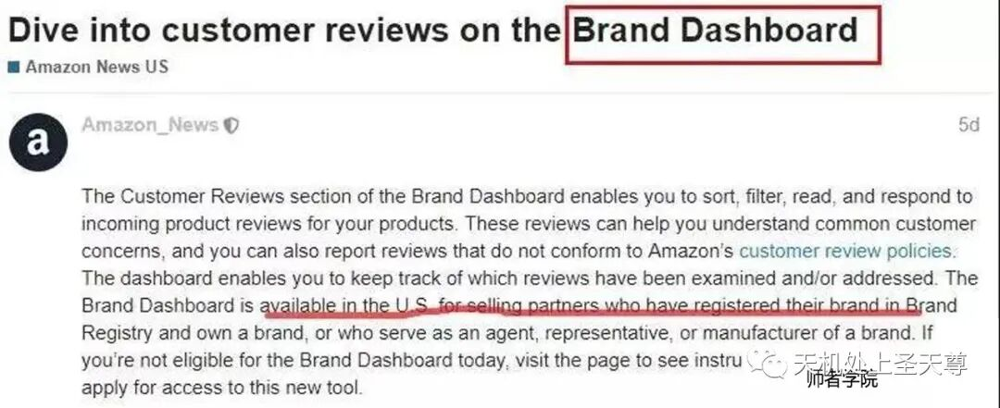
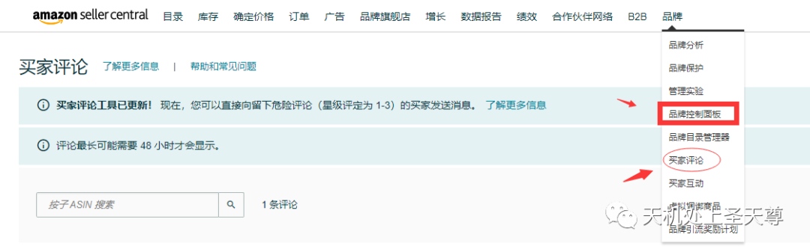
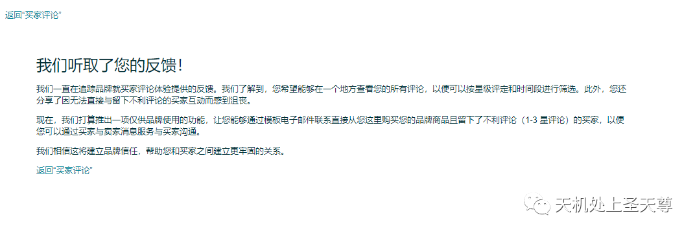
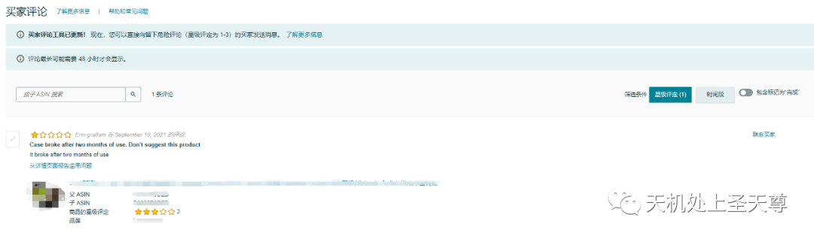
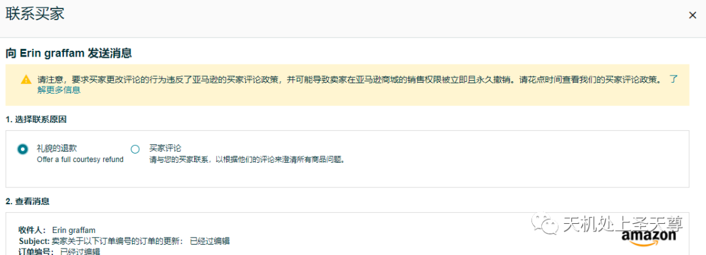
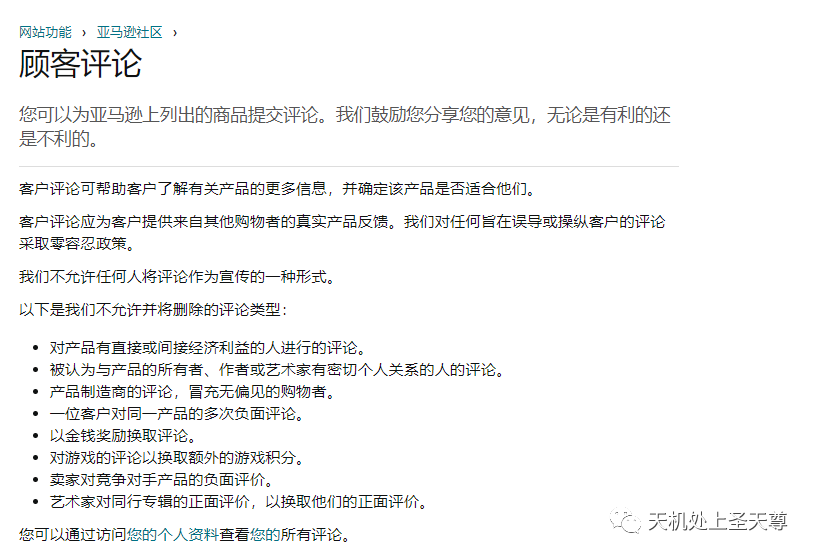

# 遇到竞争对手恶意差评，我们该怎么办？

> Source: wechat
> Author: 天机跨境
> Original: https://mp.weixin.qq.com/s/A32ztERxsJIUWAToBkjvLA

---

---

最近有许多卖家反映：在亚马逊严打严抓的大环境下，结果竞争对手不给他自己测了，全帮我们测，关键还是清一色的差评，现在真不知道怎么办？问我有什么好的解决办法，其实是有很多办法可以想的，今天就来讲讲，遇到竞争对手恶意差评以后，我们自己该怎么办？

前不久亚马逊新闻就有推出一个新功能-买家评论：

近日亚马逊后台推出了一项新功能，卖家们可以直接对产品的review进行管控了。这则消息中讲到：亚马逊卖家们现在可以通过Brand Dashboard的Customer Review部分，可以对产品的传入产品评论进行排序、过滤、阅读和回复。

这些review可以帮助卖家了解常见的客户问题，还可以报告不符合亚马逊客户review政策的评论，通过这个板块，卖家可以跟踪已检查或者已经处理的评论。

亚马逊新推出的Brand Dashboard适用于在美国站已经注册并且拥有品牌的卖家们，或者是品牌的代理商，代表或制造商的销售合作伙伴。拥有这个功能，卖家们可以针对产品review可以采取多种措施：

1.卖家可以直接通过后台来回复买家的review；

2.卖家可以对处理过的review来进行标记；

首先，去亚马逊后台买家评论那里，按照时间把30天内1-3星的差评筛选出来，路径是这个，品牌那里=品牌控制面板，或者直接点买家评论

或点击链接：

https://sellercentral.amazon.com/brand-customer-reviews

第二步 也可以通过亚马逊社区举报

举报滥用行为

对于某些类型的内容，包括客户评论和客户回答，您可以通过单击内容附近的“报告滥用”链接并输入您认为其违反这些准则的原因来报告可能违反这些准则的行为。如果没有“报告滥用”链接可用，您可以发送电子邮件至 community-help@amazon.com，指定内容的位置以及您认为其违反这些准则的原因。如果您因违反这些准则创建、修改或发布内容而收到任何形式的补偿（包括免费或打折产品、退款或补偿）要约，请将要约（包括联系信息和亚马逊商品信息）转发至community-help@amazon.com

卖家可以联系客服，说明详细的原因以及你认为差评应该被删除的原因，可信度高了亚马逊自然会帮你处理。

## 数据保留

评论数据会在评论发表在商品详情页面上的 24 小时内发布在“买家评论”页面上，并且会保留 30 天。

## 标记为“已完成”

品牌可以使用左上角的复选框标记为“已完成”，这样系统将从默认视图中删除评论。要查看在 30 天保留期内标记为“已完成”的评论，请切换为【包括标记为“已完成”】的筛选条件并取消选中复选框，以恢复评论。

## 对评论发表评论

使用评论右上角的评论图标，对卖家平台上的评论发表评论。请确保您发表的内容符合我们的买家讨论指南。

## 如何举报滥用行为?

顾客评论

如果您发现某条评论不符合我们的买家评论政策或我们的买家评论创建指南，则可以从商品详情页面上举报滥用行为。要举报滥用行为，请点击“品牌控制面板”中该评论下方的【从详情页面上举报滥用行为】链接（会将您转至买家所看到详情页面上的评论），然后点击【举报滥用行为】链接，该链接会弹出一个确认框，您可以在其中点击【举报】。我们将会删除所有违反我们政策的评论，与此同时，也会从“品牌控制面板”的“买家评论”页面删除该评论。如果品牌误将评论举报为滥用行为，则其对“品牌控制面板”的访问权限将会被撤销。

## 社区准则

**注意：** 这些指南不适用于亚马逊上销售的产品或服务中包含的内容，这些内容受单独政策的约束。

我们认真对待社区的完整性。严禁试图操纵社区内容或功能，包括提供虚假、误导或不真实的内容。

我们鼓励任何怀疑正在发生内容操纵或以任何方式违反我们的准则的人通知我们。我们彻底调查问题并采取任何适当的行动。

**注意：** 其他准则适用于客户评论。

### 合格

要为客户功能（例如，客户评论、客户问题、客户答案、想法列表）做出贡献或关注其他贡献者，您必须在过去 12 个月内使用有效的信用卡或借记卡在 Amazon.com 上花费至少 50 美元. 促销折扣不符合最低 50 美元的条件。您无需满足此要求即可阅读其他贡献者发布的内容，或者创建或修改个人资料页面、购物清单、愿望清单或注册表。

### 提供帮助和相关性

社区旨在为客户提供有用的相关内容。您提交的内容应该是相关的，并且基于您自己的诚实意见和经验。

- 对于专注于特定主题的社区功能，您应该只提交与该主题相关的内容。
- 客户评论和问答应该是关于产品的。关于卖家的反馈，可以在www.amazon.com/feedback上分享。客户评论或问答中允许对制造商或价格的产品价值和情绪发表评论。示例：“29.99 美元，这款搅拌机的表现超出了我的预期。” 不应在客户评论或问答中分享定价、产品可用性或替代订购选项的其他用途。示例：“在这里以比我当地商店低 5 美元的价格找到了这个”。

### 尊重他人

亚马逊重视不同的意见，因此您可能不同意您遇到的某些内容。请记住，您可能不喜欢的事情可能不会违反我们的准则。为了为所有用户维护一个友好的环境，您在社区中的参与必须始终尊重他人。特别是：

- 请勿发布中伤、诽谤、骚扰、威胁或煽动性的内容。例如，不得使用淫秽或亵渎语言，不得基于种族、民族、国籍、性别或性别认同、宗教、性取向、年龄或残疾表达对他人的仇恨或不容忍，包括宣传组织带着这样的看法。
- 请勿发布淫秽、色情或淫秽内容，或包含裸露或露骨色情图片的内容。
- 不要发布侵犯他人隐私的内容。例如，不要发布其他人的电话号码、电子邮件地址、邮寄地址或其他个人信息，也不要发布指向网络钓鱼或其他恶意软件站点的链接。
- 不要冒充其他人或组织，或假装自己不是某人或某物。
- 不要反复向其他人发送消息或请求。
- 不要试图淹没其他人的意见，包括通过多个帐户发帖或与他人协调。
- 不要根据您是否同意他们进行辱骂或攻击他人。
- 您可以质疑他人的信仰和专业知识，只要是相关的并且以尊重和不具威胁的方式进行。

### 促销和商业征集

为了维护社区内容的完整性，不允许包含广告、促销或招揽（无论直接或间接）的内容和活动，包括：

- 创建、修改或发布有关您（或您的亲戚、密友、商业伙伴或雇主）产品或服务的内容。
- 创建、修改或发布有关您竞争对手的产品或服务的内容。
- 创建、修改或发布内容以换取任何形式的补偿（包括免费或打折产品、退款或报销）或代表任何其他人。
- 提供补偿或要求补偿（包括免费或打折产品）以换取创建、修改或发布内容。
- 发布广告或招揽，包括带有引用标签或附属代码的 URL。

唯一的例外是：

- 您可以发布亚马逊要求的内容（例如您在亚马逊上购买或通过 Vine 计划收到的产品的客户评论，以及通过问答要求的答案）。在这些情况下，您的内容必须符合亚马逊指定的任何其他准则。
- 您可以通过问答功能（但不是问题本身）发布有关您与品牌、卖家、作者或艺术家有财务或密切个人联系的产品或服务的问题的答案，但前提是您清楚而显眼地披露了这种联系（例如，“我代表该产品的品牌。”）。我们会自动标记卖家或制造商的一些答案，在这种情况下，无需额外披露。
- 您可以发布与您与品牌、卖家、作者或艺术家有财务或密切个人联系的产品或服务的客户评论和问答以外的内容，但前提是您明确并显眼地披露了这种联系（例如， “我因这篇文章而获得报酬。”）。但是，任何品牌或企业都不得以将亚马逊客户转移到另一个非亚马逊网站、服务、应用程序或渠道的方式（包括通过广告、特别优惠或任何其他“号召性用语”）参与社区。进行营销或销售交易的目的。通过品牌、卖家、作者或艺术家帐户发布的关于他们自己的产品或服务的内容不需要额外的标签。

图书作者和出版商可以继续向读者提供免费或打折的图书副本，只要作者或出版商不需要评论来交换或试图影响评论。

有关更多信息和示例，请阅读关于促销内容。

### 色情内容

允许在亚马逊上销售某些包含色情内容的商品以及某些色情和色情商品，我们鼓励用户表达他们对这些商品的看法。某些色情内容（例如裸露和露骨的色情图片或描述）受到限制，因为我们社区中的观众可能对这些内容很敏感。

### 侵权内容

不要以侵犯他人知识产权或其他专有权利的方式发布内容或与社区的其他成员互动。仅发布您自己的内容或您有权使用的内容。

### 非法活动

不要发布鼓励或支持非法行为的内容，包括暴力、欺诈、非法吸毒、未成年人饮酒或虐待儿童或动物。禁止内容的示例包括：

- 宣扬、威胁或开玩笑对自己或他人造成身体或经济伤害的内容，包括恐怖主义。
- 提供欺诈性商品、服务、计划或促销（例如，快速赚钱计划、传销）的内容。
- 故意发布的内容具有讽刺意味，因为它与自我伤害或对他人的伤害有关。
- 鼓励或支持危险地滥用产品的内容。

### 客户评论的附加指南

除了上面给出的其他准则之外，以下准则也适用于客户评论：

- 如果您的评论因不符合我们关于促销内容的准则而被删除或拒绝，您不得重新提交对同一产品的评论，即使重新提交的评论包含不同的内容。
- 评论可能仅包含指向在亚马逊上销售的其他产品的 URL 或链接。
- 当我们检测到异常评论行为或保持最佳购物体验时，我们可能会限制提交评论的能力。
- 您不得操纵 Amazon Verified Purchase 徽章，例如向评论者提供特价或补偿评论者。

要了解有关亚马逊验证购买视图的更多信息，请参阅关于亚马逊验证购买评论。
