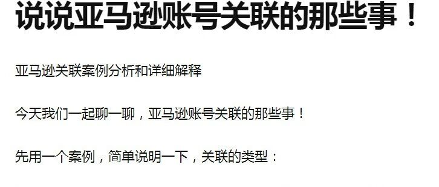
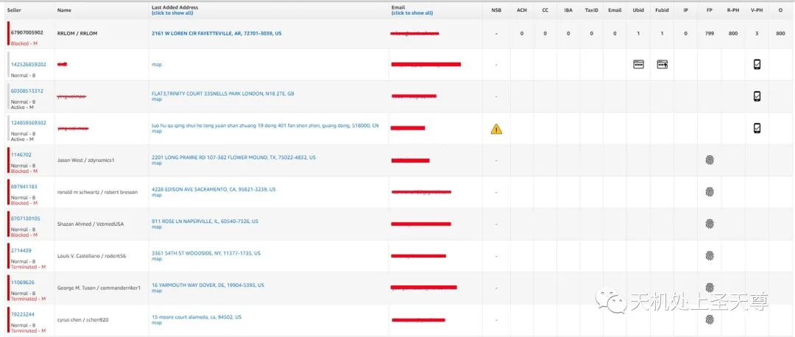
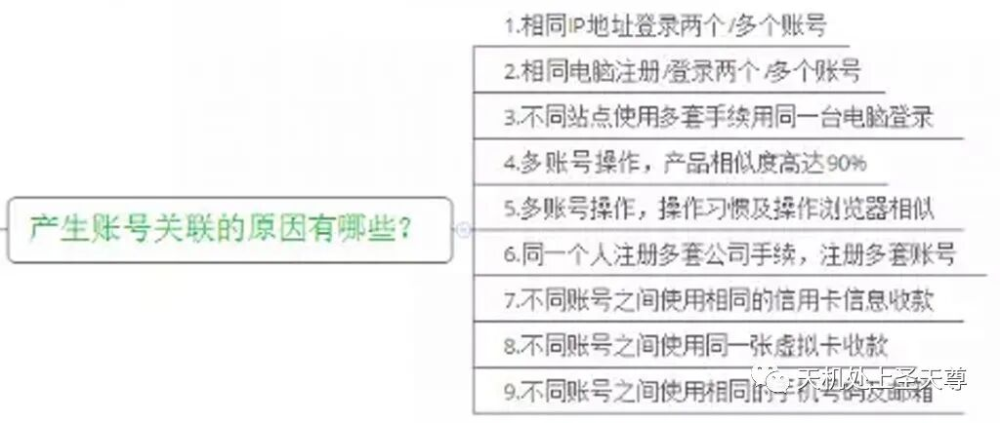
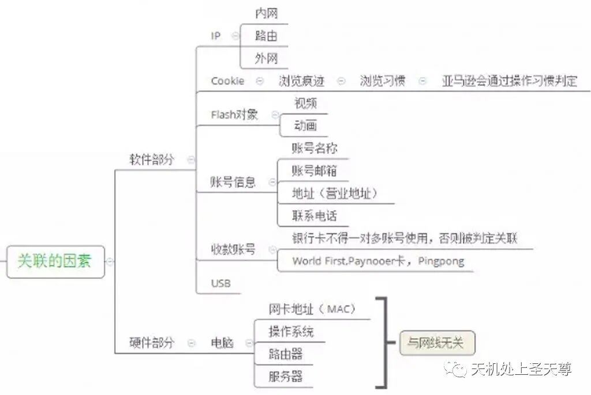
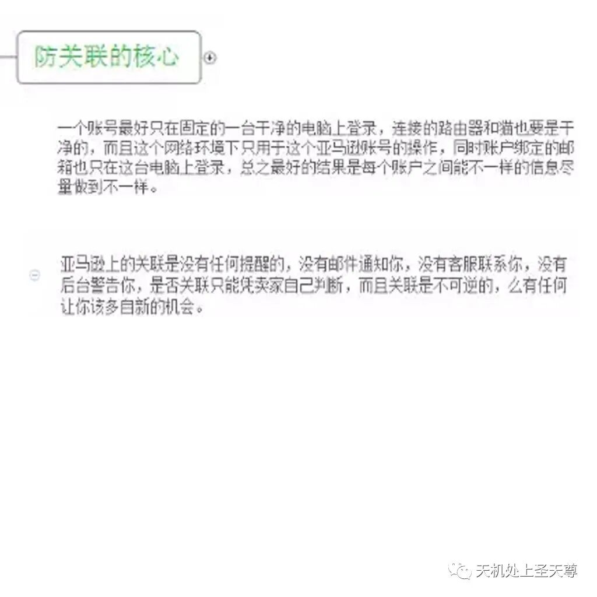
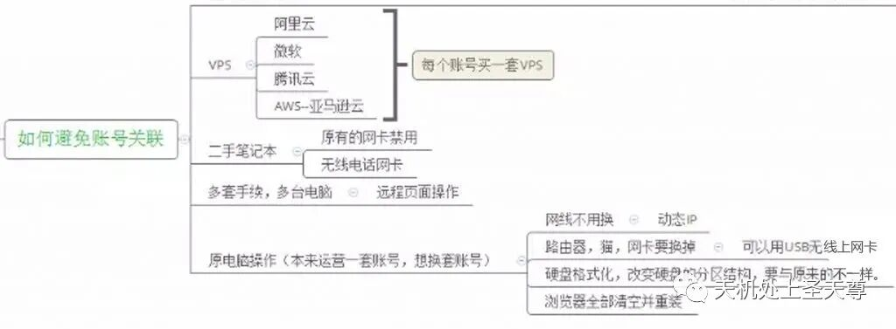
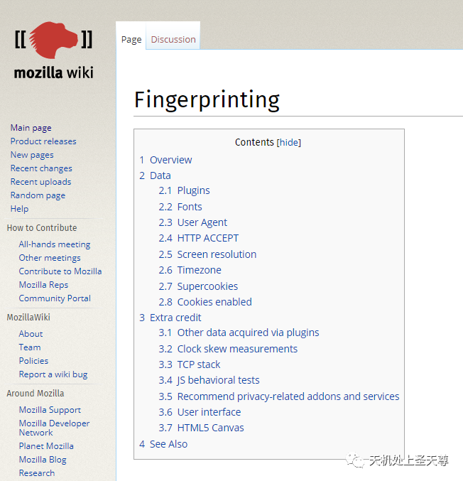
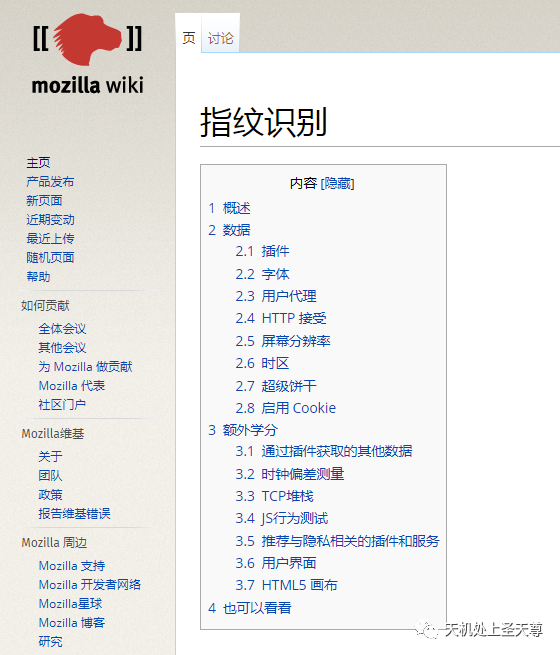
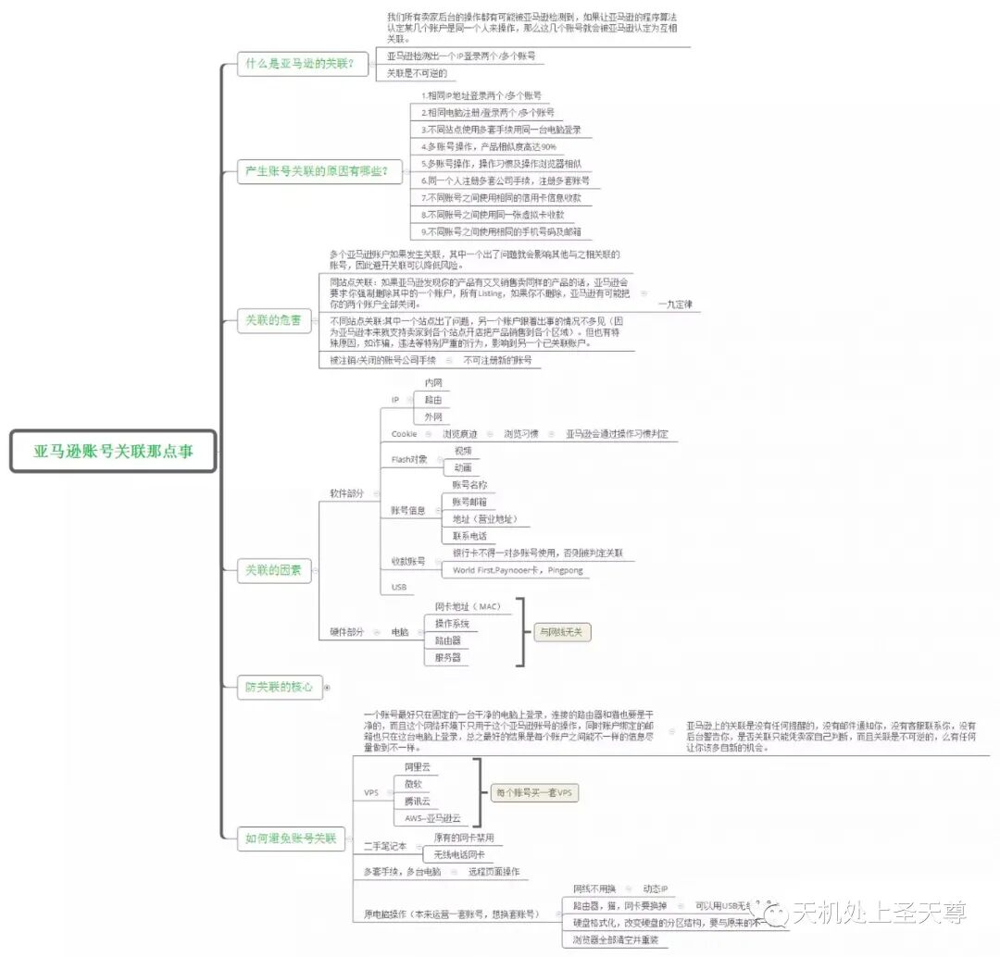
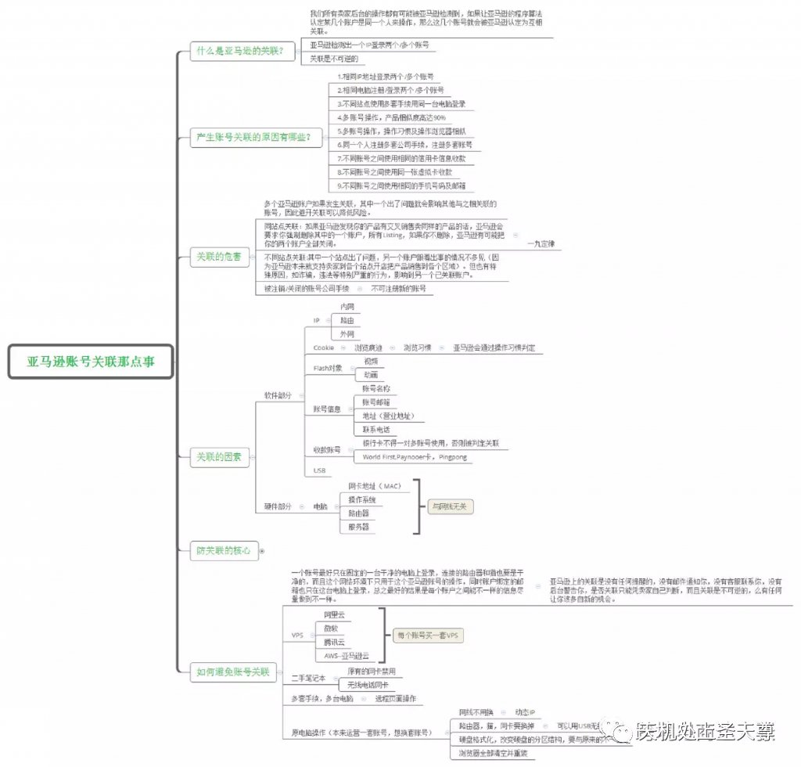

# 说说亚马逊账号关联的那些事！！

> Source: wechat
> Author: 天机跨境
> Original: https://mp.weixin.qq.com/s/oq0t1ypJnW0Hthks1Ac1QA

---

---

说说亚马逊账号关联的那些事！！

## 亚马逊关联案例分析和详细解释

## 今天我们一起聊一聊，亚马逊账号关联的那些事！

## 先用一个案例，简单说明一下，关联的类型：

亚马逊账号关联案例分享

## 第一个问题是被关联店铺子账号，就是店铺主账号和子账号关联了！

## 第二三个是注册的美国站和欧洲站的账号手机号码填了一样，手机号关联了，具体问题是验证手机号关联。 最下面的那一排问题是环境关联。

## 关联的类型大概有以下一些（包括但不局限于：）

## NSB ACH CC IBA TaxID Email Ubid Fubid IP FP R-PH V-PH O

## 接下来，由我带领大家把这个案例详详细细地解释一下：

NSB：【 子账号关联 】 ：第一个是被关联店铺子账号，主账号和子账号关联
ACH：【 信用卡关联 】 ：ACH的付款方式 （ACH支付方式，收款方式）， ACH自动清算中心（ACH支付公认是最好的一种电子支付方式）
CC：【 信息内容 】 ━━━软件因素３－【账号信息】 登陆邮箱（要无规则）、地址（退货）、电话号码、信用卡、密码，撰写listing的内容等都不可以相同。
IBA：【收款账号】？我不确定，望大家指正
TaxID：【 税号关联 】 ：税号ID，身份ID,税号ID关联
Email：【 邮箱关联 】 ：注册邮箱地址，邮箱关联
Ubid：【 COOKIE弱关联 】 Your Browser ID ，━━━软件因素３－【COOKIES】

UBID和FUBID就是COOKIE之类的弱关联造成的，
Fubid： COOKIE弱关联 Full Your Browser ID━━━软件因素4－【COOKIES】
IP：【IP地址 关联】网络IP地址， 网络IP关联，━━━软件因素１
FP：【浏览器指纹】指纹验证，浏览器指纹关联━━━软件因素2
R-PH：【客服电话关联】 绑定账号用于客服的手机号
V-PH：【验证手机关联】 验证 注册时的手机号
O：操作问题关联

## （下面的图片不是很清楚，文章后部分会用文字一 一给大家解释，会有详细解说的）

亚马逊账号关联

## ——————————–文章后半部分————————–

## 内容提纲：

亚马逊账号关联那点事：
1. 说明：什么是亚马逊的 账号关联？
2. 产生账号关联的原因有哪一些？详细介绍
3. 亚马逊账号关联的危害
4. 关联的因素
5. 防关联的核心要点
6. 如何避免账号关联
7. 补充

## 1. 什么是亚马逊的关联？

什么是亚马逊的关联？

## 2. 产生账号关联的原因有哪些？

产生账号关联的原因有哪一些？

## 3. 亚马逊账号关联的危害

亚马逊账号关联的危害

## 4. 关联的因素

关联的因素

亚马逊账号关联的因素

## 5. 防关联的核心要点

## 防止关联的核心

## ▼核心一：让亚马逊认为多个账号是不同的人在不同的地方操作。

## ▼ 核心二：做到“十新”：新邮箱，新电脑，新系统，新浏览器，新路由，新宽带，新手机号，新信用卡，新收款账号和新产品。

## ▼ 核心三：关联是根据多个因素判断的，以上单一因素相同，可能不会关联，但是多个疑似因素相同，就比较危险了，尽量减少关联因素.

防关联的核心要点

## 6. 如何避免账号关联

如何避免账号关联

亚马逊账号关联的因素 如何避免

## 7. 补充说明

## 补充如下：

━━━软件因素－【邮件图片FLASH】━━━邮件中，如果加载图片或FLASH对象，是可以读取你的IP地址，关键是这些图片或FLASH，有时候很小，小到你注意不到。针对这个问题，有两个对策：①-使用GMAIL的禁用邮件加载功能。②-只看EMAIL的标题，如果要看详细内容，去亚马逊后台看

## ━━━软件因素－【账户信息】━━━ 登陆邮箱（要无规则）、地址（退货）、电话号码、信用卡、密码等都不可以相同。

## ━━━ 【其他】将来（或者已经），亚马逊有可能监控的关联资料，纯属个人猜测，以下资料相同的话，也可能是作为关联因素：①－域名注册人 ②－品牌注册人 ③－营业执照法人 ④－图片作者

## ━━━ 硬件因素：【网卡】

## ━━━ 硬件因素：【路由器】

## 指纹管理： 浏览器指纹包括但不局限于： ①、Cookie ②、Session ③、Evercookie ④、Flash Cookies

## 那么“浏览器指纹”包含哪些信息？

## “浏览器指纹”暴露给网站的信息有很多种，常见的有如下几种：

## 指纹①：USER AGENT 关于 USER AGENT 是什么，其实简单的说USER-AGENT就是客户端浏览器等应用程序使用的一种特殊的网络协议。

## 指纹②：屏幕分辨率 这个比较通俗易懂。稍微补充一下：这一项不仅包括屏幕的尺寸，还包括颜色深度（比如你的屏幕是16位色、24位色、还是32位色）。

## 指纹③：时区 这个也比较通俗。就是我们所在的时区，我们中国应该都是“东8区”。

## 指纹④：浏览器的插件信息 也就是你的浏览器装了哪些插件。 再罗嗦一次：浏览器的“插件”和“扩展”是两码事儿，别搞混了。

## 指纹⑤：浏览器的字体信息，浏览器相关的一些字体信息。 如果你的浏览器安装了 FLASH 或 JAVA 插件，有可能会暴露某些字体信息。

指纹⑥：HTTP ACCEPT
这是 HTTP 协议头中的一个字段。考虑到列位看官大都不是搞 IT 技术的，这里就不深入解释这项。
以上就是常见的浏览器指纹。当然啦，还有其它一些信息也可以成为“浏览器指纹”，考虑到篇幅就不一一列举并解释了。有兴趣的同学，请自行阅读 MOZILLA 官网的英文文档。
(http://WIKI.MOZILLA.ORG/FINGERPRINTING)

## Data:

- 2.1 Plugins
- 2.2 Fonts
- 2.3 User Agent
- 2.4HTTP ACCEPT
- 2.5 Screen resolution
- 2.6 Timezone
- 2.7 Supercookies
- 2.8 Cookies enabled

fingerprinting指纹识别

指纹识别

## 亚马逊平台，可以通过 JAVASCRIPT 来自动收集有关你的浏览器的无害数据，如插件、系统字体、操作系统版本、打字方式、甚至打字速度……等等。

## 这些数据单个来说，不能识别你，但是，这些数据合在一起，就是一个浏览器指纹，这可以判断这到底是不是同一个人操作，就如同我们可以通过一个指纹找到一个人。

## 本文部分内容，原链接来自于知乎跨境电商达人张

## 作者：匿名用户 链接：https://www.zhihu.com/question/61136973/answer/184258001 来源：知乎

