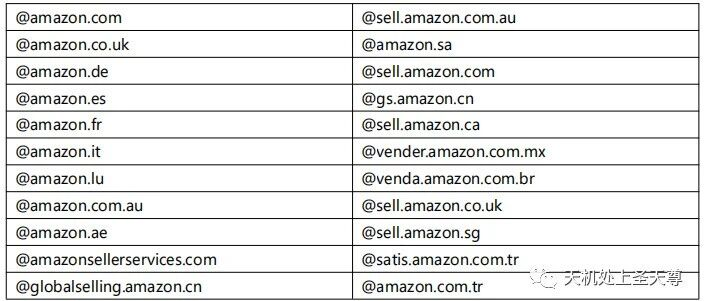
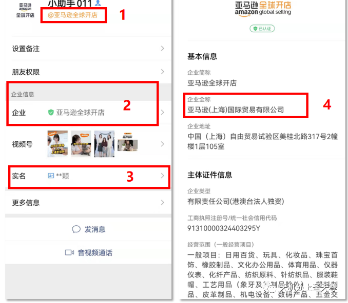
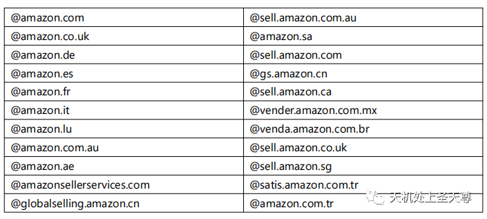
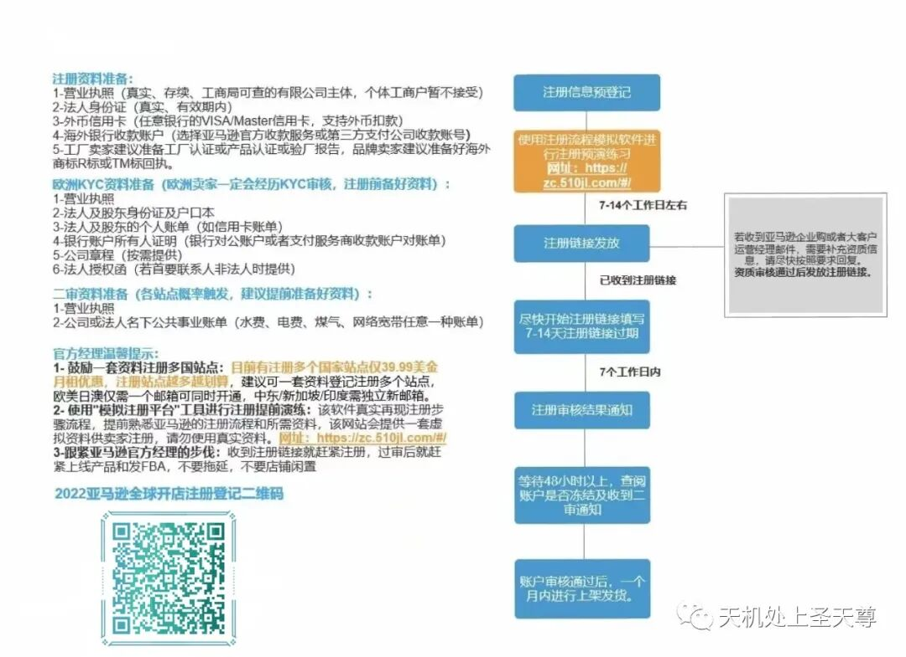
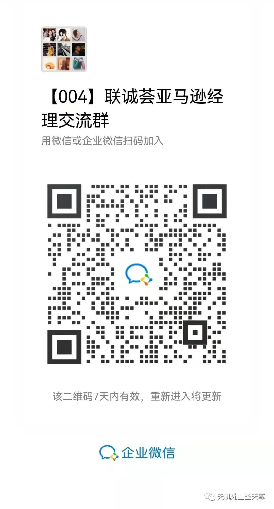
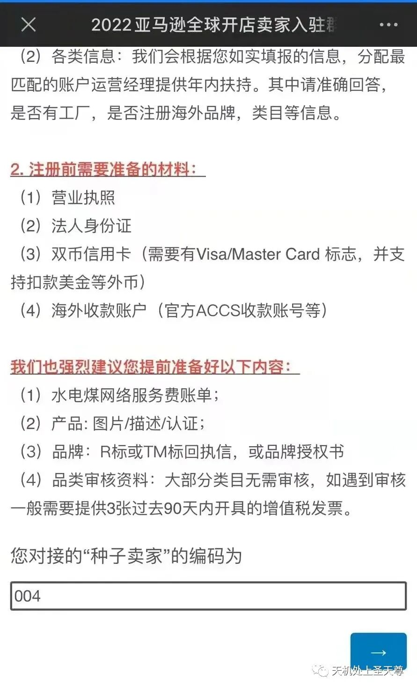
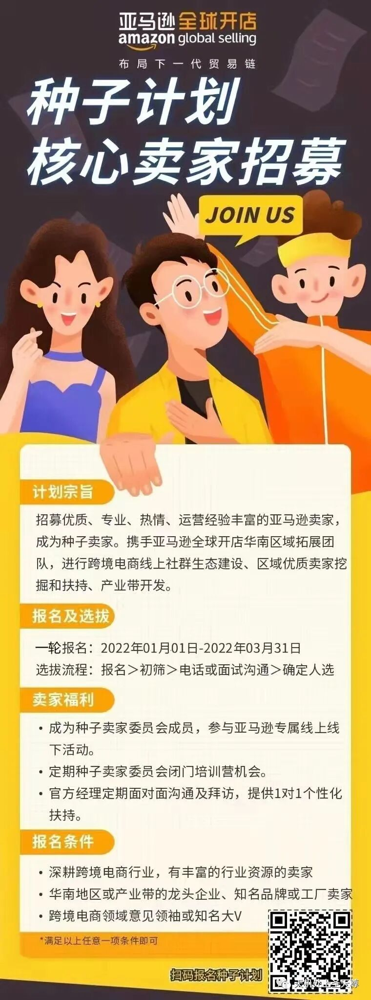
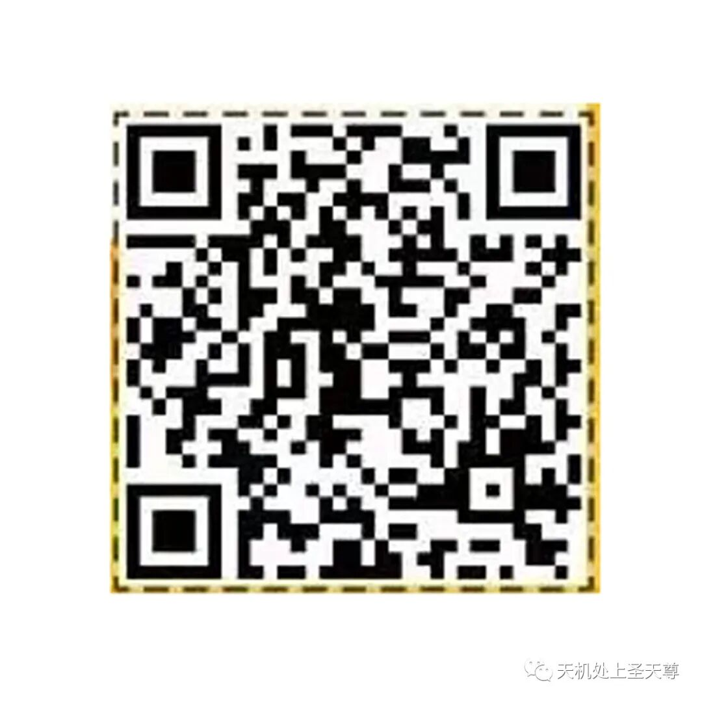

# 李逵还是李鬼，两招教您甄别亚马逊官方团队！

> Source: wechat
> Author: 天机跨境
> Original: https://mp.weixin.qq.com/s/cYNzCP86H8gvdY9lvy6lKw

---

---

近期跨境市场上有公司及个人**冒充**亚马逊官方团队进行卖家开店的服务，**给卖家造成了损失**。现在跨境市场鱼龙混杂，卖家确实很难甄别亚马逊官方人员，而我们作为和华南区亚马逊全球开店团队有着良好沟通渠道的联诚荟，提供两个方法教您如何甄别：

方式一

如果亚马逊官方人员在微信上与您取得联系，确认他拥有官方企业微信。

亚马逊官方人员的企业微信有以下的特征：

1.有橙色标注“@亚马逊全球开店”字样

2.显示的企业信息是“亚马逊全球开店”

3.有实名认证的徽章标识，亚马逊官方团队工作人员名字

4.基本信息：企业全称显示是“**亚马逊（上海）国际贸易有限公司**”企业简称“亚马逊全球开店”

方式二

如果有人通过邮件联系，请甄别清楚邮件的后缀，亚马逊官方团队的后缀如下：

|  |  |
| --- | --- |
| 亚马逊美国站@amazon.com | 亚马逊澳大利亚站@sell.amazon.com.au |
| 亚马逊英国站@amazon.co.uk | 亚马逊沙特站@amazon.sa |
| 亚马逊德国站@amazon.de | 亚马逊美国站@sell.amazon.com |
| 亚马逊西班牙站@amazon.es | 亚马逊中国站@gs.amazon.cn |
| 亚马逊法国站@amazon.fr | 亚马逊加拿大站@sell.amazon.ca |
| 亚马逊意大利站@amazon.it | 亚马逊墨西哥站@vender.amazon.com.mx |
| 亚马逊卢森堡@amazon.lu | 亚马逊巴西站@venda.amazon.com.br |
| 亚马逊澳大利亚站@amazon.com.au | 亚马逊英国站@sell.amazon.co.uk |
| 亚马逊阿联酋站@amazon.ae | 亚马逊新加坡站@sell.amazon.sg |
| @amazonsellerservices.com | 亚马逊土耳其站@satis.amazon.com.tr |
| @globalselling.amazon.cn | 亚马逊土耳其@amazon.com.tr |

最常用的后缀为【amazon.com】

加群/小助手获取亚马逊官方团队联系方式，助力您的跨境生意！

请扫描【群/小助手 二维码】

|  |  |
| --- | --- |
| 通过联诚荟注册亚马逊账户享受1对1扶持    Image | 区域拓展经理照片/微信二维码   Image |
| 新卖家开店注册【代码：004】欧阳亚运 | 亚马逊官方经理Skye Xu |

**如果你需要注册亚马逊账户，请通过官方认可的正规渠道入驻！种子卖家欧阳亚运（备注联诚荟）**

另外一个好消息：种子计划核心卖家招募选拔火热正在进行中~

如果你具备以下资质并有热情与我们携手共建跨境电商，拓展区域拓展和优质卖家，

立刻扫码报名吧！！

