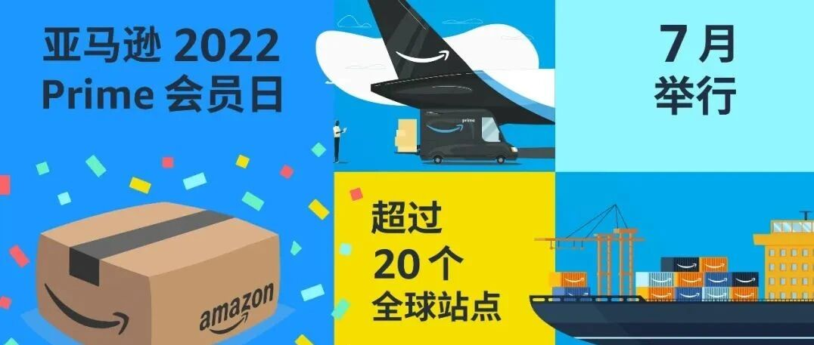
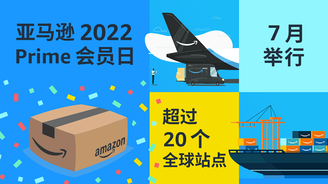

# 定了！2022亚马逊Prime会员日就在7月！多措并举助力卖家冲击新纪录

> Source: wechat
> Author: 天机跨境
> Original: https://mp.weixin.qq.com/s/gk1YCCsq7YbqZFiozf5VtQ

---

---

今日，亚马逊宣布**2022年亚马逊Prime会员日将在今年7月举行**，活动将覆盖亚马逊全球超过**20个站点**。

包括中国卖家在内，亚马逊全球第三方卖家将为亚马逊全球**超过2亿的Prime会员**，送去涵盖各类商品的超值优惠。

为了帮助卖家顺利备战年度销售旺季，亚马逊在**仓储物流、品牌打造、合规、运营**等方面推出了一系列新举措和新服务。

## 1 仓储物流方面

亚马逊为卖家提供了**多元化的选择**。从海运整箱、海运拼箱，到快船、空运商业航班和包机、Z-Parcel官方小包，多种方案满足不同卖家的需求。同时，结合旺季期间卖家**在目的港补货的巨大需求**，亚马逊还于近期推出了STAR服务（运输至亚马逊FBA卫星仓）和STS服务（运输到卖家指定海外仓），以降低供应链不稳给卖家带来的影响，并控制运输成本。

## 2 品牌打造方面

亚马逊4月在美国站上线了👉[**全系商品搜索表现报告与搜索词表现报告**](https://mp.weixin.qq.com/s?__biz=Mzg5ODA4MDgzNQ==&mid=2247567391&idx=1&sn=175909b99728ffa3269e3139462c2662&scene=21#wechat_redirect)，品牌卖家可借助多维度数据洞察，有效制定旺季策略。此外，亚马逊还推出了品牌工具使用自助申请流程，推出了价值5万美金的👉[**新卖家大礼包**](https://mp.weixin.qq.com/s?__biz=Mzg5ODA4MDgzNQ==&mid=2247563995&idx=1&sn=41c981be6f19bb9e9b6a596e1e7623b6&scene=21#wechat_redirect)、平均返还10%的👉[**品牌引流奖励计划**](https://mp.weixin.qq.com/s?__biz=Mzg5ODA4MDgzNQ==&mid=2247542481&idx=1&sn=cc210208d96083766e5134c4c2e382e6&scene=21#wechat_redirect)，以及2万个👉[**Transparency透明计划**](https://mp.weixin.qq.com/s?__biz=Mzg5ODA4MDgzNQ==&mid=2247566105&idx=1&sn=28796e3db8b2c41fb917d3799d39001e&scene=21#wechat_redirect)免费代码等福利。

## 3 合规方面

亚马逊将**加快申诉审核时效**，增强对滥用亚马逊政策行为的监测，以及对参与活动促销商品的系统保护，以确保Prime会员日期间卖家账户的安全。

## 4 运营方面

亚马逊还在官方微信、网站、邮件、直播、官方课堂等中国卖家熟悉的渠道，推出👉**“**[**冲刺！Prime Day2022**](https://mp.weixin.qq.com/mp/appmsgalbum?action=getalbum&__biz=Mzg5ODA4MDgzNQ==&scene=1&album_id=2315261239641587714&count=3#wechat_redirect)”主题活动，为卖家提供长达数月的Prime会员日备战阶段实用干货，内容覆盖**促销提报、引流、转化、物流、账户健康、品牌、广告**等中国卖家关心的话题。

**Cindy Tai 戴竫斐**

亚马逊全球副总裁

亚马逊全球开店亚太区执行总裁

“全球第三方卖家在Prime会员日不断刷新销量纪录，令人鼓舞，也让这个年度盛会成为卖家打造国际品牌、拓展全球业务的好机会。”

“今年，亚马逊提早为中国卖家的备战，提供了全方位、本地化的支持。加上中国卖家在新选品、新产品、品牌打造以及数字运营等方面的热情和投入，相信今年的Prime会员日将更加精彩。”

2015年以来，Prime会员日覆盖的**站点数量不断增加**，第三方卖家的**业绩也屡创新高**。2021年Prime会员日期间，亚马逊全球第三方卖家的销售业绩再创新高，增幅超过了亚马逊自营业务。

活动期间，亚马逊Prime会员在全球范围内购买了**超过 2.5 亿件商品**，其中也包括了来自全球第三方卖家提供的优质商品，最畅销的品类包括工具、美妆、营养保健、母婴、电子产品、服装和家居生活。

留言告诉小编，今年是你**第几次**参加亚马逊的Prime Day？你印象中**最难忘的一次**Prime Day是什么时候，发生了什么样的故事？

在4月30日晚12点前**获得最高点赞数的卖家**分享将获得由亚马逊全球开店提供的**价值200元的礼品一份**。

**小调研**

