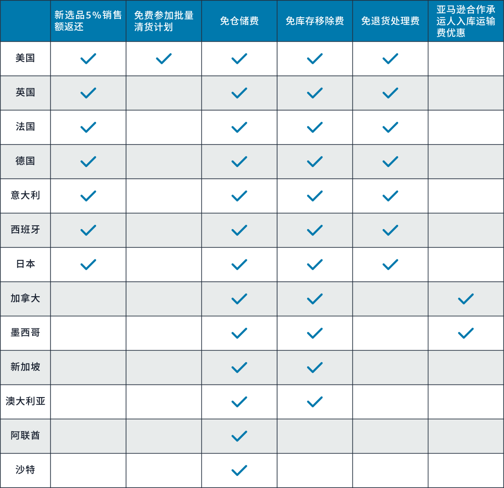
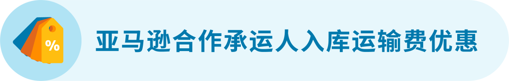
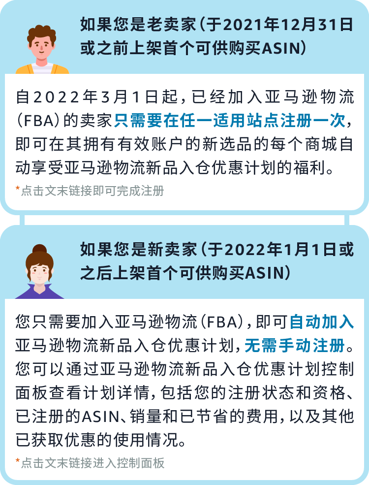
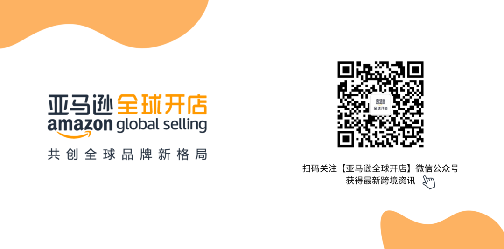

# 你测新款，亚马逊出钱！5%销售额返还！免仓储、移除、批量清货费...

> Source: wechat
> Author: 天机跨境
> Original: https://mp.weixin.qq.com/s/CQolJwwnGm9WBjAK7fSw4g

---

---

昨天我们公布的新卖家入门大礼包大家都get到了吗？如果您是新卖家，且在2022年1月1日后上线第一个ASIN，那就千万不要错过高达5万美元的新卖家入门大礼包！👉[**高达5万美元！5%销售额返还！亚马逊真金白银支持新卖家！**](https://mp.weixin.qq.com/s?__biz=Mzg5ODA4MDgzNQ==&mid=2247559204&idx=1&sn=2e95170107349aa0b610eb622c7dd1af&scene=21#wechat_redirect)

今天！继续送福利！不管您是新卖家还是老卖家，如果您**准备上新品赶紧看过来**！自2022年3月1日（太平洋时间）起，**“亚马逊物流新品入仓优惠计划”** 福利全面升级！符合条件的FBA新ASIN将获得5%销售额返还、免费批量清货、免仓储费、免移除费、免退货处理费...

**亚马逊物流新品入仓优惠计划**

亚马逊物流新品入仓优惠计划专注于帮助所有卖家用**更低的成本测试新选品**！选品选的好，爆单爆到老！卖家朋友一定要抓紧优惠，多多尝试新品！

那么加入亚马逊物流新品入仓优惠计划有什么资格要求？一起来看看吧~

**适用站点**

亚马逊美国、日本、英国、法国、德国、意大利、西班牙、加拿大、墨西哥、新加坡、澳大利亚、阿联酋和沙特站。

**对于卖家资格的要求**

使用亚马逊物流（FBA）的专业卖家，不限卖家入驻时间，新老卖家都可参与！

\*美国站、日本站和欧洲站要求卖家没有IPI分数或IPI分数大于400分，其他站点不做该要求。

**对于ASIN资格的要求**

仅限通过亚马逊物流（FBA）销售和配送的新父ASIN 。“符合要求的ASIN”需要满足：

✔️ 亚马逊物流（FBA）新选品；

✔️ 在2022年3月1日之后发送到亚马逊运营中心；

✔️ 符合产品类别的要求；

✔️ 非媒介类商品或二手商品。

查看各站点福利详情

让小编看看是谁又又又心动了！心动了就和小编继续看下去！本次“亚马逊物流新品入仓优惠计划”为大家带来了多重重磅优惠福利！

对于**完成品牌注册的品牌商\***，针对符合要求的亚马逊物流新父ASIN销售额按月提供5%的销售额返还，将用于抵扣物流费用。

**适用站点**：亚马逊美国、日本、英国、法国、德国、意大利和西班牙站。

**销售额返还服务适用于**

✔️ 对于符合要求的大件商品，每个父ASIN最多有30件商品可在90天内享受返还优惠。

✔️ 对于符合要求的标准尺寸商品，每个父ASIN最多有50件商品可在90天内享受返还优惠。

✔️ 对于服装和鞋靴分类中符合要求的商品，每个父ASIN最多有100件商品可在120天内享受返还优惠。

**\***注意：须为品牌所有者或其内部人员；“亚马逊物流新品入仓优惠计划”与“新卖家入门大礼包”中的5%销售额返还不可同时叠加。在新卖家享受“新卖家入门大礼包”5%销售额返还的活动结束后，满足条件可再获得享受“亚马逊物流新品入仓优惠计划”中新选品5%销售额返还的资格。

批量清货服务让卖家可以回收冗余和买家退回库存的资金，节省仓储费。

**适用站点**：亚马逊美国站。

**免费批量清货服务适用于**

✔️ 在首个库存接收之日后的180天内，每个符合要求的服装和鞋靴ASIN的前100件商品、每个符合要求的标准尺寸ASIN的前50件商品，以及每个符合要求的新选品大件ASIN的前30件商品。

✔️ 美国站点的卖家仍然可以通过其他移除渠道移除库存，例如弃置和退货，但需要支付相关的必要费用。

**适用站点**：亚马逊美国、日本、英国、法国、德国、意大利、西班牙、加拿大、墨西哥、新加坡、澳大利亚、阿联酋和沙特站。

**小件商品和标准尺寸商品**

**免除3个月FBA仓储费**

符合该计划要求的新ASIN，在亚马逊运营中心收到首件商品后的90天内，免收每个父ASIN前50件商品的月度仓储费。

**大件商品**

**免除3个月FBA仓储费**

即日起，符合该计划要求的大件新ASIN，也可享受该计划的费用优惠，在亚马逊运营中心收到首件商品后的90天内，免收每个父ASIN前30件商品的月度仓储费。

**服装配饰和鞋靴箱包类商品“专宠”福利**

**免除4个月FBA仓储费**

符合该计划要求的新ASIN，在亚马逊运营中心收到首件商品后的120天内，免收每个父ASIN前100件商品的月度仓储费。

新加坡、澳大利亚、阿联酋和沙特站适用ASIN情况略有不同，请复制以下链接到浏览器查看详情👇

https://gs.amazon.cn/fba/sandbox?ref=as\_cn\_ags\_fba\_sandbox\_tp

在一定时间内免收每个符合条件父ASIN特定数量商品的库存移除费。

**适用站点**：亚马逊美国、日本、英国、法国、德国、意大利、西班牙、加拿大、墨西哥、新加坡和澳大利亚站。

**小件商品和标准尺寸商品**

**入库后半年内免费移除**

符合该计划要求的新ASIN，在亚马逊运营中心收到首件商品后的180天内，免收每个父ASIN前50件商品的库存移除费用。

**大件商品**

**入库后半年内免费移除**

符合该计划要求的新ASIN，在亚马逊运营中心收到首件商品后的180天内，免收每个父ASIN前30件商品的库存移除费用。

**服装配饰和鞋靴箱包类商品“专宠”福利**

**入库后半年内免费移除**

符合该计划要求的新ASIN，在亚马逊运营中心收到首件商品后的180天内，免收每个父ASIN前100 件商品的库存移除费用。

新加坡、澳大利亚、阿联酋和沙特站适用ASIN情况略有不同，请复制以下链接到浏览器查看详情👇

https://gs.amazon.cn/fba/sandbox?ref=as\_cn\_ags\_fba\_sandbox\_tp

在亚马逊运营中心收到首件商品后的6个月内，每个父ASIN的前20件商品免除退货处理费，日本站没有数量限制！

**适用站点**：亚马逊美国、日本、英国、法国、德国、意大利和西班牙站。

**日本站服装和鞋靴类商品**

**的退货处理费全免**

日本站免除买家在2021年3月15日至2023年3月31日期间退回的服装和鞋靴类商品的全部退货处理费，并且没有商品数量限制。有关更多信息，请参阅👉[**2021年日本站费用促销优惠**](https://mp.weixin.qq.com/s?__biz=Mzg5ODA4MDgzNQ==&mid=2247542352&idx=1&sn=8e958b5f500c9c56e8b647f02b046662&scene=21#wechat_redirect)

**美国和欧洲站点服装配饰及鞋靴箱包类**

**商品的退货处理费优惠**

符合该计划要求的新ASIN，在亚马逊运营中心收到首件商品后的180天内，如果发生买家退货，被退回的每个父ASIN最多可有20件商品免收退货处理费。

如果您是新加入亚马逊物流（FBA）的卖家，并且您的商品是从目的国当地某个地址运送至亚马逊运营中心，您可以考虑使用亚马逊合作承运人运输入库。注册加入新选品计划后，可享受亚马逊合作承运人入库运输费优惠，可减免加拿大站最高135加币、墨西哥站最高2,200墨西哥比索的运输费用优惠。

**适用站点**：亚马逊加拿大和墨西哥站。

**如何加入该计划？**

经过小编的一番讲解，相信卖家朋友对“亚马逊物流新品入仓优惠计划”有了更全面的了解。亚马逊竭尽全力帮助卖家拓展业务，希望该计划可以为卖家分忧，降低新品测试成本，拓展更多的销售机会！

复制下方链接到浏览器，查看各站点福利详情、注册加入计划及查看控制面板：

✔️ 美国

https://sellercentral.amazon.com/gp/help/help.html?itemID=GWHQRT98SAZC29VQ

✔️ 日本

https://sellercentral.amazon.co.jp/gp/help/help.html?itemID=GWHQRT98SAZC29VQ

✔️ 欧洲

https://sellercentral-europe.amazon.com/gp/help/help.html?itemID=GWHQRT98SAZC29VQ

✔️ 英国

https://sellercentral.amazon.co.uk/gp/help/help.html?itemID=GWHQRT98SAZC29VQ

✔️ 德国

https://sellercentral.amazon.de/gp/help/help.html?itemID=GWHQRT98SAZC29VQ

✔️ 西班牙

https://sellercentral.amazon.es/gp/help/help.html?itemID=GWHQRT98SAZC29VQ

✔️ 法国

https://sellercentral.amazon.fr/gp/help/help.html?itemID=GWHQRT98SAZC29VQ

✔️ 意大利

https://sellercentral.amazon.it/gp/help/help.html?itemID=GWHQRT98SAZC29VQ

✔️ 加拿大

https://sellercentral.amazon.ca/gp/help/help.html?itemID=GWHQRT98SAZC29VQ

✔️ 墨西哥

https://sellercentral.amazon.com.mx/gp/help/help.html?itemID=GWHQRT98SAZC29VQ

✔️ 澳大利亚

https://sellercentral.amazon.com.au/gp/help/help.html?itemID=GWHQRT98SAZC29VQ

✔️ 新加坡

https://sellercentral.amazon.sg/gp/help/help.html?itemID=GWHQRT98SAZC29VQ

✔️ 沙特

http://sellercentral.amazon.sa/gp/help/help.html?itemID=GWHQRT98SAZC29VQ

✔️ 阿联酋

http://sellercentral.amazon.ae/gp/help/help.html?itemID=GWHQRT98SAZC29VQ

**小调研**

