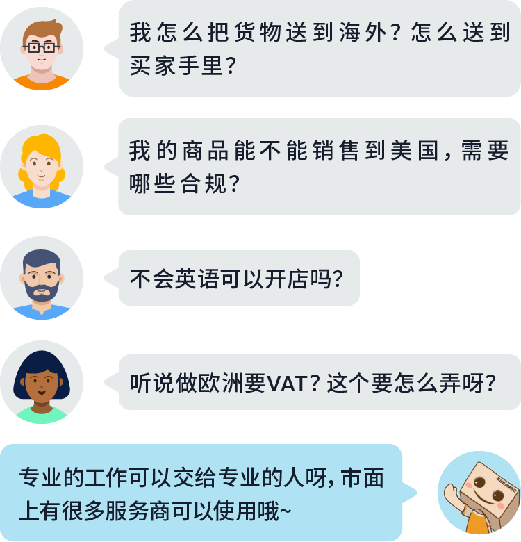
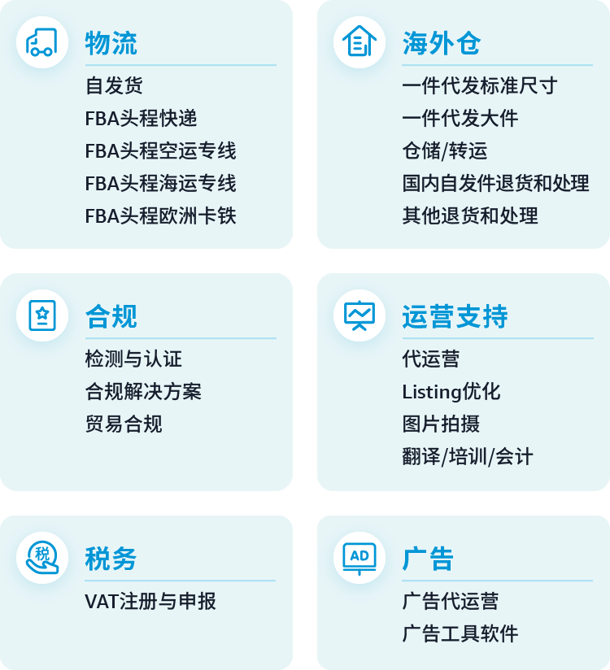
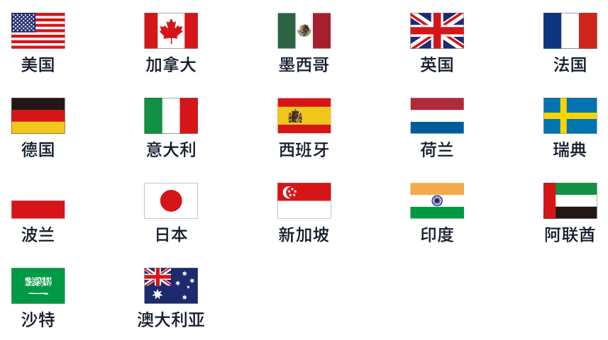
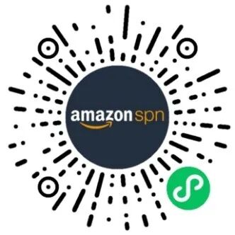
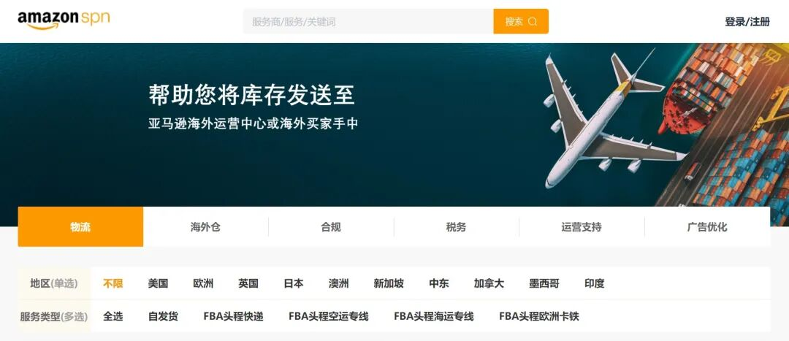
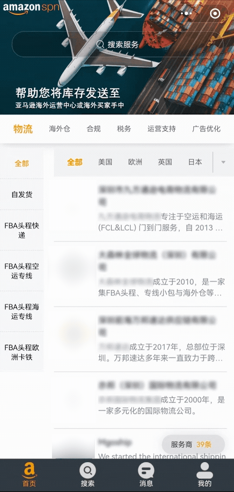
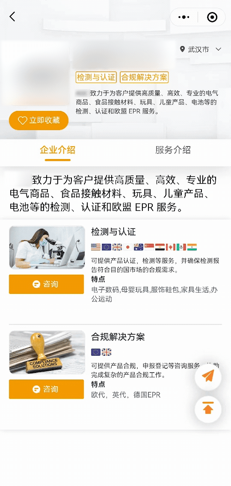

# 做跨境电商还得“专业”！亚马逊SPN小程序重磅上线，优质服务商一目了然！

> Source: wechat
> Author: 天机跨境
> Original: https://mp.weixin.qq.com/s/If4nUbgKKoNleCCxzHiCAQ

---

---

ing对跨境卖家来说，从决定开店到开店运营、做好销售的过程中，都会遇到各种各样的挑战。小编在后台收到很多卖家留言：

高效找到合适的、专业的服务商可以让卖家有更多精力专注于产品，以此提高店铺的整体效益。亚马逊重磅推出**亚马逊SPN服务商网络小程序**，帮助卖家高效找到服务商！

## 1

亚马逊SPN服务商网络小程序已于日前上线，面向**准备开店**和**已开店**的卖家朋友，整合优质第三方服务商信息，帮助卖家轻松选择合作服务商，打通出海通道！👉**点击进入亚马逊SPN服务商网络小程序**

亚马逊SPN服务商网络为广大跨境电商卖家提供6大服务板块，覆盖亚马逊17大站点，帮助卖家便捷高效找到信赖度高的服务商并建立联系。

**📍 6大服务版块，全方位为您保驾护航**

亚马逊针对服务商的口碑、服务能力及品牌影响力等方面**进行全方位评估审核**，最终精选90余家本地服务商，涵盖以下6大服务版块：

\* 服务类目和服务商持续拓展中，敬请期待！

**📍 17大站点全覆盖，助您大赚全球**

支持包括美国、加拿大、英国、法国、德国、日本、澳洲、新加坡、中东、墨西哥、印度等17个站点。

**📍 免费搭建与服务商沟通直通车**

亚马逊SPN帮助卖家快速找到合适的服务商并建立联系，在这过程中亚马逊不会额外收取任何费用。

**📍 实时沟通“零距离”**

支持卖家和服务商实时对话，达到即时、高效、快捷的沟通，实现沟通“零”距离。

**📍 一键收藏，实时跟进服务商动态**

如果您对任何一家服务商动心，只需要轻点按钮，就可以马上收藏，更方便！

**极简的界面布局，便携的导航及检索设置**，更清晰快捷地找到服务商。为了卖家们更好的使用体验，SPN服务商网络为卖家量身定制了微信小程序及网页两个版本。

🚩 **微信小程序版**

卖家在手机微信中搜索“**亚马逊SPN**”，即可找到小程序。

点击下方小程序码，一键直达👇

💡**Tips：** 建议将小程序收藏至“我的小程序”，方便随时查看哦~

🚩 **网页版**

同时，您还可在PC端查看页面并使用。

复制链接到电脑浏览器中打开，即可查看👇

**https://spn.globalsellingcommunity.cn/homepage**

这么高效的服务商网络，具体要怎么使用呢？话不多说，操作指南立马奉上！

**📍 以微信小程序版为例**

🚩 **服务商浏览与检索**

● 卖家可在首页选择不同的**服务商类型**或**站点**浏览服务商信息；

● 在**首页**搜索栏或**搜索页**输入关键字或服务商标签，即可检索出目标服务商。

🚩 **一键注册，享优质服务**

卖家可选择**微信授权**一键注册登录

🚩 **服务商收藏与咨询**

● 点击服务商详情页的“**立即收藏**”，即可收藏该服务商；

● 点击“**咨询**”，可实时与服务商沟通。

\* 请注意，亚马逊仅作为信息资源提供这些列表。如果您选择使用SPN服务商，您将直接与该服务商签约，该服务商将向您提供您的方向的服务。亚马逊不认可任何服务商或其服务。

**亚马逊卖家体验反馈**

作为一个新手卖家，选择一家专业的物流公司真的很难，价格五花八门，时效都说最快。有了这个官方整合的SPN服务商，我只要在这里边选择两家比较一下就行了，比较放心。

今年扩展了欧洲站，但欧洲VAT很麻烦。听说很多税贷都不专业，报税出问题影响就大了。用亚马逊SPN整合的税贷公司，还是比较放心的，如果报税做好了，听说还能节省一部分成本！

将服务商的资源整合到一起提高了办公效率，尤其是在头程方面帮助很大。

## 2

**问**

我在使用SPN时需要注册吗?

浏览和搜索服务商是不需要注册的，只有在收藏服务商，或者展开咨询会话时需要。

**答**

**问**

我正考虑在亚马逊开店，SPN平台上也有提供开店前期相关的服务商吗？

SPN服务商网络针对的既有在准备开店期的卖家，也有新卖家和老卖家，服务商服务范围包括了卖家开店的整个链路的需求，并在不断拓展卖家所需服务类目中。

**答**

亚马逊SPN服务商网络助您锁定商机，让运营尽在“掌”中！还等什么，快来立刻开启高效便捷的SPN服务商网络之旅吧~

✦

点分享

点收藏

点点赞

点在看
