# 美国公司注册流程大揭秘~转载来自国民弟弟Bruce的分享

> Source: wechat
> Author: 天机跨境
> Original: https://mp.weixin.qq.com/s/PkziovisK025VYgKPadWMQ

---

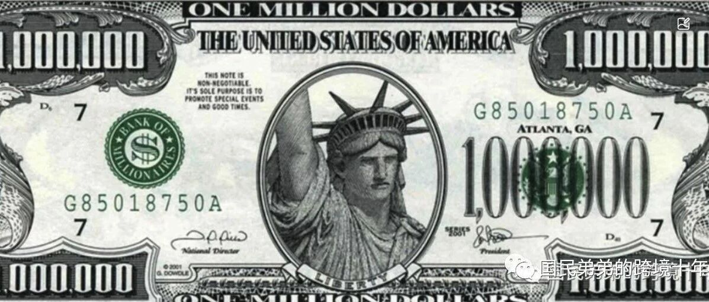

---

国民弟弟：大家好，我是国民弟弟，一位从事亚马逊OA套利的卖家,从事跨境十年。

有些朋友对于注册一个美国公司的成本非常关注，想知道真正的底价是多少。我可以告诉大家，通常情况下，注册一个美国公司的**成本在200-300美元左右，相当于1400-2100人民币的范围。**

**先直接给结论哈**！1）注册美国公司找个合规的代理基本就可以完成。外国人依然可以注册美国公司，不需要美国人持有，不需要绿卡。

2）注册州的选择上，长期使用注册Wyoming 怀俄明州，免税州。

短期做生意，可以在科罗拉多州 CO，比较便宜。

目前找到的代理，就收下身份证资料+公司名字就可以。

顺带介绍下我自己，我是利用美国公司在亚马逊注册账号，通过账号优势在美国亚马逊上进行销售~~因为美国亚马逊的账号权限比中国店铺高很多，能够销售一些有门槛的商品。这是我的个人创业故事。

[如何从0到350w+,跨境电商认知分享](https://mp.weixin.qq.com/s?__biz=Mzg2MjY2NzU4Mw==&mid=2247491249&idx=1&sn=d8fdfe5c33d6c52994663f76bf1ec13e&chksm=ce0508e1f97281f71a1f7d1293ac05165c07756e1c39a264ab1413710351dbf9c3d19f0de0e2&token=1464192628&lang=zh_CN&scene=21#wechat_redirect)

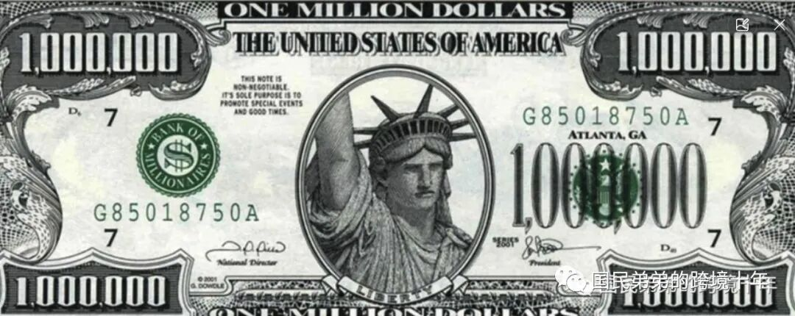

img

## 注册美司上面如何省钱的经验，正文来了~

我一直在研究如何省钱注册美国公司的方法。早在很久之前，我就开始了解注册沃尔玛的流程，一个沃尔玛账号目前价值大约4万美元。

当时，我咨询了不同的中国代理，包括一些我熟悉的和不熟悉的服务商。

### 中国代理市场级别报价：

根据市场上的报价，科罗拉多州的注册费用在3200-3500人民币之间，而纽约州的费用则大约为4500人民币。如果你去市场上打听一下，估计也会得到类似的价格。

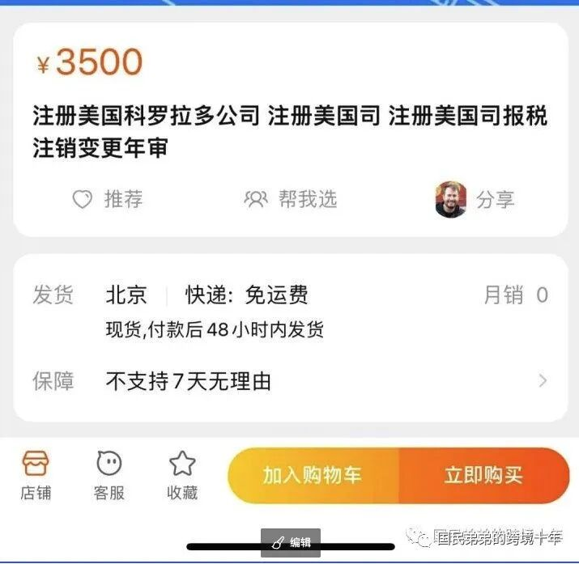

img

后来我找到了一家美国的代理——Northwest，他们的价格比其他代理都要便宜很多，但是他们的报价还是有一些小麻烦。因为美国公司的合规要求，需要有一个EIN号。

不过，Northwest公司的注册费用包含了EIN号，大约是339美元左右，相当于约2373人民币。**这个价格比其他中国代理便宜了30%左右！**

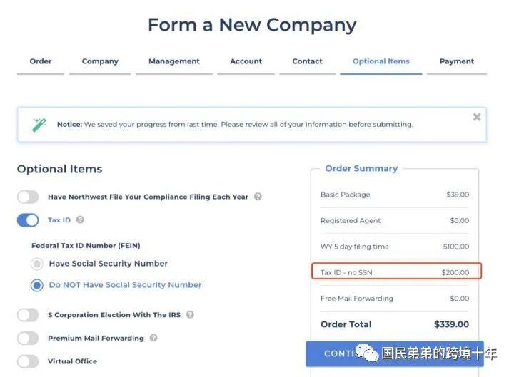

### 顺带解释下EIN 是什么？

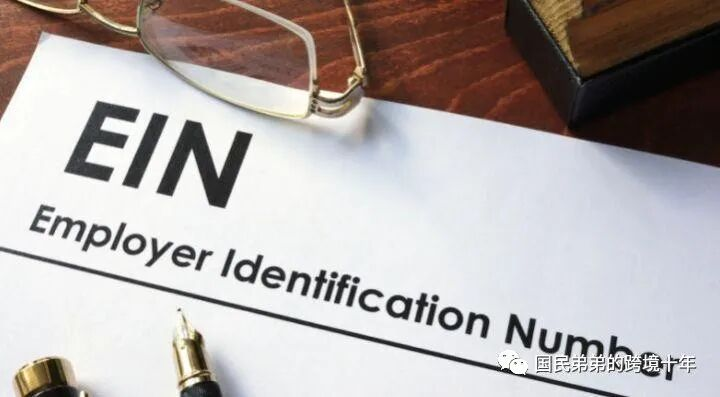

EIN是Employer Identification Number的缩写，可以理解为类似于中国企业的税号。在美国注册公司时，需要向州政府申请注册，但是税号需要向联邦政府申请，这是美国奇特的脑回路和历史原因。

EIN用于识别企业实体，几乎所有在美国做生意的企业都需要一个EIN号。无论你在哪个电商平台上运营，出示EIN都是必要的。

一般来说，通过代理申请EIN比较方便和可靠。不建议通过一些网站的个人方式获取EIN号，因为这些网站通常会采用灰色方式获取EIN号，最终导致公司被查封，罚款等问题。

申请EIN的方式有很多种，不同的方式处理时间也有所不同，大约需要1-2天，2周或两个月等。Northwest是一家可以为公司申请EIN的代理机构，他们通常需要4-6周的时间来办理EIN号，费用大约为200美元左右。

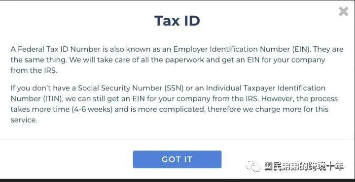

## 第一便宜的代理：

基于我已经找到比中国代理更便宜的美国代理，我学会了如何竞价并压价。接着，我开始尝试批量找美国华人代理进行谈判，希望能够以更优惠的价格获得服务。然而，有些代理不太愿意配合，像这家代理的价格几乎与中国代理相同。

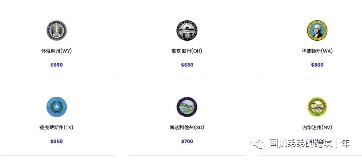

有些华人代理声称，northwest提供的注册成本卖的是亏本价，没有人会接手。但是，经过一番批量询问和压价的努力，我终于找到了一家代理。他们为我提供了一份含泪接受的价格，最终导致他们网站上的价格直接降到了我得到的这个价格。

### 第一便宜的代理：

249USD，人民币就是1800。真够卷的。

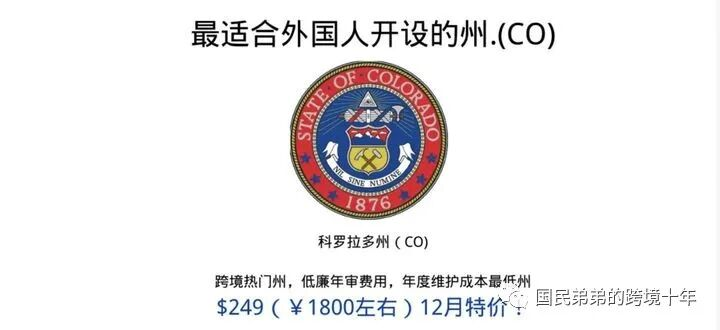

具体可以自取。

下面是他们网站。

华人代理机构

在和代理们交流的过程中，我发现美国注册代理行业其实是一个小圈子。他们告诉我，该代理商的母公司持有Northwest的股份，并且他们作为对华市场的子品牌。

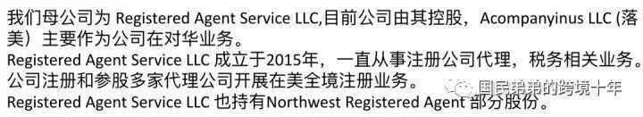

这让我想起了宝洁在中国市场推广不同的品牌，例如潘婷和飘柔，尽管品牌不同，但最终收入都汇入同一家公司。与我们在亚马逊店群中采用的策略类似，通过多个品牌进入同一类目，最终的供应商仍然是我们。这表明美国注册代理行业也是一个圈子，就像我们所说的“世界大同”。

### 关于税务维护成本：

当你注册美国公司后，需要考虑后续的税务维护成本。

有些代理公司，可能在注册时价格便宜，但后期费用高昂，这会让你感到烦恼。

**美国代理与中国代理的比较**

简单来说，美国代理公司的税务维护成本大多在550美元左右（约合3800人民币），这是在大部分州的情况下。

相比之下，在淘宝上寻找中国代理，年审费用大约为1800元，报税费用为5500元。尽管你可能可以通过讨价还价等方式减少部分费用，但最终你的公司在淘宝上的税务维护成本仍会在6800至7300元之间。

显然，这个价格真的很高。而且很可能这些淘宝代理只是拿美国代理的资源，再加价卖给你。这样的中间商并不值得赚那么多差价。

下面是我询问淘宝中国代理的截图，可以看到价格都差不多在这个范围内。

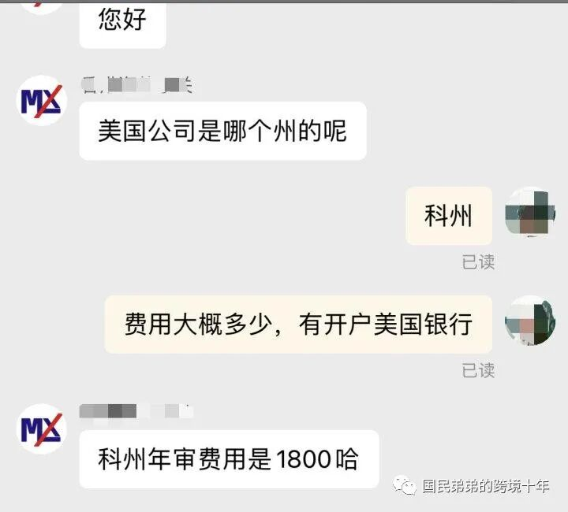

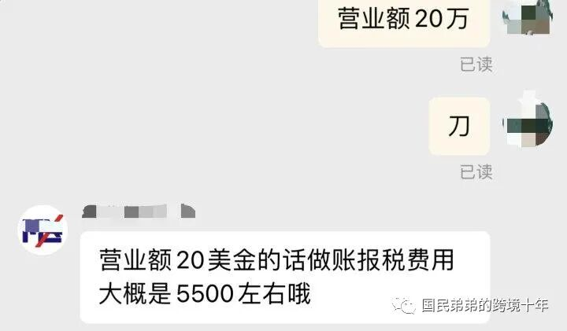

### 综上所述：

目前最便宜的美国代理注册费用是249美元，约合人民币1800元左右。相比淘宝上的代理，价格更加实惠，且方便华人对接。此外，税务成本也明显降低，让我们的持有成本和国内公司的成本接近。具体来说，注册费用相比国内代理省下了1700元，税务成本省下了3400元，**重点：总计省下了5100元人民币**。

**声明：目前我只用过这些代理服务，它们的服务和收费相对可靠。如果有不可靠的情况，请告知我，我也会寻找其他靠谱的代理服务。我想分享一些价格合理、优质且安全的代理服务给大家。以下是它们的网站链接：**

华人代理机构

**国民弟弟你还找了其他代理问过吗？有多一个选择吗？**

另外还有一家我用过的代理服务，但相对来说价格稍高，性价比不够高。虽然如此，我仍然想分享给大家，因为他们的服务也很不错，邮件沟通也很愉快。

老外税务代理（略贵）

### 国民弟弟你有知道哪家美国代理不靠谱么？

我知道，哈哈，但我不能公开说。作为一个经验丰富的创业者，我问了一下，就知道哪些代理是要坑人的。

**国民弟弟你为什么分享出来？**

我自己创业的经历非常辛苦，中间踩了很多坑。我想分享给大家这些信息，帮助大家避免这些坑。我希望通过分享能够连接更多的朋友，交流行业经验。同时，我还有付费亚马逊套利内容，有兴趣的朋友也可以了解一下。这就是我的故事！

[怎样成长赚到第一个100W?创业者的自白](https://mp.weixin.qq.com/s?__biz=Mzg2MjY2NzU4Mw==&mid=2247489666&idx=1&sn=d928c64774833533eb4d63b914f8c74c&chksm=ce050ed2f97287c4050d40b45dca15bd8cb1a39fc6f45ab4df9918bd691790e4e1fcc73cbe27&token=1032401512&lang=zh_CN&scene=21#wechat_redirect)

**当您有美国公司了，你其实可以注册很多平台。**

**美司开其他电商平台笔记：**

[立省4W,美国公司注册沃尔玛手把手保姆教程 原创](https://mp.weixin.qq.com/s?__biz=Mzg2MjY2NzU4Mw==&mid=2247488463&idx=1&sn=6891fd0c09c802d4927618fff0396a2d&chksm=ce05059ff9728c8949902bba65a8ceade37f059cad0f832215ce31cff7d39bf39d7df67782cc&token=1032401512&lang=zh_CN&scene=21#wechat_redirect)

[价值5k，OA套利新套路？亚马逊免费清库存？美司开美客多](https://mp.weixin.qq.com/s?__biz=Mzg2MjY2NzU4Mw==&mid=2247486029&idx=1&sn=0dbfc28ef244359ae7dc118a4c6128b7&chksm=ce051c1df972950b055f9ffa975953f52bee1ca98b46fec6c46b511a7cb4a5a5996eadff3937&token=882126700&lang=zh_CN&scene=21#wechat_redirect)

[2022.5月 ETSY最新注册教程-10分钟保姆教程 原创](https://mp.weixin.qq.com/s?__biz=Mzg2MjY2NzU4Mw==&mid=2247486537&idx=1&sn=2e65c806a9b4e7996db6f58b12032372&chksm=ce051a19f972930f6efa8af3ca261f99785034b86c8f66a4673a5bd1f9454784d93effb95877&token=944293884&lang=zh_CN&scene=21#wechat_redirect)

[2023年美国Tiktok小店，用中国身份开Tiktok小店教程，史上最全原创](https://mp.weixin.qq.com/s?__biz=Mzg2MjY2NzU4Mw==&mid=2247490859&idx=1&sn=5bb2c6785d7290039c5b881695e98164&chksm=ce050b7bf972826d26cd59fce3821e2776aecb528fc4f9d7541dd87f20d068c0b034b5fded13&token=1188379769&lang=zh_CN&scene=21#wechat_redirect)

[TIKTOK美国ACCU店铺注册教程](https://mp.weixin.qq.com/s?__biz=Mzg2MjY2NzU4Mw==&mid=2247491541&idx=1&sn=4ab5df4b555a72e4d430deb4b8bac887&chksm=ce050985f9728093120277bddf19a1be322e695941e2051cc445046eae848523bac7166a67e7&token=665669248&lang=zh_CN&scene=21#wechat_redirect)

[美国公司注册Wayfairz手把手教程](https://mp.weixin.qq.com/s?__biz=Mzg2MjY2NzU4Mw==&mid=2247491747&idx=1&sn=af6c2bb98fe613650f04c7b489b58a73&chksm=ce06f6f3f9717fe5c3676e3ca79fe7a7a8b4dc501716ea66042de24ba4e6899524bb3a6806c1&token=665669248&lang=zh_CN&scene=21#wechat_redirect)

温馨提示：微信改版，建议特别关注+点赞，系统会将你标记为常读用户，否则可能收不到下篇文章

## 看到这里了！人应该想接触到更厉害的人，直接转发我文章到你认为的更厉害的人。

为什么这么做？和同频的人在一起，才能有价值增长。

以后你搞项目，是不是需要判读下，你身边有什么优秀的人对吧？或者你作为老板，你是不是要看和你眼界认知差不多人一起做生意呢？优秀的人只需要和优秀的灵魂对话。

说一千道一万，不如现在通过我的文章来积累同频的人。哈哈，国民弟弟甘为小弟给各位大佬搭桥。

以上！

你在我的频道可以看到什么？
1.一个跨境电商从业者的观察

2.美国商机思考

3.在外和准备进入美国的朋友，一些手把手的经验。

4.在北美创业者的故事

5.链接和认知提升。

**跨境电商商业思考：**

[跨境电商赚一个几乎双倍的利润？](https://mp.weixin.qq.com/s?__biz=Mzg2MjY2NzU4Mw==&mid=2247491859&idx=1&sn=efad2973593bcdf14d00ef13713393db&chksm=ce06f743f9717e554e78e1e165bf6868fc35509a2651e11a89be093b40aebf7a847d1a663e38&token=665669248&lang=zh_CN&scene=21#wechat_redirect)

[跨境电商选对一个品，利润率超过100%？跨境电商如何赚到一波钱](https://mp.weixin.qq.com/s?__biz=Mzg2MjY2NzU4Mw==&mid=2247491813&idx=1&sn=83be22effa67691cff2a38b8bf7211b5&chksm=ce06f6b5f9717fa36079bdd90037f689307f96a960fb37db7536f6ee26bc884792b41fb60d9d&token=665669248&lang=zh_CN&scene=21#wechat_redirect)？

[一个赚一千万的项目，适合你么？](https://mp.weixin.qq.com/s?__biz=Mzg2MjY2NzU4Mw==&mid=2247491781&idx=1&sn=e1d833169fa91eba79973f8ee89fd28a&chksm=ce06f695f9717f83e66c0ef36e32f705084af553b624d55b3fa639dc603f2b7d1e342242560f&token=665669248&lang=zh_CN&scene=21#wechat_redirect)

[利润40%以上的思路？](https://mp.weixin.qq.com/s?__biz=Mzg2MjY2NzU4Mw==&mid=2247491422&idx=1&sn=1ee3e46317a1fc92f411240a623b2400&chksm=ce05090ef972801821becbe5bf74bc5ea9bb10402dd2bbb288a4f137f65237269d8734857a18&token=665669248&lang=zh_CN&scene=21#wechat_redirect)

**国民弟弟的创业故事和思考：**

[如何从0到350w+,跨境电商认知分享](https://mp.weixin.qq.com/s?__biz=Mzg2MjY2NzU4Mw==&mid=2247491249&idx=1&sn=d8fdfe5c33d6c52994663f76bf1ec13e&chksm=ce0508e1f97281f71a1f7d1293ac05165c07756e1c39a264ab1413710351dbf9c3d19f0de0e2&token=1464192628&lang=zh_CN&scene=21#wechat_redirect)

[怎样成长赚到第一个100W?创业者的自白](https://mp.weixin.qq.com/s?__biz=Mzg2MjY2NzU4Mw==&mid=2247489666&idx=1&sn=d928c64774833533eb4d63b914f8c74c&chksm=ce050ed2f97287c4050d40b45dca15bd8cb1a39fc6f45ab4df9918bd691790e4e1fcc73cbe27&token=1032401512&lang=zh_CN&scene=21#wechat_redirect)

[从0-100w的跨境创业者深圳往事](https://mp.weixin.qq.com/s?__biz=Mzg2MjY2NzU4Mw==&mid=2247490680&idx=1&sn=502bed16495c17ce7aae222d9360e38e&chksm=ce050a28f972833ea98c59b0db436aa23fa7a8abd512c9029640010e4ae09f551cb84609f36f&token=619157195&lang=zh_CN&scene=21#wechat_redirect)

[月入60w利润，杂谈世界，北美杂想](https://mp.weixin.qq.com/s?__biz=Mzg2MjY2NzU4Mw==&mid=2247490575&idx=1&sn=259eb253a852bf9b6915342255f57bd9&chksm=ce050a5ff9728349bdb1b656ffd624782ca5349b5299c6ae9e0c90fddfea86e4901cbcc48e61&token=62006673&lang=zh_CN&scene=21#wechat_redirect)

[OMG，这些在美国卖这么赚钱？美国跨境电商选品思路大放送？](https://mp.weixin.qq.com/s?__biz=Mzg2MjY2NzU4Mw==&mid=2247490308&idx=1&sn=d1b92fc1dcbe12e7ec0b7f04e8473303&chksm=ce050d54f97284423a0be4e83919d3ad28705a49df0a79c715ab13e63c863c8c76a94a2fb7eb&token=62006673&lang=zh_CN&scene=21#wechat_redirect)

[北美杂想，电商创业者在美生活思考](https://mp.weixin.qq.com/s?__biz=Mzg2MjY2NzU4Mw==&mid=2247490231&idx=1&sn=ca0061db0009da8bede9e5f590588cb5&chksm=ce050ce7f97285f1db37947af08d743c12a3adbecfbf09d4449b9554fae88259ea719ed0efa9&token=62006673&lang=zh_CN&scene=21#wechat_redirect)
