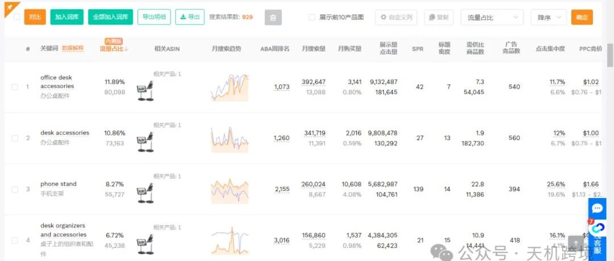
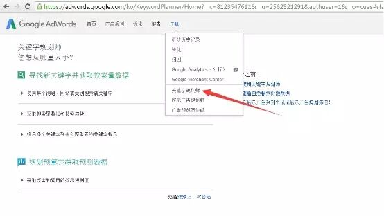
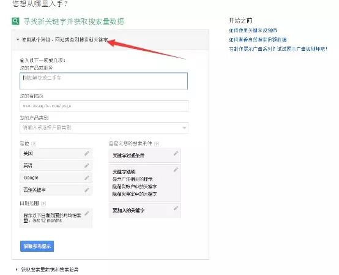
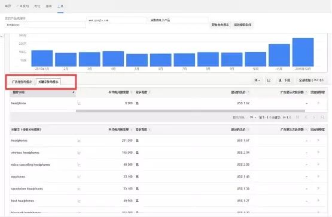
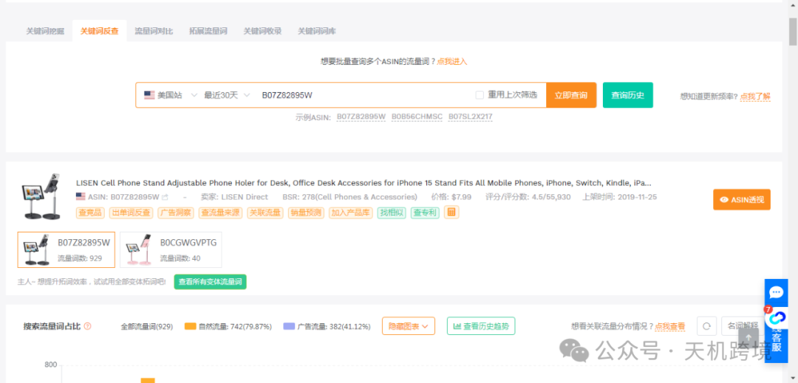
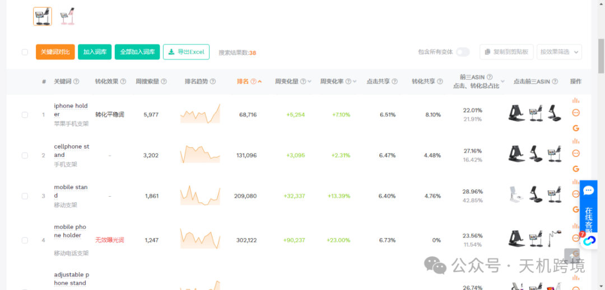
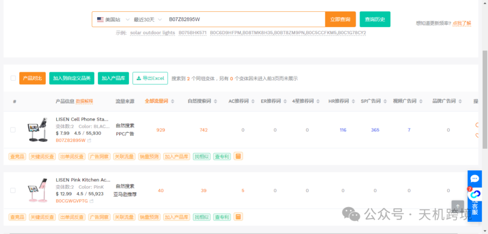
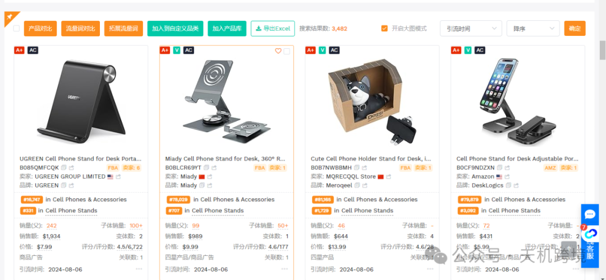
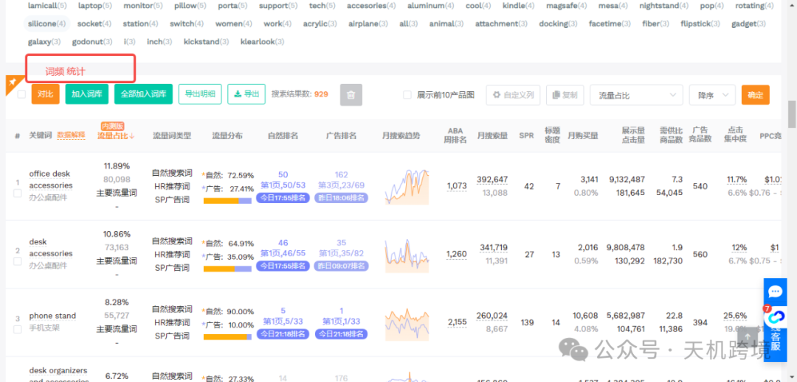
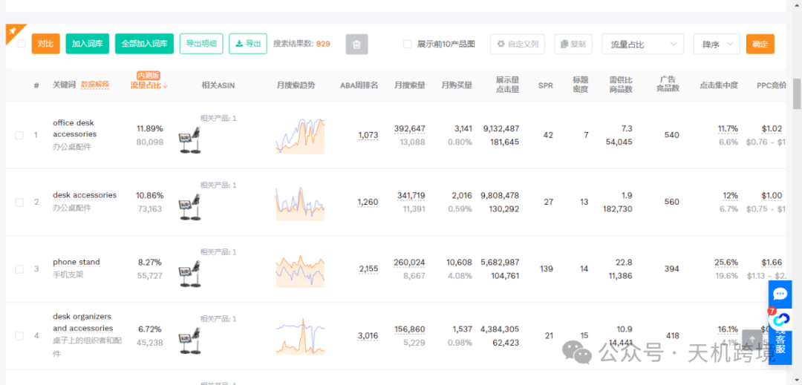

# Amazon关键词研究工具

> Source: wechat
> Author: 天机跨境
> Original: https://mp.weixin.qq.com/s/7jv8f9i9SHmqiQR703KscA

---

---

今天来介绍几款强大的亚马逊关键字研究工具，分享给大家！

①

谷歌关键字规划师 需要翻墙

 （https://adwords.google.com/KeywordPlanner）

这个谷歌关键字工具相信大家不会陌生吧！登陆你的谷歌账号，你首先的有一个谷歌广告账号（注册很简单的）在“工具”栏里找到 关键字规划师，如下图所示：

然后点击“使用某个词组，网站或类别搜索新关键字”

② 亚马逊首页搜索框  下拉框自动关键字提示：

 这里以headphone为关键字来搜索，可以看到基于headphone这个关键字可以查看他的关键词组，或者关键字提示，如下图：

显示出来的关键字，大家可以做好表格记录，一级关键字，二级关键字，以及词组的关键字，这部分都可以做表格加以记录。

③卖家精灵 Sellerspirit

 （https://www.sellersprite.com/v3/keyword-reverse）

关键词优化 - 关键词反查 ：

 出单词反查.

查流量来源

查关联流量

词频统计

拓展流量词

\关键词 词库搭建

搜索量，相关性         关键词竞争格局，机会指数

关键字优化建议，哪些词的搜索量是最高的，哪些词是比较低的，哪些是可能带来高转化词
