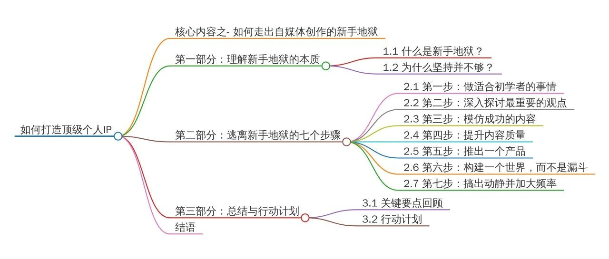
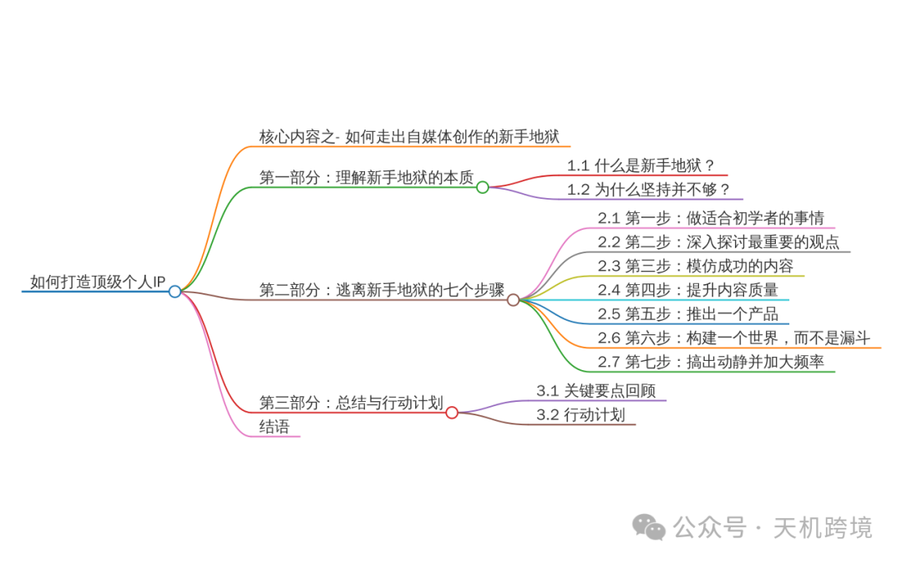

# 如何打造顶级个人IP之如何走出自媒体创作的新手地狱【视频笔记】分享

> Source: wechat
> Author: 天机跨境
> Original: https://mp.weixin.qq.com/s/Ovm_F4Yt-TyYTGoMOLp5Uw

---

---

如何打造顶级个人IP之如何走出自媒体创作的新手地狱【视频笔记】分享

思维导图：

笔记根据视频字幕生成，更佳学习体验找博主索要视频源文件

----

如果你是一个创作者、作家、音乐家，或者想要成为创作者的人，那么这可能是你今年观看的最重要的一段内容。因为有数据表明，大多数创作者会在**三到六个月**内被困在“新手地狱”。
“新手地狱”是一个可怕的地方，在那里你不知道要做什么，质疑是否还继续下去，不断重复失败的尝试。不幸的是，大多数人在开始好转之前就选择了放弃。

但请记住：**坚持并不是唯一的答案**。你需要找到正确的方法，达到顿悟的“啊哈时刻”，突破进入“中级者天堂”。本文将帮助你了解如何逃离新手地狱，掌控自己的未来。

---

## 第一部分：理解新手地狱的本质

## 1.1 什么是新手地狱？

新手地狱是一个令人沮丧的阶段。在这个阶段，你可能会：

- 不知道接下来该做什么；
- 一次又一次地失败；
- 感到迷茫和无助。

杰夫·贝佐斯曾说过：“所有的‘一夜成名’都需要10年时间。”所以，**不要把自己和那些已经在领域里深耕5到10年的人比较**。你需要接受这个事实，并采取正确的行动。

## 1.2 为什么坚持并不够？

很多人认为，只要坚持下去就能成功，但事实并非如此：

- 如果你的方法不对，坚持只会浪费时间；
- 盲目重复错误的行为不会带来任何进展。

你需要做的是找到有效的解决方案，尝试不同的方法，直到找到适合你的路径。

---

## 第二部分：逃离新手地狱的七个步骤

## 2 .1 第一步：做适合初学者的事情

许多新手尝试模仿高级创作者的行为，却忽视了他们的实际情况。作为新手，你应该：

- **解决问题**：80%的内容都应该围绕一个痛点展开；
- **从痛点出发**：每次创作时，思考你的内容如何帮助他人。

## 如何开始：

- 使用以下短语作为开头：

- “大多数人……”
- “如果你在……方面有困难……”
- “最糟糕的……”

例如：
“大多数人不擅长写作。”
“如果你难以集中注意力超过5分钟……”
“最糟糕的技能就是网页设计。”

## 2 .2 第二步：深入探讨最重要的观点

为了建立权威，你需要聚焦于某个主题，并反复讨论那些“永不过时”的观点。例如：

- 如何选择一个利基市场；
- 最适合初学者的商业模式；
- 如何在Y时间内赚取X金额。

## 建议：

- 重复那些对观众有价值的内容。即使是旧内容，也可以重新制作和发布。

## 2 .3 第三步：模仿成功的内容

## 如何模仿：

1. 搜索你喜欢的账号；
2. 查看他们最早的内容；
3. 找到那些增长峰值的内容，并使用它们作为框架。

## 注意：

- 不要直接复制，而是学习其结构和方法，结合自己的创意进行改编。

## 2 .4 第四步：提升内容质量

如果你的账号没有增长，那说明你的内容不够好。你需要：

- **吸引注意力**；
- **保持注意力**；
- **提供价值**。

## 创作的十条黄金法则：

1. **具体的数字列举**：例如，“达成目标只需这七步”。
2. **习惯模式的中断**：打破观众的滑动浏览习惯。
3. **消极偏见**：用更有力的方式表达观点。
4. **目标号召**：明确你的受众，比如“召集所有创作者”。
5. **抛出问题**：例如，“你是否在……方面遇到困难？”
6. **深入痛点**：说明克服问题后能带来的好处。
7. **他人的认同**：展示成果或资历，增加权威感。
8. **自信和信念**：用绝对的语言表达观点。
9. **节奏感和可读性**：多使用换行，保持段落简洁。
10. **警告或提醒**：指出潜在的陷阱，并提出建议。

## 2 .5 第五步：推出一个产品

大多数创作者等到积累大量粉丝后才开始赚钱，但这是错误的。你需要尽早推出产品，因为：

- 产品让你更有权威；
- 产品提供了创作的框架；
- 产品让试错变得更容易忍受。

## 建议：

- 从简单的产品开始，比如电子书、模板或课程；
- 不断迭代和改进你的产品。

## 2 .6 第六步：构建一个世界，而不是漏斗

传统的营销漏斗已经过时了，现在你需要构建一个“迷你的漫威元宇宙”，包括：

- 短内容：X、LinkedIn、Ins、TK YouTube；
- 长内容：newsletter、播客或油管视频；
- 免费教程：电子书、模板、视频培训；
- 低价产品和高价课程。

## 提示：

- 将社交媒体内容视为新的MVP（最小可行产品），通过不断测试和改进，找到最有效的内容形式。

## 2 .7 第七步：搞出动静并加大频率

## 如何做到：

- 使用模板和框架，让你的内容更具吸引力；
- 尝试各种创意，直到找到最适合你的模式；
- 平衡艺术与商业，通过市场反馈调整策略。

---

## 第三部分：总结与行动计划

## 3 .1 关键要点回顾

- **新手地狱**是每个创作者都会经历的阶段，但你可以通过正确的方法逃离；
- **解决问题**和**提供价值**是内容创作的核心；
- **推出产品**和**构建世界**是建立权威和实现收入的关键。

## 3 .2 行动计划

1. 写下你的创作主题，并围绕痛点展开内容；
2. 模仿成功的账号，学习他们的内容结构；
3. 尽早推出一个简单的产品，并不断改进；
4. 构建一个内容生态系统，包括短内容、长内容和免费教程；
5. 每周创作高质量的内容，吸引更多的受众和合作机会。

---

## 结语

逃离新手地狱并不容易，但只要你掌握了正确的方法，并坚持不懈地实践，就一定能够突破瓶颈，进入“中级者天堂”。
**现在的问题是：是什么让你陷入新手地狱？**
如果你能意识到这一点并公开它，克服它就会变得更容易。
记住，成长取决于你自己的努力，行动起来吧！

---

总结：

v

以下是为您整理的"如何逃离自媒体创作新手地狱"思维导图框架：

（受限于文字格式，以下为层级结构呈现，建议使用思维导图软件生成可视化图表）

一、理解新手地狱的本质

├─ 1.1 定义

│   ├─ 迷茫阶段：不知方向/重复失败/无助感

│   └─ 杰夫·贝佐斯启示：所有成功都需要长期积累

├─ 1.2 坚持的误区

│   ├─ 错误坚持=浪费时间

│   └─ 关键：找到有效方法

二、逃离七步法

├─ 2.1 做适合新手的创作

│   ├─ 80%内容聚焦单一痛点

│   ├─ 创作模板：

│   │   ├─ "大多数人..."

│   │   ├─ "如果你在...困难"

│   │   └─ "最糟糕的..."

├─ 2.2 深化核心观点

│   ├─ 聚焦永恒主题

│   └─ 例：利基选择/商业模式/变现路径

├─ 2.3 成功内容模仿法

│   ├─ 研究账号早期内容

│   └─ 借鉴峰值内容框架

├─ 2.4 内容质量提升法则

│   ├─ 三重标准：吸引→保持→提供价值

│   └─ 黄金十条：

│       ├─ 数字具象化（"七步法"）

│       ├─ 打破浏览惯性

│       ├─ 消极偏见应用

│       ├─ 精准目标号召

│       └─ 六项其他法则...

├─ 2.5 产品先行策略

│   ├─ 早期变现价值：

│   │   ├─ 建立权威

│   │   ├─ 创作框架

│   │   └─ 试错动力

│   └─ 产品矩阵：电子书→模板→课程

├─ 2.6 构建内容宇宙

│   ├─ 四层体系：

│   │   ├─ 短内容（社交媒体）

│   │   ├─ 长内容（播客/视频）

│   │   ├─ 免费教程

│   │   └─ 阶梯产品

├─ 2.7 规模化创作

│   ├─ 模板化生产

│   └─ 测试反馈循环

三、执行系统

├─ 3.1 关键认知

│   ├─ 必经阶段论

│   └─ 价值创造核心

├─ 3.2 行动清单

│   ├─ 痛点内容规划

│   ├─ 竞品框架分析

│   ├─ MVP产品开发

│   └─ 内容生态搭建

└─ 3.3 终极拷问

    └─ 自我诊断：困住你的具体障碍？

（注：完整思维导图应包含交叉关联关系，如"产品开发"与"内容宇宙"的联动，"质量法则"与"新手创作"的支撑关系等，建议用箭头标注关键逻辑链路）

---

对于创作者、作家、音乐家，或者希望成为创作者的人来说，这段内容可能是今年最重要的观看体验。数据显示，大多数创作者在三到六个月内会陷入“新手地狱”。

“新手地狱”是一个充满困惑和挫折的阶段，你可能会感到迷茫，不断失败，甚至怀疑是否应该继续。不幸的是，很多人在情况好转之前就放弃了。

然而，坚持并非唯一的解药。你需要找到正确的方法，经历顿悟的“啊哈时刻”，才能突破进入“中级者天堂”。本文将指导你如何逃离新手地狱，掌握自己的未来。

第一部分：新手地狱的本质

1.1 新手地狱是什么？

这是一个令人沮丧的阶段，你可能会：

不知道下一步该做什么；

不断失败；

感到迷茫和无助。

杰夫·贝佐斯曾说：“所有的‘一夜成名’都需要10年的时间。”所以，不要和那些在领域内深耕5到10年的人比较。接受这个事实，并采取正确的行动。

1.2 为什么仅靠坚持不够？

许多人认为只要坚持就能成功，但事实并非如此：

如果方法不对，坚持只会浪费时间；

盲目重复错误的行为不会带来进展。

你需要找到有效的解决方案，尝试不同的方法，直到找到适合自己的路径。

第二部分：逃离新手地狱的七个步骤

2.1 第一步：做适合初学者的事情

不要模仿高级创作者，而应该：

解决问题：80%的内容围绕一个痛点展开；

从痛点出发：思考你的内容如何帮助他人。

使用以下短语作为开头：

“大多数人……”

“如果你在……方面有困难……”

“最糟糕的……”

例如：

“大多数人不擅长写作。”

“如果你难以集中注意力超过5分钟……”

“最糟糕的技能就是网页设计。”

2.2 第二步：深入探讨最重要的观点

聚焦于某个主题，反复讨论那些“永不过时”的观点，如：

如何选择一个利基市场；

最适合初学者的商业模式；

如何在Y时间内赚取X金额。

重复那些对观众有价值的内容，即使是旧内容，也可以重新制作和发布。

2.3 第三步：模仿成功的内容

搜索你喜欢的账号，查看他们最早的内容，找到那些增长峰值的内容，并使用它们作为框架。不要直接复制，而是学习其结构和方法，结合自己的创意进行改编。

2.4 第四步：提升内容质量

如果你的账号没有增长，那说明你的内容不够好。你需要：

吸引注意力；

保持注意力；

提供价值。

创作的十条黄金法则包括：

具体的数字列举；

习惯模式的中断；

消极偏见；

目标号召；

抛出问题；

深入痛点；

他人的认同；

自信和信念；

节奏感和可读性；

警告或提醒。

2.5 第五步：推出一个产品

不要等到积累大量粉丝后再开始赚钱，而应该尽早推出产品，因为：

产品让你更有权威；

产品提供了创作的框架；

产品让试错变得更容易忍受。

从简单的产品开始，比如电子书、模板或课程，并不断迭代和改进你的产品。

2.6 第六步：构建一个世界，而不是漏斗

传统的营销漏斗已经过时，现在你需要构建一个“迷你的漫威元宇宙”，包括：

短内容：X、LinkedIn、Ins、TK；

长内容：newsletter、播客或油管视频；

免费教程：电子书、模板、视频培训；

低价产品和高价课程。

将社交媒体内容视为新的MVP（最小可行产品），通过不断测试和改进，找到最有效的内容形式。

2.7 第七步：搞出动静并加大频率

使用模板和框架，尝试各种创意，直到找到最适合你的模式。平衡艺术与商业，通过市场反馈调整策略。

第三部分：总结与行动计划

3.1 关键要点回顾

新手地狱是每个创作者都会经历的阶段，但你可以通过正确的方法逃离；

解决问题和提供价值是内容创作的核心；

推出产品和构建世界是建立权威和实现收入的关键。

3.2 行动计划

写下你的创作主题，并围绕痛点展开内容；

模仿成功的账号，学习他们的内容结构；

尽早推出一个简单的产品，并不断改进；

构建一个内容生态系统，包括短内容、长内容和免费教程；

每周创作高质量的内容，吸引更多的受众和合作机会。

结语

逃离新手地狱并不容易，但只要你掌握了正确的方法，并坚持不懈地实践，就一定能够突破瓶颈，进入“中级者天堂”。

现在的问题是：是什么让你陷入新手地狱？如果你能意识到这一点并公开它，克服它就会变得更容易。记住，成长取决于你自己的努力，行动起来吧！
