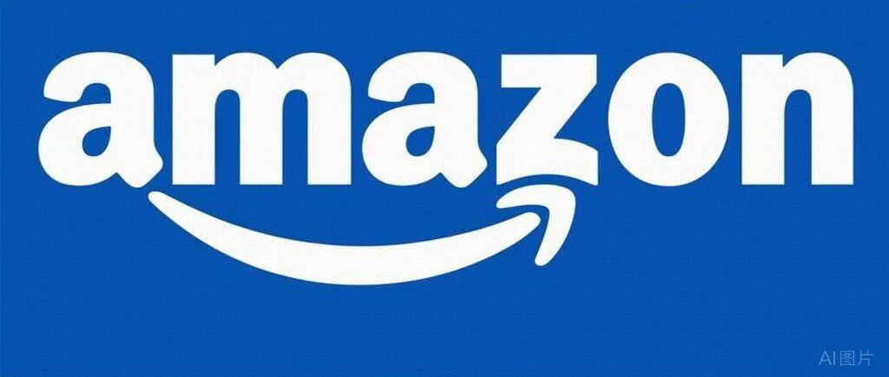
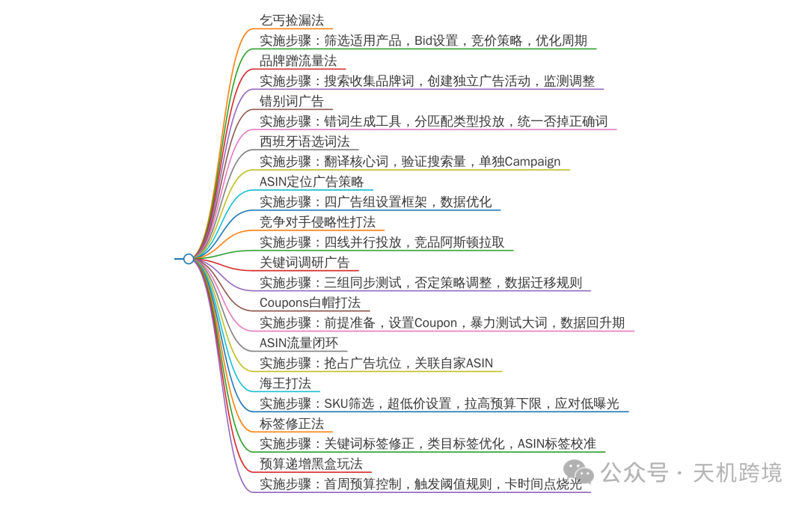

# 亚马逊站内广告打法策略全面解析

> Source: wechat
> Author: 天机跨境
> Original: https://mp.weixin.qq.com/s/zQr8BhHhC2TM49-fMVhx5Q

---

---

**亚马逊站内广告打法策略全面解析**

**亚马逊站内广告打法策略解析**

**乞丐捡漏法 捡漏广告**

比较适用于自然出单较多已经有一定的review评论积累的产品，以及针对一些Acos比较高的大词热词，把这些keyword关键词的bid直接降到0.15-0.20美金左右，竟价策略选择只降低。就是我们所说的乞丐投放法或者广告捡漏法。

low bid捡漏广告，低竞价，固定竞价 /提高和降低 杠杆200-400，最终的bid在建议竞价的40-50%

**品牌法 品牌词广告**

品牌有些是自带流量的，特别是一些大牌子，而且专门去竞价这些品牌的人可能不多，流量价格很低，所以这种蹭大牌流量的方法也是一个非常不错的省钱投放法。低价广泛方法

方法：

亚马逊前台搜索框搜索产品的核心关键词

搜索结果页面的左侧找到品牌栏目，这里面有这个产品类目下面所有的品牌名

搜集好这些品牌名以后，专门设置一个品牌campaign，然后全部以broad匹配的模式来投放这些相关品牌词，同时这些品牌词也会在这个产品其他的campaign里面做一个词组否定

**错词法 广告**

有时候老外搜索产品经常打错关键词，有些错词的搜索量还很高。虽然亚马逊后台有说明，这种错写系统能够识别，且会算到正确词的范围里面去，但是就相应的广告排名和权重来说，肯定不如直接去bid错写词好，亚马逊后台规则也说过语序和词序也是会被考虑进来的点。另外，这些错写词基本不会有人去专门竞价，这样就说明流量成本是非常便宜的，只要能够出单，基本上都是能赚钱的。

方法：

用第三方工具将核心关键词的错误书写形式全部找出来。可以用谷款搜索

keywordtypo generator SIF 西柚找词 卖家精灵工具去收集这些关键词

专门创建一个错词广告活动，放入这些词广泛或者精准匹配

**小语种选词法       西班牙语选词法广告**

美国市场除了英语之外，西班牙语是第二大语言。很多产品大词的西班牙语通常情况下也有较大流量，可以针对一些核心大词，专门去竟价西班牙语。

还是可以使用第三方关键词工具去收集这些关键词。比如可以先确定英文核心关键词然后谷歌翻译成西班牙语，然后去关键词工具验证是否有搜索流量。

一般搜索量较大的西班牙语在做竞争对手核心ASIN反查时，也会发现这些词。

可以选出来单独创建1个广告活动，精准匹配

**定位广告(布局产品的关联流量)**

①ASIN定位广告

相较而言，ASIN定位，我们有更多的选择权。能针对性的挑选更有利的ASIN去蹭流量，抢流是。具体操作，有2方面考量

ASIN 选择，可以开4个广告组

1. 捡漏定位广告组:分别选择各关键词自然排名和广告排名前4的ASIN，以及品牌分析里替代购买ASIN
2. 优势定位广告组:分别选择广告报告里面acos表现好的竞品ASIN;借用第三方工具筛选review少评分低，价格高，主图质量不高的ASIN
3. 互补定位广告组:

a.品牌分析里选择商品比较ASIN.

b.商品页面related products，位置前4ASIN，竟品详情页的广告关联位和自然关联位来获取合适的ASIN，详情页的广告关联位置 sponsored related to this item，自然关联位 FBT和CWBTAB

c.借助helium10里面black box-product targeting功能。选出Frequently BoughtTogether,和Customers Who Bought This Also Bought产品，再至少选择top4的ASIN，或者者你自己心情和预算。注总要选有价格和review优势的

4 流量闭合广告组:直接定位自家互补、同类ASIN，形成流量闭环

竞价策略

捡漏定位组:一般优势比我们大，为了不浪费预算，选择动态竟价-提高和降低，设置较低bid，商品页竞价浮动百分比，升至历史出单cpc的加权平均值

优势定位组:选择固走竟价，bid设置为cpc加权平均值

互补定位组:大家机会五五开，选择动态克价只降低。bid设置为cpc加权平均值

流量闭合组:选择动志竟价只降低

**②类目定位广告**

类目定位广告，一般是建议不做的，因为流量太泛，对于大部分有高转化诉求的卖家来说性价比实在太低。如果想尝试的 可以利用好refine筛选（和retarget定向回溯再营销）功能对ASIN进行筛选

**Competitor Targeting Campaigns竞争对手投放打法**

具体操作如下：

1. Sponsored product and Sponsored brand campaigns 投放带有竟争对手的品牌关键词以及ASIN
2. 使用工具例如js去拉取主要关键词搜素结果页排名靠前的相关ASIN,然后使用sp广告的product targeting 即商品投放来定位这些竞争对手ASIN.
3. 使用sp 广告的category targeting 类目定位结合refine 功能，细化竟争对手，例如售

价，星级，进行投放

1. 比较富有侵略性的或者获取流量为首要目标的打法就是同时运行这4种广告

Sponsored Product competitor ASlN targeting

Sponsored Brand competitor product Targeting

Sponsored Brand competitor keyword targeting

Sponsored Display competitor product targeting

**Keyword Research Campaigns关键词调研广告**

定义:顾名思义就是为你的产品寻找表现好的关键词并加以重点投放推广。这里比较关注的时long tall keywords 即长尾词/蓝海词

使用工具例如js，sif，helium10，卖家精灵，西柚找词，merchantwords魔词（找热搜词）等做好关键词库

测试所有匹配类型，给与足够的预算和测试时间以收集足够多的广告数据

这里在一开始就测试所有匹配类型的目的有以下3个：

1 最快速度的收集目标关键词表现数据

2 获取更多的曝光和关键词拓展

3 最重要的一点是 例如 一个在自动广告中的关键词或者一个特定匹配类型的关键词在一个广告活动中或者广告组表现比较好，如果把它迁移投放到手动广告同时选择一个特定匹配类型，不代表该关键词在原组的广告表现能完全复制到另外一个广告活动，有可能就表现的比较差，这是因为这个关键词在原广告活动组的广告坑位以及周边的竞争对手情况是无法复制的，转化率和竞争环境是一直在变化的。同时重点关注产品前期点击率，曝光情况（亚马逊在转化率和订单相对同等的情况下更加注重产品点击率）

同时创建broad广泛，phrase词组，exact 精准3个广告组，注意不要掉加否动作，（大词做前置否定）。broad 广告组中，同时把关键词加入否定词中选择phrase，phrase广告组中，同时把关键词加入选择exact匹配加否，前置否定

例如 Schmidt's 能够在长尾关键词“natural deodorant for men”的所有搜素中占据主导地位。如果 Schmidt 尝试针对关键字“Men's deodorant”进行操作，则该关键词的建议出价可能会高于 12 美元。这对 一些资金雄厚的大卖来说可能是可持续的，但对中小卖家来说这个关键词竞价是无法持续投放的

Ranking /Indexation Campaigns提升关键词排名权重和关键词收录的打法

可以按照关键词搜索量 相关性 竞争度来划分广告活动，同时这么做也可以更合理的分配预算和调整竟价。单独为曝光较好且有排名的关键词例如排在搜索结果页首页非top位置或者第二页第三页或者想要主推的关键词创建1个广告活动。试想如果把1个广泛大词和长尾词同时投放到一个组，那么这个长尾词肯走基本上没有曝光.

注意:这个广告活动的关注点不在于Acos高低，而是更多关注sales and keyword conversion rates，尽快提高这个关键词的排名和权重.

**广告霸屏或者广告防御策略(广告流量闭环)**

定义:所谓的广告霸屏或者做到广告流量闭环其意思简而言之就是如何让自己的产品占据大多数的广告坑位，尤其是自己卖的好的产品详情页下方的广告坑位，不让其他竞争对手占领从而分走你的流量。

这类打法比较适合垂直类目和多变体产品，即同一店铺或者交叉店铺拥有小产品线或者几个同类产品以及类似的sku越多越好，最后形成一个流量闭环，起到**广告防御的**作用

具体广告操作步骤如下

1. N多个SKU 投一组词
2. N多个sku 投一个ASIN
3. 广告结构，1个广告活动(campaign)，1个广告组(ad group)，选择多个相似sku，对应1个关键词或者1个ASIN,如果是对应多个关键词时，要有几个sku都有比较好的标签
4. 结合品牌广告和展示型广告（注意:无论时sp广告还是品牌广告，注意关键词投放时，要把branded keywords即品牌关键词和non-branded keywords 即非品牌关键词独立开来分别创建广告活动以便更加方便分配预算和调整竟价）
5. 同时可尝试把自己店铺同类产品或者互补产品开一个自动广告，把这些sku全部放到自动广告里，让产品在广告上形成关联，使用固定竞价。

**旺季广告打法:流量定位**

面对旺季，我们一定要清楚，自己“哪些流量是转化更高”。明确自己的流量“来源”才能让我们更有针对性的布局广告。我们先来看看ASIN流量定位案例。以去年“火出圈”的“running shoes“为例，流量“来源”可以分为以下七种:

1. 中性关键词流量:例如颜色 场景等关键词，容易产生点击需重点关注和使用
2. 品牌关键词:开销较大且党争激烈，建议除了旺季，平时谨慎使用
3. 同类商品流量(ASIN流量):比较建议使用此流量渠道
4. 相关商品流量:一股建议少量考虑，建议根据商品的关联特性决定
5. 类目流量:很重要的流量结构，建议使用：

我们结合弹力带(Resistance Bands Set)这个产品，看一个案例:

某个品牌的弹力带在刚进场时，同类竟品较少，但消费者喜爱度较高，因此销量一直节节高升。后来，越来越多卖家发现了这个“宝藏”类目，站内竞品开始增多，核心关键词建议竟价从不到1美金一直飙升到4+美金，且点击量寥寥无几，但产品售价才十几美金。

为了解决这个问题，我们进行全部流量结构的分析:

通过分析可以发现，为弹力带这款商品带来流量的渠道里面，出现了不少哑铃、室内自行车等同类商品。我们猜测，消费者在购买哑铃时，会搭配购买在同一使用场最下的弹力带。

既然直接投放弹力带这个关键词流量贵，竟争大且投资回报较低，那我们全可以转变思路，考虑投放同一功能相似、使用场景相近的同类ASIN(如哑铃的产品)，利用关联流量、互补流量来获取性价比更高的流量来源。(我们可以用sif)为此，我们对哑铃的流量费用进行了进一步测试：

从亚马逊广告后台的竞价中我们发现，“哑铃”建议竟价均在0.6美金左右，整体广告成本不是很高。而且去年是室内和居家健身用品类别的年份，在这样的情况下，也很容易在这个品类用低价获得流量。

根据以上推论，我们把竟价设置为0.2美金，并为弹力带投放了哑铃、自行车和家居的类目

通过一段时间的投放，我们观察亚马逊广告后台中商品推广的搜索词报告，发现单次点击成本由1.5-2.2美金，降低到了单次点击仅仅0.12-0.28美金，转化率高达30%以上，成功实现了清除积压的产品库存

因此，“流量定位”打法主要是找到对白己产品转化最有效的“流量来源”，以此实现把“钱都花在刀刃上"，提高自己的广告效率!

1. 社区流量:例如亚马逊的“卖家计划”，相当于“网红带货”，可以尝试使用
2. 站外流量:根据公司在站外的流量布局和资源使用
3. 同类商品流量(ASIN流量)作为我们非常建议使用的流量渠道。它能触达到商品推广广告流量、品牌推广广告流量以及展示型推广广告流量
4. Post帖子 自然流量
5. 亚马逊广告后台最新的功能 站外网站投放，站外亚裔网站，儿童玩具家居产品，美妆

**马甲法**

广告权重

keywords :关键词

如果这个keywords在广告里面的CTR(有效点击率)和CVR(转化率)都有不错的表现，那么keyword本身就会有权重加成

Advertised SKU:投放广告SKU

这个就不用多说了，做广告的那个listing，如果广告的CTR和CVR很不错的话，也会有很大的权重加成，这一块其实比较好理解

Campaign:广告系列

Campaign这一块我多说几句，上面两个大部分人都能够理解，但是很多人可能没有意识到Campaign本身也是有权重的。而且经过我们测试发现，这个权重主要是体现在下面两个方面:1整个campaign下面广告组的整体CTR和CVR表现数据，2整个campaign烧掉了多少钱，钱烧的越多，时问越久，权重就会累计更多

基于上面的原理，就衍生出cpc马甲法方法

**PPC马甲法模式1**

1. ads1，2，3放在同一广告组下,是共享关键词的
2. 拿一款单价比较低的产品，或者是需要清货的产品A1，创建ads1
3. 然后通过刷广告的模式，或者大折扣coupons的模式，大量刺激广告的CTR和CVR数据，从而快速达到想要的广告位置及提高各个关键词的权里得分
4. 然后选取我们真正想推的产品A2，创建ads2,将ads 1给暂停，你会发现一个非常神奇的效果，2可以马上接上1的广告坑位以及质量得分。从而能够给A2一个非常好的广告权重基础。（注意:A1和 A2 最好是其享关键词的，如果关键词不一致，效果肯定是大打折扣的。所以基于这一点，很多处在红海类目的老铁或者货值比较大的老铁，都会去通过人为手段创造出来一个经济实用型的A1，通过刷A1来抬高广告的质量分，然后让真正想推的产品A2继承A1的广告质盘分，A1就完成历史使命，退出舞台了）

**PPC马甲法模式2**

1. 找出之前花费较高且停掉的广告活动
2. 然后删除广告活动里的ad group和keywords
3. 重新ad group，放入新的keywords
4. 一般情况下发现这样比新开的campaign效果会好很多，可以测试（注意:如果之前的campaign只花了几百美金，而且表现很差的话，这种campaign就没有再翻出来的意义了。至少烧的钱得超过1000美金，而且之前的campaign表现不能太烂，这样的campalgn才值得拿出来一试的）

**Coupons白帽刷广告法**

原理

在亚马逊广告算法，对于每一个广告keyword来说，都会有一个质量评分，简单来说这个质量评分就能够决定广告位的排名以及每次点击的实扣费情况。Keyword对应的质虽评分越高，那么对应的listing的keyword广告位也会越来越高，但是这个keyword单次点击的扣费却越来越低。那么质量评分是什么决定的呢?keyword的质量评分是由这个广告keyword的CTR(有效点击率)和CVR(转化率)共同决定的

cocktail shaker 举例

开大额coupon(三个月内最低价的5%-80% off之间)

等到listing详情页面上显示了coupon后，coupons显示了就开核心大词比如cocktail shakers

充足的预算和高竟价，确保广告位置能在首页，尽可能有大量的impression展现

持续烧下去，基本上亏本跑了一百多单以后，发现当开始取消coupon，正常销售价格正常做广告的时候。cocktail shakers 这个词的广告排名牢牢的稳定在了第一页

随后慢慢的，单次点击扣费也比之前低了不少，慢慢的cocktail shakers的自然排名也爬

升起来了（注意:coupons打法要定一个大致的亏损预算，和一个大致刷广告所需要的单量，当然这个取决于你的关键词竟争程度，毕竟你不能一直这么无限制的亏本刷下去

适用于新品刚刚上架，因为这样自然排名其实无从谈起coupons策略可以集中火力主打广告一个点，确保尽量所有的订单都是等于刷广告了

这个方法实施之前，最好先拿一些review，光杆司令肯定是不行的。）

这种方法就等于说是拿着之前几百单去刷广告了，首先先通过大竟价把广告放在首页比较好的位置，尽可能的增大listing的impression曝光。然后，大折扣的coupons极大拉高了广告的CTR和CVR，广告出单增加以后就能够进步降低点击成本，稳固广告排名，当然这样同时刷了自然排名。而且也不需要缴刷单费用，也不用担心账户安全和权重，成本比刷单也低了很多

所以想要尽可能的提高相应关键词的广告排名，尽可能降低广告关键词的单次点击扣费，那么我们需要尽可能的提高广告的CTR和CVR。当广告的CTR和CVR数据达到了一个顶峰值的时候，那么相应的广告的质量评分也到达一个峰值的时候，广告的点击成本是能够降到0.02这种最低值的。当然这种情况不得不说非常罕见，不过理论上来说是可行的。其实我们卖家也不用去追求这个所谓的最低值，用上面这个白刷广告的手段把PPC点击成本降到一个可接受的范围，就已经完美达成降低预算的目标了。

**广告预算递增打法广告：**

提前3-5个小时out of budget

亚马逊广告里面可能有一种特殊的机制，把那种每天都能提前跑完预算的广告判定为热门，然后会给予额外的质量得分的加成。不过这里要注意的是预算不能卡的太严了，如果提前结束时间超过五个小时的话，广告表现会变差会明显不如第一种预算充裕的情况

亚马逊可能也有内部针对小微投放的虚拟加成机制?目的也是诱导你投放更多?针对上述猜测加上我们的几轮测试，得出了一下的结论:对于第一次做广告的产品来说，广告系统会有明显的虚拟加成，目的是诱导你进行更多的投放操作，这种效应对于老的advertised SKU加上新开的广告组来说，效果也有但是会削弱不少。另外，对于非常小的金额投放，也会有明显的虚拟加成，目的也是诱导你逐步加大投放的金额，达到最大化广告费用的目的!

**自动广告打法广告**

打法1:

自动广告有四种匹配类型，分别是close match，loose match，substitute,complementary。通常情况下是默认四种类型全部开启投放，广告投放了一段时间后会发现广告数据都集中在close match和loose match这2种匹配类型，另外2种类型基本没有数据。由于缺乏数据此时我们就不太了解这2种匹配类型的表现到底如何。那么就可以考虑尝试4个匹配类型单独创建一个广告活动去做测试，即一个产品对应4个自广告活动。广告结构如下:

auto campaign test -close match

auto campaign test - loose match

auto campaign test -substitute

auto campaign test-complementary

打法2：

多个(比如5-10个)自动广告活动设置阶梯竟价

(比如建议竟价如果是0.9刀，可以按照0,2/0.4/0.6/0.8/1.0刀开五组，或者0.1/0.2/0.3……1刀开10组)-竟价策略仅降低，每组预算够点击10下，嫌贵的话0.5刀以上的广告活动设置5刀预算，跑1周看看(如果数据对比很明显，两三天就可以考虑关掉太差的几个活动)，根据跑出来的情况追加预算(如果前期出单为目的不在意盈亏只要广告转化率(出单量/点击数):10%，本人会一点点追加预算，比如从5刀加到8刀、12刀这样，只要转化率达标就敢一直加;如果不达标就不再追加，比如点15下出1单就烧完不加)如果10个(多个)活动没一个行的，要么是类目特殊比如玩具类目或者个性化的工艺品:要么就是图文/价格/评论(无评论比顶着3星强得多)

**海王广告打法**

“海王打法”是指你有足够多的SKU去触达足够多的流量，且所消耗的流量成本较低。其中，“类目打法”是“海王打法”中最常见的打法，

例如:服饰鞋包卖家产品变体较多，可以选择其中一个变体比如卖polo衫，就可以通过用自己的粉色Polo衫低预算(如0.05美金)触达相关的多个类目(如50个)，找出能为其引流的类目，具体的实战操作如下:

1.投放的SKU或关键词要足够多

一般来说SKU是一个类型，例如我要投放连衣裙，那我会先选择多个连衣裙SKU(如100个)或多个连衣裙关键词。

2.设置的竟价要“合适的低价”

竟价设置时要参考建议竟价，如建议竟价为2美金，一般我会尝试超低竞价(如:设置竟价为0.2美金或0.3美金)

但需要避免出现设置的竟价远低于建议竟价(如0.05美金)，导致广告无效的情况

3.投放的预算可“高一些”

预算的投放可根据自身实际情况设置。但流量较大时，建议预算设置可稍高一些(如10000美金)，卖家不用担心会出现预算浪费或预算开销过高的情况。(因为咱们采用的是超低竟价的关系，一股一天只会花出去几美金，多的可能就是几十美金而已)

4.适用范围

"海王打法”比较适合特殊场景下的商品(如室内运动场景)或配件类商品(如钓鱼的配件等)或需求类的商品(如美容类商品)

5.类目选择要“慎重”

例如，针对“dog bed”这一款商品，使用“海王打法”时你可以选择“狗毯”等关联性较高的宠物狗家具。一股来说，建议选择类目时，尽量选择与你的ASIN有共同二级类目的高关联度类目

海王打法问题：

"海王打法”竟价比较高，但是曝光比较低，应该怎么办?

答:如果出现这种情况，建议先考虑是不是类目关联问题，如果你的产品关联性过低或者亚马逊认为类目与你的产品无关，不会给你曝光:你可以提高自己商品和计划投放类目的关联度。

举个例子:例如你的商品是呼啦圈，你想要触达仰卧起坐器类目，你可以将仰卧起坐器类目中的主要ASIN与呼啦圈放在同一个页面上并放到站外进行推广，当产生点击和转化时，就能“人为的制造”你的呼啦圈产品和你想触达的仰卧起坐器类目之间的关联。

“海王打法”会影响我的产品相关性吗?

答:不会的。一股在使用“海王打法”时，我们会结合进行精细化运营，而精细化运营会带来某个关键词点击和转化的提升，从而让你的广告相关性更高。而“海王打法”中，每个关键词所获得的点击数量有限(如1-2次)，因此“海王打法”主要是为了引流

标签打法

定义:标签是亚马逊系统根据对你关键词、所在类目及商品分类的“认知”，为我们的商品所贴的“标签”。“标签”越准确，代表了亚马逊对我们的商品越“了解”。标签有以下三种:

关键词标签:后台选择关键词定位时出现的系统推荐关键词列表决定了你的关键词流量

关键词标签的实战策略

实战策略1:当关键词标签与产品本身相关度较低时.……

在商品推广中，当卖家将投放的方式调整成关键词投放，那么系统推荐里可以看到如图:广告投放的产品是止鼾带，产品排名较前的关键词标签health beauty等与antisnoring chin strap相关度不大，导致流量过多损耗在无关的关键词上

建议先开启手动广告，确定并纠正标签后，再投放自动广告。

实战策略2:关键词标签比较宽泛时…

如下图案例，我们心目中这件T-Shirt的关键词应该是蓝色成人男士棉质T-Shirt，但后台靠前的关键词标签却是T-Shirt/蓝色/棉质等宽泛的关键词。此时，开启自动广告后流量会集聚在“T-Shint”上，有可能会出现女士T-Shirt或儿童T-Shirt等无关产品。

不建议立马开自动广告，需要先确定主推词，同时排除是否标题的最左侧出现了影响后台判断的大词.

实战策略3:关键词标签已经比较精准时……

如下图比基尼案例，我们的系统后台推荐的是高腰比基尼、黄色比基尼、高腰的swimsuit，关键词标签与产品的匹配度较高，开启自动广告效率会更高

类目标签:后台选择商品投放时出现的分类列表决定了你的类目流量

类目标签的实战策略

举一个瑜伽裤的案例，如下图(商品推广中的手动投放页面)，当我们在后台输入yogapants的时候，后台的搜索框出现了20个类目推荐。那我们如何判断，哪个类目能为我带来更多的流量呢?

此时，我们可以点击每个类目旁边蓝色字的细化按钮。例如，与放在Men'sYogaPants类目相比，放在Women'sYoga Pants类目下，我的瑜伽裤能定位覆盖到的商品更多，说明Women'sYoga Pants类目能帮助我带来更多流量。

结合以上案例，运用类目标签有以下建议:

1类目选择原则:相关性第一

2优质类目筛选:优先选择关联类目、搭配类目

3用好【细化】按钮:帮助判断商品在该类目下的流量价值

4考虑每个类目下的成本问题

ASIN标签:后台选择商品投放时出现的各个商品列表决定了你在ASIN投放时的流量是否精准

ASIN标签与关键词标签和类目标签相比，更具体。举个例子:

他是一个帅气的男生，他叫林XX

帅气 是关键词标签男生 是类目标签林xx 是ASIN标签

与关键词标签一样，ASIN标签也会出现以下情况:

1ASIN标签偏差较大:说明后台对于你的ASIN“认知”是有差的，此时同样需要通过手动广告，进行标签纠正后，再投放自动广告。

2ASIN标签比较准确:同时后台有较多的ASIN推荐，说明在ASIN标签是可以为你的ASIN带来比较多的流量。

DS总结如下：----------------------

以下是针对亚马逊站内广告策略的详细总结：

---

## 一、核心广告策略分类

1. **乞丐捡漏法**

- **适用场景**：自然出单较多、有一定Review积累的产品，或ACoS高的大词热词。
- **操作**：

- 将关键词竞价降至$0.15-$0.2，选择“仅降低”竞价策略。
- 主要用于低价竞争高流量大词的尾部流量。

1. **品牌法**

- **原理**：蹭大品牌的低价流量。
- **步骤**：

- 搜索核心关键词，收集竞品品牌名。
- 创建品牌词Campaign，以广泛匹配投放品牌词。
- 在其他Campaign中对这些品牌词做“词组否定”。

1. **错词法**

- **作用**：利用用户拼写错误关键词的低成本流量。
- **工具**：Keyword Typo Generator等。
- **操作**：

- 收集核心关键词的拼写错误变体。
- 创建专属错词广告组，广泛或精准匹配投放。

1. **西班牙语选词法**

1249;**适用市场**：美国西班牙语群体。

- **方法**：

- 将核心大词翻译为西班牙语，验证搜索量。
- 单独开设精准匹配广告活动投放。

---

## 二、定位广告策略

1. **ASIN定位广告**

- **四大广告组策略**：

- **捡漏组**：选择自然/广告排名前4的ASIN及替代购买ASIN。
- **优势组**：定位ACoS优秀的竞品ASIN或Review少、价格高的ASIN。
- **互补组**：选择Related Products、捆绑购买ASIN等。
- **闭环组**：定位自家互补/同类产品，形成流量闭环。

- **竞价策略**：

- 捡漏组：动态竞价+低Bid。
- 优势组：固定竞价+CPC平均值。
- 互补组：动态仅降+CPC均值。
- 闭环组：动态仅降。

1. **类目定位广告**

- **风险**：流量泛化，转化率低。
- **优化**：利用“Refine筛选功能”选择高相关竞品类目。

---

## 三、竞争对手投放打法

- **核心思路**：通过多广告类型抢占竞品流量。
- **具体操作**：

- **Sponsored Product**：定位竞品ASIN和品牌关键词。
- **Sponsored Brand**：竞品ASIN+品牌词交叉投放。
- **Sponsored Display**：覆盖竞品商品页面广告位。
- 同时运行4种广告策略，形成侵略性流量覆盖。

---

## 四、关键词调研与排名优化

1. **关键词调研广告**

- **目标**：挖掘长尾蓝海词。
- **工具**：Jungle Scout、Helium10、SellerSprite等。
- **操作**：

- 创建Broad、Phrase、Exact三组手动广告，不加否定词。
- 前置否定：Broad组否定Phrase词，Phrase组否定Exact词。

1. **关键词排名提升**

- **策略**：

- 按搜索量、相关性、竞争度分配广告活动。
- 对目标关键词设置独立Campaign，预算充足，优先关注转化而非ACoS。

---

## 五、流量闭环与霸屏策略

- **适用**：垂直类目、多SKU卖家。
- **操作**：

- **多SKU投同一词/ASIN**：平行覆盖多个广告位。
- **关联产品自动广告**：同类SKU形成内部关联。
- **品牌广告+展示广告**：区分品牌词与非品牌词，分Campaign投放。

---

## 六、旺季流量定位策略

- **流量来源分类**：

- 中性关键词（转化高）、类目流量（重要）、竞品ASIN流量（推荐）。
- **案例**：通过投放哑铃等高关联低竞价ASIN，降低弹力带广告成本（CPC降至\$0.12-0.28，转化率30%+）。

---

## 七、特殊广告打法

1. **PPC马甲法**

- **模式1**：

- 用低价/清货SKU（A1）刷高CTR/CVR，暂停后接力推广主推SKU（A2）。

- **模式2**：

- 复用历史高花费Campaign结构，替换新关键词。

1. **Coupons白帽刷广告法**

- **原理**：大额Coupon提升广告CTR/CVR，提升质量分。
- **步骤**：

- 设置5%-80% Coupon，开核心大词广告。
- 高竞价确保广告位首页，集中跑单。
- 取消Coupon后，自然排名和广告质量分均上升。

1. **预算递增打法**

- **关键**：每天预算提前3-5小时耗尽，诱导系统判定为热门广告。
- **注意**：新品或小预算广告可能获得系统虚拟加成。

---

## 八、自动广告精细化运营

1. **拆分匹配类型**

- 创建4个独立Campaign分别测试：

- Close Match / Loose Match / Substitute / Complementary。

1. **阶梯竞价测试**

- 按建议竞价梯度（如\$0.2→\$1.0）开设多个Campaign，筛选高转化组。

---

## 九、海王打法（类目覆盖）

- **核心**：低价覆盖多相关类目，撬动广泛流量。
- **操作**：

- SKU或关键词数量足够多（如100个连衣裙SKU）。
- 超低竞价（建议价的10%），预算放宽（\$10000不设限）。
- **适用场景**：配件、多SKU商品（如钓鱼配件、美容工具）。

---

## 十、标签优化策略

### 关键词标签

- 误区：无关/宽泛标签（如“T-Shirt”替代“男士棉质T恤”）。
- **优化**：手动广告纠正后，再开自动广告。

### 类目标签

- **工具**：利用“细化”按钮判断类目关联性。
- **案例**：瑜伽裤优先投Women's类目而非Men's。

### ASIN标签

- **精准度测试**：手动广告优化ASIN导向后，再开自动广告。

---

## 总结

本文涵盖了从基础捡漏到高级流量闭环的全链路广告策略，核心逻辑包括：

- **流量分层**：高价抢核心词+低价蹭竞品/错词/长尾词。
- **权重要素**：CTR、CVR、Campaign历史表现决定广告质量分。
- **关键转化场景**：旺季定位互补ASIN、标签精准优化、多SKU霸屏防御。
- **白帽操控方法**：Coupons刷转化、马甲Campaign权重转移。

脑图

以下是基于文档内容整理的亚马逊站内广告策略脑图框架：

---

## 亚马逊站内广告策略脑图

---

1. **核心广告策略分类**
2. **乞丐捡漏法**

- Bid降至0.15-0.20美金
- 竞价策略选择“只降低”

1. 适用场景：自然出单多、Acos高的大词热词
2. 操作要点：

3. **品牌法**

- 搜集竞品品牌词
- 独立广告活动（Broad匹配）+ 竞品品牌词词组否定

1. 方法：

4. **错词法**

- 工具生成错词列表（如Google Keyword Typo Generator）
- 独立广告活动（广泛/精准匹配）

1. 方法：

5. **西班牙语选词法**

- 核心大词翻译为西班牙语
- 独立精准匹配广告活动

1. 方法：

---

1. **定位广告策略**
2. **ASIN定位**

- 捡漏组（自然/广告排名前4的ASIN）
- 优势组（竞品高Acos/低评分ASIN）
- 互补组（相关类目FBTASIN）
- 闭环组（自家互补/同类ASIN）

1. 4个广告组分类：
2. 竞价策略差异化（动态/固定）

3. **类目定位**

1. 建议：结合Refine功能筛选（评分/价格）
2. 避免泛流量类目

---

1. **竞争对手打法**

- **Sponsored Product/SB/SD广告**

- 定位竞品ASIN/品牌关键词
- 工具拉取竞品ASIN（如JS）

- **侵略性打法**：同时运行4种广告类型（SP/SB/KW/SD）

---

1. **关键词调研与权重**
2. **关键词调研**

1. 工具：JS、Helium10、卖家精灵
2. 三组同时测试（Broad/Phrase/Exact）

3. **提升关键词排名**

1. 建立独立广告活动（专注高转化率词）
2. 定向预算分配（排除大词干扰）

---

1. **流量闭环策略**

- **广告霸屏**

- 垂直类目/多变体SKU
- 多SKU覆盖同一关键词/ASIN

- 品牌广告+展示广告联动

---

1. **旺季流量定位**

- **ASIN流量重点投放**

- 分析高转化流量来源（互补品如哑铃+弹力带）
- 结合工具（SIF）验证类目/竞品流量成本

---

1. **广告优化技巧**
2. **PPC马甲法**

1. 模式1：A1（低价清货产品）刷数据→权重转移至A2
2. 模式2：复用历史高权重Campaign

3. **Coupons白帽法**

1. 通过高折扣+精准大词暴力提升CTR/CVR→自然排名提升

4. **预算递增法**

1. 每天提前3-5小时耗尽预算→触发“高热度”权重加成

---

1. **自动广告打法**

- **阶梯式竞价测试**

- 拆分4种匹配类型（Close/Loose/Substitute/Complementary）
- 竞价逐级测试（0.1~1美金分10组）→筛选最优数据

---

1. **海王打法**

- **低单价广覆盖策略**

- 适用场景：多SKU（如服饰）/配件类
- 核心：超低竞价（如建议价的10%）+多类目触达

---

1. **标签修正策略**
2. **关键词标签修正**

1. 使用手动广告校准标签→再开自动广告

3. **类目标签优化**

1. 参考类目流量价值（细化按钮验证）

4. **ASIN标签精准化**

1. 手动广告纠正偏差→提升ASIN关联流量

---

## 图示说明

核心节点为各策略名称，子节点为适用场景、操作步骤及注意事项。建议使用工具（如XMind）按层级展开，结合颜色标注高优先级策略（如Coupons白帽法、ASIN定位）。

以下是添加了详细实施步骤的亚马逊站内广告策略脑图：

---

## 亚马逊站内广告策略脑图（含实施步骤）

---

1. **乞丐捡漏法**

- **实施步骤**：

- **筛选适用产品**：自然排名稳定、评论≥4星的大词出单产品。
- **Bid设置**：将高Acos大词手动降低bid至0.15-0.20美金。
- **竞价策略**：选择“动态竞价-只降低”策略。
- **优化周期**：跑7天数据，观察曝光和转化率提升。

---

1. **品牌蹭流量法**

- **实施步骤**：

- **搜索收集品牌词**：在前台搜索核心词，提取左侧栏Top10品牌名。
- **创建独立广告活动**：
- **监测调整**：每周对比品牌词流量成本与转化率。

1. 匹配模式：Broad（广泛匹配）。
2. 否定词组：在现有广告组中否定竞品品牌词。

---

1. **错别词广告**

- **实施步骤**：

- **错词生成工具**：使用谷歌Keyword Typo Generator生成错词列表。
- **分匹配类型投放**：
- **统一否掉正确词**：避免与核心词广告冲突。

1. 高搜索错词→精准匹配（Bid建议价的60%）。
2. 长尾错词→广泛匹配（Bid建议价的30%）。

---

1. **西班牙语选词法**

- **实施步骤**：

- **翻译核心词**：如“hoodie”→西班牙语“sudadera con capucha”。
- **验证搜索量**：使用Jungle Scout/SellerSprite检查流量。
- **单独Campaign**：西班牙语词只精准匹配，预算20-50刀/天。

---

1. **ASIN定位广告策略**

- **实施步骤**：

- 选ASIN：自家同类/互补ASIN。
- 竞价：动态只降低，预算占比≤10%。

- 选ASIN工具：Helium10 Black Box提取FBT/CWBTASIN。
- 竞价：动态只降低，bid=历史CPC均值。

- 选ASIN标准：Review≤3.5星、主图粗糙的竞品ASIN。
- 竞价：固定竞价，bid=历史CPC均值。

- 选ASIN标准：自然排名前4 + 竞品替代购买ASIN。
- 竞价：动态提高和降低，bid=历史CPC均值×80%。

- **四广告组设置框架**：
- **① 捡漏组**：
- **② 优势组**：
- **③ 互补组**：
- **④ 闭环组**：
- **数据优化**：每周淘汰曝光>1000次但0转化的ASIN。

---

1. **竞争对手侵略性打法**

- **实施步骤**：

- **四线并行投放**：
- SP广告：定位竞品ASIN + 品牌词
- SB广告：竞品ASIN商品定位
- SB关键词：投竞品关键词（如“Brand X”）
- SD广告：投放竞品流量闭环（详情页/购物车）
- **竞品阿斯顿拉取**：JS反查Top20竞品流量词及ASIN。

---

1. **关键词调研广告**

- **实施步骤**：

- **三组同步测试**：创建Broad/Phrase/Exact三组。
- **否定策略调整**：
- Broad组：否定Phrase匹配核心大词（防抢流）。
- Phrase组：否定Exact匹配核心大词。
- **数据迁移规则**：转化率≥10%的词迁移至手动广告（保留原组！）。

---

1. **Coupons白帽打法**

- **实施步骤**：

- **前提准备**：至少10条评论+主图优化完成。
- **设置Coupon**：3个月内最低价的30-50%折扣。
- **暴力测试大词**：
- **数据回升期**：停Coupon后降Bid至建议价80%，重心转向自然排名。

1. Bid设建议价的150%（如建议价$1，投$1.5）。
2. 预算50刀/天连跑7天，触发站内Deal标。

---

1. **ASIN流量闭环**

- **实施步骤**：

- **抢占广告坑位**：
- 用10个SKU投放同一关键词（所有SKU标题含该词）。
- Bid统一设置为建议价×120%。
- **关联自家ASIN**：所有SKU自动广告投放同类ASIN。

---

1. **海王打法**

- **实施步骤**：

- **SKU筛选**：选择成本低、颜色/尺寸多的链接（如手机壳）。
- **超低价设置**：
- **拉高预算下限**：每组预算≥$30/天（避免展示受限）。
- **应对低曝光**：

1. 添加目标类目ASIN到五点描述→提升匹配关联性。

1. 建议价$2，Bid=$0.3 → 分组测试0.1/0.2/0.3。

---

1. **标签修正法**

- **实施步骤**：

- **关键词标签修正**：
- 前2周仅开手动广告（精准匹配目标词）。
- 跑出点击>50次后，再开自动广告。
- **类目标签优化**：
- 在Helium10找到高转化类目，后台修改类目归属。
- **ASIN标签校准**：
- 投放精准ASIN（强制系统认知关联性）。

---

1. **预算递增黑盒玩法**

- **实施步骤**：

- **首周预算控制**：每天预算=建议价×10次点击。
- **触发阈值规则**：
- 若点击率>0.5%且转化率>15% → 每天加预算20%。
- **卡时间点烧光**：控制在美西时间15:00前耗尽预算。

---

## 可视化建议

- **脑图结构**：将策略名称作为主节点，其下分“适用场景”“核心步骤”“数据监控点”三级。
- **关键标注**：用❗标记高ROI策略（如Coupons法），⚠️标记风险操作（如海王打法）。
- **工具推荐**：在步骤中嵌入常用工具图标（如JS/H10图标）。

---

通过补充实施步骤，策略落地性显著提升，可按需调整预算参数或竞品筛选条件。

