# 亚马逊新功能“买家历程分析”

> Source: wechat
> Author: 天机跨境
> Original: https://mp.weixin.qq.com/s/BrpoMUtdPcLgmB8LM-JOSg

---

---

亚马逊后台上线：“买家历程分析”功能，近日，在亚马逊后台的品牌分析界面，悄悄上线了一个叫做：“买家历程分析”的新功能，该功能能把买家购物前的历程规划成了“认知，考虑，意向，购买”四个阶段，并提供四个阶段买家的一些数据参考，卖家可以借此来分析未产生转化的原因以及改进的方向。

-----

亚马逊新功能买家历程分析

昨天我们在亚马逊卖家后台发现了一个新出的功能，点进去看了一下，发现这个功能还挺新颖的。

该功能就藏在“品牌”里面的“品牌分析”中，现在进去之后多了一个“买家历程分析”的模块，这也是亚马逊第一次从买家这一侧提供一些官方可供分析的数据。

它的查看数据的路径是：后台＞品牌＞品牌分析＞买家历程分析＞选择时间范围＞查看买家四阶段数据模型。

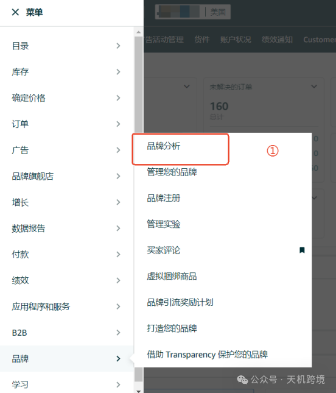

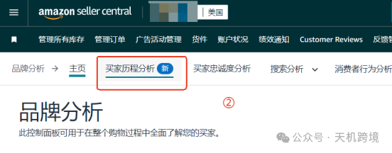

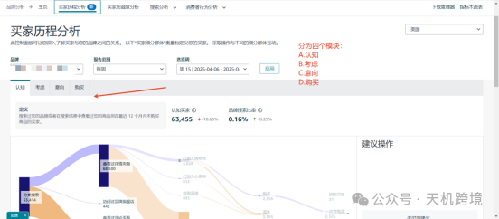

在这里我们可以看到，亚马逊把买家的购买旅程分成了四个独立的类型：

1、认知阶段

2、考虑阶段

3、意向阶段

4、购买阶段

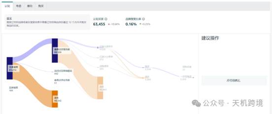

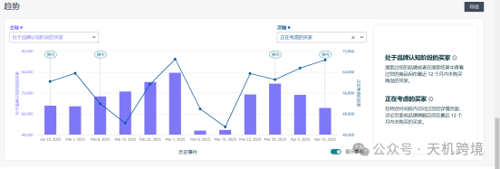

第一个，认知阶段

这里的数据是代表在12个月内在搜索结果中看过你的产品listing，但是最终没有购买的人群。

大家可以仔细想一下，顾客来搜了相关产品，看到你的产品在搜索结果中但是最终没有购买，是什么原因？

如果这一点的人群数量很多的话，那极有可能是我们产品关键词的精准度有问题，吸引过来的并不是精准的顾客，所以导致了产品没有产生点击和转化.

这一点我们可以通过优化产品的关键词和加强否定词库的建设来进行优化，避免更多的无效曝光出现。

这类人代表的是你的“潜在认知人群”，说明你有了一定的曝光但还没形成品牌吸引力或点击意愿

卖家应重点关注认知层级的点击率和展示率：

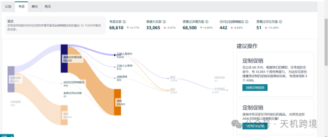

定义在特定时间段内访问过您的详情页面或品牌旗舰店但在最近 12 个月内未购买的买家。

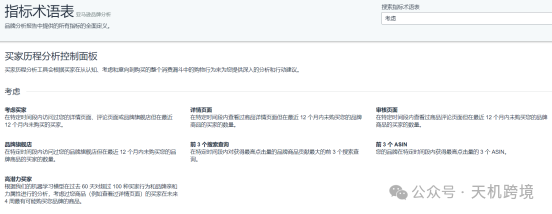

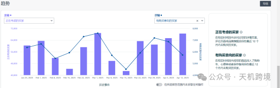

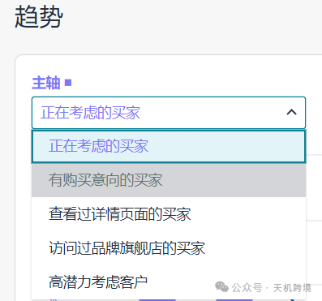

第二个，考虑阶段

这个阶段指的是进入了你的产品listing界面或者品牌旗舰店但是12个月没有购买的人群。

如果这一点上的人群数量很多的话，那大概率是我们的listing界面的质量没有能够成功的打动客户，让进入我们的旗舰店或listing的顾客最终没能完成购买，我们可以通过优化产品的listing来增加转化的几率。

这个阶段需要注意用户的流失量大不大，如果超过95%，那就可能是链接文案差，或者价格比竞品高等问题了。

卖家应着重提高页面转化效率：

对详情页进行AB测试，比如测试不同的产品图片、描述文案、功能展示顺序等，观察哪种版本能让考虑阶段的买家更愿意进一步了解产品或转化为下一个阶段。

同时，关注买家的评论和反馈，针对性地优化产品描述和卖点。

定义在特定时间段内将您的商品加入了购物车、心愿单或者保存备用但在最近 12 个月内未购买的买家。

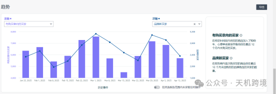

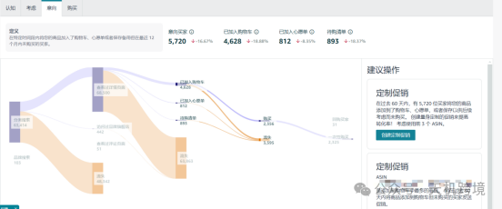

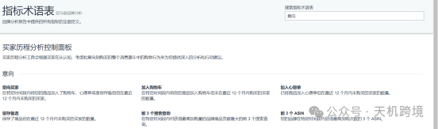

第三个，意向阶段

这个阶段离下单更近了，它是指已经把你的产品加入了购物车、心愿单但是却没有最后购买的人群。

如果这种情形有大批量的出现，那很有可能是顾客在加购之后发现了性价比更高的产品，这时我们可以多监控一下竞品的促销手法和力度，实时根据竞品的促销活动来及时调整我们的促销战略。

卖家的重点是减少弃购损失：

· 设置针对性的促销活动，如限时折扣、满减优惠、赠品等。

· 通过邮件或消息推送等方式，提醒买家购物车中的商品。

· 分析意向阶段买家的行为数据，进一步优化产品和营销策略。

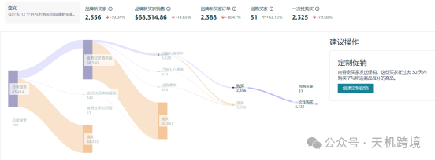

定义在过去 12 个月内未购买的品牌新买家。

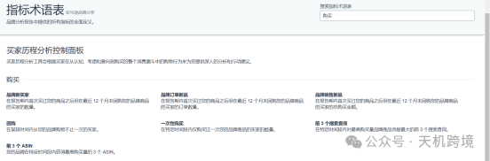

第四个，购买阶段

这个阶段的顾客已经完成下单但是在12个月内并没有产生复购的人群。

亚马逊在这里给的数据还是非常详细的，给大家细分出了新买家、复购的买家及一次性购买的买家，如果你的产品是很适合长期复购类型的产品，那一定不要错过这个数据分析的维度。

这个数据对卖家来说是很有帮助的，因为这是亚马逊官方自己公布的数据，而且是通过大数据在分析了所有顾客的购买行为之后给出的数据，所以它的精准度、关联度、可信度等等，都远超第三方软件给你提供的数据。

所以买家历程分析除了关注“谁买了”，也非常重视“谁可能会复购”、“品牌认知人群是否增长”。这一点对想做品牌长期主义的卖家来说至关重要

亚马逊会为每个阶段提供关键指标数据

如认知人群增长率、考虑到意向的转化率、复购率等，并给出相应的优化建议，帮助卖家采取针对性措施提升各阶段的表现

每一个没能完成转化的顾客背后，都隐藏着一个机会。

而亚马逊新推出的这个买家历程分析的模块，就是为了大幅提升大家抓住这种机会的可能。

快去你后台的品牌界面看一下好不好用！

期待

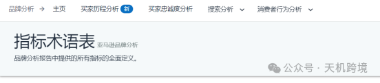

-------另一个介绍---

炸裂功能来袭，亚马逊开放买家行为轨迹数据，从此告别摸石头过河

亚马逊品牌分析功能中新增了一个全新的板块——“买家历程”，这个功能之前是小范围测试，目前已经在美国站上线！

数据查看路径：品牌分析>买家历程分析>选择时间范围（周/月）>查看四阶段模型数据

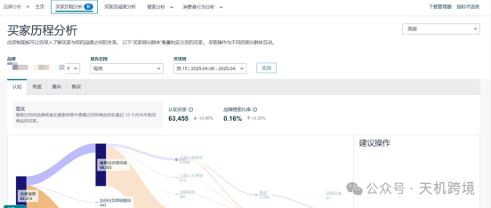

该功能将买家购买旅程划分为认知、考虑、意向、购买四个阶段，助卖家全方位掌握买家动态，精准定位客户流失阶段，从而制定优化策略

四个阶段的定义以及如何应用：

认知阶段：看过你的产品，但是12个月内没有成交过

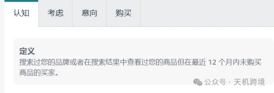

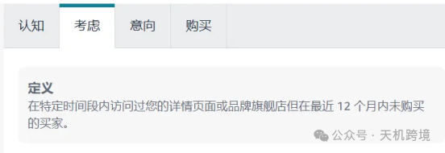

这类人代表的是你的“潜在认知人群”，说明你有了一定的曝光但还没形成品牌吸引力或点击意愿

卖家应重点关注认知层级的点击率和展示率：

如果流失比例不会太高的话，可通过优化品牌推广广告、提高关键词的精准度和出价，让品牌在搜索结果中获得更多展示，从而增加认知人群数量。

考虑阶段：点击了产品但是没购买

这说明你已经成功吸引住用户的注意力，但商品页没有给足他们下单的理由

数据维度：查看详情页的客户量和流失的客户量，如浏览产品页面、查看评论等，帮助了解买家对产品的关注重点和疑虑所在

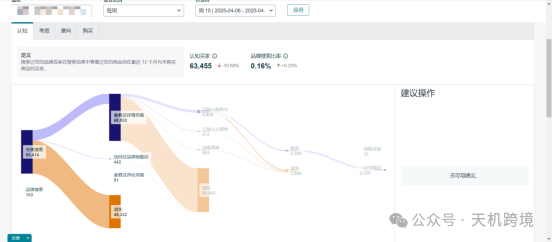

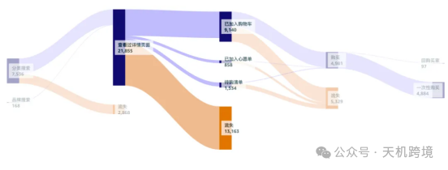

这个阶段需要注意用户的流失量大不大，如果超过95%，那就可能是链接文案差，或者价格比竞品高等问题了。

卖家应着重提高页面转化效率：

对详情页进行AB测试，比如测试不同的产品图片、描述文案、功能展示顺序等，观察哪种版本能让考虑阶段的买家更愿意进一步了解产品或转化为下一个阶段。

同时，关注买家的评论和反馈，针对性地优化产品描述和卖点。

意向阶段：他甚至已经加购了，却仍然没买

说明他们对你已经“心动”了，但还差一口气——可能在等优惠，或者还在犹豫你是否比竞品更值得买

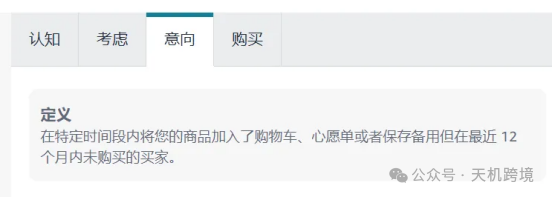

意向阶段视图会展示四个数据维度：加购客户量、心愿单客户量、待购清单客户量以及本阶段总流失量，更全面地反映买家的购买意向程度

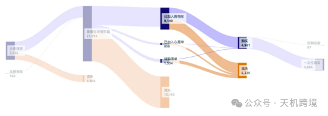

卖家的重点是减少弃购损失：

· 设置针对性的促销活动，如限时折扣、满减优惠、赠品等。

· 通过邮件或消息推送等方式，提醒买家购物车中的商品。

· 分析意向阶段买家的行为数据，进一步优化产品和营销策略。

购买阶段：最终成交

此阶段是已下单的买家群体，但是能不能复购，或者有口碑，就要展现产品的硬实力了

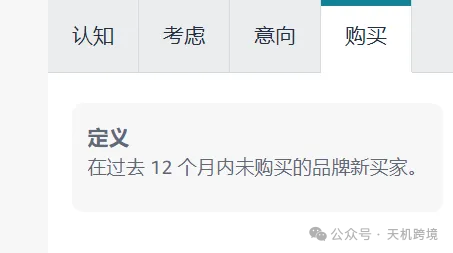

亚马逊在这里也细分出了品牌新买家、复购买家以及一次性购买买家。

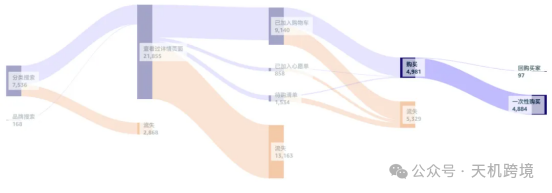

所以买家历程分析除了关注“谁买了”，也非常重视“谁可能会复购”、“品牌认知人群是否增长”。这一点对想做品牌长期主义的卖家来说至关重要

亚马逊会为每个阶段提供关键指标数据

如认知人群增长率、考虑到意向的转化率、复购率等，并给出相应的优化建议，帮助卖家采取针对性措施提升各阶段的表现

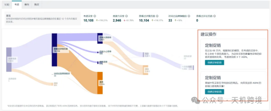

在分析完这些数据后，我们会发现：每一个没能转化的用户，背后其实都藏着一次优化的机会。

与其他一些只能宽泛地提供少量数据的品牌分析工具相比：

【买家历程分析】功能不仅呈现数据，还会为每个阶段提供系统推荐的优化动作，明确提升各阶段表现的具体方向，这是其他品牌分析工具所不具备的。

并且这个数据具有官方性和权威性，相比一些第三方品牌分析工具，数据来源更可靠，不存在数据不一致或差距大的问题。

此外，页面还会展示品牌top3搜索关键词、销量top3的asin，并且每个阶段的人群数据都可以导出，帮助卖家了解品牌的热门搜索词和畅销产品。

•哪些关键词带来的认知最有效

•哪些ASIN是真正吸引人的流量入口

•对比自己投放的词，看哪些词在意向阶段掉队严重

底部还有趋势报表，同时会展示选定时间阶段卖家的运营动作，方便卖家查看这些动作对品牌各个阶段买家数量的影响

给卖家的使用建议：

1.卖家应每周监控各阶段的关键指标，如认知人群增长率、考虑到意向的转化率、复购率等，并设定阈值预警。

2. 根据不同阶段制定明确的目标，通过不断测试和优化（参考每个阶段下方的建议优化），提升品牌在各个阶段的表现，从而提高整体的销售业绩和品牌竞争力。

亚马逊数据越来越透明的情况下，对我们使用科技的卖家越来越方便安全高效的打造关键词自然排名：

•低成本打造关键词自然排名，是广告成本的1/10

•新链接冷热启动的最强辅助

•加快产品的收录识别有效手段
