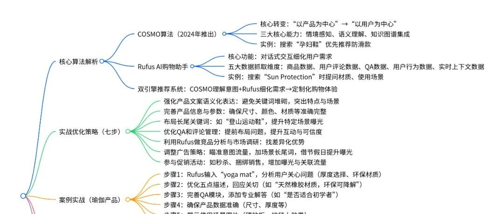

# 如何利用COSMO与Rufus算法优化亚马逊文案提升自然流量实战技巧

> Source: wechat
> Author: 天机跨境
> Original: https://mp.weixin.qq.com/s/aYuJvrWYL0eT9E-L79q1_A

---

---

如何利用COSMO与Rufus算法优化亚马逊文案提升自然流量实战技巧

https://ai.feishu.cn/wiki/EAYywEVEFiq2aNkfTTmcMA8SnUd?from=from\_copylink

ai.feishu.cn/wiki/EAYywEVEFiq2aNkfTTmcMA8SnUd?from=from\_copylink

导语：

随着亚马逊平台的流量分配机制发生微妙变化，部分卖家的产品流量下滑了高达30%，而另一部分深耕细分市场的产品却逆势崛起。这一切的背后，正是COSMO算法和Rufus购物助手重新定义了平台流量的分配规则。如果你还没有深入理解这一变革，2025年你可能会在亚马逊的竞争中处于劣势。本文将帮助你深入解析COSMO和Rufus算法，帮助你在新算法时代抢占先机，提升销量。

（文末分享配合AI的文案撰写SOP流程）

01.算法革命：COSMO与Rufus如何改变一切？

COSMO算法（Common Sense Knowledge Generation and Service Model）是亚马逊在2024年推出的全新算法，它的核心是将平台搜索从“以产品为中心”转变为“以用户为中心”。与传统的A9算法相比，COSMO在常识理解和语义解析上的突破，使得平台能够更精确地理解用户的需求。

举个例子，当用户搜索“孕妇鞋”时，COSMO不仅匹配关键词，还会推断孕妇需要防滑性强的鞋子，因此会优先推荐具有防滑特性的产品。

与此同时，Rufus AI购物助手通过对话式交互进一步细化用户需求。例如，用户在搜索“Sun Protection”时，Rufus会提出一系列问题：“你需要什么材质？”“是否用于所有户外活动？”通过这种方式引导用户明确需求，并为其提供个性化的推荐。

COSMO和Rufus的结合，形成了亚马逊全新的双引擎推荐系统：COSMO理解用户的意图，Rufus通过交互细化需求，从而为用户提供定制化的购物体验。

02.深入理解COSMO与Rufus的工作机制

COSMO算法的三大核心能力：

1.情境感知：COSMO能理解用户搜索的上下文，结合买家历史记录、位置和趋势等因素优化搜索结果。

2.语义理解：通过自然语言处理，COSMO能理解买家查询的细微差别，确保推荐的产品真正符合用户需求。

3.知识图谱集成：COSMO将产品、类别和用户偏好等信息映射到知识图谱中，帮助精准推荐相关商品。

Rufus的五大数据抓取维度：

1.商品数据：包括标题、五点描述、A+文案、图片等。

2.用户评论数据：高评分和大量评论的商品更容易被推荐。

3.QA数据：通过分析用户问答，Rufus能理解买家的关注点。

4.用户行为数据：如搜索频率和历史行为，帮助识别购物意图。

5.实时上下文数据：结合节假日等因素，动态调整推荐。

03.实战落地：七步优化策略，让算法为你所用

实战落地：七步优化策略，让算法为你所用

理解了COSMO和Rufus的原理后，接下来是如何应用这些知识进行优化。以下是七步实战优化策略，帮助你在亚马逊平台脱颖而出：

01，

强化产品文案的语义化表达：避免在标题和描述中堆砌关键词，让COSMO更好地理解你的产品。例如，将“Pet Grooming Brush for Dogs”优化为“Gentle Pet Brush for Long-Haired Dogs with Sensitive Skin”，突出产品的特点和适用场景。

02，

完善产品信息与参数：确保所有产品信息准确完整，尤其是尺寸、颜色、材质等，以便Rufus能够准确识别你的产品并推荐给正确的用户。

03，

布局长尾关键词：通过布局与用户需求相关的长尾关键词，如“登山运动鞋”，提高产品在特定场景下的曝光率。

04，

优化QA和评论管理：提前布局用户可能关心的问题，并通过Rufus的QA模块提升用户互动和产品可信度。

05，

利用Rufus进行竞品分析与市场调研：输入产品关键词，查看Rufus推荐的问题，分析竞品表现，找出你的差异化优势。

06，

调整广告策略，瞄准意图流量：增加长尾关键词，尤其是与产品相关的场景词，动态调整广告策略，利用季节性和节假日提升曝光率。

07，

参与促销活动，增加曝光机会：参与秒杀等促销活动，提高产品曝光率，并通过捆绑销售增加关联流量。

04.案例实战：如何通过新算法提升瑜伽产品销量？

案例实战：如何通过新算法提升瑜伽产品销量？

假设你销售瑜伽用品，如何应用上述策略提升销量？

01

分析Rufus推荐问题：在Rufus中输入“yoga mat”，查看推荐问题。用户可能关心“如何选择瑜伽垫厚度”和“什么材质最环保”。

02

优化五点描述：根据用户问题优化文案，回应这些关切点。例如：“采用天然橡胶材质，环保可降解”。

03

完善QA模块：添加专业解答，如“这款瑜伽垫适合初学者吗？”并给出准确的回答。

04

确保产品数据准确无误：确保瑜伽垫的尺寸、厚度等数据准确无误，并展示详细的使用场景。

05

展示使用场景的图片：展示瑜伽垫在硬地板和地毯上的使用效果。

实施这些优化后，通常在2-4周内，你的产品排名和转化率将显著提升。

05.未来展望：算法驱动下的亚马逊运营新趋势

5

未来展望：算法驱动下的亚马逊运营新趋势

随着技术的不断进步，未来3-5年，卖家竞争不再仅仅是“谁花得多”，而是“谁被算法更懂”。这意味着：

曝光的质量比数量更重要；

内容营销的核心目标是知识信号；

卖家的“内容力”将成为可持续增长的唯一壁垒。

在AI驱动的电商生态中，只有那些能够满足“算法理解”和“消费者共鸣”两者需求的卖家，才能长期保持竞争力。

我们是如何借用AI既精准又高效的实现AI化自动化优质文案撰写打爆流量的？

今天分享一下我们的文案撰写SOP，总共分为8个步骤

（结尾有视频全自动化文案撰写展示）

文案撰写SOP：从市场需求到转化优化的八个步骤

添加图片注释，不超过 140 字（可选）

01

01.了解市场需求与产品痛点

在撰写文案之前，首先要进行市场分析，了解目标消费者的痛点。通过分析产品的主要痛点，可以帮助我们在文案中精准表达出消费者的需求,以带灯吊扇为例:

产品痛点分析:

空间节省：传统风扇和灯具需要分别安装，占用更多空间。带灯吊扇将风扇和灯具结合，节省空间并提升功能性。

通风不均：传统风扇无法在大空间中提供均匀空气流通，导致部分区域仍然感觉闷热。带灯吊扇提供更广泛的空气循环，解决这一问题。

未解决的痛点：

噪音问题：高风速下，部分用户反映带灯吊扇噪音较大，影响使用体验，尤其是在卧室等安静环境中。

安装复杂性：虽然大多数产品提供安装服务，但对于初次购买者来说，安装过程仍较为复杂。

客户问题与吐槽：

“带灯吊扇适合哪些房间使用？”

“风速调节和灯光控制如何独立操作？”

吐槽点：噪音问题、亮度不足。

02

02.确定目标受众与使用场景：

明确产品的目标受众，分析其年龄、收入、家庭情况、购买动机等，并根据不同的使用场景优化文案。

受众分析：

性别：男女皆有，主要为家庭用户。

年龄：主要集中在30-50岁，尤其是有家庭的消费者。

收入：中高收入群体，倾向于购买高品质家电和家居产品。

家庭情况：以有孩子或宠物的家庭为主。

使用场景：

卧室：静音设计适合夜间使用，提供舒适睡眠环境。

客厅：适合需要广泛照明和空气流通的大空间。

办公室：改善空气质量，为长时间工作提供舒适环境。

厨房/餐厅：增强空气流通，减少油烟和湿气，创造清新环境。

03

03.了解产品功能与构成

掌握产品的核心功能与构成，并在文案中突出产品的优势。

产品功能：

风速调节：多档风速调节，满足不同需求。

调光功能：支持灯光强度调节，适应不同照明需求。

静音设计：低噪音电机设计，适合安静环境使用。

节能性：LED灯具与高效电机结合，减少能耗，环保省电。

产品构成：

电机（铜、铝，30%）：提供风扇运转的动力。

风扇叶片（ABS塑料，20%）：强化空气流通性能。

灯具（LED光源，25%）：提供照明，节能环保。

遥控器（塑料、电子元件，10%）：控制风速、灯光等功能。

外壳（钣金、塑料，15%）：外观设计与结构支撑。

04

04.竞品分析与差异化优势

通过竞品分析，提炼出与竞品的差异化优势，并在文案中突出这些独特卖点。

竞品分析：

功能差异：竞品提供类似的功能，但噪音和能效方面存在差异。

卖点分析：许多竞品侧重节能和长寿命，但常被消费者吐槽噪音大。

文案水平：竞品文案多侧重产品功能，缺乏情感化和场景化表达。

差异化优势：

超静音设计：低噪音电机，适合卧室和安静环境。

智能调控功能：通过智能遥控和APP控制，提升用户体验。

05

05.卖点提炼与排序

根据市场需求和竞品分析，提炼出最具吸引力的卖点，并确保文案简洁明了、逻辑清晰。

卖点提炼排序：

静音风扇：适合安静环境使用，提供舒适的睡眠和工作环境。

智能调控：支持APP和遥控调节，提供操作便捷性。

节能高效：LED灯具与电机组合，减少能耗，环保省电。

现代家居设计：简洁现代的外观设计，适合多种家居风格。

06

06.文案撰写与SEO优化

在文案撰写过程中，遵循合规性、机读性与人读性的原则，确保文案能够打动消费者并符合平台规则。

文案撰写规范：

合规性：避免使用侵权词和违禁词，确保符合亚马逊平台规定。

机读性：使用符合A9和COSMO算法的SEO策略，提升产品曝光。

人读性：

信：卖点提炼准确，产品优势清晰。

达：文案简洁明了，逻辑清晰，信息传达准确。

雅：语言自然流畅，符合本土表达，打动消费者。

文案润色：使用比喻、修辞、场景化表达等，增强文案吸引力。例如：“带灯吊扇不仅能为你的家增添亮丽光彩，还能为每个角落带来清新空气，让每个夜晚都充满宁静与舒适。”

07

07.埋入关键词与SEO优化

通过SEO工具挖掘长尾关键词，并自然融入标题、五点描述、A+页面和评论中，以提高产品的搜索曝光度。

关键词埋入技巧：

挖掘长尾关键词，如“LED带灯吊扇”、“超静音吊扇”。

确保关键词自然融入文案，避免堆砌，同时确保文案流畅性。

08

08.追踪与持续优化

文案发布后，使用亚马逊后台数据分析工具，持续追踪文案的表现，并根据反馈与趋势进行优化。

优化方法：

根据用户反馈和市场变化，定期调整文案。

分析搜索趋势，持续优化文案的关键词和卖点，提升转化率。

接下来为您展示我们众多AI+RPA自动化实践案例中的一个：文案撰写 —— 这是基于两年实战经验打造的SOP解决方案，后续还有更多精彩内容与您分享！

结语

添加图片注释，不超过 140 字（可选）

通过这八个步骤的文案撰写SOP，你可以精准理解市场需求，优化文案中的卖点，

结合COSMO和Rufus算法提升曝光度，并通过SEO优化策略提升转化率。

通过这种方法，你将能够为你的产品撰写更具吸引力的文案，并在亚马逊平台中脱颖而出，提升销量，获得更多曝光机会。当然要去收集到这些数据需要花费大量的时间，我们会结合我们训练好的AI再结合RPA把数据源全部实现高效收集，最终呈现的就是符合算法的结果。但是结果的精准度把控都是靠我们自身的SOP标准来实现的，看懂的小伙伴不妨去试试吧。

基于《如何利用COSMO与Rufus算法优化文案提升流量实战技巧》的总结
