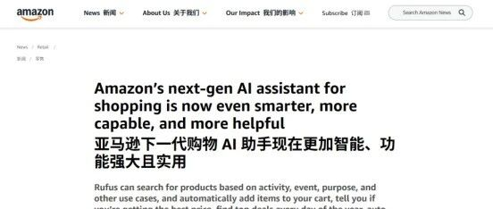

# 亚马逊 Rufus 最新解释公布！三大变化重新定义流量分发格局，影响卖家运营 SOP

> Source: wechat
> Author: 天机跨境
> Original: https://mp.weixin.qq.com/s/sXSSWJXKVZ9YzxVwyRzrkw

---

---

各位亚马逊卖家注意！近期，亚马逊正式对外公布了关于 Rufus AI 助手的能力更新说明。Rufus已经远远超出了问答的范畴，它正在成为商品搜索、视觉检索、价格匹配、自动下单的入口。作为亚马逊卖家，我们必须读懂背后的信号，提前布局。[Image]这次更新中，卖家最必须重点关注的三...
